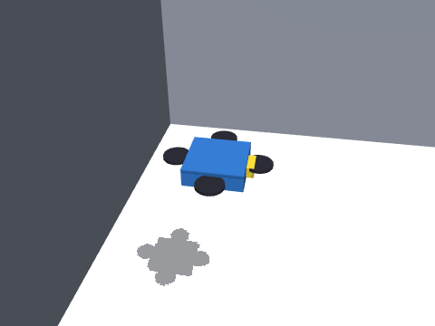

# 四旋翼无人机 MuJoCo 物理仿真与神经网络建图导航

在 MuJoCo 中搭建四旋翼无人机，完成**物理仿真与键盘遥控**、**激光/深度感知与速度控制**、
**建图导航与 SLAM 同步仿真**、**端到端深度图飞行**四项任务。飞控为串级位置/姿态控制器，
感知、规划、控制与端到端网络均为纯 NumPy 实现，通过 ROS Noetic 封装，
`roslaunch aerial_mujoco_slam_nn_nav main.launch mode:=nav` 一键启动。



## 项目结构概览

```text
aerial_mujoco_slam_nn_nav/
├── aerial_mujoco_slam_nn_nav/          # 算法库
│   ├── model.py            # MJCF：四旋翼 + 三个场景
│   ├── flight.py           # 串级飞控（速度/高度外环 + 姿态内环）
│   ├── sim.py              # MuJoCo 仿真内核（含 xfrc 推力注入）
│   ├── sensors.py          # 180 线激光 / 24×32 深度 / IMU / 里程计
│   ├── mapping.py          # 对数几率栅格 + 相关扫描匹配
│   ├── planning.py         # A* + 膨胀代价地图
│   ├── nn.py               # NumPy MLP / CNN + Adam
│   ├── neural.py           # 四个网络的推理封装
│   └── nav.py              # 建图导航栈（位置式前视点跟踪）
├── scripts/                # sim / teleop / nav / e2e / metrics 五个节点
├── launch/                 # main.launch（mode:=teleop|nav|e2e）
├── models/                 # 4 个训练好的网络权重
├── tools/                  # 采集、训练、评测、录 GIF
├── tests/                  # 无 ROS 单元测试
├── main.py                 # 一键入口（不依赖 ROS）
├── CMakeLists.txt
└── package.xml
```

## 一、环境准备与依赖安装

| 项目 | 版本 |
| --- | --- |
| 系统 | Ubuntu 20.04 LTS（虚拟机 / 原生） |
| ROS | Noetic（Python 3.8） |
| 物理引擎 | MuJoCo 3.x |
| 其他 | numpy、pillow |

```bash
# 1. 安装 MuJoCo（用户目录，不需要 sudo，不改系统 Python）
pip3 install --user "mujoco>=3.1,<3.3" numpy pillow

# 2. 编译
mkdir -p ~/aerial_ws/src && cd ~/aerial_ws
catkin_make && source devel/setup.bash
```

## 二、启动流程

三种方式任选：`main.launch` 一键、`main.py` 无 ROS、分终端手工起节点。

### 1. 一键 launch

```bash
# 键盘飞行
roslaunch aerial_mujoco_slam_nn_nav main.launch mode:=teleop scene:=warehouse
# 建图 + 导航 + SLAM 同步
roslaunch aerial_mujoco_slam_nn_nav main.launch mode:=nav scene:=corridor
# 端到端深度图飞行
roslaunch aerial_mujoco_slam_nn_nav main.launch mode:=e2e scene:=corridor
```

按键：`W/S` 前后、`A/D` 左右、`Q/E` 偏航、`R/F` 升降、`空格` 悬停、`0` 重置、`X` 退出。
无图形界面时 `terminal:=false`，另开终端 `rosrun aerial_mujoco_slam_nn_nav teleop_node.py`。

### 2. 无 ROS 入口（main.py）

```bash
cd ~/aerial_ws/src/aerial_mujoco_slam_nn_nav
python3 main.py --mode teleop --scene warehouse   # 键盘
python3 main.py --mode nav --scene corridor       # 经典栈
python3 main.py --mode neural --scene corridor    # 神经规划+控制
python3 main.py --mode e2e --scene corridor       # 端到端
python3 main.py --mode test                       # 单元测试（4 个模块）
python3 main.py --mode demo --out media/demo.gif  # 录演示
```

### 3. 手工起节点（观察话题）

```bash
rosrun aerial_mujoco_slam_nn_nav sim_node.py
rosrun aerial_mujoco_slam_nn_nav nav_node.py
rostopic hz /scan          # 10 Hz
rostopic echo /nav_status  # fly / blocked / done
rviz                       # 添加 Map(/map) 与 Path(/plan)
```

## 三、实现要点

### 3.1 四旋翼模型与推力注入

机体质量 1.2 kg、轴距 0.22 m，四个旋翼用 `xfrc_applied` 施加合力与合力矩，
不依赖 MuJoCo 旋翼插件，控制量可以直接在文档里写清楚：

$$
\mathbf f = R\,\hat z\,T,\qquad \boldsymbol\tau = k_R\mathbf e_R-k_\omega\boldsymbol\omega
$$

### 3.2 串级飞控

速度/高度外环输出期望加速度，再由期望加速度反解推力方向：

$$
\mathbf a_{des}=k_v(\mathbf v_{ref}-\mathbf v),\quad
\mathbf f_{des}=m(\mathbf a_{des}+g\hat z),\quad
\mathbf b_3^{des}=\frac{\mathbf f_{des}}{\|\mathbf f_{des}\|}
$$

姿态内环用几何误差 $\mathbf e_R=\frac12(R_{des}^{T}R-R^{T}R_{des})^{\vee}$ 做 PD。
实测：悬停 1 s 高度漂移 < 6 mm；0.6 m/s 前飞 2 s 位移约 1 m。

### 3.3 建图与导航

2D 激光（180 线）在 1.2 m 高度扫描，对数几率栅格 + 相关扫描匹配建图，
A\* 在 0.45 m 膨胀的代价地图上规划；执行层用**位置式前视点跟踪**：
把 $k(\mathbf p_{look}-\mathbf p)$ 转成机体系速度，交给飞控。
这样无人机可以侧移贴线，不会像"边转边冲"那样切角撞墙。

### 3.4 神经网络

| 网络 | 结构 | 输入 → 输出 | 训练方式 |
| --- | --- | --- | --- |
| 感知 | MLP 9-32-32-1 | 9 线滑窗 → 中心距离 | 自监督（无噪扫描为标签） |
| 规划 | MLP 124-64-64-2 | 11×11 局部栅格 + 目标 → 方向 | 克隆 A* 方向 |
| 控制 | MLP 6-64-64-3 | 距离/航向/三向净空 → $(v_x,v_y,\omega)$ | 克隆经典栈 |
| 端到端 | Conv(1→8,5×5,s2)+FC | 24×32 深度图 → $(v_x,v_y,\omega)$ | 走廊场景行为克隆 |

## 四、实验结果

三场景闭环（目标 0.4 m 内视为成功，单条 episode）：

| 策略 | warehouse | obstacle_field | corridor |
| --- | --- | --- | --- |
| 经典栈（SLAM + A\*） | ✅ 8.91 s / 0.396 m / ATE 0.019 | ✅ 7.63 s / 0.391 m / 0.010 | ✅ 7.22 s / 0.393 m / 0.012 |
| 神经规划 + 控制 | ❌ 90 s 未达 | ✅ 7.63 s / 0.391 m | ❌ 90 s 未达 |
| 端到端 CNN | ❌ 11.5 s 坠机 | ❌ 10.3 s 坠机 | ❌ 13.7 s 坠机 |

离线指标：

| 指标 | 结果 |
| --- | --- |
| 激光去噪 | RMSE 0.659 → 0.041 m |
| 规划方向误差 | 3.68°（验证集） |
| 控制器 | vx MAE 0.070，vy MAE 0.063，ω MAE 0.292 |
| 端到端 | vx MAE 0.253，vy MAE 0.090，ω MAE 0.308 |

**失败分析**：端到端网络只有 170 帧走廊数据，单帧深度图缺少时序与全局信息，
飞出几米后就会撞门柱；神经规划在开阔场景会被"目标方向"主导，绕障能力不足。
这也是本包保留 A\* 作为安全回退、并把经典栈作为默认演示的原因。

## 五、常见报错与解决方法

### 1. `ModuleNotFoundError: No module named 'mujoco'`

`pip3 install --user "mujoco>=3.1,<3.3"`，并确认 `python3 -c "import mujoco"` 通过。

### 2. `Package 'aerial_mujoco_slam_nn_nav' not found`

没有 `source ~/aerial_ws/devel/setup.bash`，或包不在 `~/aerial_ws/src` 下。

### 3. 无人机起飞就翻

检查是否给 `xfrc_applied` 写了世界系力（本项目已按机体姿态旋转）；或
`~altitude` 设得过低（< 0.6 m）导致触地。

### 4. 键盘节点没反应

`main.launch` 默认用 `xterm` 启动，需要窗口焦点；SSH 下用 `terminal:=false` 后手动 `rosrun`。

### 5. 导航一直 `blocked`

地图还没建起来（起点被膨胀层包住），等 1–2 s；或把 `~inflation` 从 0.45 降到 0.30。

### 6. 虚拟机里录 GIF 黑屏

GIF 用 MuJoCo 离屏渲染，不需要显示器；若黑屏，确认渲染器在 `mj_forward` 之后创建
（`sim.py` 已做延迟创建）。

## 六、扩展方向

- 三维导航：把 2D 栅格换成八叉树 / 体素，支持高度变化与跨楼层；
- 端到端补数据：加入历史帧（GRU）与门柱遮挡场景，或改用 DAgger；
- 与 AirSim 版本做跨模拟器对比（同一套策略接口）。
