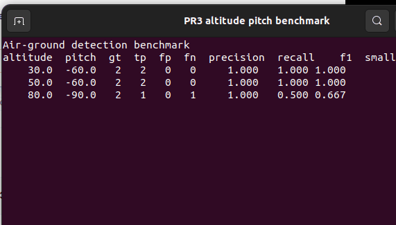

# 高度与倾角检测质量评估

该模块按无人机相机高度和俯仰角分组评估检测结果，统计 Precision、Recall、F1 与小目标召回率。它只处理离线真值和预测，不负责航线规划或飞行控制。

## 1. 前置条件

- Python 3.10 或更高版本。
- 每帧具有 `altitude_m`、`pitch_deg`、`ground_truth` 和 `predictions`。
- 真实数据和预测结果已完成帧级对应。

## 2. 注意事项

边界框格式为：

$$
\mathrm{bbox}=(x,y,w,h)
$$

预测按置信度降序进行贪心 IoU 匹配，默认阈值为 `0.5`。该评估与 GSD 航线规划模块不同：本模块评价“已经采集的数据上检测器退化多少”，不改变相机任务规划。


## Localization metrics

The evaluator also reports `localization_error_px` and `matched_iou`.
Localization error is the Euclidean distance between ground-truth and
matched prediction box centers, in pixels:

$$
e = \sqrt{(x_p-x_g)^2+(y_p-y_g)^2}
$$

Both metrics are averaged over true positives. Groups without matches
report `0.0`, so localization metrics must be interpreted together with recall.

## 3. 运行步骤

```bash
PYTHONPATH=src/air/air_ground_detection_benchmark \
  python3 -m air_ground_detection_benchmark.main
```

指定输出文件：

```bash
PYTHONPATH=src/air/air_ground_detection_benchmark python3 -m air_ground_detection_benchmark.main --output output/height_angle_metrics.csv
```

## 4. 预期结果

终端输出每个高度/倾角分组的指标，并生成 CSV：

```text
altitude  pitch  gt  tp  fp  fn  precision  recall    f1  small_recall  loc_error_px  matched_iou
    30.0  -60.0   2   2   0   0     1.000   1.000 1.000        1.000        1.266       0.897
    50.0  -60.0   2   2   0   0     1.000   1.000 1.000        1.000        1.059       0.924
    80.0  -90.0   2   1   0   1     1.000   0.500 0.667        0.500        0.000       1.000
CSV: output/altitude_pitch_metrics.csv
PASS: evaluated 3 altitude/pitch groups
```



## 5. 测试

```bash
PYTHONPATH=src/air/air_ground_detection_benchmark python3 -m unittest discover \
  -s src/air/air_ground_detection_benchmark/tests -v
```

## AI 使用声明

本模块使用大型语言模型辅助编写。提交者已完成代码审查和虚拟机运行验证，并对提交内容负责。
