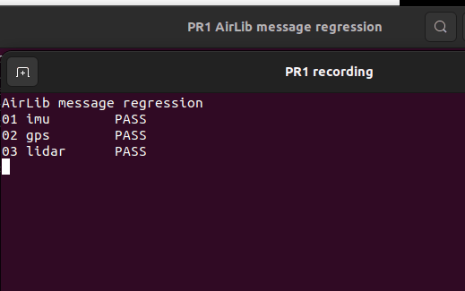

title: AirLib 传感器消息回归

# AirLib 传感器消息回归

该模块在数据进入 ROS 或下游算法前检查 AirLib 风格的 IMU、GPS、LiDAR 与里程计载荷，用于发现字段缺失、范围错误和点云布局变化。

## 1. 前置条件

- Python 3.10 或更高版本。
- 离线回归运行不需要模拟器、GPU 或 ROS。
- 使用 launch 时需先安装 ROS 2 Humble 并加载环境。

## 2. 注意事项

该模块不替代 AirLib 原生单元测试，也不验证 AirSim RPC 实际连接。它只验证跨语言边界后交给 ROS 桥接层的数据契约，因此适合在 CI 和提交前快速执行。

四元数必须满足：

$$
q_x^2 + q_y^2 + q_z^2 + q_w^2 \approx 1
$$

## 3. 运行步骤

```bash
PYTHONPATH=src/air/airlib_message_regression \
  python3 -m airlib_message_regression.main
```

使用 ROS 2 launch：

```bash
source /opt/ros/humble/setup.bash
colcon build --packages-select airlib_message_regression
source install/setup.bash
ros2 launch airlib_message_regression main.launch.py
```

## 4. 预期结果

```text
01 imu        PASS
02 gps        PASS
03 lidar      PASS
04 odometry   PASS
PASS: validated 4 AirLib messages
```



## 5. 测试

```bash
PYTHONPATH=src/air/airlib_message_regression python3 -m unittest discover \
  -s src/air/airlib_message_regression/tests -v
```

## AI 使用声明

本模块使用大型语言模型辅助编写。提交者已完成代码审查和运行验证，并对提交内容负责。
