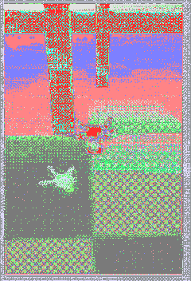

# AirSim Unity 无人机双柱连续 S 形绕行实验报告

## 修改目的与内容

已合并的 `airsim_obstacle_avoidance`（PR #597）解决了单根柱子前的"反复朝目标转向"和"低速爬行"问题，但绕行侧一旦锁定，只有连续 6 帧 `advance` 才解锁，且解锁后不排斥重新选到同一侧。当场景沿程有多根柱子、且后续柱子位于航线另一侧时，这个策略会让无人机绕完第一柱后仍倾向同一侧，走成 U 形回环或在柱间走廊左右摇头。

本实验把单柱反应式规划器扩展为**连续 S 形绕行**：沿用同一套前视深度通道检查，但在越过一根柱子后主动释放绕行侧选择，使下一根柱子按自身位置重新选边，形成 S 形路径，并把"已清除第几根柱"记录进飞行日志用于事后核对。

实现内容：

- 新增 `SlalomState` 状态机，把绕行侧锁定、连续安全帧计数、解锁后冷却和累计清除柱数从 AirSim 客户端循环里剥离，做成可离线测试的纯逻辑。
- 越过一根柱子（连续 6 帧 `advance`）后解锁侧向选择，并设 4 帧冷却：冷却期内即使画面里还有刚越过柱子的残留深度，也不立即重新锁侧，避免在柱间走廊反向摇头。
- 修正评审 #597 指出的常量不一致：被堵时扫描偏航速率不再硬编码 15°/s，与 `smooth_yaw_rate` 共用 `MAX_YAW_RATE = 12.0`。
- 飞行日志新增 `pillars_cleared` 列；`events.jsonl` 新增 `pillar_cleared` 事件，`goal_reached` 事件的 reason 记录清除柱数。
- **起飞与降落改用开环速度通道判定**（实飞暴露的环境缺陷，见"验证操作与结果"）：本机 AirSim Unity 插件的 `landed_state` 在空中仍上报 Landed，导致 `takeoffAsync`/`moveToZAsync` 误报失败、`landAsync` 挂到超时。起飞改为触发后以 `moveByVelocityAsync` 比例爬升并按实测高度判定；降落改为开环下降后连续采样 1 s，要求高度稳定在起飞前高度 ±0.35 m、高度波动 ≤0.12 m、垂直速度 ≤0.15 m/s、`landed_state=Landed` 且 `armDisarm(False)` 返回成功，任一项不满足即保留控制权并记 `landing_unconfirmed`（不再只凭单个高度采样宣告确认）。

深度解码、径向转光轴投影、通道膨胀、候选方向评分、进度看门狗全部沿用单柱版本，未调整绕行速度和障碍安全距离。

## 测试环境与结果

| 项目 | 实际环境 |
| --- | --- |
| 系统 | Windows，内核版本 10.0.26200.0（Windows 11 系列） |
| ROS | 本次实验未使用 ROS，不宣称验证了 ROS 节点或消息接口 |
| Python | 虚拟环境 Python 3.9.13，64 位 |
| 模拟器 | Microsoft AirSim 1.8.1 Unity 源码项目，SimpleFlight |
| Unity | 2019.3.12f1，DroneDemo 场景 |
| RPC | msgpack-rpc-python 0.4.1、msgpack-python 0.5.6、Tornado 4.5.3 |
| 数值依赖 | NumPy 1.26.4 |
| 通信 | 本机 127.0.0.1:41451，前视相机 256x144，FOV 90 |

源码：[模块目录](https://github.com/OpenHUTB/ros2/tree/master/src/air/airsim_double_pillar_avoidance)。本模块提供 main.py 和 PowerShell launch 启动器；不提供未经验证的 ROS 封装。

### 构建与运行命令

实验使用已构建好的 AirSim Unity 插件（本机位于 `C:\Users\颜帆\AirSim\AirSim-1.8.1`，`AirsimWrapper.dll` 已在 `UnityDemo\Assets\Plugins\x86_64`）。完整安装与场景布置见 [模块 README](https://github.com/OpenHUTB/ros2/blob/master/src/air/airsim_double_pillar_avoidance/README.md)。实飞命令（Unity Play 后在仓库根目录执行）：

```powershell
& $py .\src\air\airsim_double_pillar_avoidance\main.py --route goal --goal-x 38 --goal-y 0 --altitude 3 --speed 1.2 --stop-distance 3 --curve-distance 2 --safety-margin 1.5 --vehicle-radius 0.6 --timeout 180
```

场景要点：出生点 Unity X=-320、Z=212；README 布局表列出三根柱：pillar_1 (-322.5,4,226)、pillar_2 (-317.5,4,244)、pillar_3 (-320,4,229)，Scale 均为 (2,361,2)、保留 Box Collider；pillar_3 是 #597 单柱实验遗留柱，与 pillar_1 沿航线相隔约 3 m。下文结果均按真实三柱场景记录。

### 验证操作与结果

用户于 2026-11-06 00:13 与 00:15 两次实飞均到达目标（行为一致，归档后一次）。以下数据来自保存的 [真实飞行日志](airsim_double_pillar_avoidance/flight.csv)（106 行）与 [事件记录](airsim_double_pillar_avoidance/events.jsonl)，录屏为原始运行截取：

| 项目 | 实测 |
| --- | --- |
| 到点 | 73.6 s，位置 (249.63,-320.64)，目标 (250,-320)，误差 0.74 m < 0.8 m ✓ |
| 巡航速度 | 达到设定 1.2 m/s ✓ |
| 绕行事件 | `pillar_cleared` 共 3 次（与三柱场景一致）✓ |
| 绕行侧序列 | 第一柱 +1，第二柱 **-1**（反向，S 段成立），第三柱 -1 ✓ |
| 横向偏移 | 相对航线最大 +3.28 m（东）/ -3.21 m（西），符号翻转 ≥2 次 ✓ |
| 碰撞 | 飞行中无新增碰撞中止 ✓ |
| 巡航高度 | z≈-5.05 m（约离地 4.3 m），高于请求的 3 m：`takeoffAsync` 自身爬升与模块开环爬升叠加所致，属已知偏差，未影响绕行 |
| 降落 | **两次运行均在到点后 `landAsync` 30 s 超时、`landing_unconfirmed`**；根因是插件 `landed_state` 空中仍报 Landed。代码已改为开环下降＋稳定接地判据（1 s 采样、高度波动 ≤0.12 m、垂直速度 ≤0.15 m/s、`landed_state=Landed`、检查 `armDisarm` 返回值），**该修复尚未实飞验证** |

结论：核心命题（越过一柱后解锁、下一柱反向重选形成 S 路径）在真实三柱场景得到验证；到点判据满足；降落收尾逻辑属实验性代码、尚未复飞，已在“已知限制”中说明。

离线测试执行目录 `src/air/airsim_double_pillar_avoidance`：

```powershell
& $pythonExe -m unittest -v test_avoidance
```

32 项离线测试全部通过（`Ran 32 tests ... OK`），涵盖深度解码往返、通道膨胀、完全堵塞、绕行侧保持、偏航限幅、参数校验、运行目录隔离，`SlalomState` 的锁侧、解锁、冷却、连续两柱反向重选与两次清除计数，**被 `blocked_hover`/`scan_for_exit` 打断时连续清空帧必须归零的回归用例**，以及降落确认判据（稳定接地、Flying 状态、高度振荡、垂直速度过快、高空、空采样六类）。这些测试验证算法逻辑，不能替代仿真飞行。

## 运行效果



动图来自用户实际运行录制（原始 11,584,830 字节、522×766、844 帧、每帧 100 ms）。仓库 README 要求动图小于 **5 MB**；为压到限制内做了等比缩放与抽帧：先缩到 286×420、每 3 帧保留 1 帧（282 帧），仍为 8.99 MB；再按评审意见二次压缩到 **240×352、每 2 帧保留 1 帧（141 帧）**，并把被丢弃帧的时长合并进保留帧，总时长约 84.3 s（时间比例不变，未加速），输出 **2,876,334 字节（<5 MB）**，读回校验帧数与时长，未使用生成图冒充。观察重点：起飞爬升、依次绕过各柱且第二柱明显改走航线另一侧（S 段）、到点后下降阶段因 landAsync 超时未能完成降落确认。

## 已知限制与尚未验证内容

- **降落收尾逻辑未实飞验证**：开环下降 + 连续 1 s 稳定接地采样 + `landed_state`/`disarm` 校验属于实验性收尾代码，只过了离线单测与编译，未在 Unity 中跑到 `Landing confirmed: True`；判据不满足时会保留 API 控制权，飞行器可能悬停在空中，需要人工接管。
- 巡航高度比 `--altitude` 请求值高约 1.3 m（takeoff 与开环爬升叠加），未做高度闭环精调。
- 实飞场景为三柱（含 #597 遗留柱），与 README 的三柱布置一致；只放两柱的净场景下反向重选未单独复验。
- 本实验直接使用 AirSim Python API，ROS 集成未实现和验证；Windows 启动器不是 ROS launch。
- 只检测相机图像中部竖直带；侧后方、细杆、动态物体、复杂死胡同未验证。
- `RELEASE_FRAMES=6`、`SIDE_COOLDOWN_FRAMES=4` 为经验值，未针对实际帧率与速度标定。
- 解锁依赖"连续 6 帧 advance"间接判据，窄柱或提前看到开阔区时可能未真正越过就解锁。
- 局部方向选择与偏航平滑不构成连续曲率或固定最小间距的数学保证；横向偏移实测达 3.2 m，大于设计预估的 0.6 m 近侧绕行，实际最小间距未独立测量。
- 深度解码依赖本机 Unity 插件裁剪面与色彩空间，不能原样当作 Unreal AirSim 米制深度。
- 起飞与升高后才建立碰撞基线，起降阶段无视觉避障。
- 仿真运行成功不能作为真实无人机部署结论。

## 提交前检查

- [x] 源码与教程分别放在 `src/air/airsim_double_pillar_avoidance` 与 `docs/air`，新增文件使用英文下划线命名。
- [x] 提供 main.py、launch/run_demo.ps1、requirements.txt、README、32 项离线测试与模块 .gitignore；ROS launch 不适用于本次直接 API 实验。
- [x] 在 `mkdocs.yml` 空域载具段与首页 `docs/index.md` 各新增一条跳转入口。
- [x] 实飞两次到达目标（误差 0.74 m），保留真实 flight.csv 与 events.jsonl，未把虚拟环境、`__pycache__`、根目录 artifacts 运行产物作为源码提交。
- [x] 真实录屏压缩为 2,876,334 字节的多帧 GIF（<5 MB，141 帧、240×352、总时长约 84.3 s），读回校验帧数与体积；未用生成图冒充。
- [x] 降落收尾逻辑（实验性）与两柱净场景复验的未验证状态已写入“已知限制”，不虚报为已完成。
- [x] 已按仓库根 `requirements.txt` 安装 mkdocs 依赖并执行 `mkdocs build`（11.7 s 通过）；`mkdocs serve -a 127.0.0.1:8011` 下本页与首页均返回 HTTP 200，GIF 引用与导航入口存在。
- [x] 检查 `git diff --check` 无空白错误；本次仅新增本模块文件、报告与两处导航入口，未删除公共文件。

## 大模型使用声明

本模块代码及文档使用千问工作助理（阿里巴巴）辅助完成方案讨论、代码起草、离线测试、故障诊断与文档撰写。继承自 `airsim_obstacle_avoidance`（PR #597）的算法部分保留原作者实现思路。提交者负责检查验证，并对提交内容的正确性和完整性负责。
