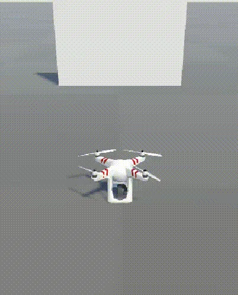

# AirSim Unity 无人机高度自适应越障实验（设计、离线验证与实飞结果）

> **状态（2026-11-10）：代码、57 项离线测试与两次实飞均已完成。** 2026-11-09 在本机 Unity 两次实飞均越障到点（第 5 节），录屏见同节；两次数据为相机偏移修正前采集，修正后的复飞尚未进行。本文结论只覆盖这一静态矮墙场景，高柱水平绕行仍待实飞。

## 1. 问题与动机

同仓库的 AirSim Unity 单柱绕行（PR #597，已合入 master）与双柱 S 形绕行（本地分支 `codex/airsim_double_pillar_avoidance`）都只扫描深度图**中部竖直带**：巡航高度全程锁定，任何进入通道的障碍都只能水平绕行。对一根矮墙而言，这意味着为了绕过一堵本可以从上方飞过的墙，要多飞十几米；在窄走廊里甚至可能找不到可用的水平通道。

本模块保留原有的深度解码、通道膨胀、偏航平滑与看门狗，把决策从“只有水平方向”扩展为“水平 + 高度”：

- 读取整幅深度图，逐列恢复障碍**顶边相对相机的高度**；
- 顶边足够低、上方净空已验证、且高度预算允许时，先原地爬升再从上方通过（`overfly`）；
- 顶边太高、净空不可验证或预算不足时，退回原来的水平绕行（`curve`）；
- 越障连续失败两次后永久解除越障，避免反复朝障碍爬升。

边界：这是只依赖前视深度图的**局部**规划器，不建图、不做全局寻路，也不替代 `uav_lidar_safety_corridor`、`uav_altitude_command_guard`、`octree_uav_3d_pathfinding` 等模块。

## 2. 方法

### 2.1 深度与几何

输入是 AirSim Unity 的浮点 `DepthVis`。按裁剪面与色彩空间解码为沿光轴的米制深度：

```text
shader = (linear_depth^(1/4))，经 sRGB 编码后由相机返回
depth  = ((pixel^(1/0.25)) / (1 + near/far) + near/far) * far
```

相机水平前视、居中安装。AirSim Unity 的 `CameraInfo.fov` 来自 `Camera.fieldOfView`，是**垂直**视场（已在 `DataCaptureScript.cs` 中核对）；方形像素下横纵焦距相同，因此焦距（像素）由图像高度换算：

```text
f = H / (2 * tan(FOV / 2))，  c = (H - 1) / 2
```

前视相机 0 实际是 `Front_Center`，垂直 FOV 90°；160×90 画面下水平视场约 121°。若按宽度换算焦距（把 FOV 当水平视场），顶边高度会被低估约宽高比倍，高柱可能被误判为可越。

AirSim Unity 的浮点深度缓冲区与 Unity 纹理一致、**自下而上**存储：2026-11-09 现场帧验证，缓冲第 5 行读到的是水平相机下方 1.4 m 的地面、第 131 行是天空，方向与自上而下正好相反。读取后先按行翻转再做列分析；只取每列最小值的旧模块不受影响，高度逻辑则必须翻转，否则会把障碍底部当作顶部、低估墙高并导致越障爬升不足。

对每一列，在分析带 `[row_top, row_bottom]` 内找最近障碍距离 `d`，再向上搜索同一障碍的连续像素，直到遇到自由空间或无效像素，得到顶边行 `r_t`：

```text
top_height = d * (c - r_t) / f        # 顶边在相机上方为正
overhead   = d * (c - row_top) / f - top_height
```

`row_top = H/8`，`row_bottom = H - 1 - ground_rows`。底部 `ground_rows` 行按地面处理而不当作障碍；无效像素按 0 距离处理，宁可悬停也不把坏点读成自由空间。`overhead > 0` 才说明相机确实看到了顶边之上的自由空间；障碍填满整个分析带时 `overhead = 0`，不会触发爬升。

### 2.2 决策

先用与单柱模块相同的膨胀扫掠体测试计算前向通道距离，膨胀半径 `r = 机体半径 + 安全间距`。**所有**进入该扫掠体的障碍（按通道入口距离判断，而不是只看图像中部窄带）都参与越障可行性判断：

```text
climb_needed = max(0, max(top_height) + camera_offset + r)
overfly_ok   = armed
               and 存在进入扫掠体的障碍
               and climb_needed <= min(max_climb, max_altitude - cruise_altitude)
               and min(overhead) > 0
```

`camera_offset` 是相机相对机体原点的安装高度，连接时用 `simGetCameraInfo` 实测（本机约 **0.49 m**）。`top_height` 是相对相机的，而 `r` 是相对机体的，两者不能直接相加；漏掉这个偏移会让实际净空比配置的 `r` 少 0.49 m。满足时输出 `overfly`；否则若通道畅通输出 `advance`；再否则在候选方向里按目标方向、上次航向、绕行侧迟滞和净空评分，输出 `curve`；没有可用方向时输出 `blocked` 并原地扫描。用整幅图而不是中部窄带聚合障碍，是为了挡住“正前方矮墙可越、侧方 1.8 m 处高杆在膨胀半径内”这一危险组合。

### 2.3 越障状态机

`OverflyState` 保证一次爬升被提交后不会在障碍顶附近来回升降：

- **保持**：连续 `OVERFLY_HOLD_FRAMES = 3` 帧目标高度稳定（±0.15 m）才提交；
- **只升不降**：提交后目标只能被抬高，不能在爬升途中降低，否则会重新落回障碍上；
- **完成**：连续 `OVERFLY_DONE_FRAMES = 6` 帧前向通道畅通才结束；
- **保持**：结束后不立即下降，保持越障高度继续飞行 `--overfly-hold-distance`（默认 5 m）再降回巡航，保证机体越过障碍远端时仍留有完整安全间距；新的越障提交或失败会取消未完成的保持；
- **中断**：出现水平绕行或 blocked 扫描时清零已累计的畅通帧，避免把不连续的帧拼成一次完成；
- **失败**：提交 10 s 后仍未达到 committed 高度的 70% 记为一次失败；累计 `OVERFLY_MAX_FAILS = 2` 次后 `armed=False`，本任务永久退化为水平绕行；
- **宽限**：进度只从提交（或目标被抬高 0.2 m 以上）之后计时，避免把刚起步的正常爬升误判为停滞。

飞行循环在 `overfly` 期间把前向速度压到 0，直到实测抬升距 committed 高度不足 0.3 m，再以规划速度越过顶边。这样“先升高、后前进”，避免一边爬升一边把机头送进墙里；越过之后保持越障高度飞行 `--overfly-hold-distance` 米再下降，避免机体在墙顶附近过早掉高。高度目标被 `max_altitude` 截断，绝不用爬升预算换碰撞余量。

### 2.4 飞行循环与安全

沿用同仓库已验证的开环高度通道（该 Unity 插件空中仍报 `landed_state=Landed`，闭环 `moveToZAsync` 不可靠），以实测高度判断爬升和降落；起飞后再建立碰撞基线，避免地面接触误报；每帧只取一次深度并校验时间戳，冻结相机立即中止；看门狗分别约束“连续 blocked 扫描 30 s”和“20 s 无水平进展”；异常时尝试降落，落地未确认则保留控制权并提示检查 Unity。

## 3. 参数

| 参数 | 默认值 | 含义 |
| --- | --- | --- |
| `--altitude` | 3.0 | 巡航高度，相对起飞后位置，米 |
| `--max-climb` | 3.5 | 单次越障最大抬升，米 |
| `--max-altitude` | 7.0 | 相对起飞点的绝对高度上限，米 |
| `--overfly-hold-distance` | 5.0 | 越过障碍后保持越障高度继续飞行的水平距离，米；0 表示越过即下降 |
| `--speed` | 1.2 | 巡航速度，m/s |
| `--stop-distance` | 3.0 | 障碍前的最小停距，米 |
| `--curve-distance` | 2.0 | 距障碍多早开始水平绕行，米 |
| `--safety-margin` | 1.5 | 障碍面之外的额外间距，米 |
| `--vehicle-radius` | 0.6 | 含桨叶的机体半径，米 |
| `--ground-rows` | 12 | 图像底部按地面处理的行数 |
| `--timeout` | 180 | 任务超时，秒 |

复现命令为了给墙高标定留 ±0.5 m 余量，显式使用 `--max-climb 4.5 --max-altitude 10`；默认值 3.5/7 对应更紧的预算。`max-climb` 必须大于 `vehicle-radius + safety-margin + 相机偏移 + 顶边高度`（0.6 + 1.5 + 0.49 ≈ 2.6 m，再加顶边），否则永远不会触发越障。

## 4. 离线验证（已完成）

2026-11-09 在 Python 3.9.13、无 AirSim 服务端的条件下运行：

```powershell
Push-Location .\src\air\airsim_height_aware_overfly
& "..\..\..\.venv-airsim\Scripts\python.exe" -m unittest -v test_avoidance
Pop-Location
```

结果：**57 项全部通过**。覆盖范围：

- 深度解码：线性/sRGB 往返、非法值与坏标定、Unity 自下而上缓冲区的行翻转；
- 相机几何与列顶边恢复、地面行排除、死像素、全无效图像；
- 通道膨胀、远处障碍不参与、矮墙越障、高墙/预算/天花板/顶边不可见时改水平绕行、侧向高杆否决越障、相机安装偏移计入预算与 committed 目标；
- 越障状态机：3 帧提交、只升不降、完成、绕行/扫描清空帧不误判完成、两次失败解除、越障后保持高度与新爬升取消保持、10 s 进度宽限；
- 看门狗、运行目录隔离、事件日志、偏航限幅、参数校验。

这些测试只验证算法逻辑，不能替代仿真飞行，也不证明任何真实场景的通过率。

## 5. 实飞验证（2026-11-09）

环境：Windows 11、Python 3.9.13、AirSim 1.8.1 Unity、Unity 2019.3.12f1、SimpleFlight；场景为 DroneDemo，出生点 Unity `(-320, 3, 212)`，障碍为 8 m 宽、6 m 高、0.4 m 厚的矮墙（Unity `(-320, 3, 227)`，Scale `(8, 6, 0.4)`），目标北向 +20 m（Unity Z=232），命令见[模块 README](https://github.com/OpenHUTB/ros2/blob/master/src/air/airsim_height_aware_overfly/README.md) 第 4 节。两次连续实飞均完成越障：巡航时机体 z≈-5.0～-5.3，相机 0 装在机体原点上方约 0.49 m（`simGetCameraInfo` 实测），故相机约 5.5～5.8 m，6 m 墙顶只比相机高约 0.2～0.5 m，`top_height_m` 读数 0.04～0.11 m（顶边像素混叠会再低一两行，约 0.09 m/行）：

| 运行（本地时间） | 时长 | committed 爬升 | 实测 `lift_m` 峰值 | 越障后保持 | 到点位置（目标 232） | 降落 |
| --- | --- | --- | --- | --- | --- | --- |
| 09:15:09 | 33.1 s | 2.14 m | 2.05 m | 5.25 m | 231.33（误差 0.67 m） | `landing_confirmed` |
| 09:16:55 | 32.6 s | 2.06 m | 1.97 m | 5.22 m | 231.42（误差 0.58 m） | `landing_confirmed` |

**这两次运行是相机偏移修正前采集的。** 当时 committed 2.06/2.14 m 按 `top + 2.1` 计算，实际机体净空只有约 1.53/1.61 m（少算了一个 0.49 m 的相机安装偏移）。代码现已把偏移计入 `climb_needed` 与 committed 目标，复飞时 committed 会约 2.6 m、净空恢复到 2.1 m；该修正有 5 项新增离线测试覆盖，**尚未复飞**。

两次事件序列一致：`mission_started → overfly_started (climb≈2.1, top≈0.04–0.11) → overfly_completed (hold=2.06/2.14) → overfly_hold_done (travelled=5.22/5.25) → goal_reached → landing_confirmed`；无新增碰撞、无 `overfly_failed`。`flight.csv` 中 `overfly_hold=1` 的保持段持续约 5 m 路程，`mode` 依次为 `advance → overfly → advance`。

证据文件（第二次运行，随 PR 提交）：[flight.csv](airsim_height_aware_overfly/flight.csv)（22 列，含 `lift_m`、`top_height_m`（相对相机）、`overfly_hold`）、[events.jsonl](airsim_height_aware_overfly/events.jsonl)、[settings.json](airsim_height_aware_overfly/settings.json)。



图为 09:16:55 这次运行的录屏：无人机在墙前先原地爬升，越过墙顶后保持越障高度继续飞行约 5 m，再降回巡航并到达目标。

仍待补：高柱（不可越障时水平绕行）的实飞录像与数据。

## 6. 已知限制

- 实飞只做了两次同一静态矮墙、直线航线的场景；3 帧保持、6 帧结束、10 s 宽限、2 次解除等阈值只有这两次数据，未做多速度、多高度、多障碍标定。
- 只处理静态障碍；相机必须水平前视并居中。侧后方、细杆、动态物体、玻璃/反光面和复杂死胡同未验证。
- 顶边只在图像竖直带内可验证：障碍高到填满图像上部时一直改水平绕行，不会盲爬。
- 图像底部按固定行数当地面排除；相机俯仰、地面坡度或低空飞行会让地面进入障碍带，需要重新标定 `--ground-rows`。
- 越障是开环高度控制，依赖推力余量和实测高度；`--max-altitude` 只是相对起飞点的软件上限，不是避障保证。
- 单目深度解码依赖本机 Unity 插件、裁剪面和色彩空间，不能原样当作 Unreal AirSim 的米制深度。
- 高度换算依赖“AirSim Unity 回报垂直 FOV”这一事实；换到返回水平 FOV 的平台（如 Unreal）时必须改回按图像宽度换算，否则高度会系统性偏差。
- 局部方向选择不构成全程连续曲率或固定最小间距的数学保证；仿真成功不能作为真实无人机部署结论。

## 7. 提交前检查

- [x] 源码在 `src/air/airsim_height_aware_overfly`，文档在 `docs/air`，使用英文下划线命名。
- [x] 提供 `main.py`、`launch/run_demo.ps1`、`requirements.txt`、`README.md` 和 57 项离线测试。
- [x] 矮墙越障实飞两次（2026-11-09），真实数据、录屏与 CSV/事件日志已写入第 5 节。
- [ ] 高柱水平绕行实飞（待补）。
- [ ] `mkdocs build` 与页面链接检查（文档入口已加入 `mkdocs.yml` 和 `docs/index.md`；本机未安装 mkdocs）。

## 大模型使用声明

本模块代码及文档由 DeepSeek Harness 辅助完成方案讨论、代码起草、离线测试与文档撰写；算法基线继承自已合入的单柱模块（PR #597）。提交者负责检查验证，并对提交内容的正确性和完整性负责。
