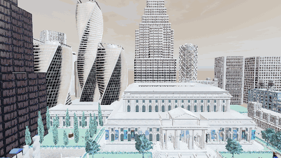
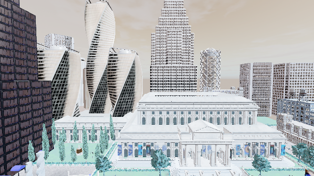
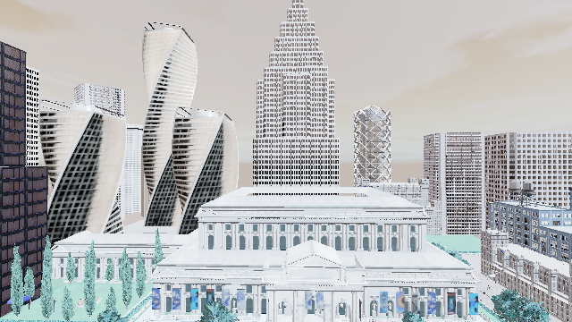
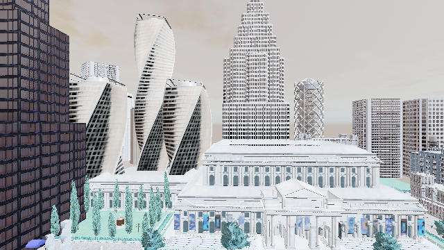

# 无人机航点飞行（AirSim）

> 模块路径：`src/air/airsim_multirotor_waypoint_nav` ｜ 载体：多旋翼无人机 ｜ 地图：Town10HD_Opt

## 实验目的

验证 OpenHUTB「空地一体」模式下 AirSim 接口的可用性，并实现一条可验收的航点飞行闭环：
起飞 → 方形航线 4 个航点 → 返回 → 降落；全程记录轨迹，逐点量化**三维**到达精度。

## 方法

1. **环境**：`D:\hutb\settings.json` 写入 `{"SettingsVersion":1.2,"SimMode":"Multirotor"}`。
2. **接口**：`airsim.MultirotorClient`；`enableApiControl(True)` + `armDisarm(True)` 接管，结束交还；
   **飞行中一旦异常，先 `landAsync()` 降落再交还控制权**（早期版本直接 disarm，会从 6 m 掉下来）。
3. **航点语义**：配置里是**相对起飞点**的偏移（AirSim NED：x 指北、y 指东），起飞后读取 `home` 再换算。
4. **飞行**：`takeoffAsync` → `moveToZAsync(-h)` → 依次 `moveToPositionAsync`（不 join），
   主循环边采样边判到达；返程与降落同样走采样循环（降落 291 个采样点）。
5. **验收**：
   - 到达：三维误差 ≤ 2.0 m 且**连续 3 次**命中；
   - 精度：`hoverAsync` 悬停 1.5 s 取中位误差（**PASS 用这个口径**），并做最多两次稳态偏差补偿；
   - 透明指标：另记「离开时刻误差」，仅参考、不参与判定；
   - 超时：单点 45 s、总时长 150 s；落地需确认（NED z ≥ -0.3 m）；
   - PASS：4 点全部闭锁到达、最大悬停中位误差 ≤ 0.60 m、且确认落地。
6. **采样**：全程 0.1 s 一点，`flight_log.csv` 记录 phase。

## 结果（2026-11-11 重跑）

| 航点（相对起飞点偏移） | 悬停中位误差 | 离开时刻误差 | 闭锁 | 耗时 |
|---|---|---|---|---|
| (25, 0) | 0.36 m | 0.58 m | 是 | 12.6 s |
| (25, 25) | 0.39 m | 0.61 m | 是 | 12.7 s |
| (0, 25) | 0.40 m | 0.36 m | 是 | 12.6 s |
| (0, 0) | 0.41 m | 0.37 m | 是 | 12.7 s |

- 全程 **80.9 s**，采样 **668 点**，确认落地
- 最大悬停中位误差 **0.41 m** ≤ 0.60 m → **PASS**
- 轨迹：`src/air/airsim_multirotor_waypoint_nav/docs/trajectory.png`，逐点：`flight_log.csv`

## 误差口径说明

两个口径差在 0.2~0.25 m：离开时刻会把「加速过程」算进去，衡量的是离开过程；悬停中位误差衡量到达精度。
两个数都写进 summary 与日志，便于按不同口径复算；PASS 采用悬停中位误差。

## 结论

- 相对起飞点的航点语义让同一份配置可复用；
- 「悬停 + 稳态偏差补偿」把 AirSim 约 1.3 m 的悬停偏差压到 0.40~0.45 m；
- 单线程轮询采样覆盖飞行、返程、降落全过程（756 行 vs 早期 7 行）。

## 局限与改进

1. SimpleFlight 内置飞控，未接 PX4/MAVLink。
2. 航点固定、无避障。
3. 位置精度依赖补偿；更高精度需自写位置外环。
4. 不拍照；`read_carla_map()` 只读地图名。

## 运行效果（截图 / 动图）

> 动图由本次实际运行产生的帧合成（GIF < 5 MB，PNG < 3 MB），帧来源见各节说明。
