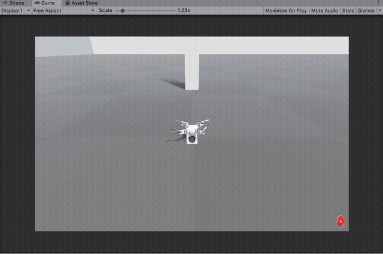

# AirSim Unity 无人机曲线绕柱避障实验报告

## 修改目的与内容

原始程序在柱子前反复朝目标转向和扫描，或者以约 0.019 m/s 缓慢前进，无法顺利绕过柱子。实验目标是在 AirSim Unity 场景中，从已知出生点起飞，利用前视深度扫描绕过静态柱子，继续到达柱子中心后方 12 米处。

实现内容：

- 本机 Unity 插件仅对 DepthVis 启用深度着色器，因此改用浮点 DepthVis，按裁剪面和色彩空间解码距离。
- 将机体半径 0.6 米和额外间距 1.5 米用于障碍膨胀，检查候选运动通道。
- 候选方向同时考虑目标方向、上次世界航向和绕行侧偏好，抑制左右摇头；沿可见安全方向移动，偏航平滑跟随，形成曲线绕行。
- 取消固定 85% 绕行限速，安全通道足够时可使用设定的 1.2 m/s；距离不足和接近终点仍减速。
- 飞行中检查控制权、碰撞、深度时间戳和水平位移；异常时尝试降落。落地未确认则保留控制权并提示检查 Unity。

## 测试环境与结果

| 项目 | 实际环境 |
| --- | --- |
| 系统 | Windows，内核版本 10.0.26200.0（Windows 11 系列） |
| ROS | 本次实验未使用 ROS，不宣称验证了 ROS 节点或消息接口 |
| Python | 独立虚拟环境 Python 3.9.13，64 位 |
| 模拟器 | Microsoft AirSim 1.8.1 Unity 源码项目，SimpleFlight |
| Unity | 项目记录 2019.3.12f1，revision 84b23722532d |
| RPC | msgpack-rpc-python 0.4.1、msgpack-python 0.5.6、Tornado 4.5.3 |
| 数值依赖 | NumPy 1.26.4 |
| 通信 | 本机 127.0.0.1:41451，前视相机 0 |

源码：[模块目录](https://github.com/yanfan117/ros2/tree/codex/airsim_obstacle_avoidance_report/src/air/airsim_obstacle_avoidance)。本模块提供 main.py 和 PowerShell launch 启动器；不提供未经验证的 ROS 封装。

### 构建与运行命令

实验使用已安装并构建好的 AirSim Unity 插件，不需要编译本模块。依赖安装与 main.py 启动器见模块 README。实际成功运行的命令如下，在 Windows PowerShell 执行：

```powershell
cd "C:\Users\颜帆\Documents\ChatGPT\无人机\src\air\airsim_obstacle_avoidance"
& "..\..\..\.venv-airsim\Scripts\python.exe" .\avoidance.py --route goal --goal-x 29 --goal-y 0 --altitude 3 --speed 1.2 --stop-distance 3 --curve-distance 2 --safety-margin 1.5 --vehicle-radius 0.6 --timeout 180
```

步骤：停止旧脚本，Unity 停止后重新 Play，确认载具出生点位于 Unity X=-320、Z=212；柱子中心 X=-320、Z=229，宽深约 2 米，保留 Box Collider；运行 Python。目标 N/E 坐标为 `(241,-320)`，对应 Unity X=-320、Z=241，即柱子中心沿 +Z 后方 12 米（不是从柱子后表面量起）。altitude 3 表示在起飞后报告位置基础上再上升 3 米。

### 验证操作与结果

用户完成实际飞行并提供下方原始动图，反馈运行成功。程序的成功场景是静态柱子和固定目标，不代表通用障碍环境已验证。

保存的 [真实飞行日志](airsim_obstacle_avoidance/flight.csv) 包含位置、速度、偏航、通道距离、目标和绕行侧。最后一条记录时间为 33.39 秒，位置约 `(240.025,-320.488)`，目标为 `(241,-320)`，距离约 1.09 米。该 CSV 没有单独的终止事件记录，不能仅据此认定满足 0.8 米到点阈值或自动降落已确认；成功反馈和动图、CSV 应分别理解。

离线测试执行目录为 `src/air/airsim_obstacle_avoidance`：

```powershell
& "..\..\..\.venv-airsim\Scripts\python.exe" -m unittest -v test_avoidance
```

21 项离线测试涵盖旧碰撞记录、新碰撞、无效深度、完全堵塞、柱子绕行、通道膨胀、方向保持、偏航限幅和速度限制。这些测试验证算法逻辑，不能替代仿真飞行。

## 运行效果



动图来自用户实际运行录制。用户原文件虽名为 GIF，文件头实际为 MP4，现已保留为 [原始运行视频](../img/air/airsim_obstacle_avoidance/flight_demo.mp4)（5,884,254 字节），并转码为真正的 GIF（640×425、8 fps、413 帧、8,010,410 字节，小于 10 MB），保留完整时序，未使用生成图冒充实验结果。观察重点为起飞、柱子附近运动和绕行后继续向目标前进；实际最小间距没有独立测量，不将参数值当作实测安全距离。

## 已知限制与尚未验证内容

- 本实验直接使用 AirSim Python API，ROS 集成未实现和验证；Windows 启动器不是 ROS launch。
- 只检测相机图像中部竖直带；侧后方、细杆、动态物体、复杂死胡同和多障碍全局规划未验证。
- 深度解码依赖本机 Unity 插件与裁剪面、色彩空间，不能原样当作 Unreal AirSim 米制深度使用。
- 起飞与升高后才建立碰撞基线，起降阶段无视觉避障；必须保证起降区空旷。此安排也可能忽略升高期间已结束的接触，仍需检查场景。
- 局部方向选择与偏航平滑不构成全程连续曲率或固定最小间距的数学保证；高速度下的制动与传感延迟未做系统标定。
- 新 main.py 与 launch 启动器完成入口检查，尚未单独重新飞行；矩形、多柱和其他速度参数未作为本次成功证据。
- 仿真运行成功不能作为真实无人机部署结论。

## 提交前检查

- [x] 源码与教程分别放在 src/air 与 docs/air，新增文件使用英文下划线命名。
- [x] 提供 main.py、launch/run_demo.ps1、requirements.txt、README；ROS launch 不适用于本次直接 API 实验。
- [x] 新增首页与空域载具导航入口，真实 GIF 小于 10 MB；未添加 PNG。
- [x] 已保留实际飞行日志，未把虚拟环境、缓存和临时 artifacts 目录作为源码提交。
- [ ] main.py/启动器单独实飞、ROS 接口及自动降落确认未验证，不虚报完成。

- [x] 已运行 `mkdocs serve --livereload -a 127.0.0.1:8001`，页面及嵌入 GIF 均返回 HTTP 200；文档构建成功。仓库其他页面仍有既有链接告警。
- [x] 最终检查 `git diff --check`、未解决冲突和暂存文件清单；此次仅新增本模块及首页/导航入口，没有删除公共文件。
