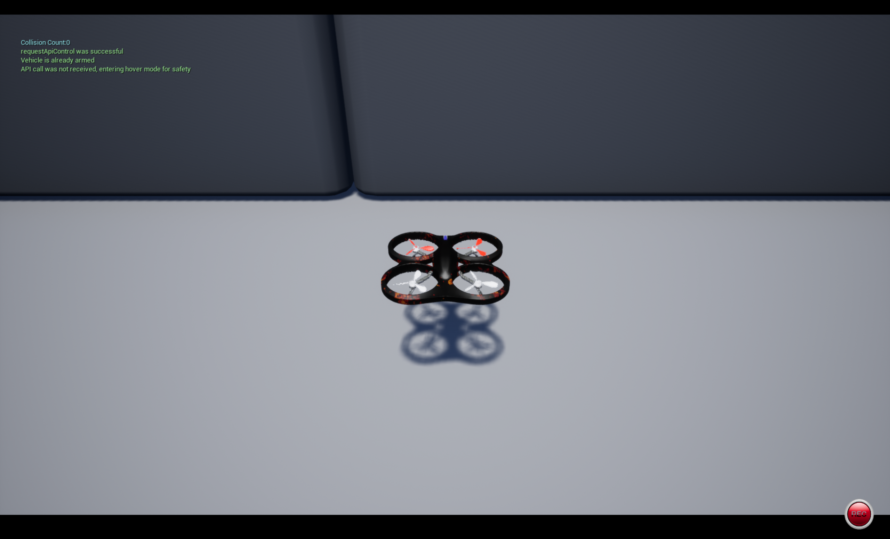

# ROS Noetic：AirSim 与 PPO 实际联调

适用环境：Ubuntu 20.04、ROS Noetic、Python 3.8。Windows 运行 AirSim，虚拟机运行本包。
这是独立 ROS 1 catkin 包。请使用单独工作空间，不要把仓库全部示例混合构建。
参考模型来自 https://github.com/GauravVRich/Auto_drone 。模型不提交进本仓库。

## 1. 将文件放入虚拟机

从 GitHub 获取本分支后，将此包复制进独立工作空间。例如在仓库根目录执行：

```bash
mkdir -p ~/airsim_noetic_bundle/src ~/airsim_noetic_bundle/models
cp -r src/air/airsim_rl_planner_ros1 ~/airsim_noetic_bundle/src/
```

从参考项目获取可信的 trained_policy.zip 和 yolov8n.pt，分别放入 models 目录。
模型不是本仓库的一部分。不要复制 .git、虚拟环境或编译产物。


使用提供的压缩包时，解压后得到 airsim_noetic_bundle，其中 src 下是本包、models 下是两个模型。
将整个文件夹放到主目录，以它作为独立 catkin 工作空间：

```bash
cd ~/airsim_noetic_bundle
source /opt/ros/noetic/setup.bash
sudo apt update
sudo apt install -y python3-venv python3-pip python3-catkin-pkg python3-rospkg ros-noetic-std-srvs
python3 -m venv --system-site-packages .venv
source .venv/bin/activate
python -m pip install 'pip<25.1' 'setuptools<70' wheel
python -m pip install numpy==1.24.4 opencv-python==4.10.0.84 msgpack-rpc-python==0.4.1
python -m pip install --no-build-isolation airsim==1.8.1
python -m pip install torch==2.2.2 torchvision==0.17.2 --index-url https://download.pytorch.org/whl/cpu
python -m pip install -r src/airsim_rl_planner_ros1/requirements-py38.txt
python -c 'import rospy, airsim, cv2, torch; from stable_baselines3 import PPO; print("imports OK")'
catkin_make -DPYTHON_EXECUTABLE="$VIRTUAL_ENV/bin/python"
source devel/setup.bash
```

此前用户已完成 Python 3.8 依赖安装和模型加载。新版图像转换和起降结果检查尚需重新在线验证；版本组合仅针对本实验，不建议直接升级为最新版本。
venv 使用 system-site-packages 是为了读取 apt 安装的 rospy 和 ROS 消息；不要用 pip 安装 rospy。新版用 NumPy 直接转换 rgb8/bgr8/32FC1 图像消息，不加载 cv_bridge；cv2 由该 venv 内固定版本的 opencv-python 提供，避免与系统 cv_bridge 的编译版 OpenCV 混用。
如果从 Git 克隆获取代码，请只把 src/air/airsim_rl_planner_ros1 复制到独立工作空间的 src 下，模型自行放入 models。

## 2. 检查 Windows 与虚拟机网络

Windows 启动 D:\AirSim\Blocks\Blocks\WindowsNoEditor\Blocks.exe。
Windows 的 ipconfig 可查看地址；选择虚拟机能够访问的宿主机网卡地址。
虚拟机的 127.0.0.1 指虚拟机自身，不是 Windows。设置并测试实际地址：

```bash
export AIRSIM_HOST=192.168.XXX.XXX
python -c 'import os,socket; s=socket.create_connection((os.environ["AIRSIM_HOST"],41451),3); print("TCP OK"); s.close()'
```

将示例地址替换为实际 IP。若不通，检查虚拟机 NAT/桥接配置、Windows 防火墙是否允许该虚拟机访问 TCP 41451，以及 AirSim 的监听地址。
只有确认 AirSim 仅监听回环时，才考虑在 Windows 的 Documents/AirSim/settings.json 中将 LocalHostIp 设为宿主机可达网卡 IP，然后重启场景。
不需要向互联网开放端口，也不需要虚拟机连接 Windows ROS Master：ROS 节点和 Master 都在虚拟机中。

## 3. 先单独测试桥接

```bash
roslaunch airsim_rl_planner_ros1 airsim_rl.launch host:=$AIRSIM_HOST
```

roslaunch 会自动启动本地 roscore。默认 run_planner=false，不加载模型，也不会自动起飞。未传 host 时读取 config/params.yaml 中的 airsim_bridge.host；显式 host:=... 才覆盖它。
第二个终端加载环境：

```bash
cd ~/airsim_noetic_bundle
source /opt/ros/noetic/setup.bash
source .venv/bin/activate
source devel/setup.bash
rostopic list
rostopic hz /drone/rgb
rostopic echo -n 1 /drone/pose_ned
rosservice call /drone/takeoff '{}'
rosservice call /drone/land '{}'
```

确认能起降、传感器连续发布后，在第一个终端 Ctrl+C 停止桥接。

## 4. 接入 PPO

在已加载环境的终端启动：

```bash
roslaunch airsim_rl_planner_ros1 airsim_rl.launch host:=$AIRSIM_HOST run_planner:=true policy_path:=$HOME/airsim_noetic_bundle/models/trained_policy.zip yolo_path:=$HOME/airsim_noetic_bundle/models/yolov8n.pt
```

在第二个终端先起飞，再启用规划：

```bash
rosservice call /drone/takeoff '{}'
rosservice call /planner/enable 'data: true'
```

停止规划再降落，成功后才关闭节点：

```bash
rosservice call /planner/enable 'data: false'
rosservice call /drone/land '{}'
```

## 实现与限制

- bridge_node.py：发布 drone/rgb、drone/depth、drone/pose_ned、drone/collision；订阅 drone/cmd_vel_ned。
- ppo_planner_node.py：实际执行 YOLO 检测及 PPO.load/predict，并未用规则控制冒充 PPO。
- runtime.py：基于 rospy 的小型回调调度层，所有 AirSim/RPC 操作在主线程串行执行，传感器队列只保留最新消息。不是 ROS 1/2 通信桥。
- core.py：10 维观测及 5 个动作转换；config/params.yaml 配置目标、速度、超时。
- 速度和位姿为 world_ned，z 负值向上、正值向下；不是默认 ROS ENU，不发布 TF 或 CameraInfo。
- 数据超时输出零速度，碰撞或显式开启的目标停止条件触发时停止规划，桥接限制速度和命令有效时间；网络或进程故障不能保证悬停。
- 目标只是停止条件，并没有输入原 PPO。原 Auto_drone 训练代码使用随机观测，标准 COCO YOLO 不识别 building/tree/road，现有策略不能视为可靠避障算法。
- 要验证的是联通、传感器和模型驱动动作，不能据此认定无人机会到达目标。换目标不等于重新训练。
- 模型反序列化只使用可信来源文件；依赖版本与保存模型的环境不一致时可能需要进一步适配。

## 已有的联调修复

1. legacy_policy.py 使用 custom_objects 重建原模型的 NumPy/Python 元数据，保留神经网络权重，解决 numpy._core 加载错误。仅针对已检查的 Auto_drone 10 维/5 动作模型，不用于恢复训练。
2. 零速度和停止状态调用 hoverAsync，避免反复发送零速度造成高度漂移。
3. 水平动作使用 moveByVelocityZAsync，锁定首次水平动作时的 NED 高度；不是自动上升到指定离地高度。
4. 桥接每约 0.1 秒续发动作，动作有效期为 1.5 秒；同线程 RPC 阻塞时实际周期可能延长。
5. depth_guard.py 在 PPO 与飞行控制之间拦截不安全动作，规则见下表。规则辅助不能称为 PPO 学会了避障。

| 条件 | 行为 |
|---|---|
| 前方深度低于 3 米 | 禁止前进，检查左右视野 |
| 前方恢复到 4 米以上 | 允许水平前进，限速 0.5 米/秒 |
| 左右存在明显空隙 | 以 0.2 米/秒尝试侧移，单次最多 2 秒 |
| 前方不足 1.5 米、无空隙、侧移超时 | 悬停 |
| 深度过期超过 0.5 秒、无效或相机倾斜过大 | 悬停 |
| PPO 请求升降、后退、纯侧向运动 | 拦截；前置摄像头看不到对应完整空间 |

保护层以相机前向与机体前向一致为前提，按当前 yaw 转换世界坐标速度。前置深度不能保证侧面安全；整面墙应停止，不会强行绕过。没有全局地图、完整路径搜索或目标引导。

## 手动控制与停止

先关闭 PPO，保持桥接运行。以下命令仅向世界 X 正方向移动，仍受深度保护约束：

```bash
rosservice call /planner/enable 'data: false'
rostopic pub -r 10 /drone/cmd_vel_ned geometry_msgs/TwistStamped "{header: {stamp: now, frame_id: 'world_ned'}, twist: {linear: {x: 0.3, y: 0.0, z: 0.0}}}"
```

桥接单独运行时没有 planner/enable 服务，可跳过关闭 PPO 的命令。
Ctrl+C 停止发布后，最多等待命令超时进入悬停；立即停止使用：

```bash
rostopic pub -1 /drone/cmd_vel_ned geometry_msgs/TwistStamped "{header: {stamp: now, frame_id: 'world_ned'}, twist: {linear: {x: 0.0, y: 0.0, z: 0.0}}}"
rosservice call /drone/land '{}'
```

本包没有键盘节点，也未处理角速度偏航指令，不能宣称支持 WASD 全向遥控。

## 常见故障

- 找不到 launch：先确认包在工作空间 src 下，执行 catkin_make 并 source devel/setup.bash。
- Unable to communicate with master：检查 roslaunch 是否退出；必需节点崩溃会关闭整组节点。
- numpy._core：使用包含 legacy_policy.py 的本分支；不要在 Python 3.8 中强装 NumPy 2。
- Stopped：查看碰撞与目标距离日志。碰撞信息可能包含之前的接触，不能仅靠停止后的 False 推断停止原因。
- Depth guard：按日志判断前方墙体、深度过期或侧移时间上限；保持悬停不等于系统故障。
- API call was not received, entering hover mode for safety：AirSim 的控制超时提示；停止指令后可能出现，规划中持续出现应检查 RPC 延迟、节点退出和指令间隔。
- 图像类别提示：标准 YOLO 不包含 building/tree/road，这三项观测会保持零，不影响加载但限制策略效果。

## 验证记录与边界

用户在 Ubuntu Noetic/Python 3.8.10 与 Windows Blocks 间报告已跑通连接、起降、PPO 加载和向前运动。
悬停修复后提供的位置记录中，Z 收敛到约 -0.460 米，整个采样段变化约 0.19 毫米；这不是离地高度或避障成功率指标。
定高前进和深度保护已通过模拟测试，但尚未收到完整的场景回归结果。截图展示无人机及 AirSim 悬停提示，不能作为自主绕墙成功证明。

离线回归：

```bash
python -m unittest discover -s src/airsim_rl_planner_ros1/tests
```

原模型保存环境为 Python 3.11、SB3 2.6.0、PyTorch 2.6.0、NumPy 2.2.4、Gymnasium 1.1.1。
兼容加载仅用于推理；它没有改善原始模型的训练质量，也不保证能到达目标。

## 联调截图



## PR #844 复核后的调整

### 速度、动作与目标

配置和节点默认 `speed=0.5`、`max_speed=0.5`，单位 m/s。前置深度保护层另有独立的 0.5 m/s 水平合速度上限；降低 speed 能降低请求速度，提高到 0.5 以上不会提高最终允许速度。侧移 bypass 的上限仍为 0.2 m/s。

保留原模型的五个离散动作以兼容原权重，没有重新训练或把动作空间改为三个：

| 动作 | NED 速度方向 | 保护层行为 |
| --- | --- | --- |
| 0 | +X | 按当前 yaw 和深度判断，允许时定高前进 |
| 1 / 2 | +Y / -Y | 纯侧向请求被拦截；保护层自己的受限侧移另行判断 |
| 3 / 4 | -Z / +Z | 请求升高/降低，但前置相机没有上下视野，统一拦截为停止 |

上述方向是世界 NED，不是随机头旋转的机体坐标。五动作映射保留不代表五个方向都能飞；策略可能连续请求被拦截动作而悬停。启动日志会说明此限制。

`goal_stop_enabled` 默认 false，`goal_ned` 默认 `[0, 0, 0]` 仅作占位，不再沿用旧场景目标。若要使用目标停止条件，在启动前修改包的 config/params.yaml：开启 `goal_stop_enabled: true` 并填写当前场景的世界 NED 坐标。先记录 `/drone/pose_ned` 检查坐标；目标距起点/起飞点过近会立即触发停止。目标在节点初始化时读取，修改目标需停止规划并重启节点。它从未输入策略，也不会让策略朝目标飞行。

### 起降期间的串行执行限制

为避免 msgpack-rpc/Tornado 跨线程访问，本版本保留主线程串行 RPC。起飞（服务端最多 15 秒，独立 RPC 客户端超时 20 秒）、降落（30/35 秒）和悬停确认（控制客户端超时 2 秒）均检查 future.get() 的返回结果；失败不报告成功。RPC 超时受事件循环和网络重试影响，并不是精确的墙钟保证。

等待起降结果时，该桥接节点的状态图像发布、指令处理及 watchdog 会暂停，`/drone/takeoff` 返回前其他服务也可能排队。这不是持续 5 Hz 状态发布或持续 10 Hz 控制保证。起飞前不要启用 PPO；起飞服务成功、话题恢复且数据新鲜后再启用。降落前先禁用 PPO，等待降落服务返回再关闭节点。通信失败不能保证飞行器执行悬停，必须结合仿真画面和状态检查。

### 模型和依赖诊断

模型仍需用户从可信来源准备，仓库没有 trained_policy.zip 或 yolov8n.pt。`run_planner:=true` 时必须同时传 `policy_path` 与 `yolo_path`；空值直接提示具体参数名，路径不存在时显示该参数对应的绝对路径，不再把空字符串误报为当前目录。

新版的 `image_codec.py` 只支持本包使用的三种图像编码，处理颜色顺序、行填充和深度字节序，不依赖 cv_bridge。它不替代通用图像格式转换器。保持独立 venv，并确认导入来源：

```bash
python -c 'import sys,cv2; print(sys.executable); print(cv2.__version__, cv2.__file__)'
```

本次仅完成离线回归与 XML/Python 检查，尚未在 ROS Noetic + AirSim 中重测新版。原联调截图和此前报告的飞行行为属于旧版记录，不能视为新版起降、避障或定高精度验证。

本次修改在 Python 3.12 下运行 25 项离线回归，全部通过；另通过 Python 语法和 launch/package XML 检查。未进行 ROS Noetic、模型推理或 AirSim 在线复测。
