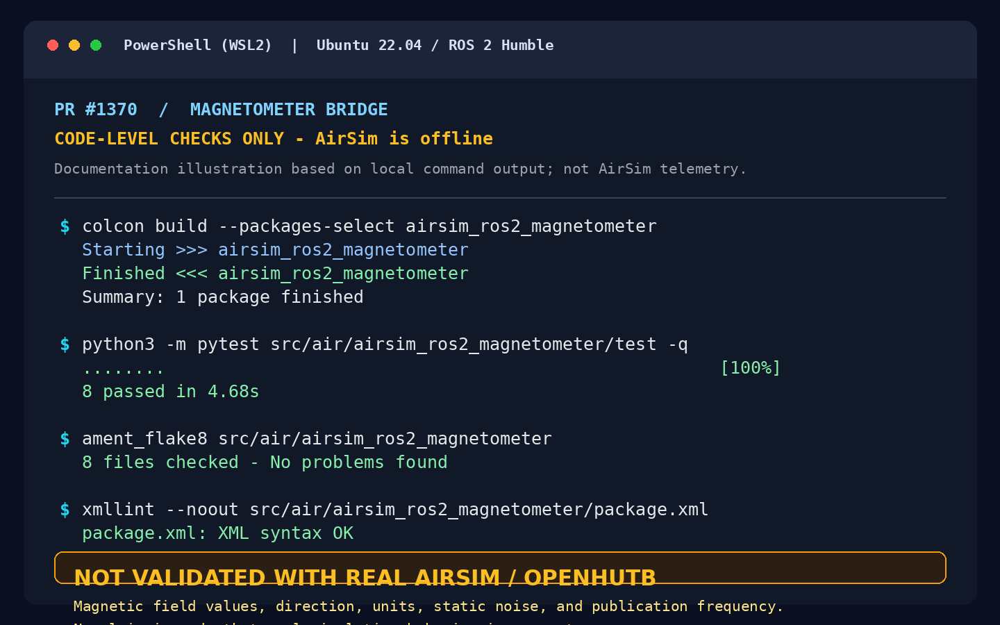

# AirSim ROS 2 Humble 磁力计桥接

本模块把 AirSim 多旋翼磁力计接入 ROS 2 Humble，发布标准
`sensor_msgs/msg/MagneticField`，可作为航向估计、磁场分析和组合导航的上游
数据源。实现位于 `src/air/airsim_ros2_magnetometer`，入口统一为 `main`，
启动文件为 `launch/bringup.launch.py`。

## 1. 接口

| 类型 | 名称 | 消息 | 说明 |
| --- | --- | --- | --- |
| 发布 | `/uav/magnetometer` | `sensor_msgs/msg/MagneticField` | 默认 20 Hz，可靠 QoS |

节点默认参数如下：

| 参数 | 默认值 | 含义 |
| --- | --- | --- |
| `host` | `127.0.0.1` | AirSim RPC 主机 |
| `port` | `41451` | AirSim RPC 端口 |
| `vehicle_name` | `""` | 多机仿真载具名 |
| `magnetometer_name` | `""` | AirSim 磁力计名称 |
| `magnetometer_topic` | `/uav/magnetometer` | 输出话题 |
| `frame_id` | `base_link` | 磁场消息坐标系 |
| `publish_rate` | `20.0` | 读取调度的最大频率（Hz）；实际受 RPC 延迟限制 |
| `reconnect_period` | `2.0` | 断线后重连等待时间（s） |
| `rpc_timeout` | `1.0` | AirSim 连接和单次读取 RPC 超时（s） |
| `field_scale` | `1.0` | AirSim 数值到 ROS 数值的比例 |

发布端使用 `RELIABLE` QoS，协方差未知时保持全零，不虚构传感器精度。
`frame_id` 默认是 `base_link`；若磁力计存在独立安装坐标系，应传入与 TF
树一致的 `magnetometer_link` 等名称。

## 2. 计算原理与公式

### 2.1 AirSim FRD 到 ROS FLU 的坐标变换

AirSim 多旋翼机体坐标采用 FRD：$x$ 向前、$y$ 向右、$z$ 向下。ROS
REP-103 的机体坐标采用 FLU：$x$ 向前、$y$ 向左、$z$ 向上。两者只差
$y$、$z$ 两个轴的符号，因此磁场分量满足

$$
\mathbf{B}_{\mathrm{FLU}}
= \mathbf{C}_{F D}^{F L}\mathbf{B}_{\mathrm{FRD}}
= \begin{bmatrix}
1 & 0 & 0\\
0 & -1 & 0\\
0 & 0 & -1
\end{bmatrix}
\begin{bmatrix}B_x\\B_y\\B_z\end{bmatrix}
=
\begin{bmatrix}B_x\\-B_y\\-B_z\end{bmatrix}.
$$

变换矩阵 $\mathbf{C}_{F D}^{F L}$ 的行列式为 $-1$，表示一次坐标反射。
它只改变坐标表达，不改变磁场向量在空间中的物理方向。对应实现位于
`airsim_ros2_magnetometer/magnetometer.py:29-30`。

### 2.2 磁场单位与 `field_scale`

ROS `MagneticField` 接口约定磁场单位为 Tesla。AirSim 场景返回值的单位
依赖场景与仿真配置，本模块不擅自假定。定义比例

$$
\mathbf{B}_{\mathrm{ROS}}
= s\,\mathbf{B}_{\mathrm{AirSim}},
\qquad
s=\frac{\text{ROS 目标单位}}{\text{AirSim 原始单位}}.
$$

默认 $s=1$，表示原样转发并明确要求使用者确认场景单位。若 AirSim 原始值为
Gauss，而 ROS 下游要求 Tesla，则使用 $1\,\mathrm{G}=10^{-4}\,\mathrm{T}$，
即 `field_scale:=0.0001`。比例必须是有限正数。

### 2.3 协方差传播

AirSim 样本中的标量 `magnetic_field_covariance` 被解释为各轴共用的方差，
即近似各向同性协方差

$$
\boldsymbol{\Sigma}_{\mathrm{AirSim}}
=c\mathbf{I}_{3\times3}.
$$

经过坐标反射和单位缩放后，协方差按线性变换传播：

$$
\boldsymbol{\Sigma}_{\mathrm{ROS}}
=\mathbf{C}\,\boldsymbol{\Sigma}_{\mathrm{AirSim}}\,\mathbf{C}^{\mathsf T}s^2
=s^2c\,\mathbf{C}\mathbf{C}^{\mathsf T}
=s^2c\mathbf{I}_{3\times3}.
$$

`sensor_msgs/msg/MagneticField` 的 9 个协方差元素按行优先存储。实现只写
对角项 `0、4、8`，其余项保持零；因此当前版本表达的是各轴独立、各向同性的
方差，不表达横轴耦合或完整任意协方差。AirSim 返回零协方差时，表示精度未知，
ROS 消息继续保持全零，而不是填入经验常数。

### 2.4 数据合法性与发布频率

三轴磁场或协方差只要出现 NaN、正/负无穷，就拒绝该样本；协方差还要求
非负。定时器周期为

$$
T_p=\frac{1}{f_p},
$$

其中 $f_p$ 是 `publish_rate`，它表示最大调度和发布频率。单次 RPC 超过周期
时实际频率会下降，但 AirSim 调用不会占用 ROS executor。模块也拒绝非有限、
非正的发布周期、重连周期、RPC 超时和尺度参数，避免把 `NaN` 或 `Inf` 传给
定时器和 RPC。

消息时间戳取当前 ROS 时钟 `get_clock().now()`，不是 AirSim 样本时间。
因此它表示“桥接节点本次发布时刻”，而不是磁力计采样时刻；当前版本不做
采样时间插值、延迟补偿或重复样本检测。

### 2.5 当前不包括的计算

本模块只转发和转换 AirSim 原始磁场，不执行磁偏角补偿、硬铁/软铁标定、
椭球拟合、姿态融合、低通滤波或静态噪声估计。真实场景中的量级、方向、
噪声和单位仍需用参考设备或已知地磁场进行核验。

## 3. 算法流程

节点启动后创建可靠发布者和按 `publish_rate` 触发的 ROS 定时器。每个定时
周期执行以下流程：

```text
ROS 定时器触发
     │
     ▼
已有 AirSim client？──否──▶ 最多创建一个后台连接任务
     │是                         │
     ▼                           ▼
处理已完成的读取 Future    成功后在下一周期登记 client
     │
     ▼
没有在途读取？──是──▶ 提交下一次后台读取
     │否
     ▼
检查已完成样本的三轴磁场与协方差
     │
     ▼
FRD(x,y,z) ──▶ FLU(x,-y,-z)
     │
     ▼
乘 field_scale，写对角协方差 s²c
     │
     ▼
填充 ROS 时间戳、frame_id，发布 /uav/magnetometer
```

连接流程：

1. client 不存在且到达 `_next_connect_time` 时，把 `_connect_once()` 提交给单线程
   `ThreadPoolExecutor`，定时器立即返回。
2. 后台任务按 `rpc_timeout` 创建 `MultirotorClient` 并调用
   `confirmConnection()`；未完成前，后续定时器不会重复创建连接。
3. 连接成功后，后续周期登记 client 并开始读取；`ImportError` 会提示安装
   `requirements.txt`，其它连接异常记录 warning 后按 `reconnect_period` 重试。

读取流程：

1. 定时器在没有在途读取时，把
   `getMagnetometerData(magnetometer_name=..., vehicle_name=...)` 提交给同一个
   后台 RPC 线程，然后立即返回；
2. 后续定时周期只轮询 Future，不阻塞等待 AirSim；
3. Future 完成后在主 executor 中校验并转换样本，失败样本不会发布；
4. 第一次有效样本写一条 debug 日志，便于确认字段量级；
5. 发布消息并将连续失败计数清零，再提交下一次读取。

故障流程：

1. 单次读取失败只记录 warning，连续失败 1 至 4 次时仍保留 client；
2. 连续失败达到 5 次时丢弃 client、清零失败计数，并等待
   `reconnect_period` 后重新连接；
3. 读取失败期间不继续发布旧样本，避免下游把缓存值误认为新观测。

## 4. 源码解析（带文件与行号）

### 4.1 `airsim_ros2_magnetometer/magnetometer.py`

| 位置 | 内容 |
| --- | --- |
| `magnetometer.py:13-16` | 不可变数据类 `MagnetometerSample`，同时携带 FLU 三轴磁场和标量方差 |
| `magnetometer.py:19-30` | `parse_magnetometer_sample()`：提取字段、有限性检查、非负协方差检查及 FRD→FLU |
| `magnetometer.py:24-28` | 把缺省或非正协方差统一为零，明确表示精度未知 |
| `magnetometer.py:33-44` | `build_message()`：写时间戳、`frame_id`、单位比例和对角协方差 |

`parse_magnetometer_sample()` 将业务校验与 ROS 消息构造分开，因此第一部分可以
不连接 AirSim、只构造 `SimpleNamespace` 做纯函数测试。

### 4.2 `airsim_ros2_magnetometer/main.py`

| 位置 | 内容 |
| --- | --- |
| `main.py:20-75` | 节点构造、参数声明、非法参数拒绝、可靠 QoS 和 client 工厂注入点 |
| `main.py:77-108` | 非阻塞连接调度：复用未完成 Future，按重连周期提交新连接 |
| `main.py:110-122` | 默认创建 `MultirotorClient`，显式传入 `rpc_timeout` |
| `main.py:124-182` | 后台读取调度、Future 完成处理，以及连续 5 次失败后的断线处理 |
| `main.py:184-187` | 关闭线程池并销毁 ROS 节点 |
| `main.py:190-202` | `main()` 入口、外部关闭异常处理和幂等 shutdown |

`client_factory` 是测试注入点：生产环境不传入时动态导入 `airsim`，测试环境可传入
假 client，从而覆盖连接、读取失败和重连状态，而不要求启动模拟器。

### 4.3 `launch/bringup.launch.py`

| 位置 | 内容 |
| --- | --- |
| `bringup.launch.py:13-18` | 通过 `get_package_share_directory()` 解析安装后的 YAML 路径 |
| `bringup.launch.py:30-42` | 声明 host、port、载具、话题、频率、重连、RPC 超时和尺度参数 |
| `bringup.launch.py:43-72` | 启动 `main`，加载 YAML，并把基本类型声明为 int、float、str、bool |
| `bringup.launch.py:59-68` | 数值参数与 `use_sim_time` 显式包装为 float/bool |

配置文件 `config/magnetometer.yaml` 提供运行参数，launch 显式传入的值优先级更高。
安装路径由 ament index 解析，不使用依赖当前用户名的绝对路径。

### 4.4 测试与 CI

| 测试文件 | 用例 | 覆盖内容 |
| --- | --- | --- |
| `test/test_magnetometer.py:17-36` | `test_frd_to_flu_and_scale` | 三轴符号、`field_scale`、协方差缩放和 `frame_id` |
| `test/test_magnetometer.py:39-52` | `test_unknown_covariance_stays_zero` | 未知协方差不被伪造成经验值 |
| `test/test_magnetometer.py:55-63` | `test_non_finite_field_is_rejected` | NaN 样本拒绝 |
| `test/test_reconnect.py:70-92` | `test_four_failures_recover_without_reconnect` | 短时故障不立即断连，恢复后继续发布 |
| `test/test_reconnect.py:94-110` | `test_fifth_failure_disconnects` | 第 5 次失败触发断线状态 |
| `test/test_reconnect.py:112-125` | `test_reconnect_restores_client` | 重连后恢复 client |
| `test/test_node_startup.py:17-50` | `test_launch_starts_without_airsim` | AirSim 离线时 launch 仍能启动节点和话题 |
| `test/test_reconnect.py:127-152` | `test_blocking_read_does_not_block_timer` | 后台读取阻塞时定时器立即返回，完成后恢复发布 |
| `test/test_reconnect.py:154-171` | `test_missing_airsim_client_reports_install_hint` | 未安装客户端时给出正确安装提示 |
| `test/test_node_startup.py:52-105` | `test_connection_is_nonblocking` | 后台连接不阻塞、超时值生效、发布 QoS 为 reliable |

`.github/workflows/air_bridge_tests.yml:12,22,78-113` 中新增包专属路径过滤和
`ROS 2 Humble magnetometer build + tests` 作业。CI 使用
官方 `ros:humble-ros-base` 容器，再执行
`colcon build --packages-select airsim_ros2_magnetometer`、
`colcon test --packages-select airsim_ros2_magnetometer` 和
`colcon test-result --verbose`。因此 `test/` 下的 10 个用例会在仓库流水线中执行。

## 5. 构建与运行

以下命令统一以 `~/hutb_ws` 为 colcon 工作区，以
`~/hutb_ws/src/airsim_ros2_magnetometer` 为软链接后的包目录。这样依赖安装、
构建和测试不再混用仓库根路径。

```bash
source /opt/ros/humble/setup.bash
mkdir -p ~/hutb_ws/src
ln -sfn ~/ros2/src/air/airsim_ros2_magnetometer \
  ~/hutb_ws/src/airsim_ros2_magnetometer

python3 -m pip install -r \
  ~/hutb_ws/src/airsim_ros2_magnetometer/requirements.txt

cd ~/hutb_ws
colcon build --symlink-install --packages-select airsim_ros2_magnetometer
source install/setup.bash
```

AirSim 运行在 Windows 宿主机时，先确认 RPC 端口可访问，再启动：

```bash
ros2 launch airsim_ros2_magnetometer bringup.launch.py \
  host:=<Windows_IP> port:=41451 vehicle_name:=""
```

检查接口：

```bash
ros2 topic hz /uav/magnetometer
ros2 topic echo /uav/magnetometer --once
```

真实场景验证至少应记录三轴磁场样例、静止噪声、发布频率，以及旋转载具时
各轴的变化方向。当前文档不把离线代码测试替代为上述真实数据证据。

## 6. 测试

从同一个 `~/hutb_ws` 工作区执行：

```bash
source /opt/ros/humble/setup.bash
source ~/hutb_ws/install/setup.bash

python3 -m pytest ~/hutb_ws/src/airsim_ros2_magnetometer/test -q
colcon test --packages-select airsim_ros2_magnetometer
colcon test-result --verbose
```



截图记录的是修改前的 `8 passed` 代码级检查；当前测试集已扩展为 10 项。
这些检查只表示转换、消息构造、连接/读取状态机、启动和 QoS 检查通过，不表示
AirSim/OpenHUTB 已提供有效磁力计数据。

## 7. 范围与限制

- 不执行磁偏角补偿、椭球拟合、硬铁/软铁标定或姿态融合；
- 不假设 AirSim 原始磁场单位，必须通过 `field_scale` 明确单位；
- 只表达标量/各向同性方差，无法表达传感器给出的完整非对角协方差；
- 使用 ROS 当前时间作为消息时间戳，不映射 AirSim 采样时间；
- 真实磁场量级、方向、噪声和频率仍需在 AirSim/OpenHUTB 中验证；
- CI 和单元测试使用假 client 或离线启动，不替代真实 MAVLink 或仿真闭环。

## 8. ROS 2 与仓库贡献规范

本模块遵循 [ROS 2 Humble 文档](https://docs.ros.org/en/humble/) 的节点、参数、
QoS、launch 和消息接口约定，并提供 `main` 入口、launch、README、首页和导航。

## AI 辅助声明

本模块、测试和文档由大语言模型辅助整理；提交者应实际连接 AirSim，检查磁场
方向、量级、单位、噪声和频率，并对提交内容负责。
