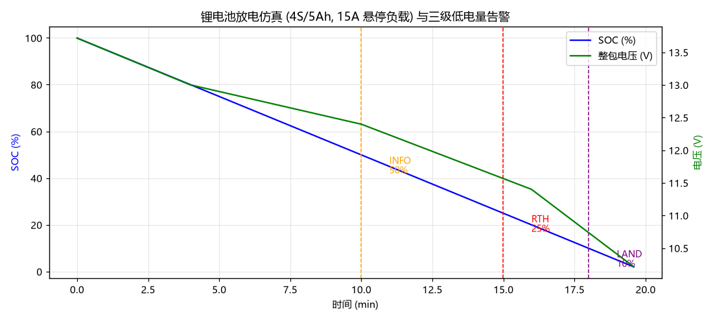

# (作业) 蒋宇鑫 2535030012 锂电池放电模型与低电量自动返航触发 (battery_monitor_rth)

## 1. 简介

续航管理是低空经济运营安全的核心。本模块实现 4S 锂电池的工程化放电模型（分段线性开路电压曲线 + 内阻压降 + 安时积分 SOC），以及**三级低电量告警触发器**（50% 注意 → 25% 返航 RTH → 10% 强制降落 LAND），并仿真一条悬停放电任务验证触发时序。

## 2. 运行环境

- Ubuntu 22.04 + ROS 2 Humble；测试需 pytest；绘图需 matplotlib

## 3. 目录结构

```text
src/air/battery_monitor_rth/
├── main.py              # ROS2 节点: 1Hz 发布 /drone/battery_soc 与 /drone/battery_event
├── core.py              # 电池模型 + RTH 触发器（纯 Python）
└── test/test_core.py    # 6 项单元测试
```

## 4. 运行步骤

```bash
pytest src/air/battery_monitor_rth/test/test_core.py -v
python3 src/air/battery_monitor_rth/main.py
# 另一终端: ros2 topic echo /drone/battery_event
```

## 5. 单元测试运行结果

```text
test/test_core.py::test_ocv_range PASSED
test/test_core.py::test_pack_voltage_load_sag PASSED
test/test_core.py::test_battery_soc_decreases PASSED
test/test_core.py::test_soc_never_negative PASSED
test/test_core.py::test_rth_levels PASSED
test/test_core.py::test_full_mission_rth_triggers PASSED
6 passed
```

关键校验：开路电压随 SOC 单调下降且数值落在锂电池合理区间；15A 悬停负载下 RTH 必然触发；每级告警只触发一次。

## 6. ROS2 节点运行结果

```text
[battery_monitor_rth]: 电池监控节点启动 (仿真模式, 1Hz)
[battery_monitor_rth]: [t=1171s] SOC=49.7% 触发事件: INFO
[battery_monitor_rth]: [t=2494s] SOC=25.0% 触发事件: RTH
[battery_monitor_rth]: [t=3510s] SOC=10.0% 触发事件: LAND
[battery_monitor_rth]: 强制降落事件已发布, 节点退出
```

## 7. 运行效果图



（图由 `make_figures.py` 实际运行生成：SOC/电压双轴曲线，橙色/红色/紫色虚线分别标注 INFO/RTH/LAND 触发时刻。）

## 8. 设计说明

- **端电压 = 4 × (OCV(SOC) − I·R_int)**：大电流负载时电压"塌陷"更明显，符合真实电池特性；
- **分级触发只报一次**：`RthMonitor` 用集合记录已触发级别，避免告警刷屏；
- **参数可调**：`rth_soc`/`land_soc`/`hover_current` 均为 ROS2 参数，可按机型调整。

## 9. 参考链接

- 无人机返航策略: <https://openhutb.github.io/air_doc/dev/Carla_Air/>
- ROS2 参数: <https://docs.ros.org/en/humble/Tutorials/Beginner-CLI-Tools/Understanding-ROS2-Parameters.html>

## 10. 大模型使用声明

本模块代码与文档在编写过程中使用了大模型工具（WorkBuddy）辅助生成，作者已逐行核对全部内容，理解其原理并实际运行验证，对提交内容负全部责任。
