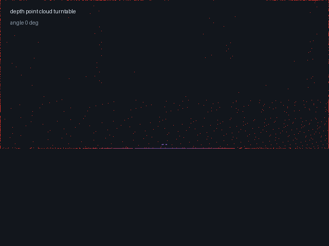

# 深度点云 Turntable GIF

把一帧 `/camera/depth/points` 点云渲染成旋转 GIF，方便在 PR、README 和评审里直接看到深度点云的结构。



## 用法

```bash
python3 src/air/carlair_ros_bridge/scripts/depth_turntable.py \
  --input points.npy \
  --output docs/img/air/carlair_ros_bridge/depth_turntable.gif \
  --frames 24 --fps 8 --max-points 9000
```

`points.npy` 是 `(N, 3)` 的相机光学系点云（x 右、y 下、z 前）。  
可以用 `demo_recorder` 或任意订阅 `/camera/depth/points` 的脚本保存。

## 参数

| 参数 | 默认 | 说明 |
|---|---|---|
| `--input` | 必填 | `(N,3)` 的 `.npy` |
| `--output` | `depth_turntable.gif` | 输出 GIF |
| `--frames` | 24 | 旋转帧数 |
| `--fps` | 8 | 播放帧率 |
| `--max-points` | 12000 | 最多渲染点数 |

## 依赖

只依赖 `numpy` 和 `Pillow`，不需要 ROS、仿真器或 GPU。

```bash
python3 -m pip install numpy Pillow
python3 tests/test_depth_turntable_local.py
# 6/6 通过
```
