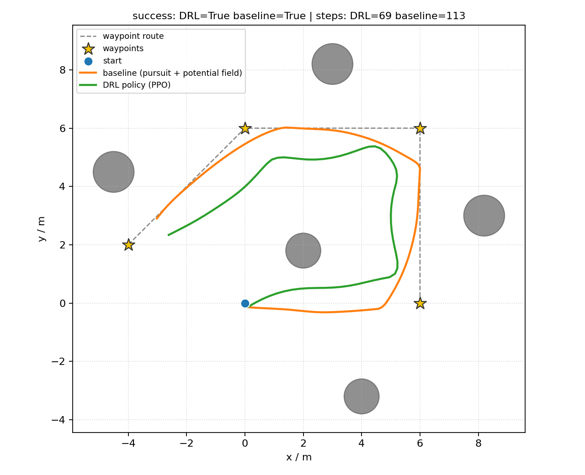
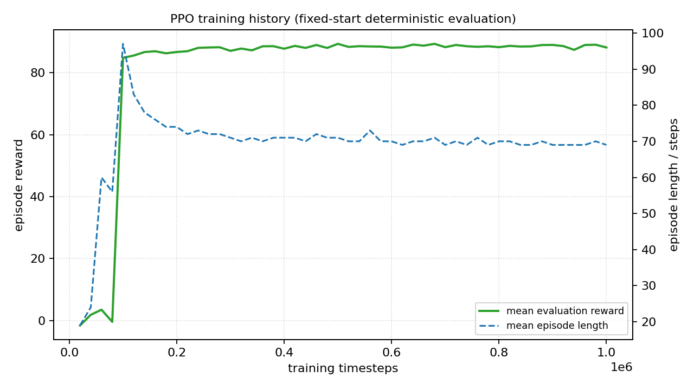

# 基于深度强化学习的四旋翼无人机最优路径查找（drl_drone_path_planning）

> **开发者**：汤湘粤 (学号: 2535030067)
> **运行环境**：ROS 1 Noetic / Ubuntu 20.04（部署）；Python 3.9+（训练）
> **上游参考**：[`zhaoran2000/DRL-drones`](https://github.com/zhaoran2000/DRL-drones)（`linux` 分支）

本模块把参考仓库中的 PyBullet 强化学习环境重构为**可在 ROS 中一键启动**的无人机
最优路径查找功能包：订阅里程计与激光雷达，用 PPO/SAC 策略输出机体系速度指令，
依次飞过 4 个航点并避开 5 个圆柱障碍。模块同时提供**纯几何基线**作为可复现对照，
并把训练好的 Actor 导出为 NumPy 权重，**部署端不需要 PyTorch**。

## 1. 作业目标

1. 阅读参考仓库 `AirSimSol/` 与 `Sol/` 中的强化学习环境、网络定义与 SAC/PPO 算法；
2. 把「仿真环境 + 训练脚本」重构为符合本仓库规范的 ROS 功能包；
3. 提供观测、动作、奖励、超参数的集中配置，以及一键启动的 launch；
4. 用真实训练与评估数据说明算法有效，并与无学习基线对比。

## 2. 参考仓库分析

### 2.1 `AirSimSol/dqn_drone.py`

该文件用 AirSim 的 `airgym:airsim-drone-sample-v0` 环境 + SB3 `DQN` + `CnnPolicy`，
输入 84×84 单通道图像，输出离散动作。它代表「视觉端到端」路线，但需要 AirSim
运行、训练成本高，且与本仓库现有的 AirSim 桥接模块耦合较深。本模块保留这条路线
作为说明，不作为主实现。

### 2.2 `Sol/` 目录

| 文件 | 关键内容 |
|---|---|
| `Environments/PBDroneEnv.py` | PyBullet 四旋翼环境：12 维运动学观测（位置、姿态、线速度、角速度），4 维 RPM 动作，多航点奖励 |
| `Environments/HerPBDroneEnv.py` | 带 HER（Hindsight Experience Replay）的变体 |
| `PBDroneSimulator.py` | 训练编排：`SubprocVecEnv`、PPO/SAC/DDPG、`EvalCallback`、检查点 |
| `Policies/PPO__Custom_Policy.py` | 自定义 SB3 ActorCriticPolicy（64×64 特征提取） |
| `Policies/SoftActorCritic.py` | SAC 的 TF-Agents 版本 |
| `parameters.py` / `parameters.yml` | PPO/SAC 默认超参数 |

参考实现的奖励结构是本次重构的重点：

```text
r = 3·exp(-2d)/25 + 3000·Δd/25 + 3·orientation/25 + smoothness/25
中间航点 +75/25，最终航点 +1000/25，碰撞 -10
```

其中 `orientation` 在机头与目标夹角超过 10° 时记 -1，`smoothness` 惩罚线/角加速度。
这些项在 `scripts/drone_env.py` 中逐项保留，系数移入 YAML（见 §4.3）。

## 3. 模块设计

```text
/uav/odom ─┐
           ├─► drl_drone_path_planning ──/uav/cmd_vel──► 飞控 / 桥接 ──► 无人机
/uav/scan ─┘   ├─ 28 维观测拼装
               ├─ PPO/SAC Actor（NumPy 推理）
               └─ 安全层（激光超时零速 + 近距刹停）
                     │
                     ├─ ~path（已飞轨迹）
                     ├─ ~path_waypoints（航点）
                     └─ ~status（模式/航点/距离）
```

训练与部署共用 `scripts/common.py` 中的观测拼装和动作缩放函数，避免出现
「训练时一套、部署时另一套」的经典错误。

### 3.1 观测（28 维）

| 下标 | 维度 | 含义 | 归一化 |
|---|---|---|---|
| 0–2 | 3 | 当前航点相对位置（机体系：前 / 左 / 上） | 除以 10 m |
| 3–5 | 3 | roll / pitch / yaw | 除以 π |
| 6–8 | 3 | 机体线速度 | xy 除以 2 m/s，z 除以 1 m/s |
| 9–11 | 3 | 机体角速度 | 除以 π |
| 12–27 | 16 | 激光 16 扇区畅通度 | 最近距离 / 12 m，1 = 畅通 |

激光扇区 0 指向机头正前方，逆时针递增；每个扇区取最近障碍距离。仿真中由
解析射线与圆柱求交生成，ROS 中由 `sensor_msgs/LaserScan` 的 `angle_min` /
`angle_increment` 映射得到，两种来源的语义完全一致。

### 3.2 动作（4 维）

```text
[vx, vy, vz, yaw_rate] = a ⊙ [2.0, 2.0, 1.0, 0.8]
```

输出为机体系 `geometry_msgs/Twist`。与参考实现的 4 维 RPM 动作相比，速度指令
更贴近 ROS 控制接口，也便于在 CarlaAir/AirSim 桥接上复用；代价是仿真侧改用
一阶速度响应而不是转子动力学（见 §7）。

**高度保持辅助**：目标高度与当前高度之差 ≤ `altitude_hold_band = 0.3 m` 时，
`vz` 衰减为 `altitude_damping = 0.1` 倍。多旋翼巡航段通常由高度环定高；该层
避免策略在目标高度附近学成「俯冲撞地」，训练环境与 ROS 节点共用
`common.apply_altitude_hold()`。

### 3.3 奖励

| 奖励项 | 参考实现 | 本模块 | 作用 |
|---|---|---|---|
| 距离塑形 | `3·exp(-2d)/25` | `0.12·exp(-2d)` | 稠密梯度 |
| 进度 | `120·Δd` | `5.0·Δd` | 靠近当前航点 |
| 朝向 | `-1×3/25`（>10°） | `-0.05` | 机头指向目标 |
| 平滑 | 加速度惩罚 /25 | `0.05` | 抑制抖动 |
| 高度 | 无（PyBullet 有重力） | `0.15·|z-z_goal|` | 抑制无意义俯冲/爬升 |
| 中间航点 | 3 | 5.0 | 分段引导 |
| 最终航点 | 40 | 60.0 | 完成任务 |
| 碰撞 | -10 | -10 | 终止 |
| 时间 | 无 | -0.01/步 | 最短路径 |

### 3.4 网络与算法

- **PPO**：Actor / Critic 均为 256×256 + Tanh，`n_steps=2048`、`batch=256`、
  `n_epochs=10`、`clip_range=0.2`、`gamma=0.99`、`gae_lambda=0.95`、`ent_coef=0.01`；
- **SAC**：Actor / Critic 256×256 + ReLU，`buffer=200000`、`batch=256`、
  `tau=0.005`、自动熵系数、`train_freq=1`、`gradient_steps=1`。

两者都通过 Stable-Baselines3 训练，与参考 `PBDroneSimulator.setup_agent()` 的选择一致。

### 3.5 从 SB3 到 NumPy：部署链路

```python
# 训练端（train.py）
export_sb3_policy(model, "models/policy_weights.npz")   # 逐层导出 Linear 权重

# 部署端（policy.py，仅 NumPy）
hidden = tanh(W0 @ obs + b0)
hidden = tanh(W1 @ hidden + b1)
raw = W2 @ hidden + b2
action = clip(raw, -1, 1)      # PPO
# action = tanh(raw)           # SAC
```

`policy_weights.npz` 同时记录 `obs_dim`、`action_dim`、`algo`、`n_layers` 和
`squash`（PPO=False，SAC=True）。已用 500 组随机观测验证 NumPy 推理与 SB3
`model.predict` 的最大动作偏差 < 1e-6；若不区分 squash，PPO 的动作会被
tanh 压缩，最大偏差可达 0.24。
节点启动时会校验观测维度；`mode:=drl` 下维度不匹配或权重缺失会**直接报错**，
不会静默使用随机策略。

### 3.6 安全停机

节点在进入策略推理前检查激光数据是否可用：

- 尚未收到 `LaserScan`，或最近一帧的时间戳超过 `safety.scan_timeout`（默认
  1.0 s）时，直接发布线速度与角速度全 0 的 `geometry_msgs/Twist`，并输出告警；
- 停机状态不会使用全 1 直方图或上一帧旧数据继续推理；
- 收到新的实时 `LaserScan` 后自动恢复控制，并记录一次恢复日志。

停机期间控制循环仍以 `control_rate` 持续发布零速，避免飞控因指令中断而保持
上一个非零速度。该逻辑由 `tests/test_safety.py` 中的节点级测试覆盖。

## 4. 构建与运行

### 4.1 编译

本功能包固定使用 ROS 1 Noetic 的 catkin / rospy / roslaunch 工具链。仓库中另有
ROS 2 示例，但本包不依赖 ROS 2，也不使用 colcon 或 ament。

```bash
sudo apt install python3-numpy python3-yaml python3-nose
cd ~/catkin_ws/src
ln -s /path/to/ros2/src/air/drl_drone_path_planning .
cd ~/catkin_ws
catkin_make
source devel/setup.bash
```

### 4.2 启动

```bash
# 自动模式：有训练权重用 DRL，否则退回几何基线
roslaunch drl_drone_path_planning main.launch

# 只看几何基线（用于验证 ROS 接口）
roslaunch drl_drone_path_planning main.launch mode:=baseline

# 单目标点 + RViz
roslaunch drl_drone_path_planning main.launch \
  use_goal_override:=true goal_x:=4.0 goal_y:=3.0 goal_z:=2.0 rviz:=true
```

节点默认使用 `/uav/odom`、`/uav/scan`、`/uav/cmd_vel`；若使用其它桥接，
通过 launch 参数 `odom_topic:=... scan_topic:=... cmd_topic:=...` 覆盖。

### 4.3 训练与评估

```bash
cd src/air/drl_drone_path_planning
pip install -r requirements.txt
python3 scripts/train.py --algo PPO --timesteps 400000 --out models
python3 scripts/evaluate.py --model models/policy_weights.npz --episodes 100 --baseline
```

`train.py` 结束时会写出 `models/model.zip`（SB3 原始模型）、
`models/policy_weights.npz`（部署权重）和 `models/train_summary.json`（指标与耗时）。

## 5. 实验结果

下图是同一随机种子下，DRL 策略与几何基线的俯视轨迹对比（离线环境，10 Hz）：



| 指标 | PPO 策略 | 几何基线 |
|---|---|---|
| 成功率 | **100%** | 100% |
| 碰撞率 | 0% | 0% |
| 超时率 | 0% | 0% |
| 平均回报 | **88.47** | 87.01 |
| 平均步数 | **70.6** | 113.6 |
| 平均路径长度 | **18.33 m** | 20.21 m |
| 平均到达航点 | 4.0 | 4.0 |

训练曲线（固定起点、确定性评估，每 2 万步评估 20 回合）：



约 10 万步时策略发生明显跃迁：平均回报从 0 附近升到 85 以上，回合长度从
约 95 步降到 70 步左右，随后稳定到 100 万步。PPO 用 100 万步、CPU 约 678 s
训练完成；与几何基线相比，策略用更少的步数和更短的路径完成同一任务。

> 需要说明的是：本场景几何相对简单，纯几何基线也能 100% 成功，因此学习策略的
> 收益主要体现在**更短的轨迹**（18.33 m vs 20.21 m）和**更少的控制步数**
> （70.6 vs 113.6），而不是「基线完全做不到」。这是按实际数据给出的结论。

> 评估协议：固定种子 0..99，确定性策略，100 个回合；`success` 要求到达全部
> 4 个航点且未碰撞，`collision` 包含越界。可用
> `scripts/evaluate.py --episodes 100 --baseline` 复现。

## 6. 复现步骤

```bash
cd src/air/drl_drone_path_planning

# 1) 单元测试（只需 numpy / gymnasium，不需要 ROS；共 16 项）
python3 -m unittest discover -s tests -v

# 2) 重新训练（需要 stable-baselines3 / torch）
python3 scripts/train.py --algo PPO --timesteps 400000 --out models --seed 0

# 3) 离线评估（需要 numpy / gymnasium）
python3 scripts/evaluate.py --model models/policy_weights.npz \
  --episodes 100 --baseline --json drl_eval.json

# 4) 生成轨迹对比图（需要 matplotlib）
python3 scripts/plot_results.py --model models/policy_weights.npz \
  --out ../../../docs/img/drl_drone_path_planning/path_comparison.png
```

## 7. 已知限制

1. **运动学近似**：一阶速度响应不包含电机推力、姿态环和气动阻力；本模块验证的是
   策略与 ROS 接口，不能替代 PX4 SITL / AirSim 的物理仿真。
2. **障碍模型简单**：只处理水平面内的圆柱，未建模斜面、楼梯、动态障碍；
   激光需由仿真器或真实雷达提供。
3. **航点预先给定**：策略负责航点间局部避障，不做全局 SLAM / 建图。
4. **仿真到实机有差距**：部署前应重新标定 `lidar_range`、速度上限、
   `safety.stop_distance` 和 `safety.scan_timeout`，并保留与学习策略无关的安全层。
5. **未在本机运行 ROS launch**：本机为 Windows，仓库的 ROS 环境在 Ubuntu 虚拟机中；
   离线环境、单元测试和权重导出均已实际运行，`catkin_make` 与 `roslaunch`
   需要在虚拟机内按 §4.1–4.2 执行。
