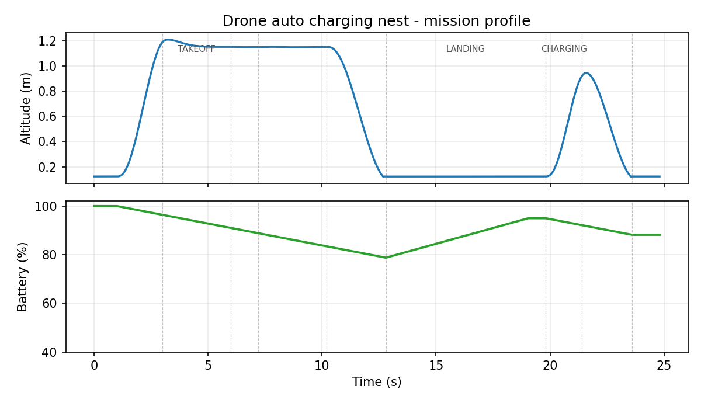
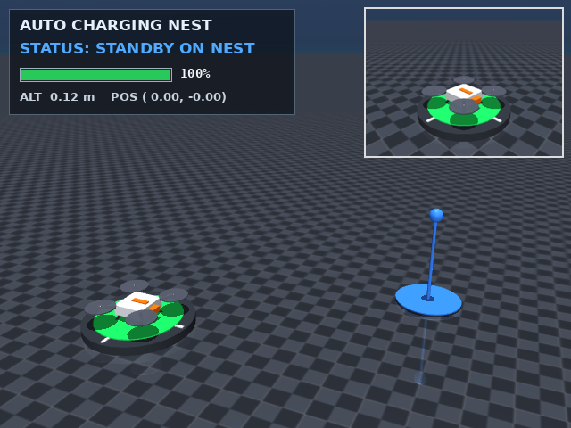
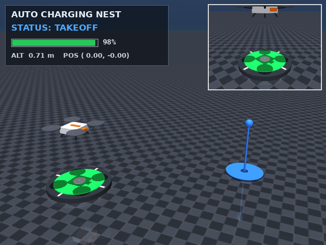
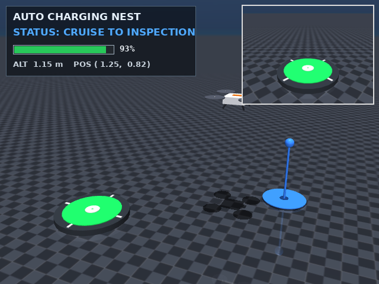
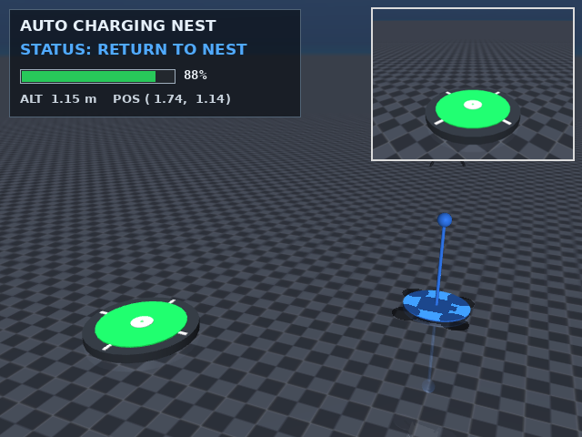
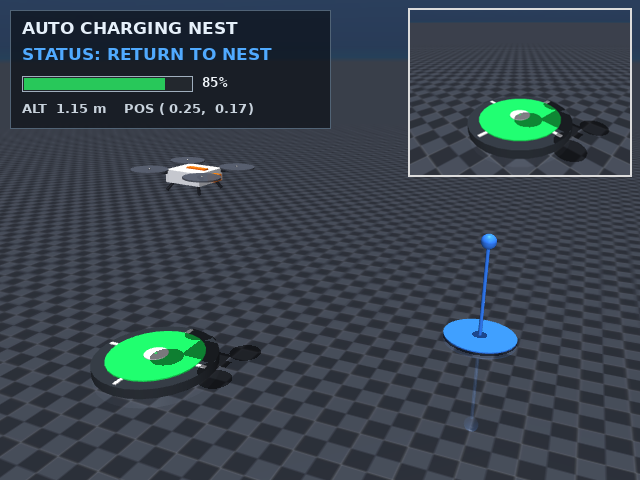
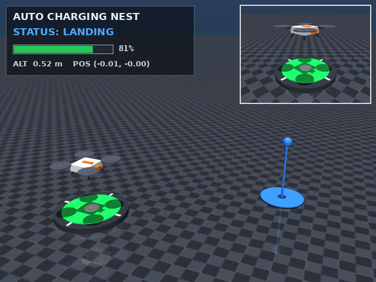
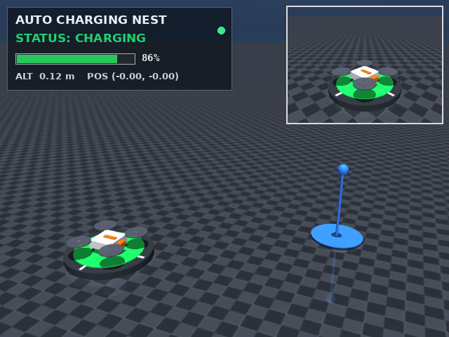
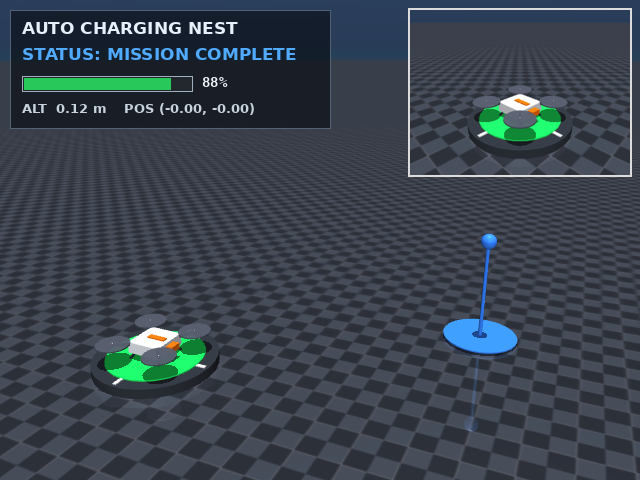
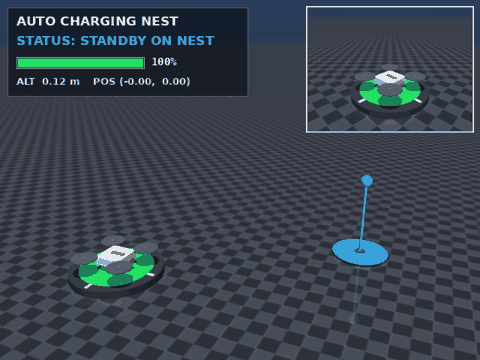

# MuJoCo 无人机自主充电/机巢仿真

> 本页对应源码模块：`src/air/drone_charging_nest/`

## 1. 简介

无人机自主充电/机巢（drone-in-a-box）是无人值守巡检的关键能力：无人机完成任务后
自动返航、精准降落、充电补能，然后再次起飞执行任务。本模块在 MuJoCo 中实现了一个
完整的演示流程：

- 自建四旋翼模型从**充电机巢**起飞；
- 飞往**巡检点**并悬停；
- 返航并降落到机巢；
- 机巢**自动充电**至 95%；
- 再次起飞、降落，任务结束。

演示包含主视图、机巢相机画中画、实时 HUD（状态/电量/高度/位置）、电量-高度任务曲线，
并生成截图、GIF 与 MP4。

## 2. 运行环境

| 项目 | 配置 |
|---|---|
| 操作系统 | Ubuntu 20.04.6（VMware 虚拟机，4 vCPU / 4 GB RAM） |
| Python | 3.8.10（venv） |
| ROS 2 封装 | ament_python（`package.xml` / `setup.py` / `launch` / `test`） |
| 仿真器 | MuJoCo 2.3.7（CPU，无 GPU） |
| 渲染 | MuJoCo GLFW + Mesa 软件渲染 |
| 依赖 | Pillow 10.4、Matplotlib |

## 3. 安装与运行

```bash
cd src/air/drone_charging_nest
python3 -m venv .venv && source .venv/bin/activate
pip install -r requirements.txt

# 仅仿真（源码方式）
python3 -m drone_charging_nest.app

# 录制并生成截图/GIF/曲线
bash scripts/record_demo.sh /tmp/dc_frames
```

ROS 2 工作区（仓库对应 ROS 2 环境）：

```bash
colcon build --symlink-install --packages-select drone_charging_nest
source install/setup.bash
ros2 launch drone_charging_nest main.launch.py
```

> `ros2 launch` 使用 ROS 2 环境的 `python3` 执行安装入口，该解释器也需要能
> `import mujoco / PIL`：请给同一解释器安装依赖（如
> `python3 -m pip install --user -r requirements.txt`），或把 ROS 2 环境建在同一 venv 中。

> 本作品的 Python 入口在 VM（Ubuntu 20.04 + ROS Noetic）中实测；ROS 2 ament_python
> 封装按仓库要求补齐（已处理 `--ros-args` 参数兼容），`colcon build` / `ros2 launch`
> 需在 ROS 2 工作区环境执行。

> 渲染需要图形会话：`DISPLAY=:0`、`XAUTHORITY`（按当前 UID 自动查找）、`MUJOCO_GL=glfw`。

## 4. 任务流程

| 阶段 | 时长 | 目标位置 | 说明 |
|---|---|---|---|
| STANDBY | 1.0 s | (0, 0, 0.14) | 停在机巢上，电量 100% |
| TAKEOFF | 2.0 s | (0, 0, 1.15) | 垂直起飞 |
| CRUISE | 3.0 s | (1.75, 1.15, 1.15) | 飞往巡检点 |
| INSPECT | 1.2 s | 同上 | 悬停巡检 |
| RETURN | 3.0 s | (0, 0, 1.15) | 返航 |
| LANDING | 2.6 s | (0, 0, 0.14) | 降落机巢 |
| CHARGING | 7.0 s | 机巢 | 电量 78.8% → 95% |
| TAKEOFF2 | 1.6 s | (0, 0, 0.9) | 充满后再次起飞 |
| LAND2 | 2.2 s | 机巢 | 再次降落 |
| DONE | 1.2 s | 机巢 | 任务完成 |



*图 0：任务高度与电量曲线（虚线为阶段边界）*

## 5. 运行效果



*图 1：无人机停在机巢上待命，右上角为机巢相机画中画*



*图 2：垂直起飞*



*图 3：飞往巡检点，HUD 显示巡航状态与电量*



*图 4：在巡检点悬停*



*图 5：返航*



*图 6：降落机巢，HUD 显示 LANDING*



*图 7：自动充电，HUD 显示 CHARGING 与电量回升*



*图 8：任务完成*



*图 9：完整任务 GIF（约 2.2 MB）*

## 6. 实现说明

1. **四旋翼模型**：自建 MuJoCo 刚体（机身/机臂/4 旋翼/起落架），free joint；
   四个旋翼位置的推力通过 `data.xfrc_applied` 合成总力/力矩施加，避免依赖外部
   螺旋桨动力学插件。
2. **级联控制**：位置 PID 生成期望推力向量；由推力向量反解期望姿态；姿态误差
   PD 生成期望力矩；再分配到 4 个旋翼（含偏航阻尼），推力限幅、线性/角阻尼。
3. **机巢与充电**：静态机巢 + 绿色环形指示灯 + 十字对准标记；电量/充电为状态机
   模型：飞行耗电 1.8 %/s，降落充电 2.6 %/s，充电到 95% 后再次起飞。
4. **显示与录制**：主视图 + 机巢相机画中画，Pillow 叠加 HUD（状态/电量/高度/位置），
   录制帧序列后生成截图、GIF、MP4 与任务曲线。

## 7. 实测数据

| 指标 | 数值 |
|---|---|
| 任务时长 | 24.8 s |
| 巡航高度 | 1.15 m；INSPECT/RETURN 实测 1.1485~1.1522 m（跨度 0.0037 m） |
| 巡检点悬停位置 | 均值 (1.807, 1.187) m（相对目标 (1.75,1.15) 偏差约 (0.057,0.037) m），std (0.037,0.024) m |
| 降落位置误差 | < 0.002 m |
| 电量变化 | 100% → 78.8%（降落）→ 95%（充电）→ 88.2%（结束） |
| 渲染 | 20 fps，496 帧，640×480 + 机巢画中画 |
| GIF / MP4 | 2.2 MB / 0.35 MB |

## 8. 参考

- DronePort: Smart Drone Battery Management System：<http://zenodo.org/records/7572208/files/droneport-icr2021.pdf?download=1>
- Automatic Landing and Battery Charging of a Multicopter Using an Intelligent Solution：
  <https://ieeexplore.ieee.org/abstract/document/11659402/authors#authors>
- Wireless charging and automation of drones (Chalmers thesis)：
  <https://odr.chalmers.se/bitstreams/4c2f38f8-bbb5-43ea-9c16-6ba0fa4cee77/download>

以上资料用于了解无人机自动降落、机巢充电与电池管理的一般方案；本模块为独立编写的
简化 MuJoCo 仿真，不复用这些工作的代码。

## 9. 已知限制

- 四旋翼为简化动力学模型（无螺旋桨气动、无真实电调/电池模型）；
- 机巢充电为状态机模拟，不包含真实触点对齐、接触电阻与充电电路；
- ROS 2 节点以 ament_python 封装并支持 launch 启动，当前节点未接入 ROS 话题通信（纯 MuJoCo 演示进程）；
- 场景、巡检目标与机巢布局为演示自定义。

## 大模型使用声明

本页文档、代码与实验由 AI 助手辅助完成；所有命令、截图、GIF、曲线与数据均在
Ubuntu 20.04 + MuJoCo 2.3.7（CPU）环境中实际运行生成，作者已核对并对内容负责。
