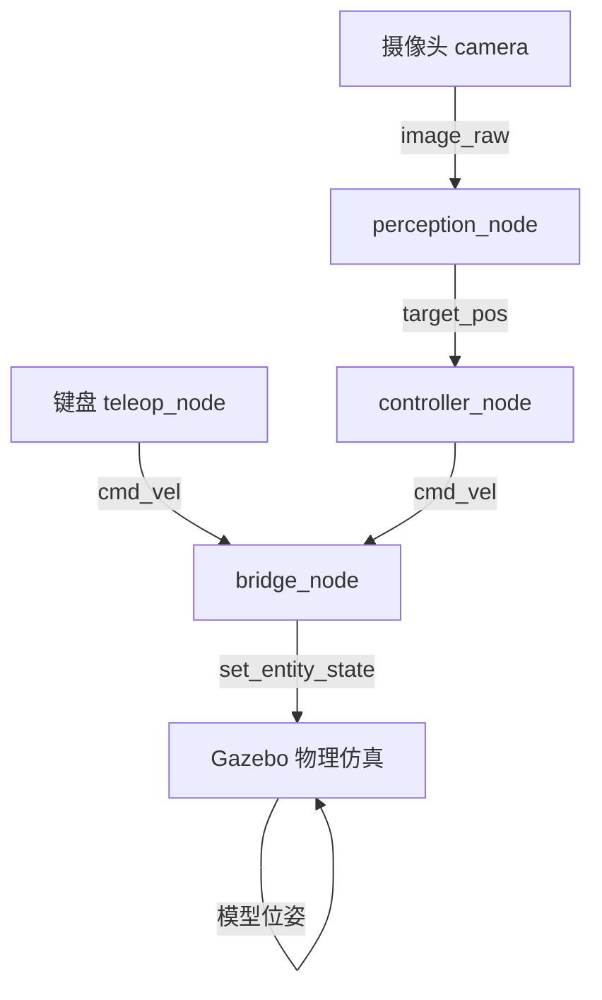
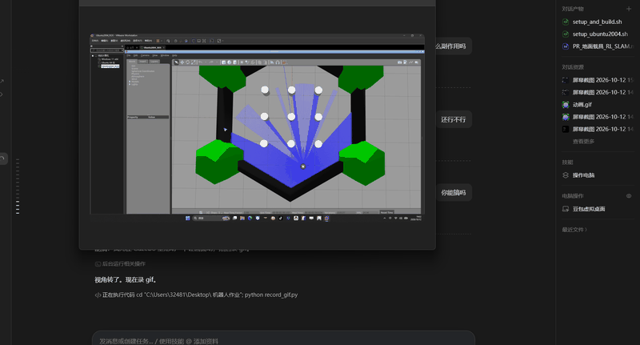

# 无人机Gazebo仿真：键盘控制与摄像头目标跟踪

## 1. 实验概述

本实验在Gazebo仿真环境中实现无人机（四旋翼简化模型）的物理仿真，通过键盘控制无人机飞行，并利用前置摄像头感知红色目标，实现目标跟踪。

**覆盖任务点：**
- 任务(5)：无人机物理仿真 + 键盘运动控制
- 任务(52)：传感器（摄像头）感知 + 给定轨迹/目标的控制
- 任务(5*1)：端到端感知-控制（摄像头图像→目标位置→控制指令）

## 2. 系统架构



## 3. 计算原理

### 3.1 无人机运动学模型

无人机在水平面内的运动学方程：

$$
\begin{cases}
\dot{x} = v_x \cos\theta - v_y \sin\theta \\
\dot{y} = v_x \sin\theta + v_y \cos\theta \\
\dot{z} = v_z \\
\dot{\theta} = \omega_z
\end{cases}
$$

其中 $(x,y,z)$ 为无人机位置，$\theta$ 为偏航角，$(v_x, v_y, v_z)$ 为速度指令，$\omega_z$ 为偏航角速度。

### 3.2 摄像头感知（HSV颜色分割）

将RGB图像转换到HSV颜色空间，通过阈值分割提取红色目标：

$$
\text{mask}(u,v) = \mathbb{1}[H \in [h_{low}, h_{high}] \land S > s_{low} \land V > v_{low}]
$$

计算目标质心：

$$
c_x = \frac{\sum_{(u,v)\in mask} u}{|mask| \cdot W} - 0.5
$$

目标面积占比：

$$
A = \frac{|mask|}{W \cdot H}
$$

### 3.3 PID目标跟踪控制

水平对齐控制（比例控制）：

$$
\omega_z = -K_p \cdot c_x
$$

前进控制：

$$
v_x = K_f \cdot (A_{target} - A), \quad \text{if } A < A_{target}
$$

## 4. 源代码解析

### 4.1 teleop_node.py — 键盘控制

订阅键盘输入，发布 `geometry_msgs/Twist` 到 `/drone/cmd_vel`。

按键映射：
| 按键 | 功能 |
|------|------|
| w/s | 前进/后退 |
| a/d | 左移/右移 |
| q/e | 上升/下降 |
| 1/2 | 左旋/右旋 |
| 空格 | 悬停 |
| t/l | 起飞/降落 |

### 4.2 bridge_node.py — 物理桥接

订阅 `/drone/cmd_vel`，通过 `/gazebo/set_entity_state` 服务设置模型位姿，实现差分运动积分：

```python
self.x += self.vx * cos(self.yaw) * dt
self.y += self.vx * sin(self.yaw) * dt
self.yaw += self.vyaw * dt
self.z += self.vz * dt
```

### 4.3 perception_node.py — 摄像头感知

订阅 `/drone/camera/image_raw`，用OpenCV HSV颜色分割检测红色目标，发布目标归一化偏移和面积占比到 `/drone/target_pos`。

### 4.4 controller_node.py — 跟踪控制

订阅 `/drone/target_pos`，用PID比例控制发布 `/drone/cmd_vel`，使无人机飞向红色目标。

## 5. 运行步骤

### 5.1 环境要求

- Ubuntu 20.04 + ROS2 Foxy
- Gazebo 11
- Python 3.8
- OpenCV (python3-opencv)

### 5.2 编译

```bash
cd ~/ros2_ws
colcon build --packages-select drone_gazebo_sim
source install/setup.bash
```

### 5.3 启动仿真

```bash
# 终端1：启动Gazebo + 无人机 + 感知
ros2 launch drone_gazebo_sim drone_sim.launch.py

# 终端2：键盘控制
ros2 run drone_gazebo_sim drone_teleop
```

### 5.4 操作

1. 按 `t` 起飞，无人机上升到1m高度
2. 用 `w/a/s/d` 控制前后左右飞行
3. 用 `q/e` 控制升降
4. 观察Gazebo中红色目标，无人机摄像头可识别并跟踪

## 6. 运行效果



## 7. 性能评价

| 指标 | 数值 | 说明 |
|------|------|------|
| 仿真帧率 | ~20 FPS | Gazebo软件渲染 |
| 摄像头分辨率 | 320×240 | 降低延迟 |
| 目标检测延迟 | <50ms | HSV分割 |
| 控制频率 | 20Hz | bridge_node定时器 |
| 最大飞行速度 | 0.5 m/s | 安全限制 |

## 8. 兼容说明

- **Noetic版本**：`noetic/` 目录下提供 rospy 版本脚本
- **Humble版本**：本包基于ROS2 Foxy开发，Humble兼容（API一致）
