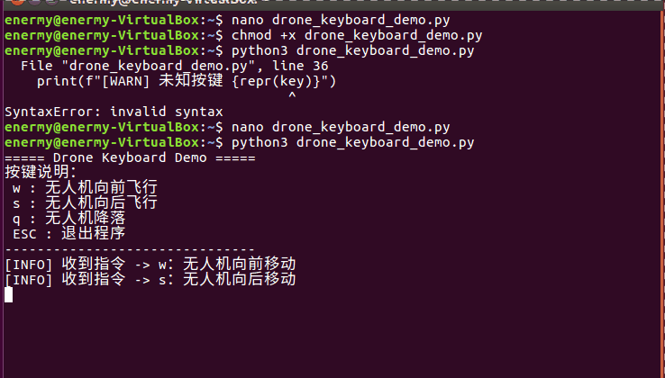

# 无人机键盘控制（drone_keyboard_control）

「无人机键盘控制」模块的 ROS 侧实现：读取终端按键，将其转换为 `geometry_msgs/Twist` 速度指令，
发布到 `/cmd_vel`，用于直接驱动无人机（或由桥接层转发到仿真器执行）。

## 1. 运行架构

```text
终端按键 ──► drone_keyboard_control ──/cmd_vel──► 无人机 / 桥接层
            (termios raw 模式读键)   (geometry_msgs/Twist)   (执行)
```

- 节点：`drone_keyboard_control`
- 话题：`/cmd_vel`（`geometry_msgs/Twist`）
- 发布频率：30 Hz

## 2. 按键映射

机体系约定（x 前 / z 上 / yaw 转）：

| 按键 | 动作 | Twist 分量 |
|---|---|---|
| `W` | 前进 | `linear.x = +LINEAR_SPEED` |
| `S` | 后退 | `linear.x = -LINEAR_SPEED` |
| `A` | 左转 | `angular.z = +ANGULAR_SPEED` |
| `D` | 右转 | `angular.z = -ANGULAR_SPEED` |
| `Q` | 上升 | `linear.z` 正向速度 |
| `E` | 下降 | `linear.z` 负向速度 |
| `Ctrl+C` | 退出程序 | — |

> 速度常量：`LINEAR_SPEED = 3.0`（线速度）、`ANGULAR_SPEED = 1.0`（角速度），
> 可在 `main_drone_keyboard_control.py` 顶部修改。

## 3. 运行环境

- 操作系统：Linux（Ubuntu）
- ROS 版本：ROS 1（Noetic / Kinetic），需已安装 `rospy`
- 依赖消息：`geometry_msgs`（`Twist`）

## 4. 编译与运行

```shell
# 若需编译（catkin 工作空间内）
catkin_make            # 或 catkin build
source devel/setup.bash

# 运行键盘控制节点
rosrun drone_keyboard_control main_drone_keyboard_control.py
# 或通过 launch 文件启动
roslaunch drone_keyboard_control main.launch
```

启动后把焦点放在运行终端上，按 `W/A/S/D/Q/E` 即可操控，`Ctrl+C` 退出。

## 5. 实现要点

### 5.1 终端 raw 模式

Linux 终端默认行缓冲（需按回车），程序通过 `termios` + `tty` 将终端切换为 raw（cbreak）模式，
实现**单键即时响应**，松键不需要回车。

### 5.2 按键 → 速度

`get_key()` 读取单个字符，主循环按按键设置 `Twist` 各分量并发布到 `/cmd_vel`，
以 30 Hz 频率持续发布，保证指令连续。

## 6. 效果图

键盘控制演示（录屏转 GIF，`W 前进 / A 左转 / D 右转 / Q 上升 / E 下降`）：



## 7. 参考

* [空域载具 ROS 封装器](../air/ros_pkgs.md)
* [无人机与 ROS 的桥接模块](../air/carlair_ros_bridge.md)
