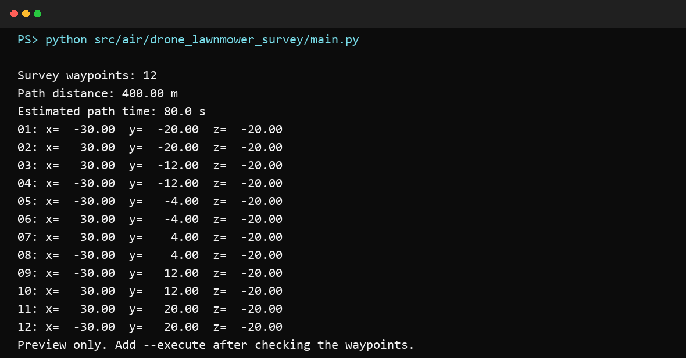

# AirSim 无人机弓字形区域勘测

`drone_lawnmower_survey` 根据方形或矩形区域尺寸生成往返覆盖航线，使 AirSim
多旋翼在固定高度完成自动勘测。源代码位于
`src/air/drone_lawnmower_survey/`。

实现思路参考 Microsoft AirSim Wiki 的
[Implementing a Drone Survey script](https://github.com/microsoft/AirSim/wiki/Implementing-a-Drone-Survey-script)。
与原教程片段相比，本模块增加了参数边界校验、安全预览、相对起飞点定位、自动降落和
不依赖 AirSim 的航线单元测试。

## 航线生成

输入参数包括区域长度、区域宽度、航线间距、飞行高度和速度。生成器把勘测区域放在
起飞点周围，并沿 NED x 轴交替飞行；每完成一条航线，就沿 y 轴移动到下一条航线。
当区域宽度不能被指定间距整除时，程序会减小实际间距，以确保两侧边界都在覆盖范围内。

AirSim 使用 NED 坐标系，z 轴向下为正，因此用户输入的正高度会转换成负 z 坐标。

## 安全预览

默认命令只输出航点、路径长度和预计飞行时间，不连接 AirSim：

```bash
python src/air/drone_lawnmower_survey/main.py \
  --length 60 --width 40 --lane-spacing 8 --altitude 20 --speed 5
```

默认安全预览运行效果：



本次验证的命令、环境和关键输出见源码目录中的
[`validation/preview_validation.log`](../../src/air/drone_lawnmower_survey/validation/preview_validation.log)。

所有尺寸、高度和速度必须是有限正数。`nan`、`inf`、零和负数会在连接仿真器前被拒绝。

## 执行勘测

安装 AirSim Python API 并启动多旋翼场景：

```bash
pip install airsim
python src/air/drone_lawnmower_survey/main.py --execute \
  --length 60 --width 40 --lane-spacing 8 --altitude 20 --speed 5
```

脚本依次启用 API 控制、解锁、起飞、爬升、执行路径、悬停和降落。无论正常结束还是
任务抛出异常，都会尝试降落、锁定电机并释放 API 控制权。

> 当前模块不包含障碍物感知与避障。首次执行应选择空旷场景，先检查预览航点是否落在
> 安全区域，再添加 `--execute`。

## ROS 2 启动入口

本模块提供标准 `ament_python` 包和 `survey.launch.py`。在 ROS 2 Humble 环境中从仓库
根目录构建该包：

```bash
source /opt/ros/humble/setup.bash
cd ~/ros2
colcon build --packages-select drone_lawnmower_survey --symlink-install
source install/setup.bash
```

默认 launch 只执行安全预览，不连接 AirSim：

```bash
ros2 launch drone_lawnmower_survey survey.launch.py \
  length:=60 width:=40 lane_spacing:=8 altitude:=20 speed:=5
```

确认终端输出的航点后，启动 AirSim 场景并显式执行任务：

```bash
ros2 launch drone_lawnmower_survey survey.launch.py \
  execute:=true ip:=127.0.0.1 port:=41451 vehicle:=Drone1
```

`execute` 默认是 `false`。launch 参数会映射到与 Python 入口相同的命令行参数，
因此上述预览和实际执行步骤可以复现；真实飞行仍需安装 `airsim==1.8.1`，并先检查
场景、载具名和航点范围。

## 测试

```bash
python -m unittest discover -s src/air/drone_lawnmower_survey/tests -v
```

测试验证矩形边界覆盖、航向交替、实际间距上限、坐标平移、路径长度和非法参数拒绝，
无需启动 AirSim。

没有 ROS 2 的环境可以运行 Python 单元测试和 launch 文件编译检查；`colcon build`
与 `ros2 launch` 需要 Ubuntu 22.04 / ROS 2 Humble。默认预览效果见上方航点输出和
预览图，未将未验证的真实 AirSim 飞行描述为已完成。
