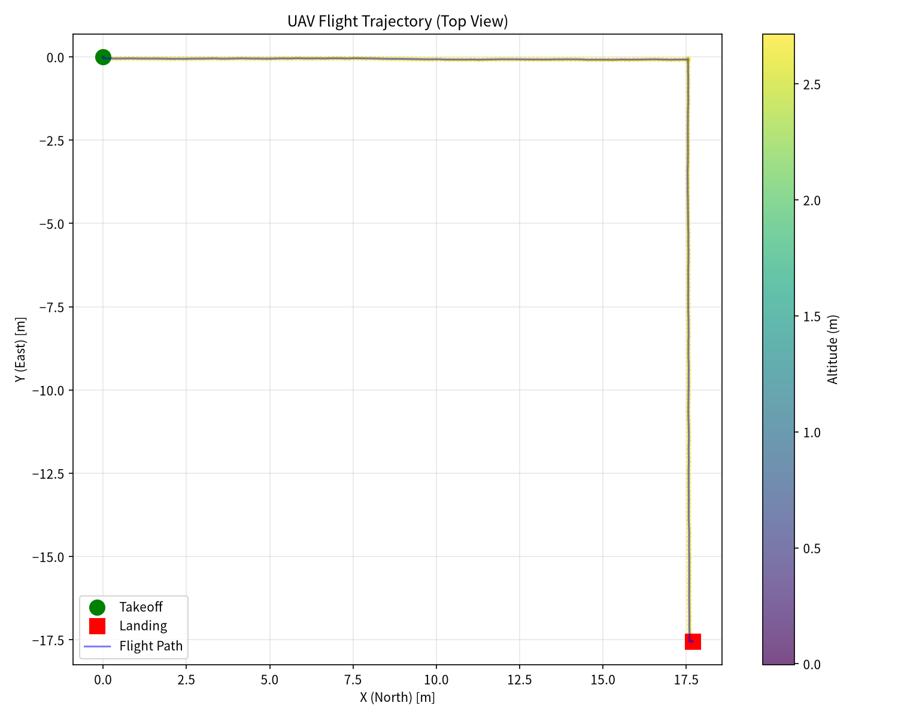
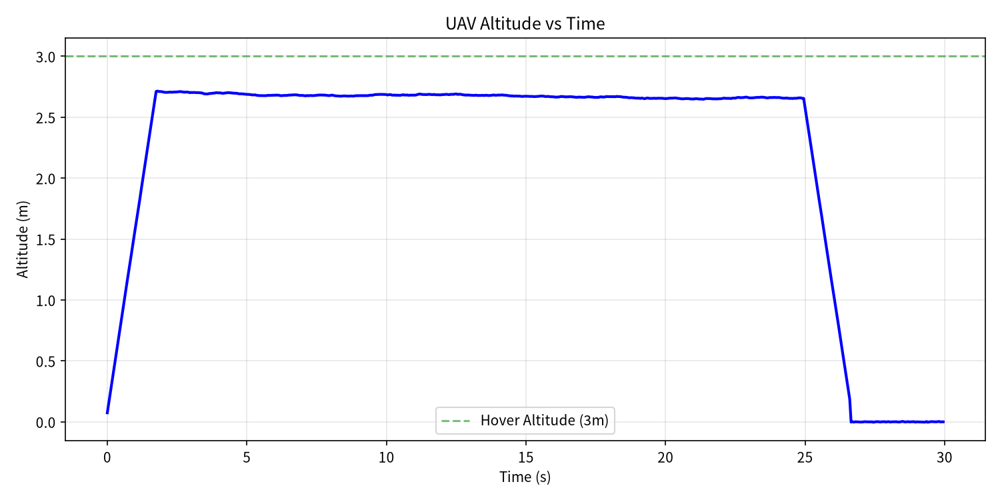
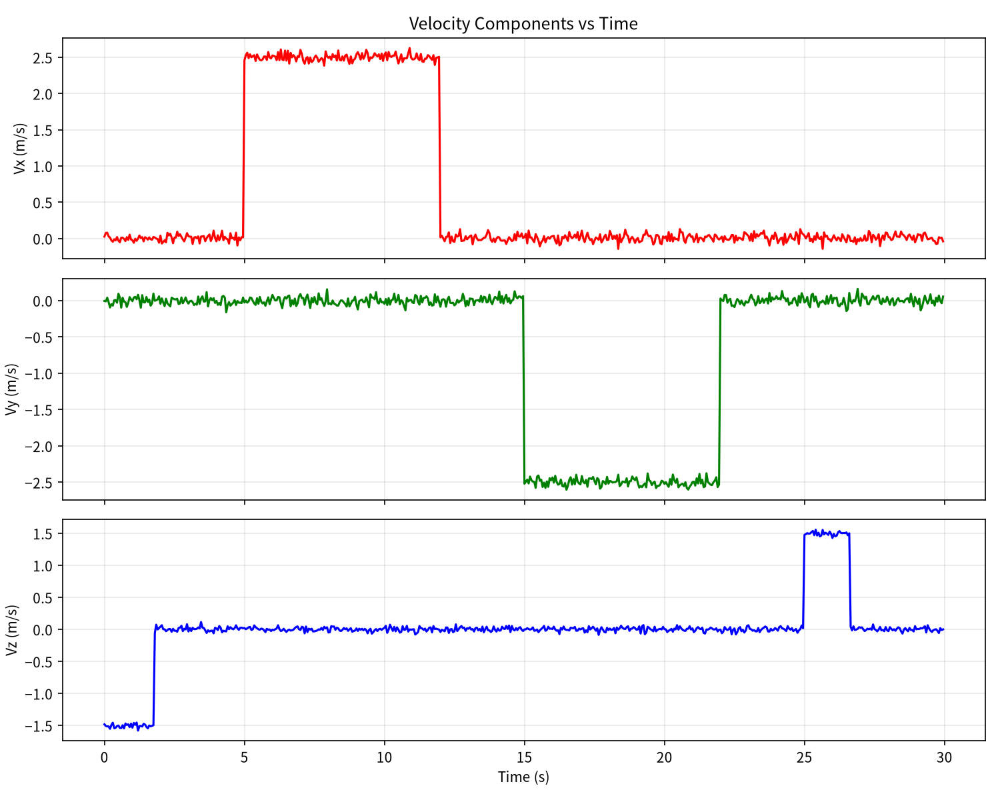
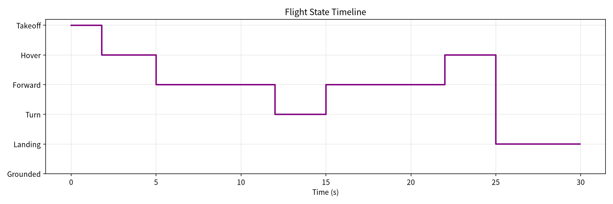

# 无人机遥操作与轨迹记录模拟

本模块实现了一套无人机键盘遥控模拟系统，包含无人机动力学模拟、遥控指令流、飞行数据记录与轨迹可视化。

## 运行环境

- Python 3
- 依赖：numpy, matplotlib

## 快速开始

```bash
cd src/air/drone_teleop_sim
python3 drone_teleop_sim.py
```

运行后自动生成以下输出文件：

| 文件 | 说明 |
|------|------|
| `flight_log.csv` | 逐帧飞行数据（600 帧，20Hz，30秒） |
| `trajectory.png` | XY 平面飞行轨迹俯视图 |
| `altitude.png` | 高度随时间变化曲线 |
| `velocity.png` | 三轴速度分量曲线 |
| `state_timeline.png` | 飞行状态时间线 |

## 飞行任务流程

| 时间段 | 状态 | 动作 |
|--------|------|------|
| 0-2s | Takeoff | 垂直爬升到 2.7m 悬停高度 |
| 2-5s | Hover | 原地悬停 |
| 5-12s | Forward | 以 2.5 m/s 水平巡航 |
| 12-15s | Turn | 原地右转 90° |
| 15-22s | Forward | 继续水平巡航（新方向） |
| 22-25s | Hover | 原地悬停 |
| 25-30s | Landing | 垂直降落到地面 |

## 运行效果

### 飞行轨迹俯视图



### 高度变化曲线



### 三轴速度曲线



### 飞行状态时间线



## 飞行数据摘要

- 总飞行时间：29.9 秒
- 采样频率：20 Hz（共 600 帧）
- 最大高度：2.71 米
- 水平最大速度：2.63 m/s
- 总航程：35.98 米

## CSV 字段说明

| 字段 | 含义 |
|------|------|
| timestamp | 时间戳（秒） |
| pos_x, pos_y, pos_z | NED 坐标系下位置（米） |
| altitude_m | 离地高度（米） |
| vel_x, vel_y, vel_z | 世界坐标系下速度分量（m/s） |
| horizontal_speed | 水平速度大小（m/s） |
| yaw_deg | 偏航角（度） |
| state | 飞行状态标签 |

## 代码位置

- 主程序：[drone_teleop_sim.py](../../src/air/drone_teleop_sim/drone_teleop_sim.py)
- 飞行数据：[flight_log.csv](./flight_log.csv)
