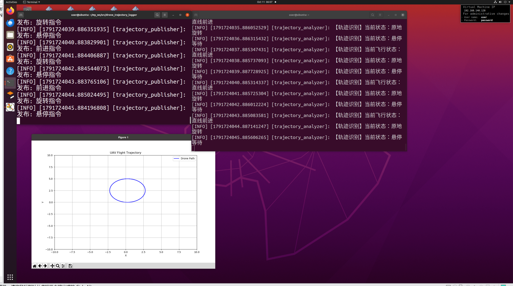

# 新增无人机飞行状态识别与轨迹绘制 ROS 2 封装模块

## 作业概述与背景
“本模块基于 ROS 2 实现了一套无人机飞行状态识别系统。系统通过发布节点模拟无人机速度指令（Twist），接收节点实时订阅数据，自动识别当前的飞行状态（直线、旋转、悬停），并基于固定步长模拟实时绘制飞行轨迹图。”

## 新增功能
在原模块的基础上补充了以下能力（原有默认行为保持不变）：

1. **状态细分**：由“直线 / 旋转 / 悬停”扩展为 9 种状态——直线前进、直线后退、原地左转、原地右转、前进左转、前进右转、后退左转、后退右转、悬停。
2. **状态广播**：识别结果同时发布到 `/drone/flight_state`（`std_msgs/String`），后续节点无需再解析日志即可拿到当前状态。
3. **记录导出**：退出时自动导出逐点轨迹 `drone_trajectory.csv` 与汇总 `drone_trajectory_summary.json`（采样数、时长、折线距离、包围盒、各状态次数/时长/占比）。
4. **参数化**：步长、转角、死区、发布频率、指令序列、导出目录等均可配置，见下方参数表。
5. **可测试**：状态识别、位姿积分、记录导出拆到纯逻辑模块 `flight_state.py`，不依赖 ROS 即可做单元测试。

## 运行环境
* 操作系统：Ubuntu 22.04（虚拟机）
* ROS 2 版本：Humble
* 依赖库：rclpy, geometry_msgs, std_msgs, matplotlib

## 核心代码文件清单
本模块包含以下核心文件，均已提交至仓库：
```text
src/drone_trajectory_logger/
├── drone_trajectory_logger/
│   ├── flight_state.py      # 状态识别 / 位姿积分 / 记录导出（纯逻辑）
│   ├── main.py              # 发布节点：按指令序列发送 Twist
│   └── trajectory_analyzer.py  # 识别节点：识别状态、绘图、导出
├── resource/
│   └── drone_trajectory_logger
├── launch/
│   └── main.launch.py
├── package.xml
├── setup.py
├── setup.cfg
└── README.md
tests/
└── test_drone_trajectory_logger_local.py   # 本地单元测试（无 ROS）
```

## 运行步骤

1. 新建工作空间并拷贝代码：

```
mkdir -p ~/ros2_ws/src
cp -r ~/OpenHUTB/ros2/src/drone_trajectory_logger ~/ros2_ws/src/
cd ~/ros2_ws
```
2.编译并加载环境：

```
colcon build --packages-select drone_trajectory_logger
source install/setup.bash
```
3.一键启动发布节点和分析节点：

```
ros2 launch drone_trajectory_logger main.launch.py
```

也可以按需指定指令序列与导出目录：

```
ros2 launch drone_trajectory_logger main.launch.py \
  sequence:=forward,forward,turn_left,hover \
  output_dir:=/tmp/drone_logs \
  export_every:=10
```

4.预期输出：终端会同时打印出“轨迹发布节点已启动”和“轨迹识别节点已启动”，并弹出一个绘图窗口。


5.运行结束后，在 `output_dir`（默认为当前工作目录）下查看导出结果：

* `drone_trajectory.csv`：`index,time_s,x,y,theta_deg,state,linear_x,angular_z`
* `drone_trajectory_summary.json`：采样数、时长、折线距离、包围盒、各状态次数/时长/占比

## 参数说明

| 参数 | 默认值 | 说明 |
| --- | --- | --- |
| `publish_rate` | `1.0` | 发布节点发送指令的频率（Hz） |
| `sequence` | `forward,turn_left,hover` | 指令序列，逗号分隔；可选 `forward/backward/turn_left/turn_right/hover` |
| `linear_speed` / `angular_speed` | `1.0` | 指令对应的线速度/角速度系数 |
| `cmd_vel_topic` | `/drone/cmd_vel` | 速度指令话题 |
| `state_topic` | `/drone/flight_state` | 识别结果发布话题 |
| `step_length` | `0.5` | 每个采样步的位移（米） |
| `turn_step` | `0.2` | 每个采样步的转角（弧度） |
| `linear_deadband` / `angular_deadband` | `0.01` | 判定为“静止”的死区 |
| `sample_dt` | `1.0` | 记录时间步长（秒），用于统计时长 |
| `enable_plot` | `true` | 是否打开 matplotlib 实时绘图（无显示器时可关掉） |
| `export_every` | `0` | 每 N 个采样点导出一次，`0` 表示只在退出时导出 |
| `output_dir` | 空 | 导出目录，留空则使用当前工作目录 |

## 本地测试

没有 ROS 环境也能验证核心逻辑：

```bash
python3 tests/test_drone_trajectory_logger_local.py
```

测试覆盖状态细分、位姿积分、指令解析、CSV/JSON 导出内容以及工程文件配置。

效果说明：发布节点成功发送不同的飞行指令，识别节点成功解析并打印出对应的飞行状态日志，同时基于实时数据绘制了飞行轨迹图（椭圆），验证了状态识别与轨迹绘制记录功能的正确性。
备注：本模块使用模拟的飞行指令流进行验证，后续可接入真实的无人机仿真数据。
