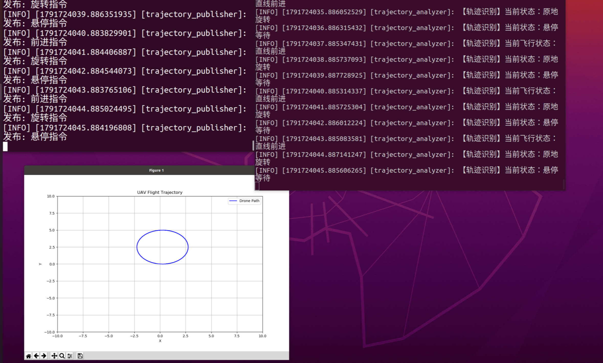

# 新增无人机飞行状态识别与轨迹绘制 ROS 2 封装模块

## 作业概述与背景
“本模块基于 ROS 2 实现了一套无人机飞行状态识别系统。系统通过发布节点模拟无人机速度指令（Twist），接收节点实时订阅数据，自动识别当前的飞行状态（直线、旋转、悬停），并基于固定步长模拟实时绘制飞行轨迹图。”
## 运行环境
* 操作系统：Ubuntu 22.04（虚拟机）
* ROS 2 版本：Humble
* 依赖库：rclpy, geometry_msgs, matplotlib

## 核心代码文件清单
本模块包含以下核心文件，均已提交至仓库：
```text
src/drone_trajectory_logger/
├── drone_trajectory_logger/
│   ├── __init__.py
│   ├── main.py
│   └── trajectory_analyzer.py
├── resource/
│   └── drone_trajectory_logger
├── launch/
│   └── main.launch.py
├── package.xml
├── setup.py
├── setup.cfg
└── README.md
```
## 运行步骤

1. 新建工作空间并拷贝代码：

```
mkdir -p ~/ros2_ws/src
cp -r ~/OpenHUTB/ros2/src/drone_trajectory_logger ~/ros2_ws/src/
cd ~/ros2_ws
```
2.编译并加载环境：

```
colcon build --packages-select drone_trajectory_logger
source install/setup.bash
```
3.一键启动发布节点和分析节点：

```
ros2 launch drone_trajectory_logger main.launch.py
```
4.预期输出：终端会同时打印出“轨迹发布节点已启动”和“轨迹识别节点已启动”，并弹出一个绘图窗口。


效果说明：发布节点成功发送不同的飞行指令，识别节点成功解析并打印出对应的飞行状态日志，同时基于实时数据绘制了飞行轨迹图（椭圆），验证了状态识别与轨迹绘制记录功能的正确性。
备注：本模块使用模拟的飞行指令流进行验证，后续可接入真实的无人机仿真数据。
