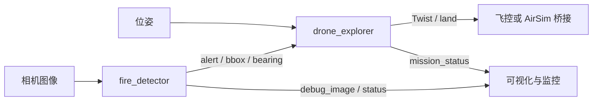
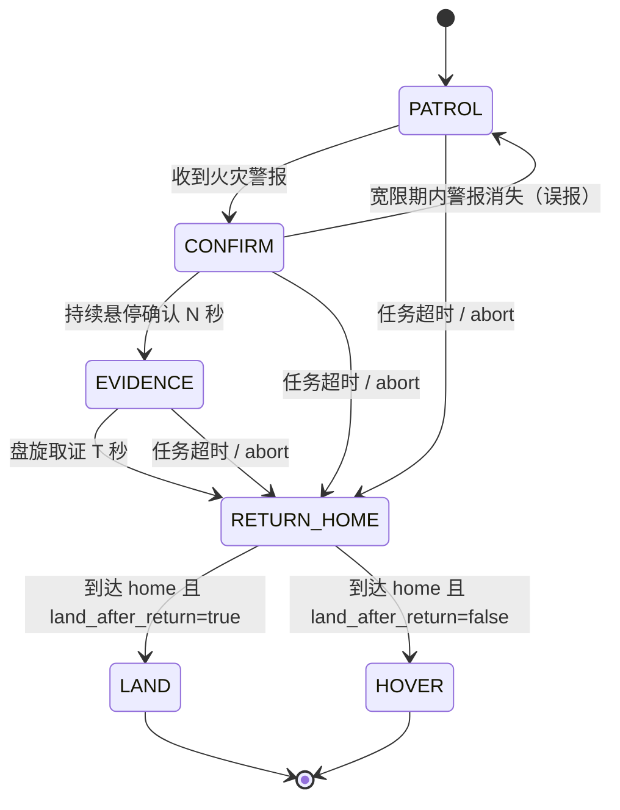

# 无人机火灾探测与自主巡检（fire_detection_drone）

森林与建筑场景的早期火情发现依赖区域覆盖和现场确认。本实验以无人机为平台，把相机火灾检测、搜索航点生成和任务状态管理组合成一条可复现的自主巡检流程：无人机按几何航线搜索，检测到火焰后悬停确认、盘旋取证，再返航或降落。

功能包参考开源仓库
[michael-2509/fire-detection-drone](https://github.com/michael-2509/fire-detection-drone)
的 AirSim 取图、目标检测过滤和无人机速度/偏航控制流程，重构为感知与控制解耦的 ROS 2
Python 功能包：检测节点只订阅标准相机图像，巡检节点只发布标准速度指令，检测与状态机
逻辑放在无 ROS 依赖的纯 Python 模块中。源代码位于 `src/air/fire_detection_drone/`，
依赖安装、构建命令、Launch 参数和话题接口见该目录的 `README.md`。


> 合成图像检测结果，由 `src/air/fire_detection_drone/tools/make_demo_image.py` 生成。

## 1. 实验目标

- 理解从图像颜色特征到火灾候选框，再到稳定报警的判定过程；
- 理解弓字形、矩形边界和螺旋三类几何航线如何覆盖搜索区域；
- 掌握巡检任务从搜索、确认、取证到返航的状态迁移条件；
- 通过话题观察检测结果、飞行指令与任务状态之间的对应关系。

## 2. 任务设计与数据流

系统分为感知、任务决策和执行三层：

- `fire_detector` 订阅相机图像，输出火灾警报、目标框、目标方位角、标注图和 JSON 状态；
- `drone_explorer` 订阅警报和位姿，运行确定性状态机，输出机体系速度、降落请求和任务状态；
- 两层只通过标准 ROS 2 消息交互，更换仿真器或飞控桥接时不需要修改检测与决策逻辑。



## 3. 火灾检测与报警判定

火焰在 HSV 空间中表现为高亮度、高饱和度的橙黄色至红色区域。检测器按橙色/黄色主区间
和红色环绕区间生成掩膜，经形态学开闭运算去除噪点，再按连通域面积、长宽比过滤，并用
IoU 非极大值抑制合并重叠候选。

单帧颜色命中的误报率较高，因此节点要求连续 `min_consecutive_frames` 帧命中才置位警报；
检测丢失后保持 `alert_hold_sec`，图像中断超过 `image_timeout_sec` 则清除警报。若提供
ONNX 二分类器，检测器对每个候选 ROI 做复核，并按 `model_weight` 融合两路置信度，模型
加载失败时退回纯 HSV。

检测结果通过 `/fire_detection/bbox` 输出，8 个元素依次为 `x_min`、`y_min`、`x_max`、
`y_max`、`confidence`、`center_x`、`center_y`、`area_ratio`。前四项为像素坐标，
`center_x`、`center_y` 为归一化后的目标中心，无目标时数组为空。确认阶段使用
`center_x` 计算偏航修正，使火灾保持在画面中央。

## 4. 搜索场景与航点生成

| 模式 | 适用场景 | 航点生成方式 |
| --- | --- | --- |
| `lawnmower` | 大面积开阔区域 | 在搜索矩形内按 `lane_spacing` 往返覆盖 |
| `perimeter` | 建筑或作业区边界 | 沿矩形四边循环 |
| `spiral` | 起飞点附近局部搜索 | 从中心向外扩展的阿基米德螺旋 |

`search_width`、`search_height` 定义搜索矩形，默认 12.0 m × 8.0 m；`spiral` 以两参数
较小值的一半作为最大半径，`spiral_turns` 控制圈数，默认 3.0 圈。三者均为 Launch 参数，
可在命令行覆盖，无需修改配置文件。

## 5. 任务状态机



- `PATROL`：依次飞向搜索航点；收到警报后转入 `CONFIRM`。
- `CONFIRM`：悬停并按目标框中心偏航对准；警报消失超过 `alert_grace_sec` 判为误报，
  回到 `PATROL`；持续确认 `confirm_hover_sec` 后进入 `EVIDENCE`。
- `EVIDENCE`：原地低速偏航约一周（`evidence_yaw_rate` × `evidence_sec`），记录现场后
  返回 home；默认取证 12 s。
- `RETURN_HOME`：按起飞时记录的 home 位置返航；到达容差内后按 `land_after_return` 选择
  降落或悬停。
- `LAND`：发布一次 `/drone/land`，任务结束。

任务总时长超过 `max_mission_sec` 或收到 `/fire_detection/abort` 时，状态机从任意活动状态
转入 `RETURN_HOME`。`require_odometry` 为 `true` 时，位姿超时立即停车并保持等待。

## 6. 实验步骤

环境：Ubuntu 22.04 LTS + ROS 2 Humble + Python 3.10。依赖安装与 `colcon` 构建见
`src/air/fire_detection_drone/README.md`。以下命令在已执行 `source install/setup.bash`
的工作空间中运行。

### 6.1 弓字形覆盖

```shell
ros2 launch fire_detection_drone fire_detection_drone.launch.py \
  exploration_pattern:=lawnmower search_width:=16.0 search_height:=10.0
```

无人机在 16.0 m × 10.0 m 的区域内往返。无警报时 `/fire_detection/mission_status` 的
`state` 保持 `PATROL`，航点序号随飞行递增。

### 6.2 矩形边界巡检

```shell
ros2 launch fire_detection_drone fire_detection_drone.launch.py \
  exploration_pattern:=perimeter search_width:=12.0 search_height:=12.0
```

航点沿搜索矩形的四个角点循环，适合沿建筑外墙或作业区边界飞行。

### 6.3 螺旋局部搜索

```shell
ros2 launch fire_detection_drone fire_detection_drone.launch.py \
  exploration_pattern:=spiral search_width:=16.0 search_height:=16.0 \
  spiral_turns:=4.0
```

航点从中心向外扩展，最大半径 8.0 m，共 4 圈。修改 `spiral_turns` 可观察航点间距和
总航程的变化。

### 6.4 无相机手动触发

只启动巡检节点，避免检测节点的 1 Hz 心跳覆盖手动警报；若环境中没有 `/odom`，追加
`require_odometry:=false`：

```shell
ros2 launch fire_detection_drone fire_detection_drone.launch.py start_detector:=false

# 另开终端：触发火灾警报
ros2 topic pub --once /fire_detection/alert std_msgs/msg/Bool "{data: true}"

# 观察速度指令与状态机
ros2 topic echo /cmd_vel
ros2 topic echo /fire_detection/mission_status
```

预期状态序列为 `PATROL → CONFIRM → EVIDENCE → RETURN_HOME → LAND`：确认约 2 s，
取证约 12 s，到达 home 后发布一次 `/drone/land`。

### 6.5 接入 AirSim 桥接

课程桥接通常提供 `/drone/camera/image_raw`、NED 位姿和 NED 机体系速度。按桥接话题
改写启动参数即可，话题与参数的对应关系见功能包 `README.md`：

```shell
ros2 launch fire_detection_drone fire_detection_drone.launch.py \
  image_topic:=/drone/camera/image_raw \
  pose_topic:=/drone/pose \
  pose_message_type:=pose_stamped \
  cmd_vel_topic:=/drone/cmd_vel \
  ned_input:=true \
  ned_output:=true \
  require_odometry:=true
```

## 7. 结果观察与判读

| 观察对象 | 判读方式 |
| --- | --- |
| `/fire_detection/alert` | 报警变化时发布，并以 1 Hz 心跳重发，可用于确认检测节点存活 |
| `/fire_detection/bbox` | 有目标时按固定 8 字段输出，`center_x` 偏离 0.5 表示目标不在画面中央 |
| `/fire_detection/debug_image` | 检测框与报警横幅叠加在原始图像上，用于核对 HSV 候选和误报来源 |
| `/fire_detection/status` | JSON 中的 `backend` 区分 HSV/ONNX，`fps` 反映处理负载，`image_timeout` 指示图像中断 |
| `/fire_detection/mission_status` | JSON 中的 `state`、`waypoint_index`、`waypoint_count`、`home`、`mission_elapsed_sec`、`reason` 反映任务进度与迁移原因 |
| `/cmd_vel` | `PATROL` 沿航线输出前进速度，`CONFIRM` 为零线速度加偏航修正，`EVIDENCE` 仅有角速度 |
| `/drone/land` | 返航完成后发布一次 `true` |

常见现象：

- 警报持续存在时，状态按 `PATROL → CONFIRM → EVIDENCE → RETURN_HOME → LAND` 推进；
- 警报在宽限期内消失时，状态由 `CONFIRM` 回到 `PATROL`，`reason` 记录误报；
- 发布 `/fire_detection/abort` 后，任意活动状态立即转入 `RETURN_HOME`；
- 位姿中断且 `require_odometry:=true` 时，速度归零，`mission_status` 记录位姿超时；
- 检测节点未启动时，手动警报不再被心跳覆盖，便于单独验证状态机。

## 8. 局限与改进方向

- 巡检航线为固定几何路径，不含避障，需在无障碍空域运行；
- HSV 检测对夕阳、红色/橙色物体和反光可能误报，可通过阈值调整和 ONNX 复核降低误报；
- `require_odometry:=false` 时使用速度积分推算位姿，误差随时间累积，只适合短时演示；
- `/drone/land` 为 `std_msgs/Bool` 话题，接入不同飞控桥接时需确认语义；
- 可扩展方向包括红外相机检测、视觉 SLAM 定位和多机协同覆盖。

## 9. 参考

- [michael-2509/fire-detection-drone](https://github.com/michael-2509/fire-detection-drone)：AirSim 取图、检测与控制流程。
- 课程 AirSim 接口：[无人机终端键盘遥控器](./drone_teleop.md)、[基于 ROS 消息解耦的无人机键盘遥控](./drone_ros_teleop.md)、[无人机与 ROS 的桥接模块](./carlair_ros_bridge.md)。
- 功能包源码与开发者文档：`src/air/fire_detection_drone/README.md`。
