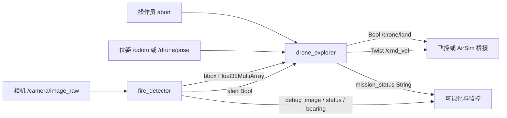
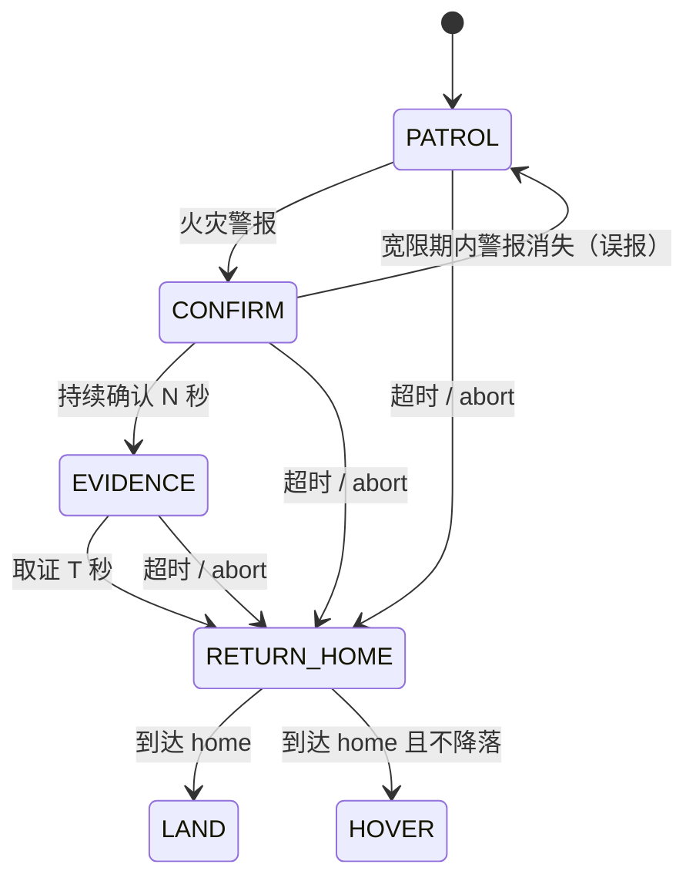

# 无人机火灾探测与自主巡检（fire_detection_drone）

本项目把参考开源仓库
[michael-2509/fire-detection-drone](https://github.com/michael-2509/fire-detection-drone)
中的 AirSim 取图、目标检测过滤和无人机速度/偏航控制思路，重构为一个模块化的 ROS 2
Python 功能包。功能包将感知与控制解耦：火灾检测节点只订阅相机图像，巡检节点只发布标准
`geometry_msgs/Twist`，便于接入不同的仿真器或飞控桥接。

源代码位于 `src/air/fire_detection_drone/`，运行说明见该目录的 `README.md`。


> 合成图像检测结果，由 `src/air/fire_detection_drone/tools/make_demo_image.py` 生成。

## 系统架构



检测器默认使用 HSV 火焰分割：橙色/黄色主区间加红色环绕区间，经过形态学去噪、面积和
长宽比过滤、IoU 非极大值抑制后输出候选框。节点再通过连续多帧命中和警报保持时间抑制
瞬时误报；图像超时会自动清除警报。若提供 ONNX 二分类器，还会对每个候选 ROI 做复核，
并按权重融合两路置信度。

巡检节点是一个确定性有限状态机：



三种巡检模式：

| 模式 | 适用场景 | 航点生成方式 |
| --- | --- | --- |
| `lawnmower` | 大面积开阔区域 | 按 `lane_spacing` 生成往返弓字形航线 |
| `perimeter` | 建筑或作业区边界 | 矩形四个角点循环 |
| `spiral` | 起飞点附近局部搜索 | 从中心向外扩展的阿基米德螺旋 |

## 话题与服务

### 订阅

| 话题 | 类型 | 说明 |
| --- | --- | --- |
| `/camera/image_raw` | `sensor_msgs/Image` | 检测节点输入 |
| `/odom` | `nav_msgs/Odometry` | 默认位姿源 |
| `/drone/pose` | `geometry_msgs/PoseStamped` | `pose_message_type:=pose_stamped` 时使用 |
| `/fire_detection/alert` | `std_msgs/Bool` | 巡检节点的火灾警报输入 |
| `/fire_detection/bbox` | `std_msgs/Float32MultiArray` | 用于悬停时的目标偏航对准 |
| `/fire_detection/abort` | `std_msgs/Bool` | 立即返航 |

### 发布

| 话题 | 类型 | 说明 |
| --- | --- | --- |
| `/fire_detection/alert` | `std_msgs/Bool` | 火灾报警，变化时发布并以 1 Hz 心跳重发 |
| `/fire_detection/bbox` | `std_msgs/Float32MultiArray` | `[x_min, y_min, x_max, y_max, confidence, cx, cy, area_ratio]`；前四项为像素坐标，`cx/cy` 归一化，无目标时为空 |
| `/fire_detection/target_bearing` | `std_msgs/Float32` | 目标相对光轴方位角（rad，右正），无目标为 `NaN` |
| `/fire_detection/debug_image` | `sensor_msgs/Image` | 带检测框与报警横幅的图像 |
| `/fire_detection/status` | `std_msgs/String` | 检测节点 JSON 状态 |
| `/cmd_vel` | `geometry_msgs/Twist` | 机体系速度指令 |
| `/drone/land` | `std_msgs/Bool` | 返航完成后发布一次 `true` |
| `/fire_detection/mission_status` | `std_msgs/String` | 巡检节点 JSON 状态 |

本包不定义自定义服务。部分桥接通过 `/drone/takeoff`、`/drone/land` 服务提供起降；本包
使用 `/drone/land` 话题，若桥接只提供服务，需要增加小型适配节点。包不负责起飞，启动前
应确保无人机已处于安全高度。

## 安装与编译

环境：Ubuntu 20.04/22.04、ROS 2 Humble、Python 3.8+。

```shell
sudo apt install -y ros-humble-cv-bridge python3-opencv python3-numpy \
  python3-pytest python3-colcon-common-extensions
source /opt/ros/humble/setup.bash
cd ~/ros2
rosdep install --from-paths src/air/fire_detection_drone --ignore-src -r -y
colcon build --packages-select fire_detection_drone
source install/setup.bash
```

## 启动

```shell
ros2 launch fire_detection_drone fire_detection_drone.launch.py
```

`launch/main.launch.py` 等价，符合仓库 `main.*` 入口约定。

选择巡检场景：

```shell
# 弓字形大面积覆盖
ros2 launch fire_detection_drone fire_detection_drone.launch.py \
  exploration_pattern:=lawnmower search_width:=16.0 search_height:=10.0

# 矩形边界巡检
ros2 launch fire_detection_drone fire_detection_drone.launch.py \
  exploration_pattern:=perimeter search_width:=12.0 search_height:=12.0

# 螺旋局部搜索
ros2 launch fire_detection_drone fire_detection_drone.launch.py \
  exploration_pattern:=spiral search_width:=16.0 search_height:=16.0 spiral_turns:=4.0
```

### 接入 AirSim 桥接

课程现有桥接常用 `/drone/camera/image_raw`、`/drone/pose`（NED）和 `/drone/cmd_vel`
（NED）。对应启动参数：

```shell
ros2 launch fire_detection_drone fire_detection_drone.launch.py \
  image_topic:=/drone/camera/image_raw \
  pose_topic:=/drone/pose \
  pose_message_type:=pose_stamped \
  cmd_vel_topic:=/drone/cmd_vel \
  ned_input:=true \
  ned_output:=true
```

NED 与 ENU 的转换由节点完成：位置 `(x, y, z) → (x, -y, -z)`，偏航取反；机体系速度
`(vx, vy, vz, wz) → (vx, -vy, -vz, -wz)`。若桥接没有位姿话题，可设置
`require_odometry:=false` 启用航位推算，但积分误差会随时间累积，只建议短时演示使用。

仓库中的 `drone_ros_node.py` / `drone_airsim_bringup` 是 ROS 1 节点；若要在 ROS 2 中直接
复用，需要 `ros1_bridge` 或改用 ROS 2 AirSim 桥接。本包只约定话题语义，不依赖 AirSim
Python 客户端。

### 手动验证

只启动巡检节点，避免检测节点的 1 Hz 心跳覆盖手动警报；若没有 `/odom`，追加
`require_odometry:=false`：

```shell
ros2 launch fire_detection_drone fire_detection_drone.launch.py start_detector:=false

# 另开终端
ros2 topic pub --once /fire_detection/alert std_msgs/msg/Bool "{data: true}"
ros2 topic echo /cmd_vel
ros2 topic echo /fire_detection/mission_status
```

预期状态序列为 `PATROL → CONFIRM → EVIDENCE → RETURN_HOME → LAND`。

## 参数与可选神经网络

完整参数在 `src/air/fire_detection_drone/config/fire_detection.yaml`，常用参数包括
`min_confidence`、`min_consecutive_frames`、`alert_hold_sec`、`confirm_hover_sec`、
`evidence_sec`、`max_mission_sec`、`land_after_return` 等。

参考仓库的 notebook 是自监督预训练实验，没有可部署的火灾推理权重。因此本包默认只用 HSV，
并预留 ONNX 分类器接口：训练 `0=non-fire / 1=fire` 的二分类器，输入 224×224 RGB，导出
ONNX 后通过 `model_path:=...` 启用。模型加载失败会自动退回 HSV。

## 测试与构建

```shell
cd src/air/fire_detection_drone
python3 -m pytest test -q
# 21 passed
```

在 Ubuntu 20.04 + ROS 2 Humble 下执行 `colcon build --packages-select fire_detection_drone`，0 errors、0 warnings；`ros2 launch ... --show-args` 与节点启动检查通过。

## 限制

- 不包含避障，固定巡检航线需在无障碍空域或配合避障模块使用；
- HSV 对夕阳、橙色/红色物体和反光可能误报，建议配合 ONNX 复核与阈值调参；
- 返航依赖位姿源，`require_odometry:=true` 时位姿超时会立即停车。

## 参考

- [michael-2509/fire-detection-drone](https://github.com/michael-2509/fire-detection-drone)：AirSim 取图、检测与控制流程。
- 课程 AirSim 接口：[无人机终端键盘遥控器](./drone_teleop.md)、[基于 ROS 消息解耦的无人机键盘遥控](./drone_ros_teleop.md)、[无人机与 ROS 的桥接模块](./carlair_ros_bridge.md)。
