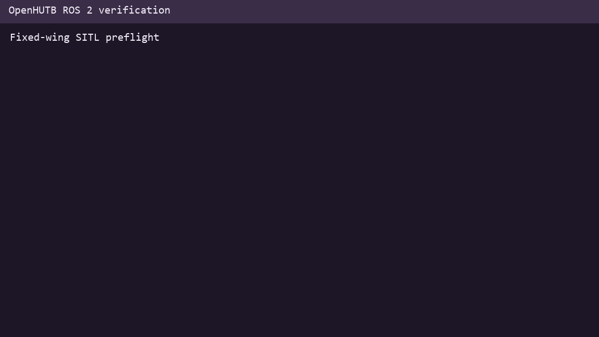

title: Fixed-wing SITL preflight

# Fixed-wing SITL preflight

This module validates fixed-wing PX4/ArduPilot SITL configuration before launch. It checks the firmware mode, airframe, ports, origin, control surfaces, sensors and failsafe settings.

## 1. Prerequisites

- Python 3.10 or newer.
- A fixed-wing SITL configuration JSON file.
- ROS 2 Humble only when using the installed launch entry.

## 2. Scope and limitations

This is a static configuration check. It does not connect to a flight controller, validate aerodynamics, or replace a real SITL arming and takeoff test.



## 3. Run

```bash
PYTHONPATH=src/air/fixed_wing_sitl_preflight \
  python3 -m fixed_wing_sitl_preflight.main
```

## 4. Expected result

```text
fixed-wing SITL preflight
errors=0 warnings=0
PASS: fixed-wing SITL configuration is internally consistent
```

## 5. Test

```bash
PYTHONPATH=src/air/fixed_wing_sitl_preflight python3 -m unittest discover \
  -s src/air/fixed_wing_sitl_preflight/tests -v
```

## AI assistance disclosure

This module, tests and documentation were prepared with large-language-model assistance. The submitter reviewed and ran the content and is responsible for the submission.
