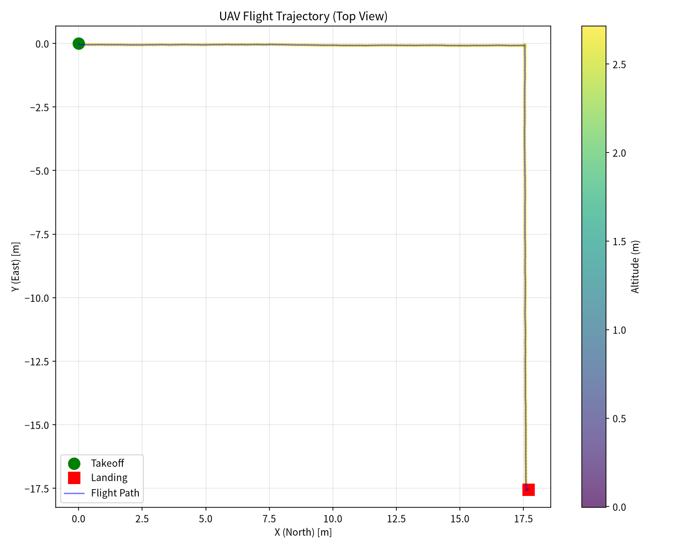
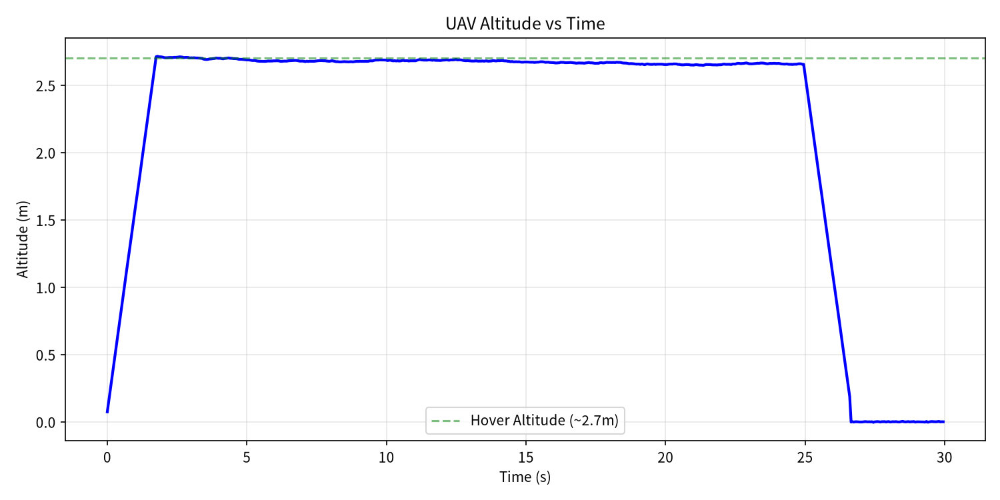
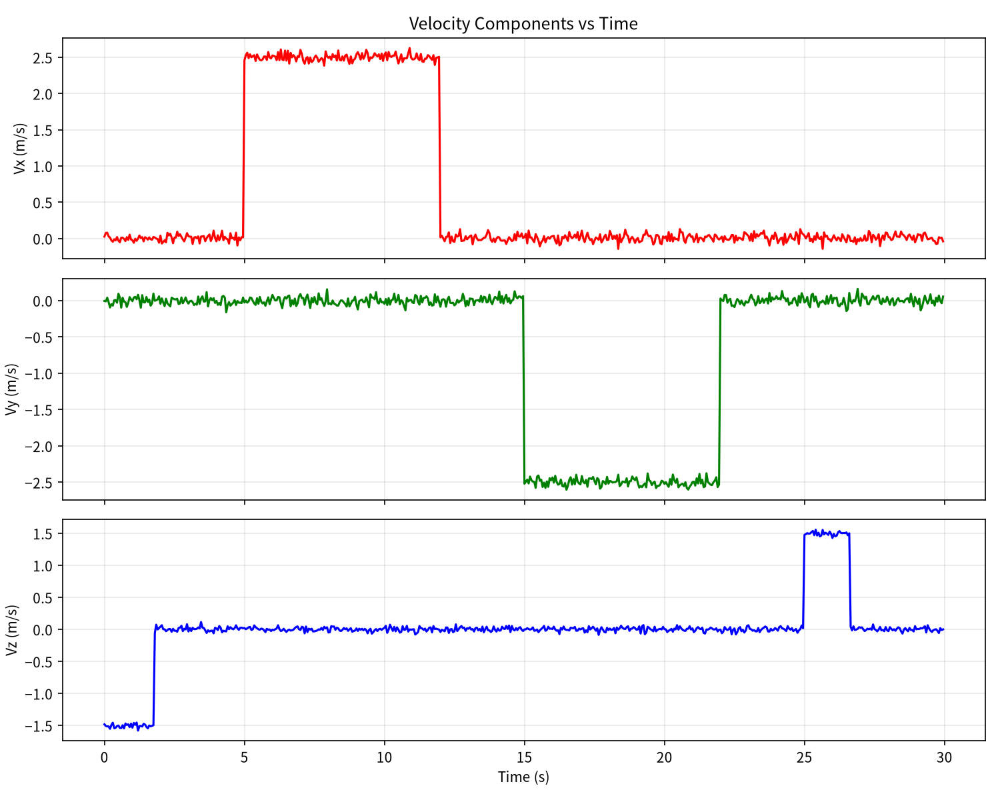
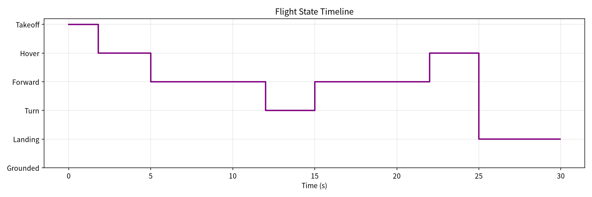

# 预设航线飞行模拟器

本模块按预设时间表播放一段多旋翼巡航飞行（起飞-巡航-转弯-悬停-降落），逐帧记录飞行状态数据，并生成轨迹图、高度图、速度图、状态时间线。

## 与已有模块的区别

| 模块 | 类型 | 输入方式 | 用途 |
|------|------|----------|------|
| [drone_teleop](drone_teleop.md) | 实时遥控 | 键盘输入 | 终端键盘遥控飞行 |
| [drone_ros_teleop](drone_ros_teleop.md) | 实时遥控 | ROS 消息 | 解耦键盘遥控 |
| [uav_keyboard_control](uav_keyboard_control.md) | 实时遥控 | 键盘 + ROS | ROS 节点键盘控制 |
| **本模块** | **离线模拟** | **预设时间表** | **快速生成可复现的飞行数据集与可视化** |

本模块为纯 Python 离线脚本，不依赖 ROS、仿真器或输入设备，用于快速生成教学/测试用的飞行数据。

### 为什么不做 ROS 封装

本模块产物是静态的 CSV 与图表，不发布/订阅任何 ROS 话题，也没有需要持续运行的节点，因此没有 `package.xml`、`launch/` 或话题接口可提供。若强行包成 ROS 节点，反而需要先起 `roscore`、等节点退出后再取文件，与"一条命令即可复现数据集"的定位相悖。

若后续需要与 ROS 生态联动，可以在此基础上加一层话题发布节点（把逐帧记录改为 `nav_msgs/Odometry` 或 `sensor_msgs/Imu` 输出），届时再补标准的 ament_python 包结构。

## 运行环境

- Python 3
- 依赖：numpy, matplotlib

## 快速开始

```bash
cd src/air/flight_path_simulator
python3 flight_path_simulator.py                    # 输出到当前目录
python3 flight_path_simulator.py --outdir results/  # 输出到指定目录
```

运行后自动生成以下输出文件：

| 文件 | 说明 |
|------|------|
| `flight_log.csv` | 逐帧飞行数据（600 帧，20Hz，30秒） |
| `trajectory.png` | XY 平面飞行轨迹俯视图 |
| `altitude.png` | 高度随时间变化曲线 |
| `velocity.png` | 三轴速度分量曲线 |
| `state_timeline.png` | 飞行状态时间线 |

## 飞行任务流程

| 时间段 | 状态 | 动作 |
|--------|------|------|
| 0-2s | Takeoff | 垂直爬升到 ~2.7m 悬停高度 |
| 2-5s | Hover | 原地悬停 |
| 5-12s | Forward | 以 2.5 m/s 水平巡航 |
| 12-15s | Turn | 原地右转 90° |
| 15-22s | Forward | 继续水平巡航（新方向） |
| 22-25s | Hover | 原地悬停 |
| 25-30s | Landing | 垂直降落到地面 |

## 运行效果

### 飞行轨迹俯视图



### 高度变化曲线



### 三轴速度曲线



### 飞行状态时间线



## 飞行数据摘要

- 总飞行时间：29.9 秒
- 采样频率：20 Hz（共 600 帧）
- 最大高度：2.71 米
- 水平最大速度：2.63 m/s
- 总航程：35.98 米

## CSV 字段说明

| 字段 | 含义 |
|------|------|
| timestamp | 时间戳（秒） |
| pos_x, pos_y, pos_z | NED 坐标系下位置（米） |
| altitude_m | 离地高度（米） |
| vel_x, vel_y, vel_z | 世界坐标系下速度分量（m/s） |
| horizontal_speed | 水平速度大小（m/s） |
| yaw_deg | 偏航角（度） |
| state | 飞行状态标签 |

## 代码位置

- 主程序：[flight_path_simulator.py](../../src/air/flight_path_simulator/flight_path_simulator.py)
- 飞行数据：[flight_log.csv](../../src/air/flight_path_simulator/results/flight_log.csv)
- 测试：[test_simulator.py](../../src/air/flight_path_simulator/test_simulator.py)
