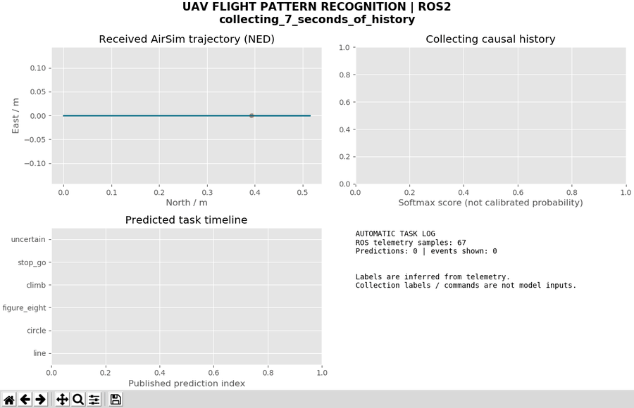
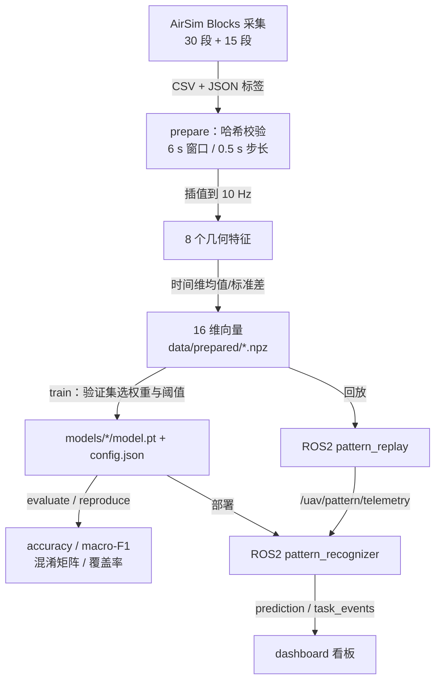
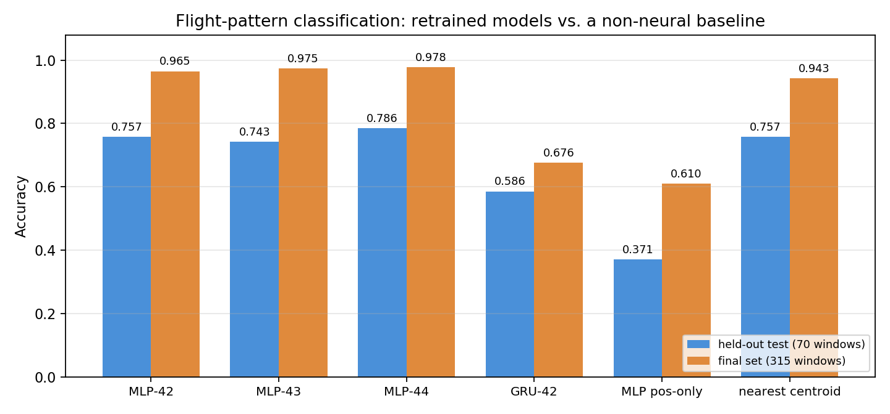
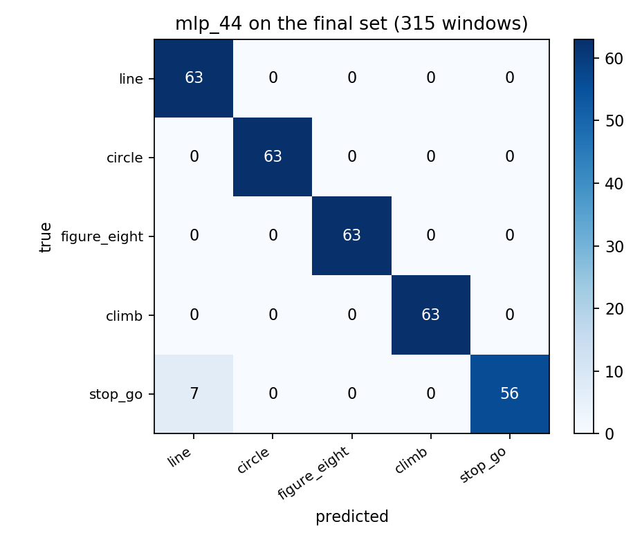
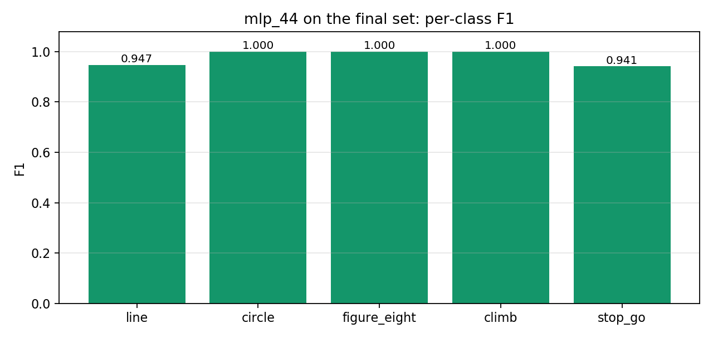

# 无人机飞行轨迹类型识别与 ROS2 自动任务日志

本页记录一个可独立复现的飞行轨迹分类实验：用过去 **6 秒**的飞行遥测，识别无人机当前在执行 **五类轨迹**中的哪一类，并在 ROS2 中把稳定的识别结果转成**任务事件**。

模型不是序列到序列的黑箱：先从遥测里抽出 8 个有物理含义的几何特征，再在时间维上取均值与标准差，最后过一个 MLP。GRU 作为序列模型对照，放在同一份数据上比较。

全部数字都在本机重跑过，包括**重训结果与仓库随附权重逐位一致**的验证（第 7.5 节）。



上图为 `ros2` 实跑窗口：左侧是收到的轨迹，右上是五类的 softmax 输出，左下是识别时间线，右下是自动任务日志。回放 `episode_300`（直线）与 `episode_302`（8 字），两段之间触发一次任务事件。

---

## 1. 任务定义与设计取舍

**输入**：最近 6 秒遥测（10 Hz 采样，61 帧），每帧取位置、速度、加速度共 9 个分量。

**输出**：五类之一 `line` / `circle` / `figure_eight` / `climb` / `stop_go`，或 `uncertain`（置信度不足时）。

**约束**：采集时的标签与命令**不进入模型输入**。识别节点只读取观测流，这一点由代码结构保证，见第 3.4 节。

三个关键取舍：

| 取舍 | 选择 | 理由 |
|---|---|---|
| 特征 vs 端到端 | 先抽 8 个几何特征，再分类 | 训练窗口只有 280 个；直接喂 61×9 原始序列，参数一多就过拟合。几何特征把"转弯有多急""走了多远"显式化，小样本下更稳 |
| 分类器 | MLP（16→32→5） | 特征已在时间维聚合，序列信息被压成统计量，不需要再堆循环层 |
| 序列对照 | 独立训练的 GRU(8→32) | 用来回答"时序建模是否必要"，而不是拿来当主模型 |

### 1.1 与相邻项目的边界

| 方向 | 输入 / 输出 | 本项目区别 |
|---|---|---|
| 状态预测（PR #121） | 历史状态 → 未来位置、速度 | 本项目输出**离散**轨迹类型 |
| 遥测异常检测（PR #138） | 状态 → 异常分数、告警 | 本项目训练正常任务类别，不注入故障 |
| 避障、PPO 导航、PID 跟踪 | 感知/目标 → 控制动作 | 分类与日志节点**不发送飞行控制指令** |
| YOLO 图像检测 | 图像 → 目标框 | 本项目只使用飞行遥测 |

2026-10-02 曾核查 OpenHUTB 主分支目录及最近 100 个 PR 的标题与范围，未发现相同的轨迹分类与任务日志模块；这不代表其他仓库不存在相关研究。上游基线为 `c10e1331a5b24dd2d9a0d37bafe91cecdb5ae92b`。

### 1.2 功能与入口

`main.py` 是统一入口，`main.sh` 负责加载 ROS 环境与虚拟环境：

| 阶段 | 入口 | 输出 |
|---|---|---|
| 自检 | `bash main.sh doctor` | `artifacts/environment.json` |
| 数据准备 | `python main.py prepare` | `data/prepared/*.npz`、`manifest.json` |
| 训练 | `python main.py train --variant mlp --seed 42 --output models/x` | `model.pt`、`config.json`、`loss.json` |
| 复现 | `python reproduce.py --output models/retrained_run` | 5 个模型 + 2 份评估 |
| 评估 | `python main.py evaluate --split final` | `results/*.json`、`*_predictions.csv` |
| 构建 | `bash main.sh build` | `install/`、`build/`、`log/` |
| ROS2 回放 | `bash main.sh demo "<csv;csv>"` | 三个话题 + 看板 |
| 看板 | `python main.py dashboard` | Tk 窗口 |

---

## 2. 运行环境与快速开始

### 2.1 环境

| 项 | 配置 |
|---|---|
| 系统 | Ubuntu 20.04.6，6 核 / 8.5 GB |
| ROS | ROS2 **Humble**（`/opt/ros/humble`，为 Python 3.8 构建） |
| Python | 3.8.10，venv `--system-site-packages` |
| 深度学习 | PyTorch **2.4.1+cpu**，numpy 1.24.4，matplotlib 3.1.2 |
| 数据来源 | AirSim 1.8.1（Blocks 场景）录制，随模块附 30 段 + 15 段语料 |

### 2.2 安装与自检

```bash
cd ~/ros2/src/air/flight_pattern_recognition
source /opt/ros/humble/setup.bash
/usr/bin/python3 -m venv --system-site-packages ~/uav_prediction_env
source ~/uav_prediction_env/bin/activate
python -m pip install -r requirements.txt
bash main.sh doctor      # 12 个必需模块逐一导入，缺一个就退出
bash main.sh build
```

`doctor` 会打印实际解释器并写入 `artifacts/environment.json`；不通过时直接报错，不会带着残缺环境继续。

安装时的四个常见问题：

- **`ensurepip` 缺失**：先 `sudo apt install python3.8-venv`；
- **没有图形窗口**：看板依赖 Tk，需要 `python3-tk`；
- **`doctor` 报 `launch_ros: No module named 'lark'`**：在模块目录、已激活的 venv 里重跑 `pip install -r requirements.txt`，依赖表已含 `lark==1.1.9`；
- **Conda 环境冲突**：Conda 的 `python3` 无法导入 ROS2，另建基于 `/usr/bin/python3` 的 venv。

虚拟环境优先级：`UAV_ENV` > 当前 `VIRTUAL_ENV` > `~/uav_prediction_env`；`ROS_SETUP` 可覆盖 ROS 发行版的 setup 文件。换目录重建时旧的 `build/`、`install/`、`log/` 不要复制过来。

### 2.3 跑通回放

```bash
python main.py prepare                     # 首次运行：解压语料、校验哈希、生成窗口
bash main.sh demo "$PWD/data/final_raw/episode_300.csv;$PWD/data/final_raw/episode_302.csv"
```

`main.sh demo` 走 `ros2 launch`，起两个节点：`pattern_replay`（按时间戳回放）与 `pattern_recognizer`（识别）。看板是独立进程，另开一个终端：

```bash
python main.py dashboard
```

看板不在 launch 里，是为了让识别链路可以脱离图形界面运行——没有显示器的机器只订阅话题即可。**先开看板再起 demo**：五段回放（`episode_300`～`304`）约 95 秒后自然结束，回放进程退出会连带关停识别节点。

### 2.4 采集与实时接入（可选）

重新采集才需要 AirSim 客户端：

```bash
python -m pip install -r requirements_airsim.txt
python collect_final.py --host <AirSim 主机 IP> --start 400 --episodes 5 --output data/new_collection
```

`collect_final.py` 会真正控制仿真无人机，含碰撞、区域边界、起点稳定与降落确认；采集器拒绝覆盖已有文件。新增数据**不属于**随附最终测试集，若用于训练需要重新设计完整划分并保留新的未见测试集。

`config/airsim_settings.json` 里的主机地址与载具名是示例值，换机器必须按实际配置修改。回放、推理与只读桥接都不下发飞控指令。

只读实时桥接（读正在运行的 AirSim，不控制）：

```bash
python main.py live --ros-args -p host:=192.168.239.1 -p vehicle:=PredictionDrone
ros2 run flight_pattern_recognition pattern_recognizer --ros-args \
  -p model:="$PWD/models/mlp_42" -p log:="$PWD/results/live_predictions.jsonl"
```

飞行本身需要独立控制器。五类训练数据**不覆盖起飞、降落、悬停、故障**等阶段，这些阶段的输出没有准确性保证。

### 2.5 验证边界

本页所有数据来自 **AirSim Blocks 场景**、规则小范围轨迹、SimpleFlight 控制器，**尚未在 OpenHUTB 模拟器上重新采集**。把这里的准确率套到别的场景或真实无人机上不成立。

---

## 3. 数据、标签与防泄漏

### 3.1 原始字段

每段飞行一个 CSV，逐行记录 `timestamp_ns`、位置 `px/py/pz`、速度 `vx/vy/vz`、加速度 `ax/ay/az`（世界 **NED**，m 与 m/s、m/s²）。标签来自采集时执行的轨迹家族，记录在对应的 JSON 里。

数据来自实际运行的 AirSim `getMultirotorState`，随模块保存 CSV、采集参数、时间戳与 SHA256——**不是**按轨迹方程直接生成的理想状态。轨迹方程只用于生成控制目标，数据里包含仿真飞行控制器的实际响应。

五个标签对应采集任务家族，含义如下：

| 标签 | 采集任务含义 |
|---|---|
| `line` | 水平直线往返，正弦速度变化 |
| `circle` | 水平圆形轨迹 |
| `figure_eight` | 水平八字轨迹 |
| `climb` | 水平位移伴随周期性**升降**，不是单向爬升 |
| `stop_go` | 平滑停留/换向，不是硬切换停车 |

后两条容易被字面意思误导：`climb` 并非一直向上，`stop_go` 也不是急停急走。

### 3.2 窗口构造

对每段飞行，从第 7 秒开始，每 0.5 秒取一个窗口：

- 取窗口末端往前 **6.0 s** 的观测；
- 在 `[-6, 0]` 秒上等间隔取 **61** 个点（10 Hz），逐通道线性插值；
- 计算 8 个几何特征（第 4.1 节）。

跳过前 7 秒是为了避开采集开始时的悬停与加速瞬态——这一点写在代码注释里，也是 `config.json` 里 `warmup_s=7` 的来源。

采样间隔超过 150 ms、时间戳非单调、含非有限值的窗口直接丢弃。

这 8 个特征对**整体平移**与**绕竖直轴旋转**不变（只用到相对位移与水平分量），但**不**对所有飞行速度或姿态变化不变——速度大小、转弯急缓、升降幅度都会改变特征值，这正是分类所依赖的。

### 3.3 数据划分

| 集合 | 回合 | 每类 | 窗口 | 用途 |
|---|---|---:|---:|---|
| 训练（`000`–`019`） | 20 | 4 | 280 | 拟合权重与标准化参数 |
| 验证（`020`–`024`） | 5 | 1 | 70 | 选权重、定置信阈值 |
| 保留测试（`025`–`029`） | 5 | 1 | 70 | 只报告，不参与任何选择 |
| 最终测试（`300`–`314`） | 15 | 3 | 315 | 冻结模型后另采，每类 3 次 |

旧语料 30 段共 **8,430** 条状态，最终测试 15 段共 **5,416** 条，合计 **13,846** 条有效状态。

final 集是**另外 15 段**飞行，与前三集在回合 ID 与文件 SHA256 上都无交集，且每类恰好 3 段——`prepare_final.py` 会对这两条做断言，不满足就报错。

采集过程中有一段被质量规则拒绝：第 `308` 段首次采集出现**重复时间戳与 0.576 秒停顿**，按规则丢弃；用相同种子与任务参数重采后通过。失败的 CSV 留在数据包的 `rejected_raw/`，原始与替代哈希记在 `results/collection_quality.json`。**替代发生在读取任何最终分类结果之前**，不影响指标。

### 3.4 防泄漏

1. **标签不进输入**：`pattern_data.geometry()` 只接受位置/速度/加速度，签名里没有任何标签或命令字段。
2. **窗口不跨回合**：窗口在单段飞行内生成，`prepare_final.py` 还校验 final 与训练/测试的哈希不重叠。
3. **标准化只拟合训练集**：均值与标准差存在 `config.json`，推理时复用同一份。
4. **测试集不参与选择**：阈值与权重只看验证集（`train.py` 的阈值策略显式写在验证集上）。
5. **冻结协议**：`results/frozen_protocol.json` 记录关键文件的 SHA256，final 集准备前先校验，改动过就直接失败。

---

## 4. 计算原理

### 4.1 八个几何特征

记窗口内第 \(t\) 帧的水平速度 \(\mathbf{v}_{xy}(t)=(v_x,v_y)\)、水平加速度 \(\mathbf{a}_{xy}(t)=(a_x,a_y)\)、水平位置 \(\mathbf{p}_{xy}(t)=(p_x,p_y)\)。八个特征逐帧计算：

$$
\begin{aligned}
f_1(t) &= \big\|\mathbf{v}_{xy}(t)\big\|_2 &&\text{水平速度}\\
f_2(t) &= v_z(t) &&\text{垂直速度}\\
f_3(t) &= \frac{\mathbf{v}_{xy}(t)\cdot\mathbf{a}_{xy}(t)}{\max(\|\mathbf{v}_{xy}(t)\|_2,\ 0.05)} &&\text{切向加速度}\\
f_4(t) &= \frac{v_x a_y - v_y a_x}{\max(\|\mathbf{v}_{xy}(t)\|_2,\ 0.05)} &&\text{带符号法向加速度}\\
f_5(t) &= a_z(t) &&\text{垂直加速度}\\
f_6(t) &= \big\|\mathbf{p}_{xy}(t)-\mathbf{p}_{xy}(0)\big\|_2 &&\text{水平位移}\\
f_7(t) &= p_z(t)-p_z(0) &&\text{相对高度}\\
f_8(t) &= \frac{f_6(t)}{L(t)},\quad L(t)=\sum_{k=1}^{t}\big\|\mathbf{p}_{xy}(k)-\mathbf{p}_{xy}(k-1)\big\|_2 &&\text{路径效率}
\end{aligned}
$$

三处设计意图：

- **分母下限 0.05 m/s**：悬停时速度接近 0，切向与法向加速度的定义会炸开；钳住分母让"停住"成为一个稳定状态而不是噪声放大器。
- **法向加速度带符号**：左转与右转在 8 字轨迹里方向相反，取绝对值会把两者抹平。
- **路径效率 \(f_8\)**：直线时位移≈路程，效率接近 1；绕圈时位移远小于路程，效率明显小于 1。它是区分"直线"与"闭合曲线"最直接的一个量。

### 4.2 时间维聚合与标准化

特征在时间维取均值与标准差（\(\sigma\) 用总体标准差，`unbiased=False`）：

$$
\mu_j=\frac{1}{61}\sum_{t=1}^{61}f_j(t),\qquad
\sigma_j=\sqrt{\frac{1}{61}\sum_{t=1}^{61}\big(f_j(t)-\mu_j\big)^2}
$$

拼成 16 维向量 \(\mathbf{z}=[\mu_1..\mu_8,\sigma_1..\sigma_8]^{\top}\)，再用训练集的统计量标准化：

$$
\tilde{\mathbf{z}}=\frac{\mathbf{z}-\mathbf{m}}{\max(\mathbf{s},\,0.02)}
$$

下限 0.02 防止某个特征在训练集上几乎不变时被除爆。

### 4.3 主模型：两层 MLP

$$
\mathbf{h}=\mathrm{ReLU}\big(\mathbf{W}_1\tilde{\mathbf{z}}+\mathbf{b}_1\big)\in\mathbb{R}^{32},\qquad
\mathbf{o}=\mathbf{W}_2\mathbf{h}+\mathbf{b}_2\in\mathbb{R}^{5}
$$

参数量 \(16\times32+32 + 32\times5+5 = 709\)。

### 4.4 序列对照：GRU

$$
\mathbf{h}_t=\mathrm{GRU}\big(\mathbf{f}(t),\mathbf{h}_{t-1}\big),\quad
\mathbf{u}=\mathrm{ReLU}\big(\mathbf{W}_g\mathbf{h}_{61}+\mathbf{b}_g\big)\in\mathbb{R}^{24},\quad
\mathbf{o}=\mathbf{W}_o\mathbf{u}+\mathbf{b}_o
$$

其中 GRU 使用 PyTorch `nn.GRU` 的约定（重置门作用于隐藏态线性变换的结果，更新门加权上一时刻隐状态）。它吃的是未经时间聚合的 61×8 特征序列。

### 4.5 softmax 与损失

$$
p_k=\frac{\exp(o_k)}{\sum_{j=1}^{5}\exp(o_j)},\qquad
\mathcal{L}=-\frac{1}{N}\sum_{n=1}^{N}\log p_{n,\,y_n}
$$

### 4.6 置信阈值与拒识

模型总会给出一个 argmax，但低置信度的预测不该变成任务事件。阈值 \(\tau\) 在**验证集**上按固定规则选：

$$
\tau^{*}=\min\Big\{\tau\in[0.20,0.95]\ \big(\text{步长 }0.01\big)\ :\ \mathrm{cov}(\tau)\ge 0.20\ \wedge\ \mathrm{acc}_{\text{acc}}(\tau)\ge 0.90\Big\}
$$

其中 \(\mathrm{cov}(\tau)=\frac{1}{N}\big|\{n:p_{\max}^{(n)}\ge\tau\}\big|\) 是被接受的窗口比例，\(\mathrm{acc}_{\text{acc}}\) 是被接受窗口的准确率。取满足条件的最小阈值，等价于**在保证 90% 接受准确率的前提下最大化覆盖率**。没有候选时回落到 0.80。

低于阈值时输出 `uncertain`，而不是硬选一个类。

### 4.7 评价指标

$$
\mathrm{acc}=\frac{1}{N}\sum_{n}\mathbb{1}\big[\hat{y}_n=y_n\big],\qquad
P_k=\frac{\mathrm{TP}_k}{\mathrm{TP}_k+\mathrm{FP}_k},\qquad
R_k=\frac{\mathrm{TP}_k}{\mathrm{TP}_k+\mathrm{FN}_k}
$$

$$
F1_k=\frac{2P_kR_k}{P_k+R_k},\qquad
\text{macro-F1}=\frac{1}{5}\sum_{k=1}^{5}F1_k
$$

宏平均让五个类权重相同——本数据每类窗口数相等，宏平均与微平均接近，但在类别均衡被打破时宏平均更能暴露短板。

另外报告**回合级准确率**：对一个回合内所有窗口的预测取众数，与回合标签比较。它衡量"整段飞行是否被认对"，比逐窗口准确率更接近实际使用。

---

## 5. 算法流程

### 5.1 总体流程



### 5.2 训练与阈值选择

```
输入: 训练窗口 X(N×61×8), 标签 y, 验证窗口 V, 变体 variant, 种子 s
1  固定 random/numpy/torch 种子; 线程数 = 3
2  μ, σ ← 训练集在 (窗口, 时间) 两维上的均值/标准差, σ 下限 0.02
3  for epoch = 1..120:
4      打乱训练集, batch = 32
5      前向 → 交叉熵 → 反传; 梯度裁剪 ‖g‖ ≤ 1.0; Adam(lr=0.002, wd=1e-4)
6      验证损失若不比历史最优低 1e-5: stale += 1, 否则保存权重并清零
7      stale ≥ 20 → 早停
8  用最优权重在验证集上算 softmax, 取 argmax 与置信度
9  按 4.6 的规则扫阈值 τ ∈ [0.2, 0.95], 写入 config.json
```

### 5.3 在线识别与事件防抖

```
每条 /uav/pattern/telemetry:
1  校验时间戳为整数、9 个分量有限; 否则清空历史并报告 invalid_telemetry_history_reset
2  若 segment 变化 / 时间戳回退 / 间隔 > 150 ms → 清空历史
3  累计样本; 不足 warmup_s=7 s → 返回 None（状态 collecting_7_seconds_of_history）
4  每 inference_period_s=0.5 s 触发一次:
      取最近 6 s → 61 帧插值 → 8 特征 → 均值/标准差 → 标准化 → softmax
      label = argmax 若 p_max ≥ τ, 否则 'uncertain'
5  若 label 与上一候选相同: count += 1; 否则 candidate = label, count = 1
6  count ≥ 3 且 label ≠ 当前稳定标签 → 发布一次 task_event, 更新稳定标签
7  超过 1 s 没有新消息 → 清空历史（no_data_history_reset）
```

防抖的作用：单帧抖动不会产生事件，只有连续 3 次（约 1.5 s）一致的判定才写进任务日志。

---

## 6. 训练设置

| 超参数 | 值 |
|---|---|
| MLP 结构 | 16 → 32(ReLU) → 5 |
| GRU 结构 | GRU(8→32) → 24(ReLU) → 5 |
| 优化器 | Adam，lr = 0.002，weight-decay = 1e-4 |
| 批量 | 32 |
| 轮数 | 最多 120，验证损失连续 20 轮无改善早停 |
| 梯度裁剪 | L2 范数 ≤ 1.0 |
| 种子 | 42 / 43 / 44 |
| 阈值策略 | 验证集覆盖率 ≥ 20% 前提下接受准确率 ≥ 90%，取最小阈值 |
| 数据增强 | 无 |

实际早停轮数：`mlp_42` 49、`mlp_43` 73、`mlp_44` 109、`gru_42` 27、`mlp_position_only_42` 39。

消融设置：

- **`mlp_position_only`**：把前 5 个特征（水平/垂直速度、切向/法向/垂直加速度）置零，只留位移、相对高度、路径效率——用于检验"运动学量是否必要"；
- **`gru`**：不做时间聚合，直接吃 61×8 序列——用于检验"时序建模是否必要"。

---

## 7. 实验结果

以下全部由本机重跑得到：`python reproduce.py` 重训 5 个模型（36 秒），再在测试集与 final 集上评估。

### 7.1 主表

| 模型 | 测试集准确率 | 测试集 Macro-F1 | 接受覆盖率 | final 准确率 |
|---|---:|---:|---:|---:|
| `mlp_44` | **0.7857** | **0.7508** | 0.886 | **0.9778** |
| `mlp_42` | 0.7571 | 0.7162 | 0.829 | 0.9651 |
| `mlp_43` | 0.7429 | 0.6750 | 0.914 | 0.9746 |
| `gru_42` | 0.5857 | 0.5104 | 0.129 | 0.6762 |
| `mlp_position_only_42` | 0.3714 | 0.3173 | 0.300 | 0.6095 |
| 最近质心基线（非神经网络） | 0.7571 | 0.7451 | — | 0.9429 |

推理耗时（单窗口，CPU）：MLP 中位数约 **0.07 ms**（p95 0.14–0.32 ms），GRU 约 **1.9 ms**（p95 2.6–3.1 ms）——相差约 **28 倍**，源于 GRU 要逐步展开 61 个时间步。上面是 3 轮 × 300 次重复测量的区间；同一模型跨轮次可差 0.05 ms 以上，所以比单点数值更有意义的是量级：MLP 始终在亚毫秒级，GRU 始终在 2 ms 级。

final 集上的 Macro-F1 与准确率几乎相同（`mlp_44`：0.9777 与 0.9778），因为五类窗口数严格相等（各 63 个），宏平均与微平均只在边界效应上有差别。

**接受率与接受准确率**（阈值拒识之后）：主模型 `mlp_42` 在 final 集上接受率 99.37%、接受部分准确率 96.81%；在旧测试集上接受率 82.86%、接受部分准确率 79.31%。阈值 0.53 完全由验证集规则确定。注意 softmax 分数**没有做过概率校准**，拒识机制也没有当作"未知轨迹检测器"验证过。

**整段多数投票准确率**：旧测试 4/5，最终测试 15/15。多数投票只用于离线统计，不是实时稳定事件的评分——后者靠连续 3 次一致的防抖规则。

**回合级准确率**（一段飞行内所有窗口取众数）：三个 MLP 在 final 集上都是 **1.0**（15 段全对），GRU 0.8，位置特征变体 0.53。逐窗口指标更能暴露边界情况，回合级指标更接近"实际使用时整段是否被认对"。



### 7.2 混淆矩阵与逐类指标

`mlp_44` 在 final 集（315 窗口）上的混淆矩阵：

$$
\begin{pmatrix}
63 & 0 & 0 & 0 & 0\\
0 & 63 & 0 & 0 & 0\\
0 & 0 & 63 & 0 & 0\\
0 & 0 & 0 & 63 & 0\\
7 & 0 & 0 & 0 & 56
\end{pmatrix}
$$



四类被完全分开，**唯一的错误是把 7 个 `stop_go` 判成 `line`**。这符合直觉：`stop_go` 是"走—停—走"，它的启动段与直线飞行几乎一样，只有在停顿足够长、或窗口正好跨过停顿段时才分得开。

| 类别 | 精确率 | 召回率 | F1 |
|---|---:|---:|---:|
| `line` | 0.9000 | 1.0000 | 0.9474 |
| `circle` | 1.0000 | 1.0000 | 1.0000 |
| `figure_eight` | 1.0000 | 1.0000 | 1.0000 |
| `climb` | 1.0000 | 1.0000 | 1.0000 |
| `stop_go` | 1.0000 | 0.8889 | 0.9412 |



### 7.3 消融实验

| 变体 | 测试集 | final | 相对完整 MLP |
|---|---:|---:|---:|
| `mlp_42`（完整） | 0.7571 | 0.9651 | — |
| `mlp_position_only_42`（去运动学量） | 0.3714 | 0.6095 | 测试集 **−0.386** |
| `gru_42`（不做时间聚合） | 0.5857 | 0.6762 | 测试集 **−0.171** |

结论：**速度与加速度信息不可替代**——去掉后准确率腰斩到 0.37；**时间聚合也重要**——GRU 虽然保留了完整序列，但没有显式的均值/标准差，反而更差。这提示在本任务里"手工统计量 + 小 MLP"比"端到端序列模型"更适合小样本。

### 7.4 一处必须写清楚的短板

**在测试集上，最好的 MLP 只比最近质心基线高 2.9 个百分点（0.786 vs 0.757），而 `mlp_42` 与基线完全持平（0.7571）。**

基线并不弱：它用的是**同一套 16 维表示**（8 个特征的时间均值与标准差），只是把分类器换成最近质心。也就是说，本任务的大部分判别信息在特征里，而不是在网络里。

为什么还保留神经网络？在 final 集上差距拉开到 3.5 个百分点（0.978 vs 0.943），且 MLP 在三类上是 100% 精确率与召回率；但必须承认，**在只有 70 个测试窗口时，这个差距的置信度很低**——一次窗口判错就会让准确率动 1.4 个百分点。

如果目标是"用最少的复杂度做对这件事"，最近质心基线是合理选择；神经网络的价值要在更大、更杂的数据上才体现得出来。

另外，**两组测试不能相互覆盖**：旧测试低分（0.757）反映的是同一批短航段内运动模式重叠——旧测试里直线样本大多被判成 `stop_go`，八字样本有部分被判成 `circle`；最终测试的任务更长（约 18 秒 vs 约 14 秒）、初始稳定过程也不同。两组结果应分别解释，不能用新测试的高分掩盖旧测试的低分。

### 7.5 复现一致性

`reproduce.py` 重训的 5 个模型与仓库随附权重完全一致：

| 数据集 | 5 个模型的准确率差值 |
|---|---|
| 测试集 | 全部 **0.000000** |
| final 集 | 全部 **0.000000** |

验证方法：`python reproduce.py --output models/retrained_run` 后，与 `models/*/config.json` 的阈值、验证损失逐项对比，并比较两份 `summary.json`。训练脚本固定了三处随机源（`random`、`numpy`、`torch`），数据顺序由 `DataLoader(shuffle=True)` 的种子决定，所以重跑可复现。

另有一条独立的等价性检查：`python verify_stream.py` 逐条喂入遥测，比对离线整批预测与流式预测的概率，容差 **2e-6**，覆盖全部 315 个最终窗口。它验证的是"在线路径与离线评估走的是同一套预处理与推理"，而不是训练可复现性。

---

## 8. ROS2 接口与事件防抖

| 话题 | 类型 | 内容 |
|---|---|---|
| `/uav/pattern/telemetry` | `std_msgs/String` | 每帧遥测：整数纳秒时间戳、`segment_id`、9 个运动分量 |
| `/uav/pattern/prediction` | `std_msgs/String` | 原始类别、拒识后类别、置信度、5 维概率、稳定标签、事件 |
| `/uav/pattern/task_events` | `std_msgs/String` | 稳定后的任务事件：`previous`、`label`、`confidence` |
| `/uav/pattern/status` | `std_msgs/String` | 节点状态：`collecting_7_seconds_of_history` / `recognizing` / `replay_complete` / `no_data_history_reset` |
| `/uav/pattern/replay_status` | `std_msgs/String` | 回放结束通知，用于触发关停 |

| 节点 | 可执行文件 | 职责 |
|---|---|---|
| `pattern_replay` | `pattern_replay` | 按记录时间戳回放 CSV，可设 `speed` 与 `startup_delay` |
| `pattern_recognizer` | `pattern_recognizer` | 维护窗口、推理、防抖、发布事件与预测 |
| `flight_pattern_dashboard` | `topic_dashboard` | 订阅四个话题实时绘图 |

启动：

```bash
ros2 launch flight_pattern_recognition pattern.launch.py \
  files:="$PWD/data/final_raw/episode_300.csv" model:="$PWD/models/mlp_42" log:="$PWD/results/ros_predictions.jsonl"
```

回放节点有一个容错设计：如果因为宿主卡顿导致落后超过 0.15 s，它会**移动本地的墙钟原点**而不是把积压的样本一次性倾倒出去，真实的记录时间戳保持不变。副作用是——在负载高时回放会显得比实时快。

启动参数：`files`（分号分隔的 CSV 路径）与 `model` 必填，`log` 可选。回放进程退出会触发识别节点退出，日志每行立即写入——看板上的任务日志因此是实时可见的。

`segment_000` 这类匿名分段标识只用于"换段即重置历史"，不携带真实任务标签。分段边界来自数据源本身，本模块**不声称**能自动发现未知任务的起止边界。

### 8.1 单元测试与集成检查

`tests/` 下 **10 项**单元测试覆盖：因果性（不使用未来数据）、特征对平移/旋转的不变性、采样间断、跨段重置、时钟回退、NaN、防抖，以及"低置信度只记 `uncertain` 而不冒充类别"。

```bash
bash main.sh test
```

另有真实 ROS2 集成检查，验证 361 条消息、21 次预测、1 条事件，以及坏 JSON、NaN 与墙钟断流重置，结果记在 `results/ros_integration.json`：

```bash
source /opt/ros/humble/setup.bash
source ~/uav_prediction_env/bin/activate
ROS_DOMAIN_ID=76 PYTHONPATH="$PWD:$PYTHONPATH" python tests/ros_smoke.py
```

---

## 9. 源代码解析

| 文件 | 行数 | 职责 |
|---|---:|---|
| `pattern_data.py` | 82 | 8 个几何特征、窗口采样、插值、按回合划分 |
| `pattern_model.py` | 19 | `PatternNet` 的三种变体（MLP / GRU / 位置特征） |
| `train.py` | 57 | 标准化、交叉熵、早停、阈值策略、写 `config.json` |
| `evaluate.py` | 65 | 五模型评估、逐类指标、混淆矩阵、最近质心基线、推理计时 |
| `pattern_stream.py` | 87 | 在线窗口维护、拒识、3 次防抖、状态机 |
| `ros_pattern.py` | 152 | `Replay` 与 `PatternNode` 两个节点 |
| `pattern_dashboard.py` | 102 | Tk 看板：轨迹、softmax、时间线、任务日志 |
| `prepare_final.py` | 44 | 校验冻结协议、生成独立 final 集 |
| `reproduce.py` | 24 | 重训 5 个模型并评估，用于一致性检查 |
| `report.py` | — | 从随附实验 JSON/CSV 与 loss 记录重新绘图表 |
| `verify_stream.py` | — | 校验离线整批预测与逐条流式预测一致（容差 2e-6） |

四个值得说明的设计：

**特征层与网络层严格分离。** `geometry()` 只接受位置/速度/加速度数组，返回 8 列特征；模型看不到原始 9 分量，也看不到标签。消融实验因此可以对特征下手（置零前 5 列），而不必改网络结构。

**阈值写在训练阶段。** `train.py` 在验证集上扫完阈值后写进 `config.json`，推理时直接读取。测试集从头到尾没参与阈值选择——这是防止"用测试集调参"的关键。

**在线与离线共用同一段代码。** `Recognizer` 既被 ROS2 节点调用，也被离线回放调用（通过注入 `predict` 函数），保证两条路径的预处理完全一致。

**状态机显式区分"未就绪"。** warmup 未满、历史被重置、无数据超时，都会通过 `/uav/pattern/status` 报出来，而不是静默返回一个旧结果。

---

## 10. 复现步骤

```bash
cd ~/ros2/src/air/flight_pattern_recognition
source /opt/ros/humble/setup.bash
source ~/uav_prediction_env/bin/activate

bash main.sh doctor                  # 环境自检
python main.py prepare               # 期望 train/val/test = 280/70/70
python main.py test                  # 10 项单元测试
python reproduce.py --output models/retrained_run
# 期望 5 个模型重训完成，并在 models/retrained_run/ 下生成两份评估
python main.py evaluate --split final --models models --output results/submitted_final
python verify_stream.py              # 离线与流式预测一致性，容差 2e-6
python main.py report                # 从实验 JSON/CSV 重绘图表
bash main.sh build
bash main.sh demo "$PWD/data/final_raw/episode_300.csv;$PWD/data/final_raw/episode_302.csv"
```

纯 CPU 环境下重训 5 个模型约 **36 秒**，单次全量评估约 **2.6 秒**，10 项单元测试 **0.04 秒**。

---

## 11. 局限与适用范围

1. **单场景**：所有数据来自 AirSim Blocks 场景与规则小范围轨迹；换地图、换控制器、换机型的准确率未知。
2. **样本极小**：测试集只有 5 段飞行、70 个窗口，一次判错就动 1.4 个百分点；置信区间很宽。
3. **神经网络优势不显著**：测试集上与最近质心基线差距在 3 个百分点以内，`mlp_42` 与基线持平（第 7.4 节）。
4. **只认这五类**：模型输出被限制在 5 个已知家族内；遇到未训练的飞行动作，它会给出一个高置信度的错误标签，而不是"未知"。
5. **`stop_go` 边界模糊**：7 个错误全部是把 `stop_go` 认成 `line`，因为两者的启动段在运动学上确实相似。
6. **不是安全组件**：识别结果只用于任务日志，不参与飞控，也没有失效保护。
7. **标签来自采集任务元数据**，不是人工逐时刻的动作标注；标签的"真值"本身依赖采集时的任务设计。
8. **窗口重叠**：315 个窗口来自 15 段飞行，互相重叠，不能当作 315 次独立试验。

---
