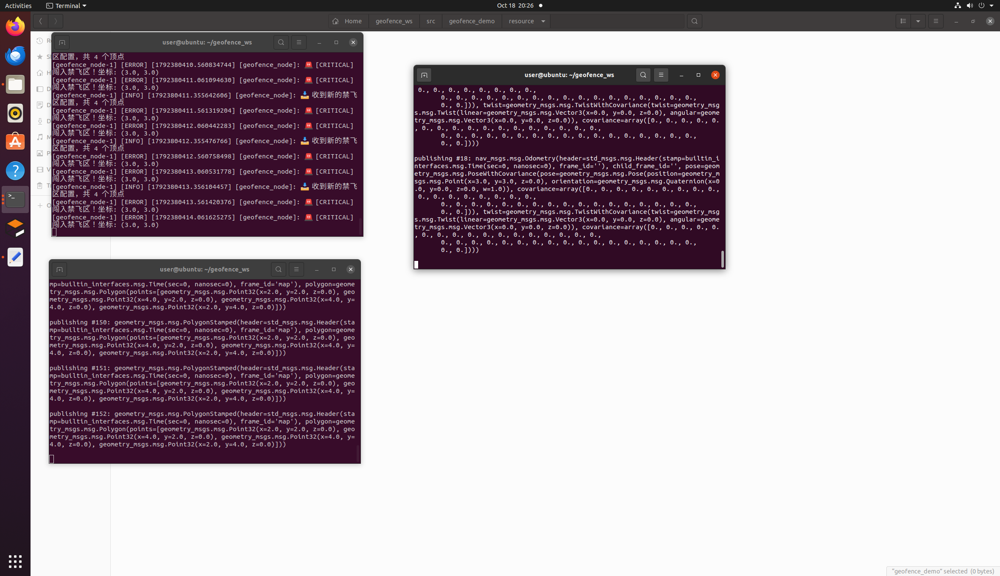

# 基于 ROS 2 的禁飞区（电子围栏）动态检测与安全预警系统

## 项目简介

本项目是一个基于 ROS 2 的独立安全监控层模块。系统旨在为无人机等移动机器人提供实时的禁飞区（电子围栏）检测。通过订阅载具的实时位姿与动态下发的禁飞区多边形边界，系统利用**射线法（Ray Casting）**实时判断载具是否侵入禁飞区，并输出 `SAFE`（安全）或 `CRITICAL`（侵入告警）两级安全状态。

## 功能与原理

节点在收到 `/geofence` 的多边形后缓存顶点，在收到 `/odom` 的载具位置后：

1. 校验两条话题的 `header.frame_id` 是否与期望的 `expected_frame_id` 一致（默认 `map`）；
2. 用射线法判断当前位置是否在多边形内部（边界点一律返回 `False`，仅内部点返回 `True`；重复顶点产生的零长度边会被忽略）；
3. 状态变化时立即发布 `/geofence_status`，消息体只放枚举字符串 `SAFE` 或 `CRITICAL`，载具坐标写入日志；发布者使用 `TRANSIENT_LOCAL` QoS，后启动的订阅者也能收到最近一次状态；收到新围栏后会重新发布一次当前状态。

## 项目目录结构

```text
src/air/
└── geofence_demo/
    ├── geofence_demo/
    │   ├── __init__.py
    │   └── geofence_node.py        # 核心检测节点
    ├── launch/
    │   └── geofence.launch.py      # 启动脚本
    ├── resource/
    ├── test/
    │   ├── test_geofence_logic.py  # 多边形判定单元测试
    │   ├── test_flake8.py
    │   └── test_pep257.py
    ├── package.xml
    ├── setup.cfg
    └── setup.py
```

## 依赖环境

- **操作系统**：Ubuntu 22.04 / WSL2
- **ROS 版本**：ROS 2 Humble
- **Python**：Python 3

## 编译与运行步骤

1. **编译工作空间**

```bash
colcon build --packages-select geofence_demo --symlink-install
source install/setup.bash
```

2. **启动核心节点**

在终端 1 中启动禁飞区检测节点：

```bash
ros2 launch geofence_demo geofence.launch.py
```

3. **发布禁飞区边界**

终端 2 发布矩形禁飞区（X:2~4, Y:2~4）：

```bash
ros2 topic pub /geofence geometry_msgs/msg/PolygonStamped "{
  header: {frame_id: 'map'},
  polygon: {
    points: [{x: 2.0, y: 2.0}, {x: 4.0, y: 2.0},
             {x: 4.0, y: 4.0}, {x: 2.0, y: 4.0}]
  }
}" -r 1
```

4. **发布载具位置并验证状态**

终端 3，先测试安全状态：

```bash
ros2 topic pub /odom nav_msgs/msg/Odometry \
  "{header: {frame_id: 'map'}, pose: {pose: {position: {x: 0.0, y: 0.0}}}}" -r 2
```

再测试入侵状态（在围栏内部 (3, 3)）：

```bash
ros2 topic pub /odom nav_msgs/msg/Odometry \
  "{header: {frame_id: 'map'}, pose: {pose: {position: {x: 3.0, y: 3.0}}}}" -r 2
```

## 话题接口说明

| 方向 | 话题 | 类型 | 说明 |
|------|------|------|------|
| 订阅 | `/odom` | `nav_msgs/Odometry` | 载具实时位置，`header.frame_id` 需与期望一致 |
| 订阅 | `/geofence` | `geometry_msgs/PolygonStamped` | 禁飞区多边形边界 |
| 发布 | `/geofence_status` | `std_msgs/String` | `SAFE` / `CRITICAL` 分级安全状态，`TRANSIENT_LOCAL` QoS（latched） |

## 坐标系要求

节点通过参数 `expected_frame_id` 指定期望的坐标系（默认 `map`）。
若 `/odom` 和 `/geofence` 两条话题的 `frame_id` 与期望不一致，
节点会输出警告并跳过检测。需先用 tf2 将两者变换到同一坐标系。

## 边界语义

落在多边形边上或顶点上的位置按 `SAFE` 处理，这是有意选择：把围栏边界视为
"仍在围栏内"，避免载具贴着边界飞行时反复触发告警。

这一选择的代价是边界外侧紧邻的一条窄带同样不会告警。如果实际场景需要一个
缓冲带，可以把判定改成"到围栏边界距离小于阈值即 `CRITICAL`"，或单独输出
`WARN` 级别。

## 自动化测试

在已 source 工作空间的环境中执行：

```bash
# 方式一：使用 colcon test
colcon test --packages-select geofence_demo
colcon test-result --verbose --test-result-base build/geofence_demo

# 方式二：直接运行 pytest
cd src/air/geofence_demo
python3 -m pytest test -v
```

测试覆盖：

* 多边形判定对边界点、空多边形、退化多边形的处理；
* 矩形内部点返回 `True`、外部点返回 `False`；
* 起点旋转、顺时针/逆时针顶点顺序变化时结果一致；
* 重复顶点（零长度边）不会让围栏整体失效；
* 零长度边不会被误判为有效边界。

## 运行效果展示

### 1. 安全状态


### 2. 入侵告警


