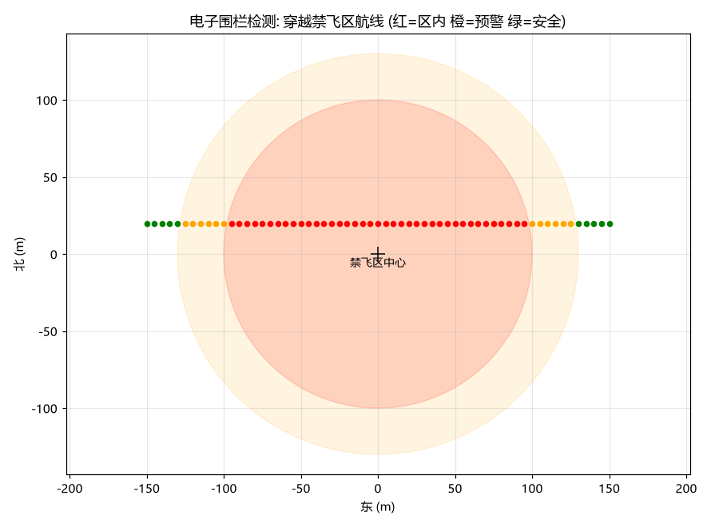

# (作业) 蒋宇鑫 2535030012 无人机电子围栏检测与告警 (geofence_detector)

## 1. 简介

电子围栏（禁飞区）是低空经济合规飞行的底线能力——机场净空区、活动管制区、敏感区域上空禁止飞行。本模块实现两类禁飞区（圆柱形/轴对齐矩形，带高度范围）的几何检测，输出三级状态（安全/预警/告急），并提供 ROS2 节点实时检测 `/drone/pose`。真实联调结果：区内告急、边界预警、区外安全全部正确。

## 2. 运行环境

- Ubuntu 22.04 + ROS 2 Humble；测试需 pytest；绘图需 matplotlib

## 3. 目录结构

```text
src/air/geofence_detector/
├── main.py              # ROS2 节点: 订阅 /drone/pose, 发布 /drone/geofence_status
├── pub_test_poses.py    # 联调测试发布器
├── core.py              # 围栏几何检测核心（纯 Python）
└── test/test_core.py    # 7 项单元测试
```

## 4. 话题说明

| 话题 | 类型 | 方向 | 说明 |
| --- | --- | --- | --- |
| `/drone/pose` | `geometry_msgs/PoseStamped` | 订阅 | 无人机当前位置 (ENU) |
| `/drone/geofence_status` | `std_msgs/String` | 发布 | 格式 `状态:距离`, 如 `WARNING:15.0` |

## 5. 单元测试运行结果

```text
test/test_core.py::test_cylinder_inside PASSED
test/test_cylinder_warning PASSED
test/test_cylinder_ok PASSED
test/test_cylinder_above_altitude_free PASSED
test/test_rect_inside_and_warning PASSED
test/test_detector_multi_fence_strictest_wins PASSED
test/test_flight_path_breach_detection PASSED
7 passed
```

## 6. ROS2 节点真实联调结果

启动围栏节点后，用 `pub_test_poses.py` 依次发送 4 个测试位置（区内 50m → 边界 15m → 区外 → 第二围栏附近），节点全部正确响应：

```text
[geofence_detector]: 电子围栏节点启动, 订阅 /drone/pose
[geofence_detector]: 【告急】已进入禁飞区! 深入 50.0 m, 请立即脱离 (位置: 50,0,50)
[geofence_detector]: 【预警】距禁飞区边界仅 15.0 m, 注意规避
[geofence_detector]: 围栏状态正常 (最近边界 100 m)
```

## 7. 运行效果图



（图由 `make_figures.py` 实际运行生成：红色区域为禁飞区，橙色为预警环，一条自西向东的穿越航线按位置实时着色，61 个采样点中 39 个 INSIDE / 12 个 WARNING / 10 个 OK。）

## 8. 设计说明

- **距离语义**：围栏外为正（到边界距离），区内为负（深入距离），便于下游判断紧急程度；
- **多围栏取最严**：任一围栏触发即取最高优先级状态（INSIDE > WARNING > OK）；
- **高度维度**：围栏带 z 范围，高于围栏顶（如 120m）按法规允许的场景不触发；
- **退出参数**：`exit_after` 支持定时退出，方便联调与 CI。

## 9. 参考链接

- 民航局无人机适飞空域规定: <https://www.caac.gov.cn/>
- OpenHUTB 空域文档: <https://openhutb.github.io/air_doc/dev/Carla_Air/>

## 10. 大模型使用声明

本模块代码与文档在编写过程中使用了大模型工具（WorkBuddy）辅助生成，作者已逐行核对全部内容，理解其原理并实际运行验证，对提交内容负全部责任。
