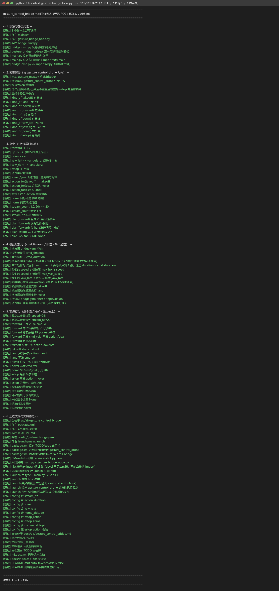

# 手势控制无人机（桥接层版）

用**摄像头 + MediaPipe** 识别手势，但执行层不再直连 AirSim，而是把指令翻译成
`carlair_ros_bridge` 的话题（`/uav/action`、`/uav/cmd_vel`、`/uav/goal`），由桥接层
统一限速、超时悬停并执行。

源码位于 [`src/air/gesture_control_bridge`](https://github.com/OpenHUTB/ros2/tree/master/src/air/gesture_control_bridge)，
完整运行细节见模块 `README.md`；**直连版**见 [`gesture_control_drone`](gesture_control_drone.md)。

---

## 1. 它解决什么问题

`gesture_control_drone` 已经证明"手势能飞"，但它是**直连 AirSim** 的：自己建连接、
自己限速、自己判超时。仓库里其它无人机模块（键盘、遥操作、导航）都统一走
`carlair_ros_bridge`，直连就带来三个问题：

1. **安全逻辑两份**：模块自己的 `command_timeout` 与桥接层的 `cmd_timeout` 语义不同，
   出问题时不知道哪一层生效；
2. **换仿真器要改模块**：换 CarlaAir、多机 `vehicle_name`、换桥接层的限速策略，都得动手势代码；
3. **位姿话题两套**：直连版发 `/drone/odom`，桥接层发 `/uav/odom`，RViz/TF 里容易混乱。

本模块把"翻译"和"执行"分开：

```
gesture_control_drone（感知，不动）
    /gesture_command ──►  gesture_control_bridge（只翻译，不连仿真器）
                             ├─ /uav/action   takeoff | land | hover
                             ├─ /uav/cmd_vel  机体系速度流（前/左/上 + 偏航角速度）
                             └─ /uav/goal     home 的 ENU 目标点
                                        │
                              carlair_ros_bridge（唯一连仿真器）
                                        ├─ control/* 限速限幅
                                        ├─ cmd_timeout 超时自动悬停
                                        ├─ /uav/odom + TF
                                        └─ 多机 vehicle_name
```

换仿真器、改限速、上多机，都只动桥接层参数，本模块一行不改。

## 2. 指令 → 桥接层消息

| 手势指令 | 通道 | 消息 | 内容 |
|---|---|---|---|
| `takeoff` / `land` / `hover` | `/uav/action` | `std_msgs/String` | 一条消息，桥接层在工作线程里执行 |
| `forward` | `/uav/cmd_vel` | `geometry_msgs/Twist` | `linear.x = +speed`（机体系前） |
| `up` / `down` | `/uav/cmd_vel` | `Twist` | `linear.z = ±speed`（机体系上/下） |
| `yaw_left` / `yaw_right` | `/uav/cmd_vel` | `Twist` | `angular.z = ±yaw_rate`（rad/s，逆时针为正） |
| `home` | `/uav/goal` | `geometry_msgs/Point` | `(0, 0, home_altitude)`，ENU 世界系 |
| `estop` | `/uav/cmd_vel` + `/uav/action` | `Twist`×N + `String` | 先 `estop_zeros` 条零速刹停，再 `hover`（或 `land`） |

### 2.1 为什么一"次"手势要发 N 条速度指令

桥接层的两条安全语义决定了这件事：

| 桥接层参数 | 默认 | 含义 | 对本模块的约束 |
|---|---|---|---|
| `control/cmd_duration` | 0.1 s | **单条**速度指令的作用时长 | 只发一条 → 飞机只动 0.1 s |
| `rate/cmd_timeout` | 0.5 s | 超过该时间没有**新**指令 → 自动悬停 | 发得太稀 → 中途被悬停打断 |

所以一次 1 s 的位移被拆成 `action_duration × stream_hz = 1.0 × 20 = 20` 条、
间隔 `1/20 = 0.05 s` 的指令流：每条覆盖 0.1 s、下一条在 0.05 s 后接上，既不中断也不堆积。
`tests/test_gesture_bridge_local.py` 会直接读桥接层的 `bridge.yaml` 校验
`1/stream_hz < cmd_timeout`，防止以后有人把频率调低把功能调坏。

### 2.2 给桥接层补的动作通道

桥接层原本只有速度（`/uav/cmd_vel`）和目标点（`/uav/goal`）两个通道，"起飞"只能靠
`control/auto_takeoff` 启动即起飞，**没有降落通道**。本模块给它补了最小的
`/uav/action`（`takeoff` / `land` / `hover`）：

- `cmd_vel_sub.py` 新增 `cb_action` + `_action_worker`，用独立线程调用
  `SimClient.takeoff()/land()/hover()`（同步调用会阻塞到动作完成，不能放订阅回调）；
- 动作执行期间 `action_active` 置位，速度通道让位（与原有的 `goal_active` 一致），
  避免"边降落边接受速度指令"；
- 状态回报：`ACTION:takeoff` → `ACTION_DONE takeoff` / `ACTION_FAILED takeoff <err>`；
- 因此桥接层的 `auto_takeoff` 在配合本模块时应设为 **`false`**，由手势决定何时起飞。

## 3. 环境要求

| 位置 | 项目 | 版本 |
|---|---|---|
| 宿主 | 操作系统 | Windows 10/11 |
| 宿主 | 模拟器 | AirSim（Blocks）或 CarlaAir，RPC 41451 |
| 客户机 | 操作系统 | Ubuntu 20.04 |
| 客户机 | ROS | Noetic（ROS 1） |
| 客户机 | Python | 3.8 |
| 客户机 | 依赖 | `python3-opencv` `python3-numpy` `python3-pil`（apt）<br>`mediapipe`(0.10.x) `airsim`（pip，见 `gesture_control_drone/requirements.txt`） |

摄像头必须接在**跑 ROS 的那台机器**上（虚拟机需透传 USB 摄像头；VMware 透传时建议
`GESTURE_CAMERA_FOURCC=MJPG`，见直连版文档 §9.3）。

## 4. 运行

```bash
# 1) 编译
cd ~/uav_ws && catkin_make && source devel/setup.bash

# 2) 宿主机启动 AirSim

# 3) 一条命令：桥接层 + 手势感知 + 本模块
roslaunch gesture_control_bridge main.launch host:=192.168.49.1

# 或分两个终端（推荐，桥接层日志单独看）：
roslaunch carlair_ros_bridge main.launch host:=192.168.49.1 \
    auto_takeoff:=false publish_image:=false publish_lidar:=false
roslaunch gesture_control_bridge main.launch start_bridge:=false
```

预期日志：

```
[bridge] 已启动：订阅 /gesture_command -> /uav/cmd_vel / /uav/action / /uav/goal
[bridge] 指令通道：takeoff->/uav/action，land->/uav/action，…，forward->/uav/cmd_vel，…
[bridge] 速度 0.80 m/s，偏航 0.50 rad/s，单次时长 1.00 s，指令流 20 Hz（20 条/次），急停=hover
[bridge] takeoff OK action=takeoff
[bridge] forward OK cmd_vel×20 (0.80,0.00,0.00) yaw=0.00 rad/s
```

## 5. 话题接口

| 方向 | 话题 | 类型 | 说明 |
|---|---|---|---|
| 订阅 | `/gesture_command` | `std_msgs/String` | 手势指令 token（由 `gesture_control_drone` 发布） |
| 订阅 | `/uav/status` | `std_msgs/String` | 桥接层状态（`READY`/`HOVER`/`VELOCITY`/`ACTION_DONE`…） |
| 订阅 | `/uav/odom` | `nav_msgs/Odometry` | 桥接层位姿（本模块只用于日志/观测） |
| 发布 | `/uav/action` | `std_msgs/String` | `takeoff` / `land` / `hover` |
| 发布 | `/uav/cmd_vel` | `geometry_msgs/Twist` | 机体系速度流 |
| 发布 | `/uav/goal` | `geometry_msgs/Point` | home 目标点（ENU） |
| 发布 | `/gesture_bridge/state` | `std_msgs/String` | 本模块的执行结果，便于排查 |

排查命令：

```bash
rostopic echo /gesture_command        # 感知端有没有发指令
rostopic echo /gesture_bridge/state   # 本模块翻译成了什么
rostopic echo /uav/status             # 桥接层执行到哪一步
rostopic echo /uav/odom               # 位姿有没有真的变
rostopic hz /uav/cmd_vel              # 指令流是否按 20 Hz 发（一次动作约 1 s）
```

## 6. 参数

| 参数 | 默认 | 说明 |
|---|---|---|
| `command_topic` | `/gesture_command` | 订阅的手势指令话题 |
| `cmd_vel_topic` / `action_topic` / `goal_topic` | `/uav/cmd_vel` / `/uav/action` / `/uav/goal` | 三个输出通道 |
| `status_topic` / `odom_topic` | `/uav/status` / `/uav/odom` | 桥接层状态与位姿 |
| `speed` | 0.8 | 机体系线速度 m/s（须 ≤ 桥接层 `max_horiz_speed`/`max_vert_speed`） |
| `yaw_rate` | 0.5 | 偏航角速度 rad/s（须 ≤ 桥接层 `max_yaw_rate`） |
| `action_duration` | 1.0 | 一次位移/偏航持续时长 s |
| `stream_hz` | 20.0 | 速度指令流频率 Hz（`1/hz` 必须 < 桥接层 `cmd_timeout`） |
| `home_altitude` | 3.0 | `home` 的 ENU 高度 m |
| `estop_action` | hover | 急停语义：`hover`（刹停后悬停）/ `land`（刹停后降落） |
| `estop_zeros` | 5 | 急停先发几条零速 |
| `command_cooldown` | 0.5 | 同一条指令的最小间隔 s |

> **限速/限幅不在本模块**：改速度上限请改 `carlair_ros_bridge/config/bridge.yaml`
> 的 `control/max_*`；本模块只保证自己发出去的速度不超过它（离线回归里有这条断言）。

## 7. 自测

```bash
python3 tests/test_gesture_bridge_local.py
```

覆盖：脚本语法与静态约定、**与 `gesture_control_drone` 的词表契约**（逐项比对，防漂移）、
指令→`Twist`/`Point`/`String` 映射与符号、指令流条数与节拍、**桥接层 `cmd_timeout`
兼容性**、急停（零速 + 动作）、home 目标点、节点冷却/未知指令/退出安全、工程文件与文档约定。

## 8. 常见问题

| 现象 | 原因与处理 |
|---|---|
| 发的 `takeoff` 没反应，桥接层日志报 `already moving` | 桥接层 `auto_takeoff` 还是 `true`（它启动就起飞了）→ 用 `auto_takeoff:=false` |
| 飞机只动一下就停 | 指令流频率太低（`stream_hz` 被调小）导致被 `cmd_timeout` 判失效 → 保持 20 Hz |
| `rostopic hz /uav/cmd_vel` 看不到数据 | 只在动作那一瞬间有（约 1 s / 20 条），动作结束就没有了，属正常 |
| `land` 卡住十几秒 | 桥接层是同步 `land()`，降落实测 20 s 量级（AirSim 下降约 0.2 m/s 且带减速） |
| 桥接管相机/雷达节点报错退出 | 纯 AirSim Blocks 没有 `front_rgb`/`lidar1` → `publish_image:=false publish_lidar:=false` |

## 9. 运行证据

### 9.1 离线回归（本机真实输出）



上图由 `gesture_control_drone/tools/log_to_png.py` 从**真实终端输出**渲染（不是系统截屏）：

```bash
python3 tests/test_gesture_bridge_local.py 2>&1 | tee /tmp/bridge_test.log
python3 src/air/gesture_control_drone/tools/log_to_png.py /tmp/bridge_test.log \
    docs/img/air/gesture_control_bridge/local_test.png \
    --title "python3 tests/test_gesture_bridge_local.py"
```

### 9.2 桥接层联调（真机）

```bash
roslaunch carlair_ros_bridge main.launch host:=<宿主IP> auto_takeoff:=false \
    publish_image:=false publish_lidar:=false
roslaunch gesture_control_bridge main.launch start_bridge:=false
# 另一个终端：
rostopic pub -1 /gesture_command std_msgs/String "data: 'takeoff'"
rostopic pub -1 /gesture_command std_msgs/String "data: 'forward'"
rostopic pub -1 /gesture_command std_msgs/String "data: 'land'"
rostopic echo /uav/status     # ACTION:takeoff -> VELOCITY -> ACTION:land -> HOVER
```

证据图（`docs/img/air/gesture_control_bridge/`）待真机跑通后按上面的命令生成。

## 10. 与直连版的关系

| | `gesture_control_drone` | 本模块 |
|---|---|---|
| 连接仿真器 | 自己持有 `MultirotorClient` | 不持有，走桥接层 |
| 起飞/降落 | 自己 `armDisarm/takeoffAsync/landAsync` | `/uav/action` |
| 位移 | `moveByVelocityBodyFrameAsync` | `/uav/cmd_vel` 指令流 |
| 限速/超时保护 | 模块自己实现 | 桥接层 `control/*` + `cmd_timeout` |
| 位姿 | `/drone/odom` | `/uav/odom` |
| 适用场景 | 手机上只有 AirSim Blocks、不想装 CarlaAir 栈 | 与仓库其它无人机模块统一栈、多机、需要统一安全策略 |

两个模块可以共存：直连版保留原有证据与文档，本模块作为"接入统一桥接层"的替代路径。

## 11. 大模型使用声明

本文档及配套模块代码在编写过程中使用了 AI 大模型辅助（需求分析、代码与文档起草）。
参数与话题接口以本模块的离线回归测试和桥接层源码为准；真机动作序列以现场日志为准。
作者对提交内容的正确性与完整性负全部责任。
