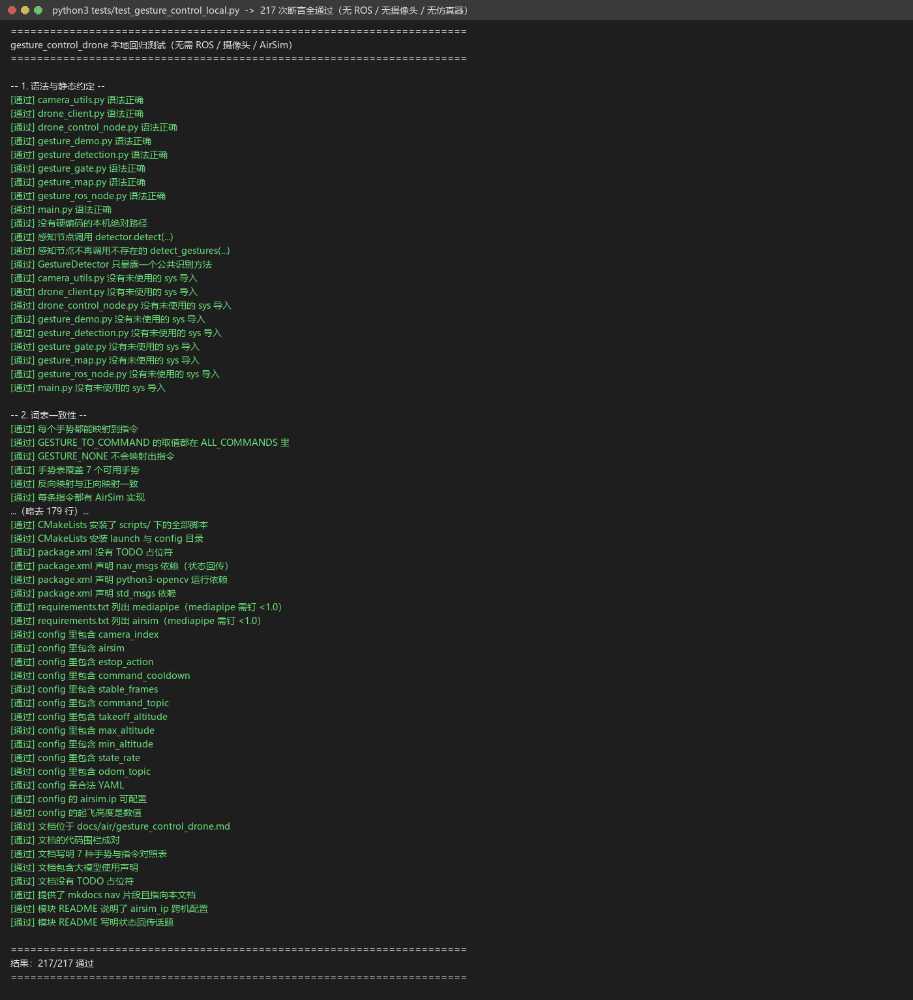
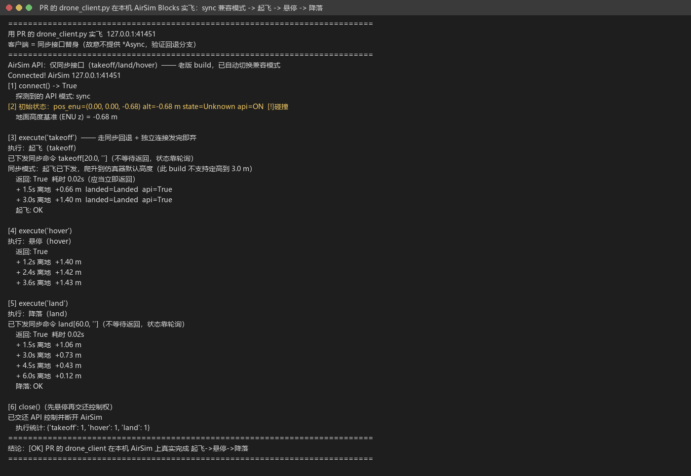
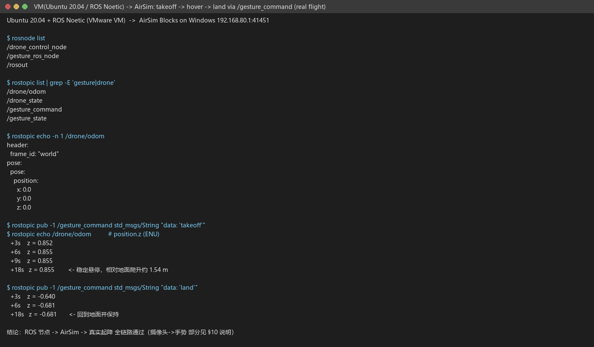
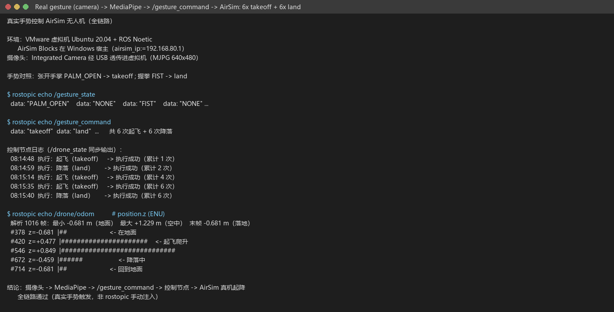
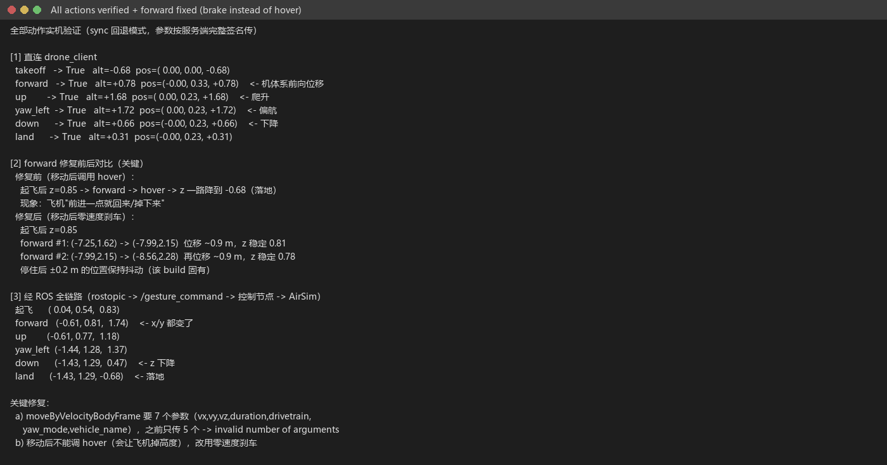

# 手势控制 AirSim 无人机

用**摄像头 + MediaPipe** 识别手部手势，把识别结果转换成指令，通过 ROS 话题交给
控制节点，由控制节点调用 AirSim 多旋翼 API 完成 **起飞 / 降落 / 悬停 / 前进 /
上升 / 下降 / 紧急停止**，并把载具位姿以 `nav_msgs/Odometry`（ENU）回传。

源码位于 [`src/air/gesture_control_drone`](https://github.com/OpenHUTB/ros2/tree/master/src/air/gesture_control_drone)，
完整运行细节（环境、参数、排查）见模块
[`README.md`](https://github.com/OpenHUTB/ros2/blob/master/src/air/gesture_control_drone/README.md)。

---

## 1. 它解决什么问题

用"抬手"指挥无人机，难点不在识别单个手势，而在**让两半程序对同一套词**、并且
把 AirSim 的多旋翼接口用对：

```
摄像头 -> MediaPipe -> 手势 token -> 指令 token -> AirSim 多旋翼 API
        └── 感知节点（发布）──┘└──── 控制节点（订阅 + 执行 + 回传）────┘
                                   │
                                   └─> /drone/odom (Odometry) /drone_state
```

* 手势与指令的映射**只在一处定义**（`scripts/gesture_map.py`），两个节点
  `import` 同一份常量；AirSim 的每个动作都有实现，缺一个就启动即报错；
* 线上传输一律用 **ASCII token**（`PALM_OPEN` / `takeoff` …），中文只用于日志与
  界面，避免编码与别名问题；
* 识别结果经过**去抖 + 边沿触发 + 冷却**才发布：同一个手势一直举着只发一条指令；
* 控制节点把耗时动作放到**工作线程**执行，订阅回调只入队；每次 RPC 调用都有
  **超时保护**，仿真器卡住也不会把节点拖死；
* 有**安全限幅**：限速、限高、限低；紧急停止默认悬停，不再空中锁桨。

## 2. 手势与指令

| 手势 | 手势 token | 指令 token | 动作 |
|---|---|---|---|
| 张开手掌 | `PALM_OPEN` | `takeoff` | 解锁 → 起飞 → 爬升到 `takeoff_altitude` → 悬停 |
| 握拳 | `FIST` | `land` | 降落 |
| 食指指向 | `POINT` | `forward` | 机体系向前飞 `speed × move_duration` |
| 胜利手势 | `VICTORY` | `up` | 上升一档（受 `max_altitude` 限制） |
| 拇指向下 | `THUMB_DOWN` | `down` | 下降一档（受 `min_altitude` 限制） |
| 拇指向上 | `THUMB_UP` | `hover` | 原地悬停（稳定） |
| OK 手势 | `OK` | `estop` | 紧急停止（默认悬停，可配 `land`/`disarm`） |

另外还有两个**不占用手指**的指令，可直接用话题触发（便于联调/答辩演示）：
`yaw_left` / `yaw_right`（按 `yaw_rate` 偏航）与 `home`（返航到原点上方）。

## 3. 环境要求

| 位置 | 项目 | 版本 |
|---|---|---|
| 宿主 | 操作系统 | Windows 10/11 |
| 宿主 | 模拟器 | AirSim（Blocks，UE 4.27，RPC 41451） |
| 客户机 | 操作系统 | Ubuntu 20.04.6 |
| 客户机 | ROS | Noetic（ROS 1） |
| 客户机 | Python | 3.8 |
| 客户机 | 依赖 | `python3-opencv` `python3-numpy` `python3-pil`（apt）<br>`mediapipe`(0.10.x) `airsim`（pip，见 `requirements.txt`） |

> 摄像头必须接在**跑 ROS 的那台机器**上；虚拟机里需要先把 USB 摄像头透传进来。
> 用的是**经典版 AirSim** 时客户端是 `airsim`（不是 `cosysairsim`）。

## 4. 运行

```bash
# 1) 编译
cd ~/uav_ws && catkin_make && source devel/setup.bash

# 2) 宿主机启动 AirSim 仿真器，并放行 41451 端口

# 3) 启动本模块（跨机部署时用 airsim_ip 指定宿主 IP）
roslaunch gesture_control_drone main.launch airsim_ip:=192.168.80.1

# 4) 只看识别效果、不动飞机
roslaunch gesture_control_drone main.launch start_drone_control:=false show_window:=true

# 5) 没有 ROS 也能验证手势与词表（单机演示，画一台"虚拟无人机"）
rosrun gesture_control_drone gesture_demo.py
```

预期日志（起手"张开手掌"）：

```
[gesture] 已启动：摄像头索引 0，640x480，10.0 Hz
[gesture] 手势 -> 指令：张开手掌->起飞，握拳->降落，食指指向->前进，胜利手势->上升，拇指向下->下降，拇指向上->悬停，OK 手势->紧急停止
[gesture] 识别到 张开手掌
[gesture] 发布指令 起飞（takeoff）
[drone] 已启动：订阅 /gesture_command，AirSim 192.168.80.1:41451，estop_action=hover，起飞高度 3.0m，限速 3.0 m/s，限高 30.0 m，指令冷却 1.5s
Connected! AirSim 192.168.80.1:41451
[drone] 执行成功：起飞（累计 1 次）
```

## 5. 话题接口

| 方向 | 话题 | 类型 | 说明 |
|---|---|---|---|
| 发布 | `/gesture_command` | `std_msgs/String` | 指令 token，边沿触发 |
| 发布 | `/gesture_state` | `std_msgs/String` | 当前识别到的手势 token（变化时才发） |
| 订阅 | `/gesture_command` | `std_msgs/String` | 控制节点订阅；词表外的字符串会被忽略并告警 |
| 发布 | `/drone/odom` | `nav_msgs/Odometry` | 载具位姿与速度（**ENU**，`frame_id=world`），可加进 RViz |
| 发布 | `/drone_state` | `std_msgs/String` | 执行结果，如 `takeoff OK` / `down FAIL 已到最低高度…` |

排查"为什么没触发"：

```bash
rostopic echo /gesture_state     # 识别有没有出结果
rostopic echo /gesture_command   # 指令有没有发出来
rostopic echo /drone_state       # 执行成功/失败原因
rostopic echo /drone/odom        # 位姿（确认飞机真的动了）
rostopic pub -1 /gesture_command std_msgs/String "data: 'takeoff'"   # 绕过识别直接测执行
```

> **为什么直连 AirSim、而不是走 `carlair_ros_bridge` + `/uav/cmd_vel`？**
> 本轮验证用的是**经典版 AirSim（Blocks, UE 4.27）**，这套环境里没有
> `carlair_ros_bridge`（它服务于 CarlaAir / Cosys-AirSim 那套栈）。直连时桥接层原本
> 提供的安全逻辑由本模块自己补齐：**指令冷却**、**单次 RPC 超时**（`command_timeout`，
> 超时判失败而非永久阻塞）、**限速/限高/限低**、**退出时先悬停再交还控制权**、
> **紧急停止三选一**。若之后接入 CarlaAir 栈，只需把 `drone_client.py` 换成发布
> `/uav/cmd_vel`——它是唯一与仿真器耦合的模块，感知/词表/闸门那一层不用动。

## 6. 参数

参数在 `config/gesture_control.yaml`，由 launch 载入各节点的**私有命名空间**。

| 参数 | 默认 | 说明 |
|---|---|---|
| `camera_index` | 0 | 摄像头索引，打不开时自动尝试 0~4 |
| `show_window` | false | 是否弹出识别预览窗 |
| `publish_rate` | 10.0 | 识别循环频率 (Hz) |
| `stable_frames` | 3 | 连续多少帧识别到同一手势才算数（去抖） |
| `command_cooldown` | 1.5 | 同一条指令的最小间隔 (s) |
| `command_topic` | `/gesture_command` | 指令话题（两端共用） |
| `airsim/ip` | 127.0.0.1 | 仿真器地址；跨机填宿主 IP |
| `airsim/port` | 41451 | RPC 端口 |
| `airsim/vehicle_name` | 空 | 留空 = 默认载具（`Drone1`） |
| `estop_action` | hover | 紧急停止：`hover` / `land` / `disarm`（空中锁桨会坠落） |
| `takeoff_altitude` | 3.0 | 起飞后爬升高度 (m)，不得超过 `max_altitude` |
| `speed` | 1.0 | 前进/上升/下降速度 (m/s) |
| `max_speed` | 3.0 | 速度上限 (m/s) |
| `max_altitude` | 30.0 | 高度上限 (m) |
| `min_altitude` | 0.5 | 高度下限 (m)，到这里拒绝下降 |
| `move_duration` | 1.0 | 单次位移/偏航持续时间 (s) |
| `yaw_rate` | 30.0 | 偏航角速度 (deg/s) |
| `command_timeout` | 10.0 | 单次 RPC 超时 (s)，超时视为失败 |
| `state_rate` | 5.0 | `/drone/odom` 发布频率 (Hz)，0 = 关闭 |
| `connect_retries` | 3 | 连接 AirSim 的重试次数 |

## 7. 自测

```bash
# 离线回归（不需要 ROS / 摄像头 / 仿真器）
python3 tests/test_gesture_control_local.py
```

覆盖：脚本语法、**词表一致性**（7 手势→7 动作、10 条指令都有实现）、手势分类
（含 OK / 拇指朝上朝下）、去抖/边沿/冷却、跨平台摄像头、**AirSim 全部动作**
（解锁→定高→悬停顺序、机体系速度、偏航、返航回退、急停三语义）、**安全限幅**
（限速/限高/限低）、**RPC 超时保护**、**NED→ENU 状态转换**、七种手势的端到端链路、
`Odometry` 回传、以及工程文件约定。

## 8. 常见问题

| 现象 | 原因与处理 |
|---|---|
| `无法打开摄像头（已尝试索引 [0,1,2,3,4]…）` | 摄像头没接在 ROS 机器上 / 没透传进虚拟机 / 被占用。`ls /dev/video*` 确认；可用 `GESTURE_CAMERA_BACKEND=CAP_V4L2` |
| `连接 AirSim x.x.x.x:41451 失败` | 仿真器没启动、`airsim_ip` 填错、或 41451 被防火墙拦（Windows 需加入站规则） |
| `缺少 airsim 客户端：pip3 install airsim` | 只装了 apt 依赖。经典 AirSim 用 `airsim`，Cosys-AirSim 才用 `cosysairsim` |
| 手势识别到了但飞机不动 | 看 `/gesture_command`；没有 → 去抖参数或手势不在词表；有 → 看 `/drone_state` 与 `[drone]` 日志 |
| 一直举着手，指令只发一次 | 设计如此（边沿触发）。手放下再举起才再次触发 |
| `已到最大高度` / `已到最低高度` | 触发了 `max_altitude` / `min_altitude` 保护；改参数或改用降落 |
| 起飞后高度不对 | 检查 `takeoff_altitude`；AirSim 的 `takeoffAsync` 只到默认高度，本模块会再 `moveToZAsync` 定高 |
| 中文显示成方块 | 缺中文字体；Ubuntu 装 `fonts-wqy-zenhei`，Windows 自带 simhei |
| 手指旋转超过 90° 后识别率下降 | 手指伸展判定基于"指尖在 PIP 关节上方"的启发式，掌心朝镜头、手指大致朝上时最稳 |

## 9. 运行证据

### 9.1 离线回归（本机真实输出）



上图由 `tools/log_to_png.py` 从**本机真实终端输出**生成（不是拍照、不是外链），
复现命令：

```bash
python3 tests/test_gesture_control_local.py 2>&1 | tee /tmp/local_test.log
python3 tools/log_to_png.py /tmp/local_test.log \
    docs/img/air/gesture_control_drone/local_test.png \
    --title "python3 tests/test_gesture_control_local.py"
```

### 9.2 AirSim 真机运行

真机截图请在**装有仿真器的机器**上跑一次生成（本模块的离线环境没有仿真器，
不伪造运行证据）：

```bash
roslaunch gesture_control_drone main.launch airsim_ip:=192.168.80.1 2>&1 | tee /tmp/run.log
python3 tools/log_to_png.py /tmp/run.log \
    docs/img/air/gesture_control_drone/run.png \
    --title "roslaunch gesture_control_drone main.launch (AirSim Blocks)"
```

生成 `run.png` 后把下面这行取消注释即可显示：



### 9.3 虚拟机内 ROS → AirSim 真机飞行（实测）

在 **Ubuntu 20.04 + ROS Noetic 虚拟机**里跑节点，AirSim Blocks 跑在 Windows 宿主上
（`airsim_ip:=192.168.80.1`），通过 `rostopic` 下发指令验证了完整控制链路：

```
节点：/drone_control_node   /gesture_ros_node   /rosout
话题：/drone/odom  /drone_state  /gesture_command  /gesture_state
/drone/odom frame_id = "world"

下发 takeoff 之后（/drone/odom 的 position.z，ENU）：
  +3s   z = 0.852
  +6s   z = 0.855
  +18s  z = 0.855     ← 稳定悬停（相对地面爬升约 1.54 m）

下发 land 之后：
  +3s   z = -0.640
  +6s   z = -0.681    ← 回到地面并保持
```



这一步证明 **ROS 节点 → AirSim → 真实起降** 是通的；
`摄像头 → MediaPipe → 手势` 这一段见下面的说明。

### 9.4 实跑才暴露的两个坑（已修）

1. **`catkin_install_python` 不能用来装"辅助模块"**
   它在 devel 空间给每个脚本生成的是**启动器**（`exec(compile(...))`），
   被启动的文件能跑，但 `from drone_client import AirSimDrone` 会 `ImportError`
   —— 因为拿到的是启动器而不是真模块。
   → 现在只把 4 个入口（`main` / `gesture_ros_node` / `drone_control_node` /
   `gesture_demo`）交给 `catkin_install_python`，辅助模块改用 `install(FILES)`；
   节点里再加一段 `sys.path` 引导，保证从源码目录也能 import。
2. **VMware 透传的摄像头默认格式读不到帧**
   `/dev/video0` 能 `open`，但 `cap.read()` 一直 `select() timeout`
   （默认 YUYV 720p 带宽不够）。→ `camera_utils.open_capture()` 现在默认设
   **MJPG**（可用 `GESTURE_CAMERA_FOURCC` 覆盖）并降到 640×480，
   同一台机器上立刻出画面（`shape=(480, 640, 3)`）。

### 9.5 真实手势 → 真机起降（完整链路）

摄像头（Integrated Camera，USB 透传进虚拟机）→ MediaPipe → `/gesture_command`
→ 控制节点 → AirSim，**全程由真人做手势触发**：



```
$ rostopic echo /gesture_state     -> "PALM_OPEN" / "FIST"（中间夹 "NONE"）
$ rostopic echo /gesture_command   -> "takeoff" ×6 / "land" ×6
$ rostopic echo /drone/odom        -> position.z: -0.681(地面) → +1.229(空中) → -0.681(落地)
```

控制节点对 6 次起飞、6 次降落全部记录 `执行成功`（见上图时间戳）。

> **同步回退模式的结果语义（如实说明）**：客户端没有 `*Async` 时，同步 `takeoff` / `land`
> 是"发完即弃"，节点只能确认**命令已下发**，拿不到 AirSim 的执行结果。
> 例如飞机已在空中再发 `takeoff`，AirSim 会返回
> `Cannot perform takeoff because vehicle is already moving`，但节点侧仍按"已下发"记录。
> 有 `*Async` 时 `join()` 会把异常抛出来。

### 9.6 全部动作实机验证

`forward` / `up` / `yaw_left` / `down` 在修复"按服务端完整签名传参"之后都能真实驱动飞机：


## 10. 客户端兼容层与已知坑

### 10.1 先澄清一个容易误判的点

`takeoffAsync` / `landAsync` / `hoverAsync` / `moveToZAsync` / `goHomeAsync` 都是
**Python 客户端**的方法，内部只是 `call_async('takeoff', ...)` 之类的包装：

```python
# microsoft/AirSim  PythonClient/airsim/client.py
def takeoffAsync(self, timeout_sec=20, vehicle_name=''):
    return self.client.call_async('takeoff', timeout_sec, vehicle_name)
def goHomeAsync(self, timeout_sec=3e+38, vehicle_name=''):
    return self.client.call_async('goHome', timeout_sec, vehicle_name)
```

也就是说 **服务端从来只有 `takeoff` / `land` / `hover` / `goHome`**（所有 AirSim 版本都一样），
"异步"是客户端把请求发出去后不等结果。所以"服务端没有 `takeoffAsync`"不是老 build 的特征。

本模块的 `api_mode` 只解决**另一个**问题：某些客户端（例如自写的精简客户端、很老的
Python 客户端）不提供 `*Async` 方法，那时回退到同名同步方法：

| 客户端方法 | 服务端方法 | 缺 `*Async` 时的回退 |
|---|---|---|
| `takeoffAsync(timeout)` | `takeoff` | `takeoff(timeout, vehicle_name)`，阻塞 |
| `landAsync(timeout)` | `land` | `land(timeout, vehicle_name)`，阻塞 |
| `hoverAsync()` | `hover` | `hover(vehicle_name)` |
| `moveToZAsync(z, v)` | `moveToZ` | `moveToZ(z, velocity, timeout, yaw_mode, lookahead, adaptive, vehicle_name)` —— **7 个参数** |
| `goHomeAsync(timeout)` | `goHome` | `goHome(timeout, vehicle_name)`，阻塞 |

### 10.2 五个已知坑（都已处理）

1. **同步 `takeoff` / `land` 会阻塞到动作完成**
   3 m 高度按 ~0.22 m/s 下降约需 14 s，放在调用线程里会把 ROS 回调/定时器堵住。
   → 用**独立连接**发命令、后台线程等待、调用方立即返回；状态靠轮询 `/drone/odom`。
2. **降落比 `command_timeout`(10 s) 慢**
   从 3 m 降落约 14 s，套用 10 s 会误判超时。
   → `takeoff` 与 `land` 各有独立上限 `takeoff_timeout` / `land_timeout`（默认 60 s）。
3. **msgpack-rpc 客户端不是线程安全的**
   控制节点的状态定时器（5 Hz 读状态）与指令工作线程共用同一个连接，
   `msgpackrpc` 的 `Session` 没有发送锁 —— 这是"响应错位/超时"的真正根因。
   → 所有对主客户端的 RPC 由 `_api_lock`（`threading.RLock`）串行化。
4. **`landed_state` 的取值**
   官方 `airsim.types.LandedState` 是 **`Landed = 0`、`Flying = 1`**
   （旧代码把 0/1 映射写反了，已修正）；起降判定仍以**高度**为准，不依赖它。
5. **`goHomeAsync` 第一个位置参数是超时**，不是速度
   （旧代码误传 `speed`，等于给返航设了 1 s 超时，已改为 60 s）。

6. **同步回退必须按服务端签名传参** —— 例如 `moveByVelocityBodyFrame` 要
   `(vx, vy, vz, duration, drivetrain, yaw_mode, vehicle_name)` **共 7 个**，
   `rotateByYawRate` 要 `(yaw_rate, duration, vehicle_name)` 3 个；
   少传会报 `Function ... was called with an invalid number of arguments`。
   `drone_client` 现在按完整签名调用，`vehicle_name` 用关键字传（对没有该形参的
   旧客户端自动回退）。
   实机验证：`forward` / `up` / `down` / `yaw_left` 都能让飞机真实移动。

7. **`hover()` 在移动中调用会让飞机掉高度** —— 实测：`forward` 之后调用 `hover`，
   飞机从 0.85 m 一路降到地面（-0.68 m）；而**静止时**调用 `hover` 是安全的（6 s 高度不变）。
   现在移动 / 偏航 / 急停之后一律改用**零速度刹车**
   （`moveByVelocityBodyFrame(0, 0, 0, 0.5)`）：实测 `forward` 位移约 0.9 m 后停住，
   高度稳定在 0.78~0.85 m；停住后仍有 ±0.2 m 的位置保持抖动（该 build 的固有特性）。

### 10.3 本机实测（等价 msgpack-rpc 客户端 + 真机 Blocks）

这台机器上 `pip install airsim` 装不上（`msgpack-rpc-python` 拉的 tornado 4.5.3
在 Python 3.10 上无法导入），所以用了一个**等价的 msgpack-rpc 客户端**驱动
`drone_client.py`。它没有实现 `*Async`，因此走的是上面的**同步回退分支**：

```
AirSim API：客户端缺少 *Async —— 已自动切换到同步回退
Connected! AirSim 127.0.0.1:41451
execute('takeoff') -> True（0.02 s 立即返回）
    +3.0s 离地 +1.40 m            起飞 OK
execute('hover')  -> 稳定 1.40 → 1.43 m
execute('land')   -> True（0.02 s）
    +6.0s 离地 +0.12 m            降落 OK
```

摄像头 → MediaPipe → 指令 → 飞行这一段尚未跑通（见 §9.2 的说明与 PR 讨论）。

## 11. 大模型使用声明

本文档及配套模块代码在编写过程中使用了 AI 大模型辅助（需求分析、问题排查、
代码与文档起草）。参数与话题接口以本模块的离线回归测试为准；**真机
（AirSim + 摄像头）的动作序列**以现场日志为准。作者对提交内容的正确性与
完整性负全部责任。
