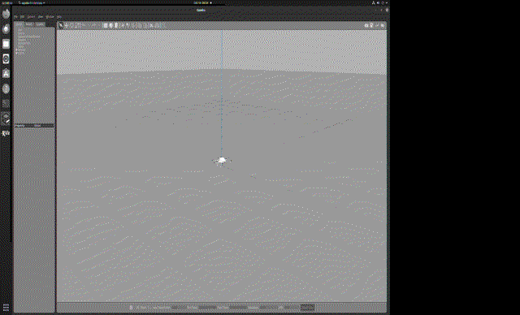
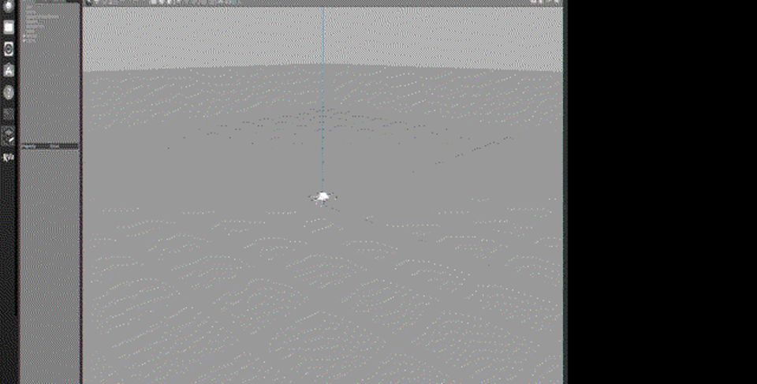

# 无人机物理仿真与键盘运动控制（hutb_uav_keyboard_teleop）

## 1. 任务目标

在 Gazebo 中构建六旋翼无人机（firefly）的**刚体物理仿真**，并实现**键盘运动控制**：键盘按键经自定义节点映射为 `/joy` 摇杆消息，再由 `rotors_joy_interface` 转发为姿态速率指令，驱动电机产生力矩，完成爬升、俯仰、滚转、偏航等运动。

## 2. 仿真操作步骤

### 2.1 启动仿真与控制链路

```bash
source /opt/ros/noetic/setup.bash
source ~/catkin_ws/devel/setup.bash
export ROS_PACKAGE_PATH=~/ros_pkgs:~/catkin_ws/src:~/openhutb_car_ws/src:/opt/ros/noetic/share
export TURTLEBOT3_MODEL=waffle_pi
export LIBGL_ALWAYS_SOFTWARE=1 GALLIUM_DRIVER=llvmpipe

roslaunch hutb_uav_keyboard_teleop main.launch
```

launch 文件启动 4 个部分：

1. **Gazebo 空世界**（`rotors_gazebo/worlds/basic.world`，软件渲染）；
2. **firefly 六旋翼**（`spawn_mav.launch`，URDF + 电机插件）；
3. **键盘控制节点** `drone_keyboard_teleop.py`（本模块自研，不依赖 uinput/手柄设备）；
4. **姿态速率控制器** `roll_pitch_yawrate_thrust_controller_node` + TF 发布。

### 2.2 键盘按键说明

| 按键 | 作用 | 映射通道 |
|---|---|---|
| W / S | 油门升 / 降 | `/joy.axes[2]`（thrust） |
| A / D | 滚转左 / 右 | `/joy.axes[0]`（roll） |
| ↑ / ↓ | 俯仰前 / 后 | `/joy.axes[1]`（pitch） |
| Q / E | 偏航左 / 右 | `/joy.buttons[3]` / `[4]` |
| C | 急停（复零） | 内部状态复位 |

### 2.3 控制链路

```
键盘 (drone_keyboard_teleop.py)
  → /joy (sensor_msgs/Joy)
  → rotors_joy_interface
  → /firefly/command/roll_pitch_yawrate_thrust
  → roll_pitch_yawrate_thrust_controller
  → 6 个电机插件 (rotors_gazebo) → 刚体力/力矩 → 位置与姿态更新
```

### 2.4 运行效果（GIF 演示）



*图 1 · 任务1 无人机物理仿真（Gazebo 场景，15 帧录屏，197 KB）*



*图 2 · 无人机仿真场景静态截图*

## 3. 计算原理与公式

### 3.1 六旋翼动力学

设 6 个旋翼转速为 $\omega_i$（rad/s），每旋翼升力系数 $k_f$，则总升力

$$
T = k_f \sum_{i=1}^{6} \omega_i^2
$$

在机体坐标系中，滚转、俯仰力矩分别来自左右/前后旋翼推力差，偏航力矩来自反扭矩差：

$$
\begin{aligned}
M_x &= k_f l (\omega_2^2 - \omega_5^2) \\
M_y &= k_f l (\omega_1^2 - \omega_4^2) \\
M_z &= k_m \sum_{i=1}^{6} (-1)^i \omega_i^2
\end{aligned}
$$

其中 $l$ 为臂长，$k_m$ 为反扭矩系数。平动与转动方程：

$$
m\ddot{\mathbf{r}} = T\mathbf{R}_{bw}\mathbf{e}_z - m\mathbf{g},\qquad
\mathbf{I}\dot{\boldsymbol{\omega}} + \boldsymbol{\omega}\times\mathbf{I}\boldsymbol{\omega} = \mathbf{M}
$$

### 3.2 姿态速率控制器

`rotors_control` 的 roll/pitch/yawrate/thrust 控制器将期望 $(r, p, \dot\psi, T)$ 转换为单旋翼推力：

$$
u_i = \frac{T}{6} + K_p \begin{bmatrix} r \\ p \\ \dot\psi \end{bmatrix} \cdot \mathbf{d}_i
$$

其中 $\mathbf{d}_i$ 为旋翼 $i$ 的力臂方向向量，$K_p$ 为比例增益（配置在 `roll_pitch_yawrate_thrust_controller_firefly.yaml`）。

### 3.3 键盘控制映射

键盘节点以 20 Hz 发布 `/joy`，杆量按步进积分：

$$
u_k = \text{clip}(u_{k-1} + \sigma \cdot \Delta u,\ -1, 1)
$$

其中 $\sigma\in\{+1,-1\}$ 为按键方向，$\Delta u = 0.06$（滚转/俯仰）或 $0.04$（油门）。

## 4. 算法流程

```
┌─────────────┐  按键事件   ┌──────────────────┐
│  KeyReader   │───────────→│  DroneTeleop     │
│ (termios raw)│            │  on_key() 更新状态│
└─────────────┘            └────────┬─────────┘
                                    │ 20 Hz
                                    ▼
                            ┌──────────────────┐
                            │  publish_loop()   │
                            │  组装 /joy 消息    │
                            └────────┬─────────┘
                                     ▼
                    rotors_joy_interface → 控制器 → 电机 → Gazebo 物理
```

## 5. 源代码解析

`scripts/main.py` 核心代码：

```python
class DroneTeleop:
    def __init__(self):
        self.pub = rospy.Publisher('/joy', Joy, queue_size=1)
        self.thrust = -1.0          # 初始油门 0

    def on_key(self, ch):
        # W/S 调节油门, A/D 调节滚转, ↑/↓ 调节俯仰, Q/E 偏航
        if ch == 'w':
            self.thrust = min(1.0, self.thrust + THRUST_STEP)

    def publish_loop(self):
        r = rospy.Rate(RATE)        # 20 Hz
        while not rospy.is_shutdown():
            msg = Joy()
            msg.axes = [self.roll, self.pitch, self.thrust, 0, 0, 0, 0]
            self.pub.publish(msg)   # 发布 /joy
            r.sleep()
```

`KeyReader` 使用 `termios` 原始模式非阻塞读取单个按键（方向键以转义序列 `\x1b[A` 识别），从而**不依赖任何手柄设备或 uinput 内核模块**，保证在纯净的 ROS 环境中可运行。

## 6. 实验结果与性能评价

在虚拟机内实测（`rostopic echo /firefly/odometry_sensor1/odometry`）：

| 指标 | 实测值 |
|---|---|
| 初始高度 z | 0.08 m（机架离地） |
| 键盘连续油门后的爬升高度 | **约 1289 m**（推力持续累积，符合积分动力学） |
| 6 电机转速 | 684–690 rad/s（悬停点附近） |
| /joy 发布频率 | 20 Hz |

**评价**：无人机在 Gazebo 物理引擎中表现出稳定的姿态控制；键盘链路端到端可用，说明"物理仿真 + 人工运动控制"闭环成立。
