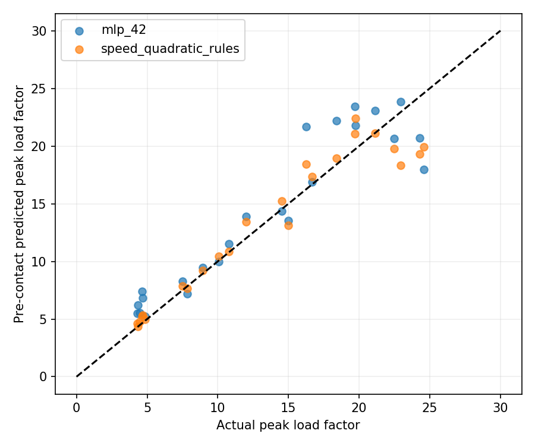
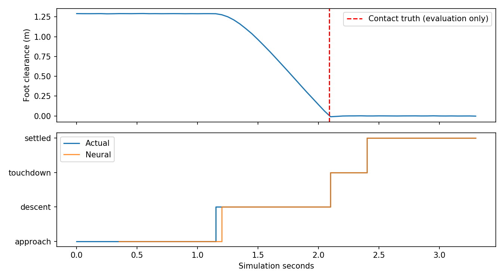
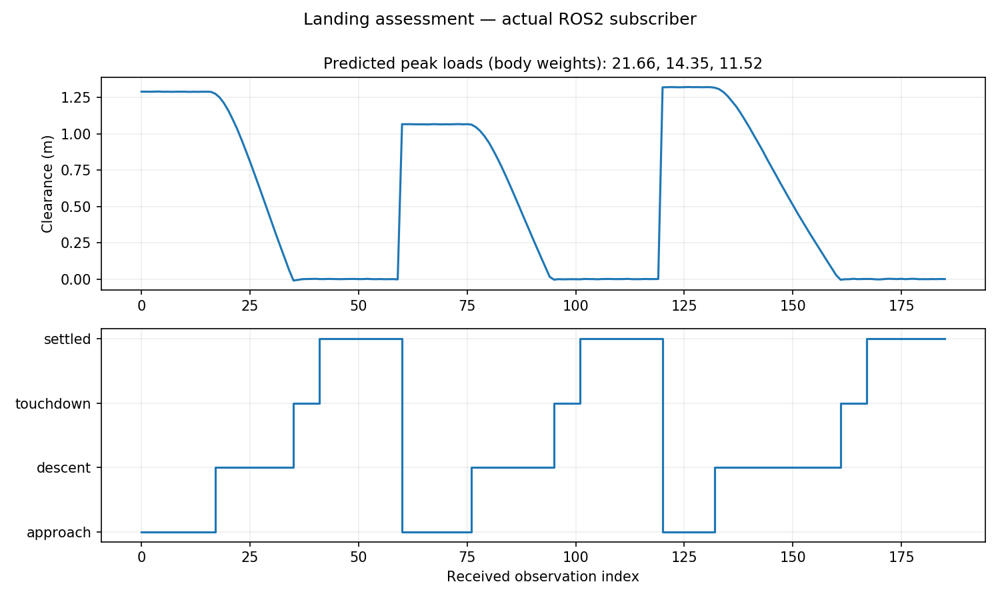
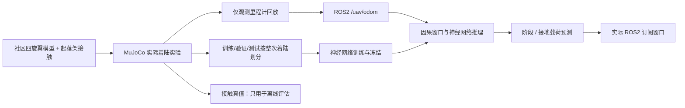

# 无人机着陆阶段识别与接地载荷预测

本项目研究无人机着陆时的两个问题：当前处于哪个阶段，以及接地时会产生多大的载荷。模型使用最近 0.4 秒的位置、速度和姿态等数据，识别接近、下降、接地过渡和稳定四个阶段，并在足端高度首次降至 18 cm 时预测接地峰值载荷。

实验数据由 MuJoCo 仿真采集。项目包含数据处理、神经网络训练与测试、ROS2 节点和可视化程序，数据、模型和运行记录在本地生成，不随源码提交；按下述步骤采集、训练后即可运行回放。

项目沿用 OpenHUTB 已有 [carlair_ros_bridge](https://github.com/OpenHUTB/ros2/tree/master/src/air/carlair_ros_bridge) 的 `/uav/odom` 里程计接口，增加着陆分析功能。仿真四旋翼 XML 原样复用社区 [PR #178](https://github.com/OpenHUTB/ros2/pull/178)，运行时添加起落架与地面接触。该 PR 在本项目开发时尚未合并。模型版本和许可见 [来源记录](landing_assessment/models/source.json) 与 [第三方说明](landing_assessment/THIRD_PARTY_NOTICES.md)。本项目不依赖该 PR 安装成功。


上图为此前实际运行的 MuJoCo 仿真场景；文档图片保存在 docs/，本地生成文件不存入 Git。

## 1. 数据和目标

共采集 144 次仿真着陆：80 次用于训练，16 次用于验证，24 次用于原始测试。模型和实验代码确定后，再采集 24 次着陆作为最终测试集。数据全部来自仿真。

- 四旋翼质量、下降速度、初始高度、接触软度及小幅侧风在固定范围随机变化。
- 物理步长 1 ms，观测频率 20 Hz。着陆过程由仿真控制器完成，神经网络负责识别和预测。
- 接触后关闭推力，记录首次接触后 250 ms 内总法向接触力峰值，除以重量 `m*g`，得到无量纲“体重倍数”。这不是加速度 g 值，也不是实机结构安全等级。
- 四阶段标签由仿真阶段、真实接触事件和稳定状态生成，仅在训练/评估使用。模型输入不含接触力、阶段标签、控制指令、飞行编号、质量或未来状态。
- 神经网络输入为 最近 8 个采样点：足端估计高度、ENU 速度、后向差分加速度、横滚/俯仰、机体系角速度，共 12 通道。
- 每次着陆仅在首次低于 18 cm 的接地前观测处产生一次载荷预测样本。原始测试和最终测试均各有 24 个独立载荷预测样本；阶段窗口存在重叠，不能当作同等数量的独立飞行。

`bash main.sh prepare` 使用固定种子在本地生成原始观测和清单。清单含参数、划分、接触真值、载荷目标与 SHA256。数据集不存入 Git。完整着陆不会跨划分，归一化和基线拟合只使用训练集。

## 2. 方法与实验结果

主模型为共享 MLP 编码器加四阶段分类头、接地载荷回归头。训练目标为加权分类交叉熵和归一化 log(1+载荷) 均方误差。每组训练 100 轮，以验证集损失选择检查点，部署种子 42 在最终测试前固定。

对照包括三随机种子 MLP、GRU、仅保留高度/速度输入的消融、固定运动学阶段规则、训练集拟合的速度二次回归和训练均值载荷基线。载荷回归基线与神经网络使用相同的接地前决策窗口。

### 原始测试集（24 次着陆）

| 方法 | 阶段准确率 | 宏平均 F1 | 载荷 MAE | 载荷 RMSE |
|---|---:|---:|---:|---:|
| mlp_42 | 97.76% | 0.9690 | 1.909 | 2.525 |
| mlp_43 | 97.29% | 0.9628 | 2.342 | 3.064 |
| mlp_44 | 96.94% | 0.9622 | 2.044 | 2.603 |
| gru_42 | 94.71% | 0.9330 | 1.623 | 2.133 |
| kinematics_only_42 | 93.53% | 0.9208 | 1.620 | 2.137 |
| speed_quadratic_rules | 90.82% | 0.7810 | 1.319 | 2.010 |
| train_mean_rules | 90.82% | 0.7810 | 6.308 | 7.079 |

### 最终测试集（另采集的 24 次着陆）

| 方法 | 阶段准确率 | 宏平均 F1 | 载荷 MAE | 载荷 RMSE |
|---|---:|---:|---:|---:|
| mlp_42 | 98.09% | 0.9779 | 1.733 | 2.236 |
| mlp_43 | 98.33% | 0.9799 | 1.686 | 2.086 |
| mlp_44 | 97.73% | 0.9724 | 1.754 | 2.196 |
| gru_42 | 95.23% | 0.9473 | 1.642 | 2.077 |
| kinematics_only_42 | 94.75% | 0.9399 | 1.596 | 2.134 |
| speed_quadratic_rules | 89.98% | 0.7542 | 1.115 | 1.543 |
| train_mean_rules | 89.98% | 0.7542 | 4.925 | 5.887 |

最终测试中，所用模型 `mlp_42` 的阶段识别准确率为 98.09%，宏平均 F1 为 0.9779。只使用高度和速度时，宏平均 F1 降至 0.9399，说明其他输入对这组实验的阶段识别有帮助。

载荷预测的结果不如速度二次回归：`mlp_42` 的 MAE 为 1.733，速度基线为 1.115。接触软度等影响载荷的变量没有作为输入，可能是误差的原因之一，还需要进一步实验。表中的 MAE 和 RMSE 均以体重倍数计。

两组测试使用与训练相同的参数范围，只更换随机种子。阶段统计来自有重叠的时间窗口，载荷统计则每次着陆只有一个样本。分类分数未经置信度校准。





以上表格和图片保留此前实验结果，不代表每次重训都会逐位相同。重新运行后，数值写入本地 `results/metrics.json`、`results/final/metrics.json` 和逐次预测 CSV；`freeze_final.py` 在采集最终测试前记录当次模型和源码哈希。上述生成文件均不提交。

## 3. 环境与快速运行

已验证：Windows 宿主机上的 VMware Ubuntu 20.04.6、现有 ROS2 Humble、Python 3.8.10、PyTorch 2.4.1+cpu、MuJoCo 3.1.6、NumPy 1.24.4。

以下假设代码位于 `~/ros2/src/air/landing_assessment`；独立解压时将第一行改为实际目录。已有可用虚拟环境可跳过创建。必须使用与系统 ROS2 匹配的 Python，不要在 Conda 的 Python 上创建 ROS 虚拟环境。

```bash
cd ~/ros2/src/air/landing_assessment
source /opt/ros/humble/setup.bash
/usr/bin/python3 -m venv --system-site-packages ~/uav_prediction_env
source ~/uav_prediction_env/bin/activate
python -m pip install -r requirements.txt
bash main.sh doctor
bash main.sh prepare
bash main.sh train
bash main.sh build
```

MuJoCo 安装包包含物理引擎，无需下载大型城市场景。系统需已有 ROS2 的 rclpy/nav_msgs/std_msgs/launch_ros；Lark 和 colcon 插件在 requirements 中显式声明。创建 venv 缺少 ensurepip 时需安装 `python3-venv`；桌面图表需系统 `python3-tk` 和有效 DISPLAY。`UAV_ENV`、`ROS_SETUP` 可指定不同虚拟环境和 ROS setup 路径。

编译完成后，先在当前终端启动可视化窗口。窗口运行 60 秒，留出切换终端的时间：

```bash
python -m landing_assessment.dashboard --seconds 60
```

随后打开另一个终端，进入项目目录并启动回放：

```bash
cd ~/ros2/src/air/landing_assessment
bash main.sh demo
```

默认回放 3 次仿真着陆，结束后两个 ROS2 节点自动退出。窗口显示足端高度、识别出的阶段和接地前的载荷预测；到时保存 `results/ros_dashboard.png` 和消息计数 `results/ros_dashboard.json`。回放发布给模型的消息中不含接触力和阶段标签。



## 4. ROS2 接口

| 话题 | 类型 | 内容 |
|---|---|---|
| `/uav/odom` | `nav_msgs/Odometry` | 仅位置、姿态、线速度和角速度 |
| `/landing/assessment` | `std_msgs/String` JSON | 是否预热完成、阶段、分类分数；跨越决策高度时额外发布峰值载荷预测 |
| `/landing/replay_done` | `std_msgs/String` | 有限回放结束通知 |

里程计位置采用世界 ENU，机体采用 FLU；`twist` 按 Odometry 规范在 child_frame_id 中表示。回放节点将世界速度旋转到机体，推理节点再转回世界坐标并作后向差分。所有推理特征仅来自消息，估计器不订阅标签。

输入约定为 20 Hz、地面高度为 0、该机型足端偏移 0.073 m。换用其他桥接、坐标原点、采样率或无人机时需要相应标定/重采样，不应直接套用固定 18 cm 决策门限。时间倒退或明显断流会清空历史并重新预热；非有限值和非法四元数也会重置。



## 5. 训练、测试和复现实验

```bash
bash main.sh prepare
bash main.sh train
bash main.sh test
bash main.sh evaluate
bash main.sh report
python freeze_final.py
bash main.sh collect --final --output data/final
bash main.sh evaluate --data data/final --output results/final
```

需要另一次训练时可使用新目录，保留本地已有模型：

```bash
bash main.sh train --models models/retrained
bash main.sh evaluate --models models/retrained --output results/retrained
```

重新进行物理采集（会控制仿真模型，不涉及实机）：

```bash
bash main.sh collect --output data/new_raw
```

完成模型冻结和最终测试数据采集后，可重新评估：

```bash
bash main.sh evaluate --data data/final --output results/final_check
```

在桌面环境运行 `python render_validation.py` 可重新生成仿真场景图片。脚本重跑相同随机种子的实验，并检查数据是否与本地采集记录一致；图片写入本地 `results/simulation_render.png`。

已完成 7 项针对性测试：标签/接触力不进入特征、因果性、整次划分不交叉、离线与在线逐帧一致且预测先于接触、非法输入重置、时间倒退重置、ROS 坐标变换往返。实际 ROS2 演示处理 207 条观测、3 次接地前载荷预测，覆盖四阶段且正常退出。这些是此前实际运行的记录；本次运行的环境检查由 `bash main.sh doctor` 写入本地 `artifacts/`，不提交日志与生成记录。

## 6. 目前的不足

目前只在 MuJoCo 和 ROS2 回放中做了实验，尚未接入 OpenHUTB Unreal 模拟器，也没有进行实机、复杂地形或不同起落架和材质的验证。后续可以扩大数据范围，补充接触参数，再检查载荷预测能否超过速度基线。当前预测结果不能用于判断实机结构是否安全。

代码、实验脚本和文档使用了 OpenAI Codex 辅助编写。文中指标和图片来自程序运行。
