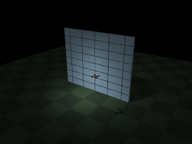
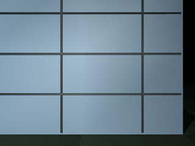

# 基于测距感知与定距控制的 MuJoCo 无人机幕墙图像采集

模块围绕建筑立面的规则扫描组织航线、测距和摄影。物理环境使用 MuJoCo 3.12.0，立面由简单几何体组成；无人机采用三个平移自由度、固定姿态的稳定飞行器模型。运动由力驱动积分产生，相机图像来自仿真渲染。

## 1. 环境与启动

安装 Python 3.10 或 3.11，在 `src/air/mujoco_facade_capture` 目录执行：

```bash
python3 -m pip install -r requirements.txt
python3 main.py --style grid --output output/grid
```

ROS 2 Humble 环境中可使用统一启动文件：

```bash
ros2 launch ./launch/main.launch.py style:=grid output:=/tmp/facade_grid
```

`grid`、`brick`、`plain` 分别选择网格、砖色和素色立面。输出照片、轨迹及指标位于指定目录。更改 `--offset 0.5` 可使无人机从距墙较近的位置开始，观察定距调整。





## 2. 航线与控制原理

纵向视场角为 $\theta=50^\circ$、目标壁距为 $d$ 时，相机覆盖高度为

$$ H=2d\tan(\theta/2),\qquad W=\frac{4}{3}H. $$

设重叠率为 $r$，相邻拍摄中心的最大间隔分别为 $(1-r)W$、$(1-r)H$。程序将扫描区域均匀采样，逐行交替遍历左右端点形成蛇形航线。航点误差和速度同时低于阈值后拍照，再进入下一个航点。

九束测距射线沿不同方向指向同一平面。斜向距离 $s_i$ 经方向投影并补偿传感器安装偏移，得到垂直壁距估计：

$$ d_i=s_i\cos\alpha_i\cos\beta_i+0.14. $$

外环将位置误差换算为受限速度，内环通过速度误差生成驱动力：

$$ v^*=\operatorname{clip}(1.1(p^*-p),-1,1),\qquad F=m\,[4(v^*-v)+g e_z]. $$

壁距方向的误差由传感器估计，不直接取真实墙面位置。无有效回波时发出零速度指令。

## 3. 源码与流程

1. `facade/scene.py` 构建立面、飞行器、相机和测距传感器。
2. `facade/route.py` 计算相机覆盖尺寸及蛇形航点。
3. `facade/simulation.py` 执行测距、速度内环、物理积分和照片保存。
4. `main.py` 解析场景、距离、时长和结果路径。

每个积分周期依次执行“读取测距 → 计算目标误差 → 限速 → 施加驱动力 → 物理积分”。拍摄只发生在航点稳定后，照片编号与航点一一对应。

## 4. 运行结果与验证

默认网格立面扫描宽 6 米、高 3 米，目标壁距 4 米，重叠率 55%。Windows / Python 3.11 / MuJoCo 3.12.0 的一次完整运行结果如下；时间为仿真时间，结果未包含实际飞行和建筑外观测量。

| 指标 | 数值 |
|---|---:|
| 完成航点 | 12 / 12 |
| 扫描时长 | 29.21 s |
| 壁距均方根误差 | 0.00125 m |
| 最小壁距 | 3.9863 m |
| 最大速度 | 0.9852 m/s |

单位测试覆盖航线输入、蛇形顺序、测距几何、力驱动位移及完整扫描。运行：

```bash
python3 -m pip install pytest
python3 -m pytest test -q
```

## 5. 适用范围

该环境表达规则平面立面和姿态稳定后的平移运动，不等同于 Town10 地图或真实幕墙。立面材质、光照和无人机气动均有简化，结果用于同一仿真设置下的可复现比较。
