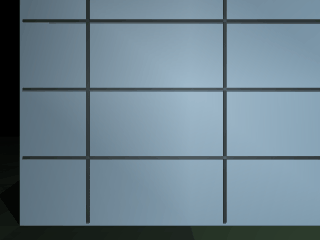
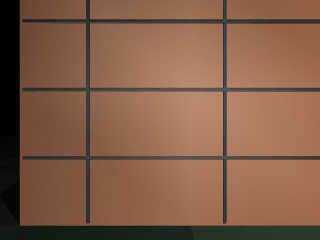
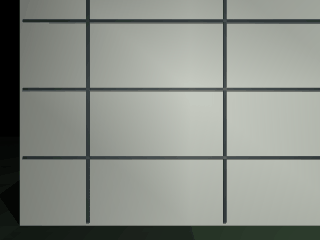

# 基于测距感知与定距控制的 MuJoCo 无人机幕墙图像采集

模块围绕建筑立面的规则扫描组织航线、测距和摄影。物理环境使用 MuJoCo 3.12.0，立面由简单几何体组成；无人机采用三个平移自由度、固定姿态的稳定飞行器模型。运动由力驱动积分产生，相机图像来自仿真渲染。神经网络读取九束测距、航点偏差和当前速度，输出三个方向的归一化速度指令。

## 1. 环境与启动

安装 Python 3.10 或 3.11，在 `src/air/mujoco_facade_capture` 目录执行：

```bash
python3 -m pip install -r requirements.txt
python3 main.py --style grid --output output/grid
python3 main.py --controller neural --style plain --offset 0.5 --output output/neural
python3 train.py --epochs 60 --output output/training
```

ROS 2 Humble 环境中，在构建并加载工作区后可通过统一启动文件运行神经网络控制扫描：

```bash
cd <工作区>
colcon build --symlink-install --packages-select mujoco_facade_capture
source install/setup.bash
MUJOCO_GL=osmesa ros2 launch mujoco_facade_capture main.launch.py style:=grid output:=/tmp/facade_grid
```

`grid`、`brick`、`plain` 分别选择网格、砖色和素色立面。输出照片、轨迹及指标位于指定目录。`offset:=0.5` 可设置初始壁距偏移，`duration:=70.0` 设置仿真时长。

节点配置为 100 Hz 控制周期，每次回调读取九束测距、计算控制指令，并按 MuJoCo 时间步推进物理状态；当前场景每周期推进一个 0.01 秒物理步。相机每十个控制周期发布一帧，实际墙钟频率受渲染和运行负载影响。ROS 话题如下：

| 话题 | 类型 | 作用 |
|---|---|---|
| `/facade/image` | `sensor_msgs/msg/Image` | 发布 RGB 相机图像 |
| `/facade/range` | `std_msgs/msg/Float32MultiArray` | 发布九束测距值，单位为米 |
| `/facade/cmd_vel` | `geometry_msgs/msg/Twist` | 发布当前线速度控制指令 |
| `/facade/cmd_vel_override` | `geometry_msgs/msg/Twist` | 接收外部线速度覆盖指令，超时后恢复自主控制 |
| `/facade/status` | `std_msgs/msg/String` | 发布航点进度和任务状态 |

外部覆盖指令限制在每轴 ±1 m/s，角速度字段不参与该简化飞行器模型。任务完成后节点保留运行并持续发布零速度，便于读取最终话题状态；照片、轨迹 CSV 和 `metrics.json` 写入 `output` 参数目录。

可在另一个终端查看接口和发送短时速度覆盖：

```bash
ros2 topic info -v /facade/image
ros2 topic echo /facade/range
ros2 topic hz /facade/image
ros2 topic pub -r 10 --times 10 /facade/cmd_vel_override geometry_msgs/msg/Twist \
  '{linear: {x: 0.7, y: 0.0, z: 0.0}}'
```

## 2. 航线与控制原理

纵向视场角为 $\theta=50^\circ$、目标壁距为 $d$ 时，相机覆盖高度为

$$ H=2d\tan(\theta/2),\qquad W=\frac{4}{3}H. $$

设重叠率为 $r$，相邻拍摄中心的最大间隔分别为 $(1-r)W$、$(1-r)H$。程序将扫描区域均匀采样，逐行交替遍历左右端点形成蛇形航线。航点误差和速度同时低于阈值后拍照，再进入下一个航点。

九束测距射线沿不同方向指向同一平面。斜向距离 $s_i$ 经方向投影并补偿传感器安装偏移，得到垂直壁距估计：

$$ d_i=s_i\cos\alpha_i\cos\beta_i+0.14. $$

输入特征包括九束原始距离、三个方向位置误差和三个方向速度。壁距方向的位置误差由测距中值计算。单隐藏层网络将标准化特征映射到速度：

$$ h=\max(0,\hat{x}W_1+b_1),\quad \hat{v}=\operatorname{clip}(hW_2+b_2,-1,1),\quad L=\frac{1}{N}\sum_i\|\hat{v}_i-v_i\|_2^2. $$

训练标签来自包含速度阻尼的比例控制器。底层速度内环仍使用仿真力推动无人机运动。

## 3. 神经网络数据划分

训练数据由四个完整 MuJoCo 扫描序列生成，包含网格与砖色立面及不同起始壁距。独立测试序列使用训练中未出现的素色立面。按场景划分序列，避免将同一轨迹相邻图像拆进训练和测试集合。`train.py` 会重新生成测距数据、训练权重、计算独立指令误差，并在完整测试扫描中比较神经网络控制与比例控制基线。

## 4. 源码与流程

1. `facade/scene.py` 构建立面、飞行器、相机和测距传感器。
2. `facade/route.py` 计算相机覆盖尺寸及蛇形航点。
3. `facade/dataset.py` 分别运行训练场景和未见测试场景并记录传感输入与控制标签。
4. `facade/learning.py` 实现 NumPy 前馈网络、权重验证和 JSON 序列化。
5. `facade/simulation.py` 执行测距、控制、物理积分和照片保存。
6. `train.py` 训练网络并在独立立面评估；`main.py --controller neural` 加载权重运行扫描。

## 5. 运行结果与验证

在 Windows / Python 3.11 / MuJoCo 3.12.0 的 CPU 环境中，以默认随机种子和 60 个训练轮次运行训练与测试。结果为同一仿真环境下的可复现实测值。

| 指标 | 神经网络控制 | 比例控制基线 |
|---|---:|---:|
| 素色立面航点完成率 | 12 / 12 | 12 / 12 |
| 壁距均方根误差 | 0.0651 m | 0.0748 m |
| 最大速度 | 0.9863 m/s | 0.9847 m/s |
| 网络对独立测试专家速度指令 MAE | 0.0164 m/s | — |

结果目录还会保存 `evaluation.json`、训练和测试场景清单、压缩样本以及权重文件。训练数据由脚本生成，不需要下载外部数据集。

在 MuJoCo 3.12.0 中使用同一权重、4.0 m 目标壁距和 0.5 m 初始偏移，对三种外观分别执行了完整扫描。每种均到达 12 个航点；指标来自对应轨迹记录：

| 立面外观 | 完成航点 | 用时 | 壁距 RMSE | 最大速度 |
|---|---:|---:|---:|---:|
| 网格 | 12 / 12 | 49.61 s | 0.0764 m | 0.9815 m/s |
| 砖色 | 12 / 12 | 49.61 s | 0.0764 m | 0.9815 m/s |
| 素色 | 12 / 12 | 49.61 s | 0.0764 m | 0.9815 m/s |

三种外观共享相同的几何、测距布置和动力学参数，因此测距轨迹指标一致；该组运行用于核对不同立面外观下的扫描执行与相机取像。采集过程由每个航点的实际相机帧组成：







三种场景的完整机器可读数据保存在 `scenario_metrics.json`；每个动图均小于 0.5 MB。

ROS 2 Humble 下运行相同素色立面任务，神经网络控制完成 12 / 12 个航点，仿真用时 49.64 s，壁距 RMSE 为 0.0717 m；节点保存了 12 张前视照片、总览图和轨迹。ROS 话题检查确认图像类型为 `sensor_msgs/msg/Image`，距离数组含九个数值，外部线速度覆盖可改变控制输出与物理位移。

单元测试覆盖航线输入、蛇形顺序、测距几何、力驱动位移、完整扫描、网络确定性和训练/测试场景分离：

```bash
python3 -m pip install pytest
python3 -m pytest test -q
```

ROS 2 接口测试使用 `python3 -m pytest test -q`，三种立面神经网络评估与相机采集动图使用：

```bash
python3 evaluate_scenarios.py
```

脚本将各场景实测值写入 `docs/air/mujoco_facade_capture/scenario_metrics.json`，并在 `docs/img/air/mujoco_facade_capture/` 保存逐航点采集图像组成的 GIF。

## 6. 适用范围

该环境表达规则平面立面和姿态稳定后的平移运动，不等同于 Town10 地图或真实幕墙。立面纹理、光照和无人机气动均有简化，指标用于相同仿真设置下的比较。
