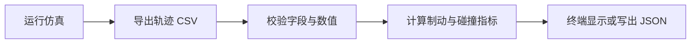
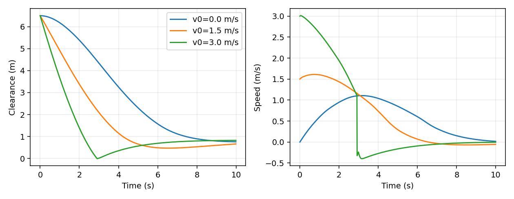

# 无人机测距制动轨迹指标分析

## 使用方法

先运行测距控制并导出轨迹，再对 CSV 计算单次运行指标。以下命令在 `src/air/mujoco_uav_range_neural_braking` 目录中执行：

```
python main.py --headless --controller range --output results/range
python trajectory_metrics.py results/range/trajectory.csv --output results/range/metrics.json
```

不指定 `--output` 时，结果会显示在终端；指定路径后会同时写入 JSON 文件。

## 指标定义

| 指标 | 定义 |
| --- | --- |
| 初始间距 | 轨迹第一条记录的表面间距 |
| 最小间距 | 本次轨迹记录到的最小表面间距 |
| 制动距离 | 初始间距减最小间距，最小取值为 0 |
| 超调量 | 最小间距小于 0 时的穿越距离 |
| 峰值加速度 | 轨迹中加速度绝对值的最大值 |
| 调节时间 | 速度首次进入 ±0.05 米/秒阈值并在后续采样中保持的时刻 |
| 碰撞步数 | 碰撞标记为 1 的轨迹步数 |
| 无效测距步数 | 测距有效标记为 0 的轨迹步数 |

碰撞与测距有效标记只接受 0 或 1；轨迹所需字段必须存在，数值必须为有限值。

## 处理流程





图中展示模块的神经控制闭环结果；完整场景、曲线和动态过程见[无人机测距制动与神经控制](mujoco_uav_range_neural_braking.md)。

## 文件与测试

工具文件为 `src/air/mujoco_uav_range_neural_braking/trajectory_metrics.py`。新增测试覆盖指标计算、输入校验和 JSON 输出。
