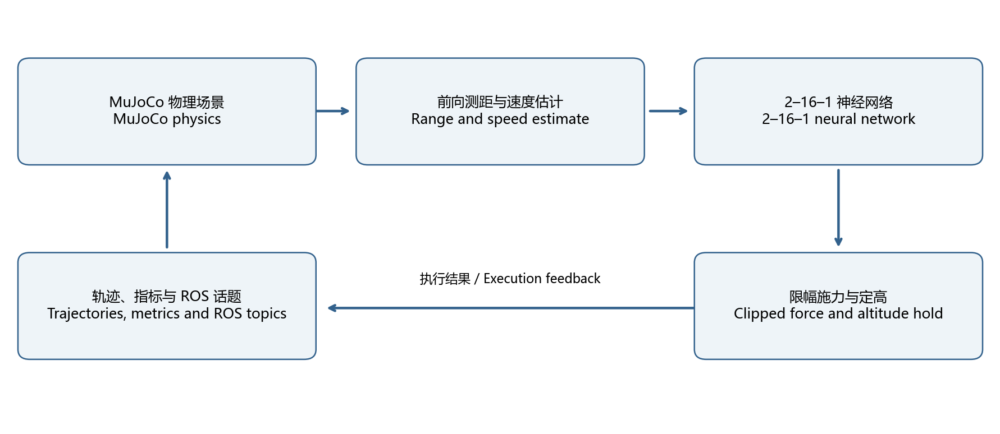
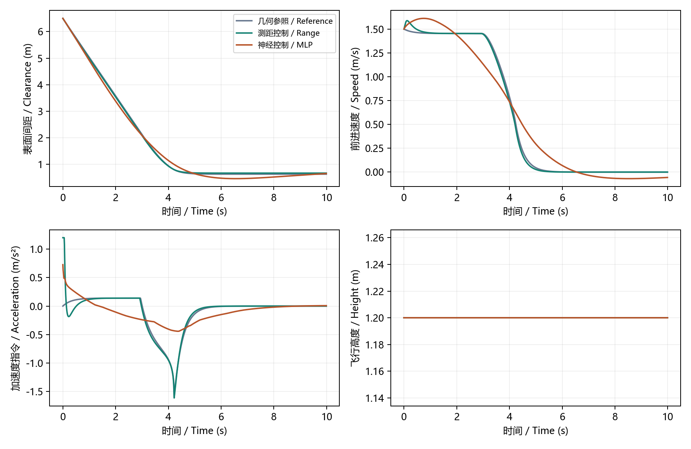
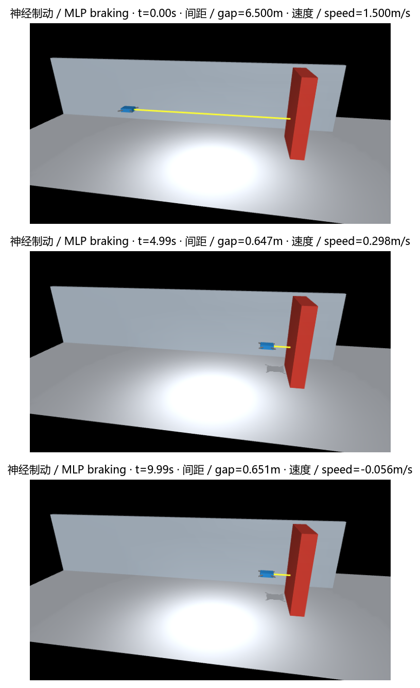
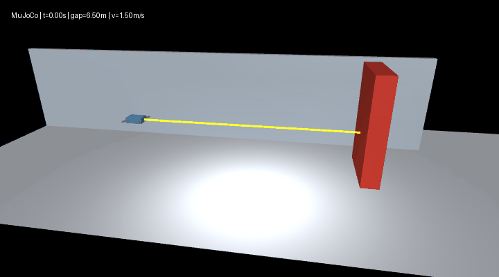

# 基于前向测距与轻量神经网络的 MuJoCo 室内无人机安全制动与定高悬停

MuJoCo Indoor UAV Safe Braking and Altitude Hold Using Forward Ranging and a Lightweight Neural Network

## 摘要 / Abstract

本项目面向室内通道中无人机沿固定航向接近障碍物的场景，构建保留重力、质量、阻尼和碰撞的 MuJoCo 平移模型。前向测距提供障碍距离，距离差分与一阶低通滤波得到闭合速度，轻量神经网络输出水平加速度，独立的重力补偿与 PD 回路保持高度。项目包含解析控制参照、回合级数据采集、网络训练与测试、三种控制策略对比以及 ROS 2 状态发布。

This project studies a UAV approaching a fixed obstacle along an indoor corridor. A translational MuJoCo model retains gravity, mass, damping and contact. Forward ranging supplies obstacle distance; finite differences and a first-order filter estimate closing speed. A small neural network commands horizontal acceleration, while gravity compensation and a separate PD loop hold altitude. The implementation includes analytical references, episode-level data collection, network training and testing, controller comparison, and ROS 2 state publication.

30 个回合产生 36000 条样本，按回合划分为训练、验证和测试集，避免同一轨迹跨集合。网络测试集平均绝对误差为 0.1454 m/s²，均方根误差为 0.2604 m/s²。默认初速度 1.5 m/s、时长 10 s 的场景中，神经控制无碰撞，最小表面间距为 0.4596 m；3 m/s 的外推场景存在接触。结果说明网络能够学习基本制动规律，其高速工况表现仍受训练覆盖范围限制。

Thirty episodes produce 36000 samples, split by episode to keep trajectories separate across training, validation and testing. Held-out mean absolute error is 0.1454 m/s² and root mean squared error is 0.2604 m/s². In the default 10 s scene at 1.5 m/s, neural control produces no contact and a minimum surface clearance of 0.4596 m. Contact occurs in the 3 m/s extrapolation case. The network learns basic braking behavior, with high-speed performance limited by training coverage.

关键词：无人机；MuJoCo；前向测距；神经网络；制动控制；ROS 2。

Keywords: UAV; MuJoCo; forward ranging; neural network; braking control; ROS 2.

## 1. 问题定义与系统结构 / Problem definition and system architecture

### 1.1 任务与观测量 / Task and observations

机体从通道一侧沿水平轴前进，目标是在固定障碍物前平稳减速，同时保持给定高度。系统以测距和闭合速度作为水平控制输入，以高度和竖直速度作为定高反馈。几何真值仅用于参照控制与指标计算；测距控制和神经控制的水平输入不直接读取机体真实水平速度。

The vehicle advances along the corridor's horizontal axis, aiming to slow down before a fixed obstacle while maintaining the reference height. Horizontal control takes range and closing speed; altitude feedback uses height and vertical velocity. Geometric truth is used for reference control and metric calculation. The horizontal inputs of ranging and neural control do not directly use true body velocity.

### 1.2 模块结构 / Module structure



控制闭环依次执行传感器读取、闭合速度估计、控制器推理、输出限幅、施力、物理积分和传感器刷新。轨迹与指标导出提供离线分析，ROS 2 封装对外发布测距、控制量和状态数组。

The loop reads sensors, estimates closing speed, evaluates the controller, clips its output, applies force, integrates physics and refreshes sensors. Trajectory and metric exports support offline analysis; the ROS 2 wrapper publishes range, acceleration and a state array.

### 1.3 研究范围 / Study scope

模型采用水平和竖直两个平移自由度，航向固定。机体质量为 0.52 kg，参考高度为 1.2 m，物理步长为 0.01 s。场景不包含姿态稳定、旋翼气动、传感器噪声、图像识别、三维建图与全局路径规划；本文研究对象为沿给定直线方向的接近制动与高度保持。

The model has horizontal and vertical translation with fixed heading. Total mass is 0.52 kg, reference height is 1.2 m, and the physics step is 0.01 s. Attitude stabilization, rotor aerodynamics, sensor noise, visual recognition, 3D mapping and global planning are outside the model. The study addresses braking along a prescribed straight approach and altitude hold.

## 2. 环境与仿真步骤 / Environment and simulation procedure

### 2.1 软件环境 / Software environment

| 组件 / Component | 配置 / Configuration | 用途 / Purpose |
| --- | --- | --- |
| Python | 3.10–3.11 | 仿真、数据处理与训练 / Simulation, data and training |
| MuJoCo | 3.12.0 | 物理积分与测距 / Physics integration and ranging |
| NumPy | ≥1.24，<3 | 神经网络计算 / Neural network computation |
| Matplotlib、Pillow | 见 requirements.txt / See requirements.txt | 曲线、场景图和动图 / Plots, scene images and animation |
| Ubuntu、ROS 2 | Ubuntu 22.04、Humble | 启动与话题通信 / Launch and topic transport |
| Windows | 独立 Python 仿真 / Standalone Python simulation | 运行与结果分析 / Execution and analysis |

### 2.2 安装与首次运行 / Installation and first execution

步骤一：进入仓库中的模块目录，建立独立 Python 环境并安装依赖。以下为 Windows PowerShell 命令；后续 Python 命令均在模块目录中执行。

Step 1: Enter the module directory, create an isolated Python environment, and install dependencies. The following commands use Windows PowerShell. Subsequent Python commands also run from this directory.

```powershell
cd src/air/mujoco_uav_range_neural_braking
py -3.11 -m venv .venv
& ./.venv/Scripts/python.exe -m pip install -r requirements.txt
& ./.venv/Scripts/python.exe main.py --headless --controller range --output results/range
& ./.venv/Scripts/python.exe main.py --controller mlp --output results/mlp
```

Linux 环境可使用以下命令。无窗口模式直接生成轨迹与指标；带窗口模式显示机体接近障碍物的过程。

On Linux, use the following commands. Headless execution writes trajectories and metrics, while viewer execution shows the approach to the obstacle.

```bash
cd src/air/mujoco_uav_range_neural_braking
python3 -m venv .venv
source .venv/bin/activate
python -m pip install -r requirements.txt
python main.py --headless --controller range --output results/range
python main.py --controller mlp --output results/mlp
```


步骤二：确认输出目录包含 trajectory.csv 与 summary.json。前者记录逐步状态，后者记录步数、接触步数、最小表面间距、末速度、无效测距步数和最大高度误差。默认运行 10 s，对应 1000 个物理步。碰撞指标为非零时，main.py 返回非零退出码。

Step 2: Check trajectory.csv and summary.json in the output directory. The former contains per-step states; the latter contains step count, contact steps, minimum surface clearance, final speed, invalid-range steps and maximum altitude error. The default 10 s run has 1000 physics steps. main.py returns a nonzero exit code when contact is recorded.

### 2.3 数据采集与网络训练 / Data collection and network training

步骤三：采集回合数据，训练网络，再运行神经控制。模型权重以 JSON 保存；默认仓库权重可直接运行，重新训练会更新指定输出目录中的模型与误差指标。

Step 3: Collect episodes, train the network, and run neural control. Weights are stored as JSON. The included model runs directly; retraining writes weights and error metrics to the selected output directory.

```bash
python dataset.py --seed 2026 --episodes 30 --output datasets
python train.py --data datasets --output models
python main.py --headless --controller mlp --model models/mlp_controller.json --speed 1.5 --output results/mlp
python evaluate.py --controller range --render --output results/range_comparison
```

### 2.4 ROS 2 启动 / ROS 2 launch

步骤四：在 Ubuntu 22.04 / ROS 2 Humble 环境中进入模块目录并加载 ROS 环境。main.launch.py 用于完整离线仿真，ros_node.launch.py 用于持续发布状态。

Step 4: Enter the module directory in Ubuntu 22.04 / ROS 2 Humble and source the ROS environment. main.launch.py runs the complete offline simulation, while ros_node.launch.py continuously publishes state.

```bash
source /opt/ros/humble/setup.bash
ros2 launch ./launch/main.launch.py controller:=mlp output:=/tmp/uav_braking
ros2 launch ./launch/ros_node.launch.py controller:=mlp
```

另开已加载 ROS 环境的终端订阅状态；使用 Ctrl+C 停止持续节点。

Use another terminal with the ROS environment loaded to subscribe to state. Stop the continuous node with Ctrl+C.

```bash
ros2 topic echo /uav/state
ros2 topic echo /uav/front_range_m
ros2 topic echo /uav/braking_accel_m_s2
```

Windows 的 ROS 环境可通过模块 Dockerfile 构建。以下 PowerShell 命令将当前模块挂载到容器；容器采用 Ubuntu 22.04 与 ROS 2 Humble。

On Windows, build the ROS environment from the module Dockerfile. These PowerShell commands mount the current module into an Ubuntu 22.04 / ROS 2 Humble container.

```powershell
docker build -t uav-braking:humble .
docker run --rm --mount "type=bind,source=${PWD},target=/work/module" uav-braking:humble bash -lc 'source /opt/ros/humble/setup.bash && ros2 launch ./launch/main.launch.py controller:=mlp output:=/work/module/results/humble_mlp'
```

## 3. 计算原理 / Mathematical formulation

### 3.1 测距与闭合速度 / Range and closing speed

前向测距射线位于机身前缘外 0.01 m，因此控制间距按安装偏移补偿。定义传感器读数为 r，控制使用的间距为 d，周期为 Δt，则：

The range ray is mounted 0.01 m ahead of the vehicle surface, so the controller compensates for this mounting offset. Let r be sensor range, d compensated clearance, and Δt the sample period:

$$
d_k=r_k+0.01,\qquad
v_k^{raw}=\frac{r_{k-1}-r_k}{\Delta t},\qquad
\hat v_k=0.8\hat v_{k-1}+0.2v_k^{raw}.
$$

首帧闭合速度初始化为零；正值表示接近障碍物。控制依据传感器值而非几何距离真值。无效测距时输出 -2.5 m/s²，仅对应当前前进接近工况。

Closing speed starts at zero and is positive when approaching the obstacle. Control uses sensor values rather than geometric clearance. Invalid range commands -2.5 m/s², a policy limited to the forward-approach case.

### 3.2 解析制动参照 / Analytical braking reference

解析参照以剩余距离构造目标速度，并通过速度反馈输出加速度：

The analytical reference sets target speed from remaining distance and applies velocity feedback:

$$
v_r=\min\left(1.5,\sqrt{2\cdot0.8\max(d-0.8,0)}\right),
\qquad a_x=\operatorname{clip}\left(3(v_r-v),-2.5,1.2\right).
$$

几何参照使用真实表面间距与水平速度，测距控制使用补偿间距与闭合速度估计。0.8 m 是减速参考参数，有限反馈增益、阻尼与积分过程会使实际停车间距不同于该参数。

Geometric reference uses true clearance and horizontal velocity; ranging control uses compensated range and estimated closing speed. The 0.8 m value is a braking reference. Finite feedback gain, damping and integration make the actual stopping clearance differ from that parameter.

### 3.3 神经网络控制 / Neural network control

网络结构为 2–16–1，输入为距离和闭合速度，隐藏层采用 ReLU，输出为水平加速度。训练使用训练集均值与标准差归一化输入和标签；验证集和测试集复用训练集统计量。

The network has a 2–16–1 structure with range and closing speed as inputs, a ReLU hidden layer, and horizontal acceleration as output. Inputs and targets use the training mean and standard deviation; validation and testing reuse those statistics.

$$
\tilde{\mathbf{x}}=\frac{\mathbf{x}-\boldsymbol\mu_x}{\boldsymbol\sigma_x},\quad
\mathbf{h}=\max(0,\tilde{\mathbf{x}}W_1+\mathbf{b}_1),\quad
\tilde y=\mathbf{h}W_2+b_2,\quad
\hat a_x=\sigma_y\tilde y+\mu_y.
$$

$$
L=\frac{1}{N}\sum_{i=1}^{N}(\tilde y_i-\tilde a_i)^2,\qquad
\theta\leftarrow\theta-0.003\nabla_\theta L,\qquad
a_x=\operatorname{clip}(\hat a_x,-2.5,1.2).
$$

训练采用固定种子 2026、全批量梯度下降和 350 个训练轮次。模型学习解析测距控制器的加速度标签，属于监督回归式控制近似；它不以相机图像为输入，也不实现图像到控制指令的端到端策略。

Training uses seed 2026, full-batch gradient descent and 350 epochs. The model learns acceleration labels from analytical ranging control as a supervised controller approximation. It does not take camera images or implement an image-to-command policy.

数据表保留高度误差字段，但所有采集回合从参考高度开始，该字段恒为零。当前网络仅使用两个有效输入；高度保持由独立 PD 回路承担。

The dataset retains an altitude-error field, but collection episodes start at reference altitude, making that field zero. The current network therefore uses two effective inputs; a separate PD loop handles altitude.

### 3.4 施力与高度保持 / Force application and altitude hold

$$
F_x=ma_x,\qquad F_z=m\left[g+16(z_r-z)-8\dot z\right],\quad g=9.81\ \mathrm{m/s^2}.
$$

水平控制通过施力改变速度，竖直力补偿重力并反馈高度误差与竖直速度。控制过程不在制动时直接清零速度。每步积分后刷新传感器，保证下一控制步使用当前状态。

Horizontal force changes speed, while vertical force compensates gravity and feeds back height error and vertical velocity. Braking never directly resets velocity. Sensors refresh after integration so that the next control step uses the current state.

## 4. 数据集、训练与测试 / Dataset, training and testing

### 4.1 回合划分 / Episode split

数据集由 30 个 12 s 回合组成。初速度随机分布在 0–2.5 m/s，起点至障碍物中心距离为 4–9 m，参考高度为 0.8–1.8 m，障碍物位置在 -0.5–0.5 m 范围内变化。固定种子使参数与划分可复现。

The dataset contains thirty 12 s episodes. Initial speed varies over 0–2.5 m/s, start-to-obstacle-center distance over 4–9 m, reference altitude over 0.8–1.8 m, and obstacle position over -0.5–0.5 m. A fixed seed makes parameters and splits reproducible.

| 集合 / Split | 回合 / Episodes | 样本 / Samples | 用途 / Use |
| --- | ---: | ---: | --- |
| 训练 / Training | 18 | 21600 | 参数优化与归一化统计 / Parameter fitting and normalization |
| 验证 / Validation | 6 | 7200 | 独立误差观察 / Separate error assessment |
| 测试 / Test | 6 | 7200 | 留出集性能报告 / Held-out performance |

同一回合的所有记录属于同一个集合。manifest.json 保存每个回合的参数、数据行数与 SHA-256；sample_data/ 提供少量字段样本和数据汇总，完整 CSV 可由 dataset.py 重建。验证集不参与梯度更新，当前训练固定轮次，不使用提前停止。

All records from one episode stay in one split. manifest.json records episode parameters, row counts and SHA-256. sample_data/ provides small schema samples and summaries, while dataset.py reconstructs the full CSV files. Validation does not update gradients; training uses a fixed epoch count without early stopping.

### 4.2 误差指标 / Error metrics

$$
\operatorname{MAE}=\frac{1}{N}\sum_{i=1}^N|\hat a_i-a_i|,\qquad
\operatorname{RMSE}=\sqrt{\frac{1}{N}\sum_{i=1}^N(\hat a_i-a_i)^2}.
$$

| 集合 / Split | MAE (m/s²) | RMSE (m/s²) | 最大绝对误差 / Max absolute error (m/s²) |
| --- | ---: | ---: | ---: |
| 训练 / Training | 0.148962 | 0.260949 | 1.942822 |
| 验证 / Validation | 0.168308 | 0.301089 | 1.741131 |
| 测试 / Test | 0.145426 | 0.260402 | 1.671442 |

训练集与测试集误差接近，验证集略高。上述误差衡量对解析标签的拟合，不能单独证明闭环轨迹安全；因此还需观察完整接近过程的碰撞、间距、末速度与高度误差。

Training and test errors are similar, with somewhat higher validation error. These metrics quantify analytical-label fitting and do not alone establish closed-loop safety. Full approach runs therefore also measure contact, clearance, final speed and altitude error.

## 5. 对比实验与结果 / Comparison experiments and results

### 5.1 实验设置 / Experimental setup

三种控制器共用同一物理模型，起始机身中心 x=-7 m，障碍物中心 x=0 m，参考高度 1.2 m。分别设置 0、1.5、3 m/s 初速度，每组运行 10 s。3 m/s 超过采集速度上限，作为外推工况单独观察。

All controllers share the same physical model, starting body center x=-7 m, obstacle center x=0 m, and reference altitude 1.2 m. Initial speeds are 0, 1.5 and 3 m/s, each simulated for 10 s. The 3 m/s case exceeds the collection speed limit and is observed as extrapolation.

### 5.2 闭环指标 / Closed-loop metrics

| 控制器 / Controller | 初速度 / Initial speed (m/s) | 接触步数 / Contact steps | 最小间距 / Min clearance (m) | 末速度 / Final speed (m/s) |
| --- | ---: | ---: | ---: | ---: |
| 几何参照 / Reference | 0.0 | 0 | 0.629500 | 0.000000 |
| 几何参照 / Reference | 1.5 | 0 | 0.629413 | 0.000000 |
| 几何参照 / Reference | 3.0 | 0 | 0.629409 | 0.000000 |
| 测距控制 / Range | 0.0 | 0 | 0.668362 | 0.000000 |
| 测距控制 / Range | 1.5 | 0 | 0.668331 | 0.000000 |
| 测距控制 / Range | 3.0 | 0 | 0.668360 | 0.000000 |
| 神经控制 / MLP | 0.0 | 0 | 0.748400 | 0.015567 |
| 神经控制 / MLP | 1.5 | 0 | 0.459629 | -0.056239 |
| 神经控制 / MLP | 3.0 | 3 | -0.004636 | -0.020618 |

接触步数统计控制采样时刻存在接触的步数；负间距表示物体表面发生穿入。最小间距取整段轨迹与末状态的最小值。九组初始高度均为参考高度，最大高度误差为零；这反映平衡初值，不能解释为任何扰动下误差为零。独立的 0.1 m 高度偏移检查中，10 s 后误差小于 0.005 m。

Contact steps count sampled states with contact; negative clearance indicates surface penetration. Minimum clearance covers the trajectory and terminal state. All nine runs start at reference altitude and retain zero maximum altitude error; this reflects the equilibrium initial condition, not zero error under arbitrary disturbances. A separate 0.1 m altitude-offset check recovers to within 0.005 m after 10 s.



### 5.3 制动过程 / Braking sequence





在 1.5 m/s 场景中，神经控制完成基本制动，末速度为 -0.0562 m/s，说明末段存在轻微反向运动。其最小间距小于解析测距控制，尚未达到解析控制的稳态与间距表现。3 m/s 场景记录到接触，说明仅凭训练集误差不能保证速度外推下的闭环表现。

At 1.5 m/s, neural control performs basic braking and ends at -0.0562 m/s, indicating slight reverse motion near the end. Its minimum clearance is smaller than analytical ranging control and its terminal behavior does not match the analytical baseline. Contact at 3 m/s shows that training error alone cannot guarantee closed-loop performance under speed extrapolation.

### 5.4 ROS 2 观测结果 / ROS 2 observations

神经控制通过 ros_node.launch.py 启动后，订阅端实际接收了 20 条 /uav/state 消息。消息时间从 0.00 s 递增至 0.19 s，数组长度为 4，高度为 1.2 m。该结果验证了启动、网络模型加载、仿真步进和状态话题传输；长期运行指标来自前述 10 s 独立物理仿真。

After neural control starts through ros_node.launch.py, the subscriber receives 20 /uav/state messages. Simulation time advances from 0.00 s to 0.19 s; each message has four values and altitude is 1.2 m. This verifies launch, model loading, physics stepping and state transport. The 10 s physical simulations above provide the longer-run metrics.

| 话题 / Topic | 类型 / Type | 数据含义 / Meaning |
| --- | --- | --- |
| /uav/front_range_m | std_msgs/Float32 | 原始前向测距，m / Raw forward range, m |
| /uav/braking_accel_m_s2 | std_msgs/Float32 | 限幅后的水平加速度，m/s² / Clipped horizontal acceleration, m/s² |
| /uav/state | std_msgs/Float64MultiArray | 时间、原始测距、闭合速度、高度 / Time, raw range, closing speed, altitude |

## 6. 算法流程与源码解析 / Algorithm flow and source walkthrough

### 6.1 执行流程 / Execution flow

1. 读取场景与控制器参数，加载 XML 模型；神经模式同时加载 JSON 权重。 / Read scene and controller settings, load XML, and load JSON weights for neural mode.
2. 读取测距、高度及用于评价的几何状态；计算测距有效性与闭合速度。 / Read range, altitude and evaluation truth; determine sensor validity and closing speed.
3. 有效测距送入神经网络，反归一化输出并限幅；无效测距采用固定反向制动。 / Infer from valid range, denormalize and clip acceleration; apply fixed reverse braking on invalid range.
4. 计算水平力与重力补偿 PD 竖直力，写入机体外力。 / Compute horizontal force and gravity-compensated vertical PD force, then apply them to the body.
5. 推进一个 MuJoCo 步长，刷新传感器，并记录轨迹或发布 ROS 消息。 / Advance one MuJoCo step, refresh sensors, and record trajectory or publish ROS messages.
6. 到达离线运行时长后导出 CSV 与 JSON；持续 ROS 节点由退出指令结束。 / Export CSV and JSON after the offline duration; stop the continuous ROS node with an interrupt.

### 6.2 文件与关键函数 / Files and key functions

| 文件 / File | 关键实现 / Key implementation |
| --- | --- |
| scene.xml | 机体、两个平移关节、障碍物、接触与传感器 / Body, two slide joints, obstacle, contact and sensors |
| simulation.py | Scenario 参数校验；sense 测距估速；step 控制与积分；run 指标汇总 / Scenario validation; sense; step; run |
| main.py | 参数解析、完整仿真、CSV 与 JSON 导出 / Arguments, complete execution, CSV and JSON export |
| dataset.py | 固定种子场景采样、回合级划分与清单 / Seeded scenarios, episode splits and manifest |
| mlp.py | 归一化、前向计算、梯度更新、权重读写 / Normalization, forward pass, gradients and weight I/O |
| train.py | 读取三个集合、训练及 MAE/RMSE 统计 / Read splits, fit model, calculate MAE/RMSE |
| evaluate.py | 多速度解析控制对比、图像与 GIF / Analytical controller speed comparisons, figures and GIF |
| ros_node.py | 定时推进仿真、构造并发布三类消息 / Timer stepping and publication of three message types |
| launch/main.launch.py | 完整离线仿真入口 / Complete offline launch |
| launch/ros_node.launch.py | ROS 2 节点与模型路径参数 / ROS 2 node and model-path arguments |

### 6.3 神经前向计算 / Neural forward computation

以下摘录对应 mlp.py；矩阵乘法将两个输入映射为 16 个隐藏单元，ReLU 保留正激活，再线性映射为单个输出。归一化与反归一化分别位于 fit 和 predict 中。

The excerpt from mlp.py maps two inputs to sixteen hidden units, applies ReLU, and projects to one output. fit and predict handle normalization and denormalization.

```python
def _forward(self, features):
    hidden = np.maximum(features @ self.w1 + self.b1, 0)
    return hidden, hidden @ self.w2 + self.b2
```

### 6.4 传感器到控制量 / Sensor-to-control path

simulation.py 的 step 在有效测距下调用模型，并将加速度限制在设定范围。安装偏移补偿发生在推理前；最终控制量进入力计算，不直接设置位置或速度。

In simulation.py, step calls the model for valid ranging and limits acceleration. Mounting-offset compensation precedes inference. The final command enters force calculation without directly setting position or velocity.

```python
acceleration = float(np.clip(
    self.policy.predict([distance + 0.01, closing_speed]),
    -2.5, 1.2,
))
```

### 6.5 状态发布 / State publication

ros_node.py 的 tick 调用同一个物理步进函数，分别构造测距、加速度与状态消息。状态数组采用固定顺序，订阅端按时间、测距、闭合速度、高度解释。

tick in ros_node.py uses the same physics step and constructs range, acceleration and state messages. The state array has the fixed order time, range, closing speed and altitude.

```python
row = self.simulation.step()
state_msg = Float64MultiArray()
state_msg.data = [row['time_s'], row['sensor_range_m'],
                  row['closing_speed_m_s'], row['height_m']]
self.state_pub.publish(state_msg)
```

## 7. 结论与适用范围 / Conclusions and scope

本项目建立了测距—估速—神经加速度—物理施力的完整闭环，并提供数据采集、训练测试、图形结果和 ROS 2 启动接口。在默认接近速度下，训练后的网络能够完成基础制动与定高；解析测距控制仍具有更稳定的停车表现。网络在训练速度范围之外出现接触，说明后续改进应关注高速制动样本、闭环状态覆盖和独立的控制约束。

The project implements a complete loop from ranging and speed estimation to neural acceleration and physical force, with data collection, training and testing, visual results and ROS 2 launch. At the default approach speed, the trained network performs basic braking and altitude hold; analytical ranging control has more stable stopping behavior. Contact outside training-speed coverage motivates high-speed braking data, broader closed-loop state coverage and independent control constraints.

本文结论仅适用于固定航向、静态障碍物与理想传感器的简化仿真。该模型用于分析控制规律和接口组织，不作为真实无人机飞行控制或安全认证依据。

Conclusions apply to the simplified fixed-heading scene with a static obstacle and ideal sensors. The model supports control analysis and interface development; it is not evidence for real-UAV flight control or safety certification.

## 8. 资料与成果入口 / References and project entry points

- [模块源码 / Module source](https://github.com/xzy12351/ros2/tree/docs/uav_experiment_delivery/src/air/mujoco_uav_range_neural_braking)
- [项目文档 / Project documentation](https://xzy12351.github.io/ros2/)
- [MuJoCo Python 接口 / MuJoCo Python API](https://mujoco.readthedocs.io/en/stable/python.html)
- [MuJoCo 测距传感器 / MuJoCo rangefinder](https://mujoco.readthedocs.io/en/stable/XMLreference.html#sensor-rangefinder)
- [ROS 2 Humble 文档 / ROS 2 Humble documentation](https://docs.ros.org/en/humble/)
