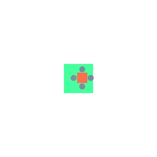
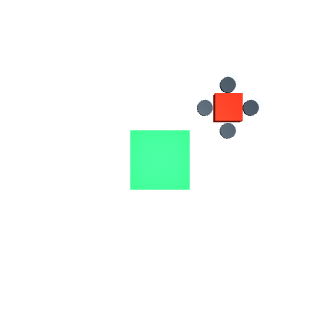
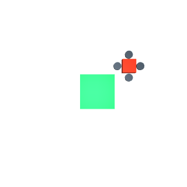
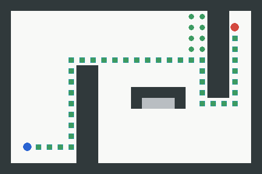
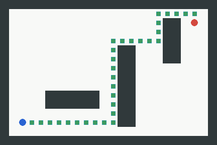
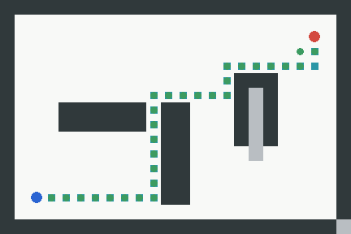
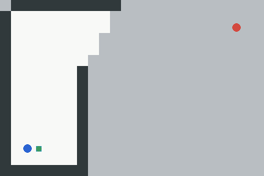

# MuJoCo 无人机视觉着陆与同步建图导航

本模块使用 MuJoCo 演示移动平台着陆、单帧 RGB 端到端控制、键盘遥控和二维激光神经导航。移动平台实验以相机提取的中心偏差、高度和平台速度训练 MLP；端到端基线直接使用 RGB 像素输入 MLP。ROS 2 Humble 节点提供特征或图像输入模式。

{width=55%}

{width=55%}

## 模块结构

| 文件 | 用途 |
| --- | --- |
| `assets/moving_pad.xml` | 四旋翼位置伺服、移动平台、地面与俯视相机场景 |
| `landing.py` | HSV 颜色定位、特征控制、MuJoCo 闭环仿真和接触判定 |
| `image_controller.py` | RGB 像素输入、端到端 MLP 训练与速度推理 |
| `navigation_policy.py` | 激光 MLP 策略、MuJoCo 位姿推进和多场景评估 |
| `main.py` | 训练、仿真、键盘遥控和导航命令行入口 |
| `teleop.py` | 键盘指令到 MuJoCo 速度控制的映射 |
| `navigation.py` | 虚拟激光扫描、占据栅格更新、A* 与同步重规划 |
| `ros_node.py` | ROS 2 速度控制节点 |
| `launch/landing.launch.py` | 启动控制节点 |

## 运行步骤

在模块目录安装依赖并运行：

```bash
python -m pip install -r requirements.txt
python main.py train --samples 5000
python main.py train-image --samples 6000
python main.py train-navigation
python main.py demo --steps 180 --output output
python main.py demo --controller image --steps 600 --output output
python main.py teleop --output output
python main.py navigate --output output
python -m pytest -q tests
```

键盘遥控提示出现后，每行输入一条指令并按回车：`W/A/S/D` 控制水平移动，`R/F` 升降，空行悬停，`Q` 退出。每次输入会推进 10 个 MuJoCo 步并显示当前位置。

着陆流程：MuJoCo 俯视相机生成 RGB 帧 → HSV 区域提取 → 计算平台与无人机中心偏差 → 合并高度和平台速度 → MLP 预测 `vx`、`vy`、`vz` → 输出 MuJoCo 控制量或 ROS 速度话题。

端到端流程：MuJoCo 俯视相机生成 RGB 帧 → 缩放至 32x32 → 像素归一化 → MLP 输出 `vx`、`vy`、`vz` → MuJoCo 执行器更新位置。训练和测试按完整 episode 分组；测试 RMSE 以三轴速度误差计算。`train-image` 用于生成模型，`demo --controller image` 运行静止平台端到端基线。

导航流程：八向模拟激光测距与目标偏差 → MLP 选择上下左右动作 → MuJoCo slide-joint 推进一格 → 从 MuJoCo 位姿读回状态 → Bresenham 射线更新占据栅格 → 下一步推理。A* 生成离线训练标签；运行中仅当神经策略动作会驶入已知障碍或短程重复位置时提供安全一步。三种固定障碍布局用于场景评估。

{width=55%}

{width=65%}

{width=65%}

{width=65%}

{width=65%}

## Docker 运行

环境基于 ROS 2 Humble、MuJoCo 3.12.0、OpenCV 和 scikit-learn。首次运行构建容器；默认 Compose 演示以 1200 个样本训练控制器后运行 180 步仿真。

```bash
cd src/air/mujoco_uav_moving_pad_landing
docker compose build
docker compose run --rm landing
```

如需运行图像端到端 ROS 节点，先训练图像模型并通过只读输出卷提供给节点容器：

```bash
docker compose run --rm landing python3 /workspace/mujoco_uav_moving_pad_landing/main.py train-image --samples 6000
docker compose run --rm -e LANDING_INPUT_MODE=image ros_adapter
```

仿真运行后，`output/` 保存真实渲染的 `landing_scene.png`、`landing_run.gif`、`trajectory.json` 和 `metrics.json`。默认演示步数为 180，可用 `--steps` 调整：

```bash
docker compose run --rm landing python3 /workspace/mujoco_uav_moving_pad_landing/main.py demo --steps 300 --output /workspace/output
```

键盘与二维导航场景可在本机 Python 环境直接运行；导航结果保存为 `navigation_map.png`、`navigation_run.gif` 和 `navigation_metrics.json`。

启动 ROS 2 节点容器：

```bash
docker compose run --rm ros_adapter
```

## ROS 2 接口

在 ROS 2 Humble 工作区编译后启动控制节点：

```bash
colcon build --packages-select mujoco_uav_moving_pad_landing
source install/setup.bash
ros2 launch mujoco_uav_moving_pad_landing landing.launch.py
```

节点订阅 `/landing/features`（`std_msgs/Float32MultiArray`），按顺序接收归一化图像 x/y 偏差、高度、平台 x/y 速度及视觉有效标志；节点发布 `/cmd_vel`（`geometry_msgs/Twist`）。视觉无效时速度归零。可通过 `MUJOCO_LANDING_MODEL` 指定控制器文件。

端到端 RGB 模型通过 launch 参数切换，订阅 `rgb8` 或 `bgr8` 格式的 `/camera/image_raw`，直接推理图像并输出 `/cmd_vel`：

```bash
ros2 launch mujoco_uav_moving_pad_landing landing.launch.py input_mode:=image
```

训练模型通过 `MUJOCO_LANDING_IMAGE_MODEL` 指定；默认路径为模块 `output/image_controller.joblib`。

Docker 话题联调：在一个终端启动节点容器，在另一个终端监听一次速度消息，再发布六维有效特征；监听到的 `Twist` 即为控制输出。

```bash
docker compose up -d ros_adapter
docker compose exec -T ros_adapter bash -lc 'source /opt/ros/humble/setup.bash && ros2 topic echo --once /cmd_vel geometry_msgs/msg/Twist'
docker compose exec -T ros_adapter bash -lc 'source /opt/ros/humble/setup.bash && ros2 topic pub --once /landing/features std_msgs/msg/Float32MultiArray "{data: [0.0, 0.0, 0.5, 0.0, 0.0, 1.0]}"'
docker compose stop ros_adapter
```

## 训练与评估

移动平台特征模型使用固定随机种子样本，按完整 episode 80%/20% 划分训练集与测试集。MLP 隐藏层为 `(24, 16)`，输出三轴速度；测试 RMSE 为 `sqrt(sum((y - y_hat)^2) / (3N))`。1200 条样本中 960 条用于训练，240 条用于测试，RMSE 为 0.036406 m/s。

端到端模型将 32x32 RGB 像素作为输入，经标准化后送入 `(96, 48)` 两层 MLP，输出 `vx`、`vy`、`vz`。固定种子的 6000 张真实渲染图像按完整 episode 划分为 4800/1200，测试 RMSE 为 0.099554 m/s。ROS 2 Humble 容器中的 600 步静止平台运行持续 12 秒，着陆接近误差为 0.0963 m，中心高度为 0.23494 m；成功判定要求机体完整位于平台有效区域并且中心高度在接触高度 ±0.03 m 内。

神经导航策略输入为八向激光归一化距离和目标相对位置，MLP 输出四个网格方向。训练样本来自三类障碍布局中的完整路径片段，按 episode 分组留出测试。三场景评估分别为：走廊 46 步、覆盖率 99.22%；偏置屏障 32 步、覆盖率 100%；交错障碍 30 步、覆盖率 98.44%。三场景均到达目标，成功率 100%，平均覆盖率 99.22%。位姿由 MuJoCo slide-joint 状态提供；扫描为无噪声模拟激光。

## 计算原理与代码解析

图像预处理将 RGB 帧双线性缩放到 `32x32`，并将像素值归一化为 $p=I/255$。图像控制器以标准化像素向量为输入，使用两层隐藏层 `(96, 48)` 的 MLP 输出三轴速度：

$$h_1=\tanh(W_1\hat p+b_1),\quad h_2=\tanh(W_2h_1+b_2),\quad \hat v=W_3h_2+b_3$$

其中 $\hat p$ 由 `StandardScaler` 变换，网络通过 Adam 最小化训练样本上的均方误差 $L=\frac{1}{3N}\sum_{i=1}^N\|v_i-\hat v_i\|_2^2$。`image_controller.py` 负责 MuJoCo 相机采样、按完整 episode 分组留出、模型训练及推理限幅；`landing.py` 负责 HSV 特征基线、执行器更新和着陆判定；`ros_node.py` 根据 `input_mode` 订阅六维特征或 RGB 图像，再将预测速度转成 `/cmd_vel`。

导航输入为归一化八向测距与相对目标坐标 $x=[r_1,\ldots,r_8,\Delta x/W,\Delta y/H]$，分类 MLP 输出上、下、左、右四类动作。每次扫描后，Bresenham 射线经过的自由格记为 `0`，命中终点记为 `100`，未观测格保持 `-1`；地图覆盖率为 $C=N_{known}/(WH)$。`navigation_policy.py` 生成按 episode 留出的监督数据、训练动作分类器，并在每一步从 MuJoCo slide-joint 读回位姿；`navigation.py` 实现射线遍历、占据栅格更新与 A* 重规划。本文导航演示采用仿真位姿作为里程计输入，激光射线无噪声。
