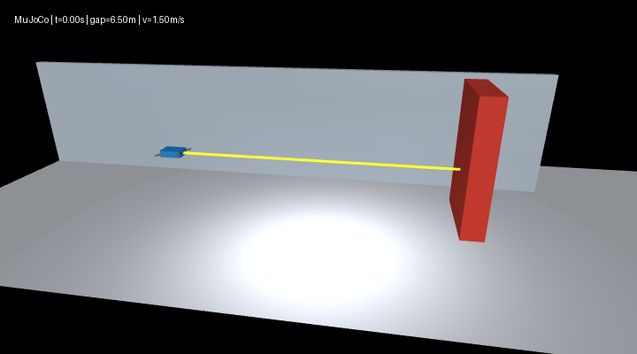
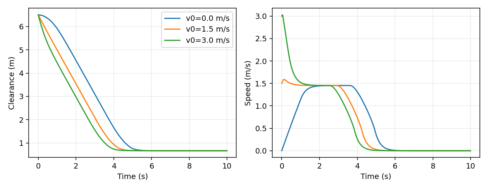

# MuJoCo 无人机测距制动与神经控制

## 场景与模型

无人机沿固定航向接近静态障碍物，模型保留水平、竖直两个平移自由度，以及重力、质量、阻尼和碰撞。机体质量为 0.52 千克，参考高度为 1.2 米，物理步长为 0.01 秒；不包含姿态稳定、旋翼气动或真实飞控接口。



## 控制原理

`reference` 读取几何间距与真实速度作为参照；`range` 使用前向测距与距离差分估速；`mlp` 使用相同传感输入预测水平加速度。传感器比机身前缘向前安装 0.01 米，推理前补偿该偏移。

闭合速度采用一阶低通滤波：

\[
\hat v_k=0.8\hat v_{k-1}+0.2(r_{k-1}-r_k)/0.01.
\]

解析控制按剩余间距给定目标速度，以加速度限幅产生连续制动力。高度由重力补偿与独立 PD 回路保持；制动过程不直接清零速度。

\[
v_r=\min(1.5,\sqrt{2\cdot0.8\max(d-0.8,0)}),\quad
a_x=\operatorname{clip}(3(v_r-v),-2.5,1.2),\quad F_x=ma_x.
\]

\[
F_z=m[9.81+16(z_r-z)-8\dot z].
\]

无效测距触发最大反向制动，此策略限于前进接近场景。0.8 米为减速参考值，并非任意初始条件下的停车距离保证。

## 环境与运行

Python 3.10～3.11，MuJoCo 3.12.0，NumPy 依赖见 `requirements.txt`。以下命令在 `src/air/mujoco_uav_range_neural_braking` 中执行：

```
python -m pip install -r requirements.txt
python main.py --headless --controller mlp
python evaluate.py --controller all --output results/comparison
python -m pytest -q
```

主入口和评测默认写入系统临时目录；`--output` 可显式指定结果目录。初速度 `--speed` 范围为 0～3 米/秒，超界时给出参数提示。接触步数保存在指标中，完成边界场景的记录后正常退出。

Ubuntu 22.04 / ROS 2 Humble 中执行：

```
source /opt/ros/humble/setup.bash
ros2 launch ./launch/main.launch.py controller:=mlp model:=/absolute/path/mlp_controller.json
```

不传 `model` 时加载模块内的权重文件。旧运行入口 `src/ground/mujoco_drone_distance_stop/main.py` 转发到相同模块。

<span id="dataset"></span>

## 数据集与训练

固定随机种子 2026，采集 30 个 12 秒回合，初速度 0～2.5 米/秒，起点与障碍中心间隔 4～9 米，参考高度 0.8～1.8 米。按回合划分训练、验证、测试集，分别为 18、6、6 回合，以及 21600、7200、7200 条记录。

```
python dataset.py --seed 2026 --episodes 30 --output datasets
python train.py --data datasets --output models --epochs 350 --hidden-size 16
```

网络输入为 `sensor_range_m` 和 `closing_speed_m_s`，标签为解析测距控制器的 `accel_m_s2`。高度误差不列入数据集；独立高度控制仍参与仿真。清单记录特征、单位、回合参数与文件 SHA-256，仓库只保留每组 24 行样本和汇总。

模型为 NumPy 两层 MLP，默认含 16 个 ReLU 隐藏单元，学习率 0.003。验证误差用于保留最佳模型，连续 30 轮未改善则提前停止；`metrics.json` 记录实际训练轮数、隐藏单元数和学习率。默认训练完成 350 轮，测试 MAE 为 0.145426 米/秒²，RMSE 为 0.260402 米/秒²。

<span id="results"></span>

## 闭环比较

同一次评测使用机身中心 x=-7 米、障碍中心 x=0 米、参考高度 1.2 米，每组运行 10 秒。结果文件见模块 `results/`，其中各控制器 JSON 与 `comparison_metrics.json` 可由上述评测命令重建。

| 控制器 | 初速度（米/秒） | 最小表面间距（米） | 末速度（米/秒） | 接触步数 |
| --- | ---: | ---: | ---: | ---: |
| 几何参照 | 0 | 0.629500 | 0.000000 | 0 |
| 几何参照 | 1.5 | 0.629413 | 0.000000 | 0 |
| 几何参照 | 3 | 0.629409 | 0.000000 | 0 |
| 测距控制 | 0 | 0.668362 | 0.000000 | 0 |
| 测距控制 | 1.5 | 0.668331 | 0.000000 | 0 |
| 测距控制 | 3 | 0.668360 | 0.000000 | 0 |
| 神经控制 | 0 | 0.748400 | 0.015567 | 0 |
| 神经控制 | 1.5 | 0.459629 | -0.056239 | 0 |
| 神经控制 | 3 | -0.004636 | -0.020618 | 3 |

几何参照与测距控制分别对应约 0.629 米和 0.668 米的间距，两者使用不同观测，不能混作同一组结果。神经控制在默认 1.5 米/秒场景无碰撞；3 米/秒超出训练速度范围，记录 3 个接触步。




## 检查与文件职责

21 项自动化检查覆盖物理制动、高度恢复、测距失效、回合划分、模型保存加载、命令行参数提示、接触实验退出行为和 MLP 多速度评测。

| 文件 | 职责 |
| --- | --- |
| `scene.xml` | 刚体、接触和前向测距 |
| `simulation.py` | 物理步进、控制与指标 |
| `main.py` | 运行与轨迹导出 |
| `evaluate.py` | 多速度闭环比较与图形 |
| `dataset.py` | 回合采样与划分 |
| `mlp.py`、`train.py` | 神经模型、训练与误差计算 |
| `launch/main.launch.py` | 仿真启动、控制器和权重参数 |

## 资料

- [MuJoCo Python 接口](https://mujoco.readthedocs.io/en/stable/python.html)
- [ROS 2 Humble 文档](https://docs.ros.org/en/humble/)
