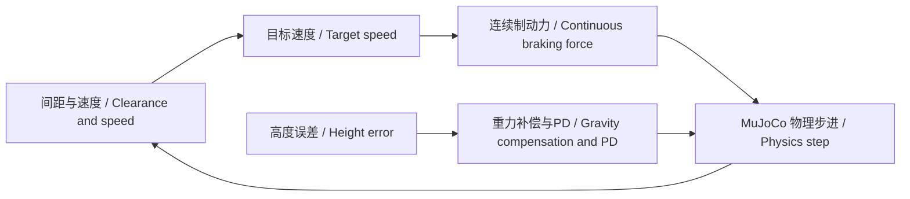
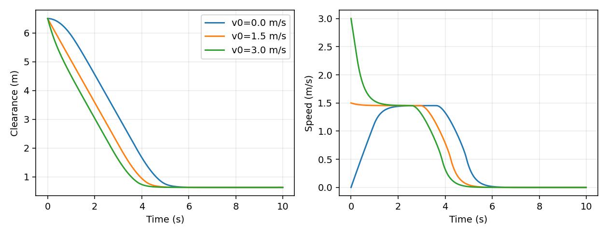
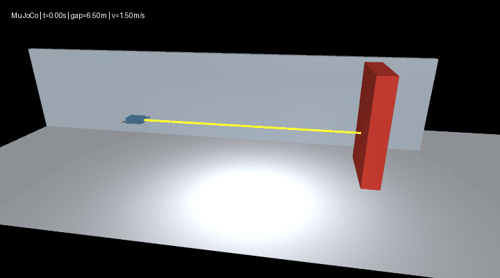

# MuJoCo 室内无人机安全制动与定高悬停 / Indoor UAV safe braking and altitude hold

## 场景与模型 / Scene and model

无人机沿室内通道接近固定障碍物，水平速度连续衰减并在障碍物前停止。模型采用水平、竖直两个平移自由度，固定航向；保留重力、质量、阻尼和接触。该模型研究纵向制动与高度保持，不描述六自由度姿态和旋翼气动。

The UAV approaches a fixed obstacle in an indoor corridor and brakes continuously. Two translational degrees of freedom retain gravity, mass, damping and contact with fixed heading. The model covers longitudinal braking and altitude hold rather than six-degree-of-freedom attitude or rotor aerodynamics.


源码 / Source: `src/air/mujoco_uav_range_neural_braking/`。

## 控制结构 / Control structure



设表面间距为 \(d\)、前进速度为 \(v\)、总质量为 \(m\)。几何参照控制器使用：

Let \(d\) denote surface clearance, \(v\) forward speed and \(m\) total mass. The geometric reference controller uses:

\[
v_r=\min(1.5,\sqrt{2\cdot0.8\max(d-0.8,0)}),\quad
a_x=\operatorname{clip}(3(v_r-v),-2.5,1.2),\quad F_x=ma_x.
\]

\[
F_z=m\left[9.81+16(z_r-z)-8\dot z\right].
\]

场景质量由 MuJoCo 模型读取，含机身与支臂，共 0.52 kg；控制周期 0.01 s。0.8 m 为减速参考值，不是停车距离保证。控制过程通过施力改变运动，不在制动时清零速度。场景同时定义朝前测距射线，几何间距当前用于建立参照基线。

Mass is read from the MuJoCo body, including the airframe and arms, totaling 0.52 kg. The control period is 0.01 s. The 0.8 m parameter is a braking reference rather than a guaranteed stop gap. Forces change motion without directly resetting velocity. A forward rangefinder is defined in the scene; geometric clearance establishes the reference baseline.

## 环境与入口 / Environment and entry points

Python 3.10–3.11，MuJoCo 3.12.0。ROS launch 使用 Ubuntu 22.04 / ROS 2 Humble。在模块目录执行：

Python 3.10–3.11 and MuJoCo 3.12.0. ROS launch uses Ubuntu 22.04 / ROS 2 Humble. Run from the module directory:

```bash
python -m pip install -r requirements.txt
python main.py --headless --controller reference --output results
python main.py
python evaluate.py --output results --render
python -m pytest -q
```

`main.py` 输出轨迹 CSV 和指标 JSON；不带 `--headless` 时显示交互窗口。`evaluate.py` 输出三组速度对照、场景图和 GIF。旧入口 `src/ground/mujoco_drone_distance_stop/main.py` 转发到同一模块。

`main.py` writes trajectory CSV and metric JSON; omitting `--headless` opens the interactive viewer. `evaluate.py` exports speed comparisons, a scene image and a GIF. The original ground-directory entry forwards to this module.

```bash
source /opt/ros/humble/setup.bash
ros2 launch ./launch/main.launch.py controller:=reference output:=/tmp/uav_braking
```

当前 launch 启动完整无窗口仿真进程；传感器话题与学习控制节点属于后续接口扩展。

The launch entry runs the complete headless simulation process. Sensor topics and learning-control nodes are separate interface extensions.

Ubuntu 22.04、Python 3.10、ROS 2 Humble 下，14 项检查通过，launch 完整运行 1000 个物理步并正常退出，默认测距控制的最小间距为 0.668331 m。

On Ubuntu 22.04, Python 3.10 and ROS 2 Humble, fourteen checks pass and launch completes 1000 physics steps with a clean exit. Default range control has a minimum gap of 0.668331 m.

## 仿真结果 / Simulation results

起始机身中心 x=-7 m，障碍物中心 x=0 m，参考高度 1.2 m，每组运行 10 s。以下为本场景实测，不代表所有初始条件下的安全保证。

The airframe starts at x=-7 m, the obstacle at x=0 m, and reference height is 1.2 m. Each episode runs for 10 s. These measurements apply to the specified scene and do not guarantee safety for arbitrary initial conditions.

| 初速度 / Initial speed (m/s) | 碰撞步数 / Contact steps | 最小间距 / Minimum clearance (m) | 最终速度绝对值 / Absolute final speed (m/s) |
| --- | --- | --- | --- |
| 0.0 | 0 | 0.629500 | < 0.000001 |
| 1.5 | 0 | 0.629413 | < 0.000001 |
| 3.0 | 0 | 0.629409 | < 0.000001 |

三组初始高度均等于参考高度，最大高度误差为 0；另以 0.1 m 高度偏移检查恢复，末端误差小于 0.005 m。三组制动、一次高度恢复及三组无效参数检查共 7 项通过。

Initial altitude equals the reference in all three episodes, giving zero maximum height error. A separate 0.1 m height perturbation recovers to within 0.005 m. Seven checks cover braking, height recovery and invalid parameters.





## 文件职责 / File responsibilities

| 文件 / File | 职责 / Responsibility |
| --- | --- |
| `scene.xml` | 物理体、碰撞和前向测距 / Bodies, contact and forward ranging |
| `simulation.py` | 场景参数、物理控制与指标 / Scenario parameters, physics control and metrics |
| `main.py` | 完整运行与数据导出 / Complete execution and data export |
| `evaluate.py` | 多速度评估与图像输出 / Speed evaluation and visual output |
| `launch/main.launch.py` | ROS launch 进程启动 / ROS launch process entry |
| `test_simulation.py` | 制动、恢复和参数检查 / Braking, recovery and parameter checks |

## 参考 / References

默认运行采用前向测距与距离差分速度，几何控制仅作参照。详见[测距与数据集](mujoco_uav_ranging_dataset.md)。 / Default execution uses forward ranging and finite-difference speed; geometric control is a reference. See [Ranging and datasets](mujoco_uav_ranging_dataset.md).

- [MuJoCo Python](https://mujoco.readthedocs.io/en/stable/python.html)
- [MuJoCo rangefinder](https://mujoco.readthedocs.io/en/stable/XMLreference.html#sensor-rangefinder)
