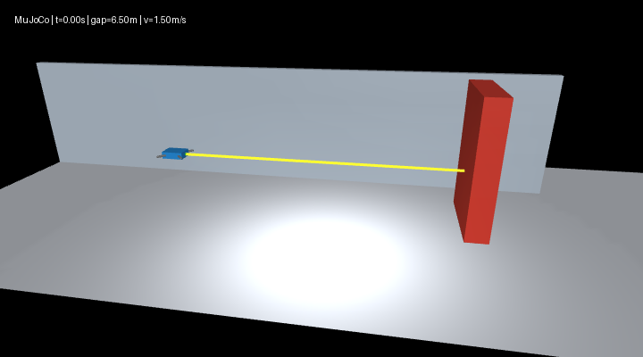
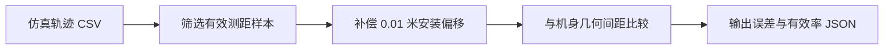

# 无人机测距几何一致性检查

## 用途

仿真轨迹同时记录机身几何间距 `range_m` 与前向测距读数 `sensor_range_m`。传感器安装在机身前缘外 0.01 米，因此将该固定安装偏移加回传感器读数后，可与机身间距对照。本工具检查这两种仿真观测是否保持几何一致，并统计轨迹中的无效测距比例。



## 运行

在 `src/air/mujoco_uav_range_neural_braking` 目录执行：

```
python main.py --headless --controller range --output results/range
python range_sensor_quality.py results/range/trajectory.csv --output results/range/sensor_quality.json
```

安装位置不是默认的 0.01 米时，可用 `--sensor-offset` 指定偏移量。输出 JSON 可用 `--output` 保存，也会显示在终端。

默认场景的一次运行结果保存在[测距质量报告样例](https://github.com/OpenHUTB/ros2/blob/master/src/air/mujoco_uav_range_neural_braking/sample_data/range_sensor_quality.json)。

## 统计口径

仅将 `sensor_valid=1` 的样本用于误差指标。偏差定义为 `sensor_range_m + sensor_offset_m - range_m`；报告包含有效率、平均偏差、平均绝对误差、均方根误差、最大绝对误差和绝对误差 95 分位数。百分位数采用最近秩法。无效样本不进入误差统计，但会计入有效率；若整条轨迹没有有效测距则返回输入错误。

该检查使用仿真中的几何间距作为对照，验证固定安装偏移补偿的一致性。当前场景未加入传感器噪声，因此结果不代表噪声条件下的测量精度或真实设备标定。


