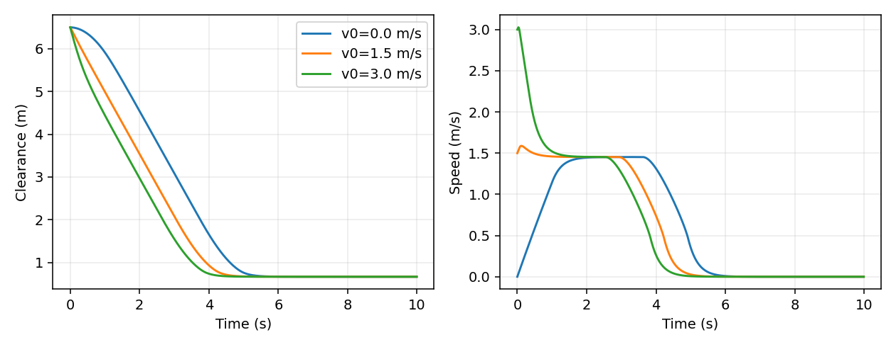
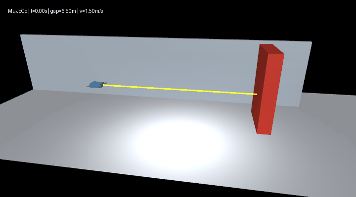

# 无人机前向测距与回合数据集 / UAV forward ranging and episode dataset

本模块在[室内制动与定高模型](mujoco_uav_range_neural_braking.md)中使用 MuJoCo 原生 `rangefinder`。前向射线测量安装点到首次命中表面的距离。水平控制读取测距及其差分估计，不读取障碍物坐标或真实水平速度。

This module uses MuJoCo's native rangefinder in the [indoor braking model](mujoco_uav_range_neural_braking.md). A forward ray measures distance from its site to the first geometry hit. Horizontal control uses ranging and its finite difference, not obstacle coordinates or true horizontal velocity.

## 测量与控制 / Measurement and control

传感器安装于机身中心前方 0.26 m，机身前缘为 0.25 m，故表面间距估计为 \(d=r+0.01\)。每步积分后 `mj_forward` 同步传感器。闭合速度为：

The site sits 0.26 m ahead of the center and the airframe front at 0.25 m, giving estimated gap \(d=r+0.01\). Post-integration `mj_forward` synchronizes sensors. Closing speed is:

\[
\hat v_k=0.8\hat v_{k-1}+0.2\frac{r_{k-1}-r_k}{0.01}.
\]

首帧闭合速度为 0；测距为负、非有限值或达到量程边界时施加 -2.5 m/s² 制动。此策略针对前进接近，不覆盖任意方向运动。高度使用理想 `framepos` 的 z 分量，竖直速度反馈读取物理状态。

Initial closing speed is zero. Negative, nonfinite or out-of-range readings trigger -2.5 m/s² braking. This policy covers forward approach rather than arbitrary motion. Height comes from the ideal frame-position sensor; vertical-speed feedback uses physics state.

## 重建数据 / Regenerate data

在模块目录执行 / Run from the module directory:

```bash
python dataset.py --seed 2026 --episodes 30 --output datasets
python main.py --headless --controller range --output results
python evaluate.py --controller range --render --output results/range
```

每回合 12 s、步长 0.01 s；机体与障碍物中心初始间隔 4–9 m，初速度 0–2.5 m/s，参考高度 0.8–1.8 m，障碍物 x 为 -0.5–0.5 m。固定种子决定参数和划分，同一回合的所有帧只属于一个集合。

Each episode lasts 12 s at a 0.01 s step. Initial center spacing varies from 4 to 9 m, speed from 0 to 2.5 m/s, reference height from 0.8 to 1.8 m and obstacle x from -0.5 to 0.5 m. A fixed seed determines parameters and splits; all frames from each episode stay in one split.

| 集合 / Split | 回合 / Episodes | 行 / Rows | 碰撞步 / Contact steps | 无效测距 / Invalid range | 最小表面间距 / Minimum gap (m) |
| --- | --- | --- | --- | --- | --- |
| train | 18 | 21600 | 0 | 0 | 0.668099 |
| validation | 6 | 7200 | 0 | 0 | 0.668175 |
| test | 6 | 7200 | 0 | 0 | 0.668098 |

以上来自解析测距控制器，不是神经网络测试成绩。回合初始高度等于参考值，采集中的高度误差为零；后续学习使用距离和闭合速度两个有效输入，定高由独立 PD 保持。数据不含测距噪声、姿态变化和其他障碍物类型。

These metrics describe the analytical range controller rather than neural-network performance. Initial height equals its reference, yielding zero height error; range and closing speed are the two active learning inputs while an independent PD loop holds altitude. Data exclude range noise, attitude variation and other obstacle types.

## 字段与校验 / Fields and verification

| 字段 / Field | 含义 / Meaning |
| --- | --- |
| `episode_id`, `time_s` | 回合与仿真时间 / Episode and simulation time |
| `sensor_range_m` | 前向测距 / Forward range |
| `closing_speed_m_s` | 滤波闭合速度 / Filtered closing speed |
| `height_error_m` | 参考高度减测得高度 / Reference minus measured height |
| `accel_m_s2` | 解析控制标签 / Analytical acceleration target |
| `range_m`, `speed_m_s`, `height_m` | 评价真值 / Evaluation ground truth |
| `collision`, `sensor_valid` | 碰撞与测量有效标志 / Contact and measurement-valid flags |

完整 CSV 与 `manifest.json` 保存于输出目录；清单记录版本、单位、回合参数、指标和 SHA-256。仓库 `sample_data/` 每个集合仅保留 24 行供格式检查，`dataset_summary.json` 保存完整文件校验值。

Full CSV files and `manifest.json` reside in the output directory. The manifest records versions, units, episode parameters, metrics and SHA-256. Versioned `sample_data/` holds only 24 rows per split for schema inspection; `dataset_summary.json` records full-file hashes.

Windows Python 3.11 与 Ubuntu 22.04 Python 3.10 均运行 MuJoCo 3.12.0，三个 CSV 校验值完全一致。14 项检查覆盖物理、传感器朝向、几何输入隔离、失效制动、三组速度、划分互斥及重现；ROS 2 Humble launch 正常退出。

Windows Python 3.11 and Ubuntu 22.04 Python 3.10 both use MuJoCo 3.12.0 and produce identical CSV hashes. Fourteen checks cover physics, ray direction, separation from geometric inputs, invalid-sensor braking, speeds, disjoint splits and reproducibility. ROS 2 Humble launch exits cleanly.




