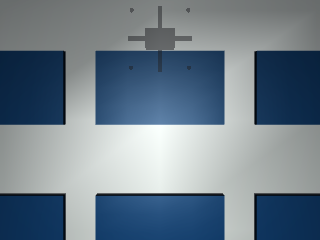

# 基于轻量语义分割与神经网络航迹控制的 MuJoCo 城市屋顶光伏覆盖率测量

**MuJoCo Urban Rooftop Photovoltaic Coverage Survey Using Lightweight Semantic Segmentation and Neural Flight-Line Control**

## 项目目标 / Project Objective

系统面向城市建筑屋顶光伏覆盖率测量。无人机沿往复条带航线采集下视 RGB 影像，后续由轻量语义分割网络识别光伏像素，并由神经网络航迹控制器跟踪测量航线。当前工程阶段完成 MuJoCo 场景、四旋翼、相机与确定性航线接口，为感知和控制网络提供统一坐标与数据基础。

The system targets photovoltaic coverage surveys on urban rooftops. A quadrotor follows a boustrophedon flight line and captures nadir RGB images. A lightweight semantic segmentation network will identify photovoltaic pixels, while a neural controller will track the survey path. The current engineering stage establishes the MuJoCo scenes, quadrotor, camera, and deterministic route interface used by both learning tasks.

## 场景与航线 / Scene and Route

工程提供稀疏阵列、密集阵列、带天窗和空调机组遮挡的阵列三种轻量场景。所有对象均由 MJCF 基础几何体组成。默认屋顶为 20 m × 14 m，航高 8 m，条带间距 2 m，边缘余量 1 m，航速 2 m/s。航线始终落在安全边界内，并在相邻条带间交替飞行方向。

Three lightweight layouts are provided: a sparse array, a dense array, and an occluded array with a skylight and HVAC units. Every object uses MJCF primitive geometry. The default roof is 20 m × 14 m with an 8 m flight altitude, 2 m strip spacing, 1 m edge margin, and 2 m/s speed. The route remains inside the safe boundary and alternates direction between adjacent strips.



## 可复现运行 / Reproducible Run

```bash
python3 -m venv .venv
.venv/bin/pip install -r src/air/mujoco_uav_rooftop_pv_coverage_survey/requirements.txt
.venv/bin/python src/air/mujoco_uav_rooftop_pv_coverage_survey/main.py --scenario sparse
.venv/bin/python -m pytest src/air/mujoco_uav_rooftop_pv_coverage_survey/tests -q
```

入口读取固定 YAML 配置和随机种子，输出航线、RGB 影像及摘要。输出文件使用相对路径，便于在 Windows、Linux 与 ROS 2 Humble 工作区中复现。

The entry point reads a fixed YAML configuration and random seed, then writes the route, RGB image, and summary. Outputs use relative paths for reproducibility on Windows, Linux, and ROS 2 Humble workspaces.

## 数据与 ROS 接口 / Data and ROS Interfaces

航线采用屋顶局部 ENU 坐标系，航点包含位置、偏航角、速度、预计到达时间、条带编号和转弯标记。相机固定名为 `downward_rgb`。后续 ROS 2 封装将保持该字段语义，并将航线映射为标准路径消息、将相机数据映射为图像消息。

The route uses a rooftop-local ENU frame. Each waypoint contains position, yaw, speed, expected arrival time, strip index, and turn flag. The camera has the stable name `downward_rgb`. A later ROS 2 wrapper will preserve these semantics while mapping routes and images to standard ROS messages.

## 同步标签与专家控制 / Synchronized Labels and Expert Control

数据入口使用 MuJoCo 3.12.0 的几何体分割缓冲区，将 `pv_panel_*` 的可见像素转换为二值光伏掩码。RGB 与分割图使用相同模型状态、相机、分辨率和帧编号，因此遮挡关系与像素坐标保持一致。

The data entry point uses the MuJoCo 3.12.0 geometry segmentation buffer and converts visible `pv_panel_*` pixels into a binary photovoltaic mask. RGB and segmentation share the same model state, camera, resolution, and frame identifier, preserving both occlusion and pixel coordinates.


确定性专家控制器接收横向偏差、航向误差和距转弯点距离，输出有限幅的前进速度与偏航角速度。接近转弯点时降低速度；横向或航向正误差产生负偏航修正，负误差产生正偏航修正。该输入输出模式作为后续神经航迹控制器的监督训练接口。

The deterministic expert receives cross-track error, heading error, and distance to the next turn, then emits bounded forward speed and yaw rate. It slows near turns; positive lateral or heading error produces a negative yaw correction, while negative error produces a positive correction. This input-output schema is the supervised training interface for the later neural flight-line controller.

固定种子 `20261016` 的小型采集生成 18 帧：三个场景各 6 帧，train、validation、test 各包含一个完整场景序列。质量报告核对文件存在性、RGB-mask 尺寸、二值标签、帧编号唯一性、序列划分隔离与内容重复项。

The small collection with seed `20261016` contains 18 frames: six from each scene, with one complete scene sequence in each of train, validation, and test. The quality report checks file existence, RGB-mask dimensions, binary labels, unique frame identifiers, sequence-level split isolation, and duplicate content.
