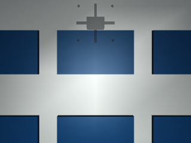
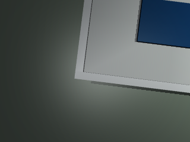

# 基于轻量语义分割与神经网络航迹控制的 MuJoCo 城市屋顶光伏覆盖率测量

## 项目目标

系统面向城市建筑屋顶光伏覆盖率测量。无人机沿往复条带航线采集下视 RGB 影像，由轻量语义分割网络识别光伏像素，神经网络规划与控制器根据局部状态预测航点和速度。工程提供 MuJoCo 场景、同步数据、训练测试、RGB-D 平面地标 SLAM、键盘交互与 ROS 2 传感器控制。

## 场景与航线

工程提供稀疏阵列、密集阵列、带天窗和空调机组遮挡的阵列三种轻量场景。所有对象均由 MJCF 基础几何体组成。默认屋顶为 20 m × 14 m，航高 8 m，条带间距 2 m，边缘余量 1 m，航速 2 m/s。航线始终落在安全边界内，并在相邻条带间交替飞行方向。



## 可复现运行

```bash
python3 -m venv .venv
.venv/bin/pip install -r src/air/mujoco_uav_rooftop_pv_coverage_survey/requirements.txt
.venv/bin/python src/air/mujoco_uav_rooftop_pv_coverage_survey/main.py --scenario sparse
.venv/bin/python -m pytest src/air/mujoco_uav_rooftop_pv_coverage_survey/tests -q
```

入口读取固定 YAML 配置和随机种子，输出航线、RGB 影像及摘要。输出文件使用相对路径，便于在 Windows、Linux 与 ROS 2 Humble 工作区中复现。

## 数据与 ROS 接口

航线采用屋顶局部 ENU 坐标系，航点包含位置、偏航角、速度、预计到达时间、条带编号和转弯标记。相机固定名为 `downward_rgb`。ROS 2 节点通过标准图像、位姿和路径消息接收传感器及目标数据，输出速度与运行状态。

## 同步标签与专家控制

数据入口使用 MuJoCo 3.12.0 的几何体分割缓冲区，将 `pv_panel_*` 的可见像素转换为二值光伏掩码。RGB 与分割图使用相同模型状态、相机、分辨率和帧编号，因此遮挡关系与像素坐标保持一致。




确定性专家控制器接收横向偏差、航向误差和距转弯点距离，输出有限幅的前进速度与偏航角速度。接近转弯点时降低速度；横向或航向正误差产生负偏航修正，负误差产生正偏航修正。该输入输出模式作为神经航迹控制器的监督训练接口。

固定种子 `20261016` 的小型采集生成 18 帧：三个场景各 6 帧，train、validation、test 各包含一个完整场景序列。质量报告核对文件存在性、RGB-mask 尺寸、二值标签、帧编号唯一性、序列划分隔离与内容重复项。

完整神经网络训练、平面 SLAM、键盘交互和 ROS 2 控制见[完整技术指南](mujoco_uav_rooftop_pv_coverage_survey_day2.md)。
