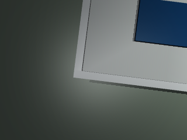
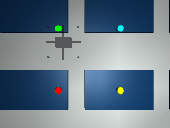
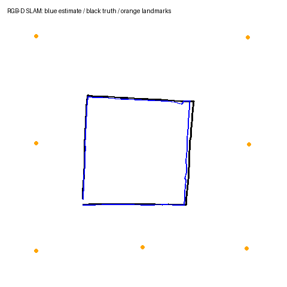
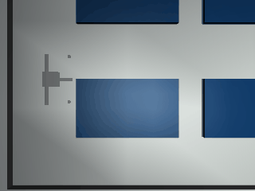
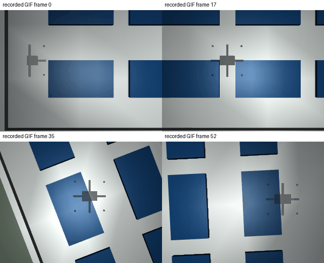

# MuJoCo 屋顶光伏感知、神经控制与平面 SLAM

## 1. 系统与运行条件

本模块在 MuJoCo 3.12.0 中构建稀疏、密集和遮挡三种屋顶光伏布局，使用下视相机采集 RGB、深度和光伏分割标签。数据采集、神经网络训练、指标评价、平面地标建图导航和 ROS 2 控制采用统一入口。无人机运动采用固定高度的速度积分；地标 SLAM 使用固定航向的平面模型。

容器环境采用 Ubuntu 22.04、ROS 2 Humble 和 Python 3.10。图像处理与训练依赖 NumPy、Pillow、PyYAML 和 CPU PyTorch。Ubuntu 22.04 与 Humble 对应；ROS Noetic 环境不作为本模块的验收环境。




## 2. 仿真与训练步骤

在模块目录中启动容器。Compose 将结果目录挂载到主机，保留 JSON 指标、模型权重和 GIF：

```bash
cd src/air/mujoco_uav_rooftop_pv_coverage_survey
docker compose build
docker compose run --rm rooftop-pv
```

在已准备依赖的 Python 环境中，也可从仓库根目录分步运行：

```bash
python3 -m pip install -r src/air/mujoco_uav_rooftop_pv_coverage_survey/requirements.txt
python3 src/air/mujoco_uav_rooftop_pv_coverage_survey/main.py --mode dataset --output survey_data
python3 src/air/mujoco_uav_rooftop_pv_coverage_survey/main.py --mode train-segmentation --output survey_data
python3 src/air/mujoco_uav_rooftop_pv_coverage_survey/main.py --mode train-control --output survey_data
python3 src/air/mujoco_uav_rooftop_pv_coverage_survey/main.py --mode train-end-to-end --output survey_data
python3 src/air/mujoco_uav_rooftop_pv_coverage_survey/main.py --mode train-planning --output survey_data
python3 src/air/mujoco_uav_rooftop_pv_coverage_survey/main.py --mode slam-nav --output survey_data/slam
python3 src/air/mujoco_uav_rooftop_pv_coverage_survey/main.py --mode all --output survey_data
```

`manifest.jsonl` 将每帧图像、标签、相机位姿和专家指令关联起来。`splits.json` 以完整场景序列划分训练、验证、测试集；`quality_report.json` 检查缺失文件、掩码值、尺寸、序列泄漏与重复内容。训练与测试不随机混合相邻帧。

## 3. 感知、控制与端到端模型

轻量编码器–解码器接收归一化 RGB，输出单通道光伏像素 logits。训练目标由二元交叉熵和软 Dice 损失组成，其中 $p_i$ 是 sigmoid 概率，$y_i$ 是二值标签：

$$
L_{seg}=-\frac{1}{N}\sum_i[y_i\log p_i+(1-y_i)\log(1-p_i)]+1-\frac{2\sum_i p_i y_i+1}{\sum_i p_i+\sum_i y_i+1}.
$$

MLP 控制器将横向偏差、航向误差和距转弯点距离映射为前进速度与偏航角速度。图像控制网络直接将 RGB 映射为相同的两维指令。两者使用专家标签的均方误差训练：

$$
L_{ctrl}=\frac{1}{N}\sum_{i=1}^{N}\|u_\theta(s_i)-u_i^*\|_2^2.
$$

神经规划模块以局部状态预测下一段导航位移，并保存独立规划权重。训练后的模型文件保留网络类别、轮次、随机种子和参数；部署加载时校验模型类别，避免把未训练的随机网络当作已训练模型运行。主要文件为 `segmentation.pt`、`control.pt`、`end_to_end.pt` 和 `planning.pt`。

分割评价使用 IoU、Dice、像素准确率与面积相对误差。这里的像素比例衡量图像中的可见光伏区域；它与经过相机标定和屋顶平面投影得到的物理面积是不同量。

$$
IoU=\frac{TP}{TP+FP+FN},\qquad Dice=\frac{2TP}{2TP+FP+FN}.
$$

## 4. RGB-D 地标 SLAM 与导航

场景中的彩色标记提供可重识别地标。检测器使用 RGB 颜色确定标记身份，使用深度与相机视场角将像素中心反投影为相机相对平面坐标。滤波器只接收相对观测和带噪声的指令里程计；仿真真值用于移动相机和统计误差，不作为 SLAM 观测。



固定航向平面状态由机器人位置和未知地标位置组成。相机相对观测满足 $z_j=m_j-r+v$；新地标由首次观测初始化，再观测联合修正机器人与地图：

$$
x=[r_x,r_y,m_{1x},m_{1y},\ldots]^T,\quad S=HPH^T+R,\quad K=PH^TS^{-1}.
$$

$$
x^+=x^-+K(z-h(x^-)),\quad P^+=(I-KH)P^-(I-KH)^T+KRK^T.
$$

导航在同一循环中依次执行“相机渲染 → 地标观测 → 联合滤波 → 目标航点误差 → 速度更新”。地图与估计轨迹随导航共同更新。模型固定高度和航向，重点验证平面定位、未知地标估计及航点到达。




三种布局的运行产物均记录 `navigation_completed=true`。以下数值来自保存的三场景 `slam_metrics.json`，误差以仿真真值计算：

| 场景 | 位置 RMSE（m） | 仅里程计 RMSE（m） | 到达航点 |
|---|---:|---:|---:|
| sparse | 0.06579 | 0.22370 | 4/4 |
| dense | 0.04999 | 0.19734 | 4/4 |
| occluded | 0.05843 | 0.19966 | 4/4 |

## 5. 键盘控制

交互模式打开 MuJoCo 查看器并接收真实键盘事件：`W/S` 沿当前航向前进和后退，`A/D` 转向，`Q/E` 小幅转向，空格停车。按键超时后自动停止；速度积分受到屋顶边界约束。

```bash
python3 src/air/mujoco_uav_rooftop_pv_coverage_survey/main.py --mode keyboard-interactive --output keyboard_run
```

无窗口批处理可使用确定性键序列回放。另在 Xvfb 虚拟显示器中向真实 GLFW 查看器发送 `W/A/Space` 键盘事件，记录到 229 个轨迹样本：最大位移 5.6737 m、转向 1.5210 rad；空格后的 153 个样本无位移，输入超时后的 7 个样本保持停止。该验收通过真实查看器事件链路执行，GIF 包含 53 个不同画面。





## 6. ROS 2 安装与传感器控制

功能包使用 `ament_python`，安装场景、配置、launch 和命令入口。`setup.cfg` 将节点安装到 `lib/mujoco_uav_rooftop_pv_coverage_survey`。在仅包含本模块的工作空间执行：

```bash
source /opt/ros/humble/setup.bash
colcon build --packages-select mujoco_uav_rooftop_pv_coverage_survey
source install/setup.bash
ros2 launch mujoco_uav_rooftop_pv_coverage_survey rooftop_pv_controller.launch.py
ros2 launch mujoco_uav_rooftop_pv_coverage_survey rooftop_pv_workflow.launch.py mode:=all output:=survey_data
```

节点订阅 `sensor_msgs/Image`、`geometry_msgs/PoseStamped` 和 `nav_msgs/Path`，发布 `geometry_msgs/Twist` 与 JSON 状态消息。配置中的 `segmentation_checkpoint`、`planning_checkpoint` 和 `control_checkpoint` 指向训练权重；`end_to_end_checkpoint` 选择直接从 RGB 预测速度的模型，状态标识为 `trained_image`。未配置权重时，状态明确标识颜色基线与几何跟踪。所有模式均要求有效且未过期的图像；坐标系不一致、输入过期或尚未获得有效位姿和路径时，控制输出停车指令。

`rooftop_pv_workflow.launch.py` 接受 `mode`、`output` 和 `scenario` 参数，通过安装的 `rooftop_pv_pipeline` 入口启动数据、训练、SLAM 和键盘模式；控制节点使用独立的 `rooftop_pv_controller.launch.py`。

| 参数| 用途|
|---|---|
| `image_topic` | RGB 输入|
| `pose_topic` | 机器人位姿|
| `route_topic` | 目标航线|
| `command_topic` | 速度指令|
| `status_topic` | 控制和感知状态|
| `control_checkpoint` | 训练后的 MLP 权重|
| `planning_checkpoint` | 训练后的局部航点规划权重|
| `end_to_end_checkpoint` | 训练后的 RGB 到速度模型权重 |
| `segmentation_checkpoint` | 训练后的分割权重|
| `input_timeout` | 输入超时停车|

## 7. 源代码结构

| 文件| 实现说明|
|---|---|
| `main.py` | 读取 YAML，分派模式，汇总输出|
| `rooftop_pv/scene.py` | 解析安装或源目录的 MJCF，设置相机位姿|
| `rooftop_pv/dataset.py` | 同步 RGB、分割与控制标签，记录序列元数据|
| `rooftop_pv/quality.py` | 文件、标签和序列划分审计|
| `rooftop_pv/models.py` | 分割、特征控制与图像控制网络|
| `rooftop_pv/training.py` | 优化、测试指标、模型权重保存|
| `rooftop_pv/slam.py` | RGB-D 反投影、联合状态滤波与航点导航|
| `rooftop_pv/keyboard.py` | 查看器按键回调、超时停车与回放|
| `ros2_uav_controller.py` | 图像解析、路径跟踪、模型加载与 ROS 话题|

`TrackingCore` 将消息适配与控制计算分离，使相同的输入校验、限幅与目标切换逻辑既能在 ROS 节点运行，也能在离线测试中执行。图像解析遵循 `step` 行跨度，兼容 RGB、BGR、RGBA 和单通道输入。SLAM 的地标状态和协方差随新观测扩展，重复观测通过卡尔曼增益更新整张联合地图。

## 8. 运行结果与复现文件

已保存的 Ubuntu/Humble 容器运行生成 18 对 RGB/掩码、三个完整场景序列，质量审计为 `pass`，训练和测试每种网络均使用独立序列。分割、特征控制与图像控制的保存指标分别来自 `day2_summary.json` 对应字段；这些是固定种子的小数据实验结果。

| 指标| 已保存结果|
|---|---:|
| 分割 IoU| 0.43870 |
| 分割 Dice| 0.58493 |
| 特征控制 MSE| 0.30014 |
| 图像控制 MSE| 0.47178 |
| 局部航点规划 MSE| 0.10398 |
| 局部航点误差（m）| 0.41047 |

本轮 Ubuntu/Humble 容器中 55 项测试通过，完整入口生成四个训练权重文件。`colcon build` 后，在源码目录之外成功载入三种已安装 MJCF，并由安装后的 workflow launch 运行场景。Docker 镜像将功能包安装到 `/opt/rooftop_pv`，默认通过真实 ROS launch 执行完整流程，Compose 运行成功并保留 `artifacts/day2/day2_summary.json`。

ROS 消息验收确认图像、位姿与路径输入可产生非零且有界的速度，并在位姿过期时停车。训练模式同时加载分割、规划和控制三个权重，状态分别报告 `trained_segmentation`、`trained_local_waypoint` 与 `trained_mlp`。端到端模式加载图像控制权重，真实 RGB 消息产生有界速度，状态为 `trained_image`，位姿超时停车通过。安装启动、训练模型控制和端到端图像控制三轮 ROS 验收均记录 `passed=true`。

最新完整入口的稀疏布局 SLAM 运行完成四个航点，记录七个地标和 136 次重复观测，位置 RMSE 为 0.06606 m。上面的三场景表对应独立保存的多场景运行，因此保留各自数值。

保留 `manifest.jsonl`、`splits.json`、`quality_report.json`、`day2_summary.json`、模型权重和 SLAM 的指标、轨迹、地图与 GIF，即可逐项检查数据来源、序列隔离、训练结果和地图估计。图像中的光伏覆盖率属于相机可见区域的估计；SLAM 的定位结果对应固定高度、固定航向和可识别地标的平面场景。
