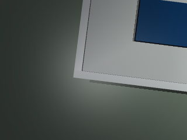
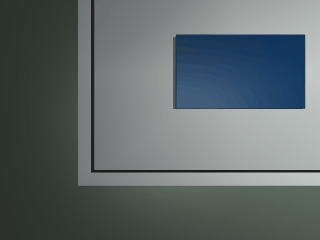

# MuJoCo 屋顶光伏覆盖率测量：第二天 / Day 2

本页说明轻量语义分割、专家航迹控制、离线回放和三种屋顶布局评价。完整运行步骤见模块内 `DAY2.md`。

This page documents lightweight segmentation, expert flight-line control, offline replay, and evaluation across three rooftop layouts. See the module `DAY2.md` for complete commands.

完整入口 / Full entry: `main.py --mode all --output survey_data`。该入口同时覆盖键盘遥操作、传感器感知、给定轨迹控制、端到端图像控制、同步建图导航和性能评价。

## 模型与指标 / Models and Metrics

分割网络输出像素级光伏掩码，使用 IoU、Dice、像素准确率、面积相对误差和平均推理时间评价。控制网络读取横向误差、航向误差、距转弯点距离，输出前进速度与偏航角速度，并与确定性专家标签比较均方误差。

The segmentation network predicts pixel-level PV masks and reports IoU, Dice, pixel accuracy, area relative error, and mean inference time. The controller reads cross-track error, heading error, and distance to turn, then reports command mean squared error against the deterministic expert labels.

## 覆盖率 / Coverage

`coverage = A_pv / A_roof × 100%`。遮挡场景只把当前相机可见的光伏板计入 `A_pv`，因此评价同时保留布局差异和可见性差异。

`coverage = A_pv / A_roof × 100%`. In the occluded layout, only currently visible PV pixels contribute to `A_pv`, preserving both layout and visibility differences.

## 键盘、建图与端到端 / Keyboard, Mapping, and End-to-End

中文：键盘回放使用 `W/S/A/D/Q/E/Space` 控制四旋翼速度与偏航；下视 RGB 光伏掩码与位姿同步投影到 ENU 占据栅格；端到端卷积网络将 RGB 图像直接映射到前进速度和偏航角速度。英文：keyboard replay controls quadrotor velocity and yaw with `W/S/A/D/Q/E/Space`; synchronized RGB masks and poses are fused into an ENU occupancy grid; a convolutional end-to-end network maps RGB images directly to forward speed and yaw rate。

