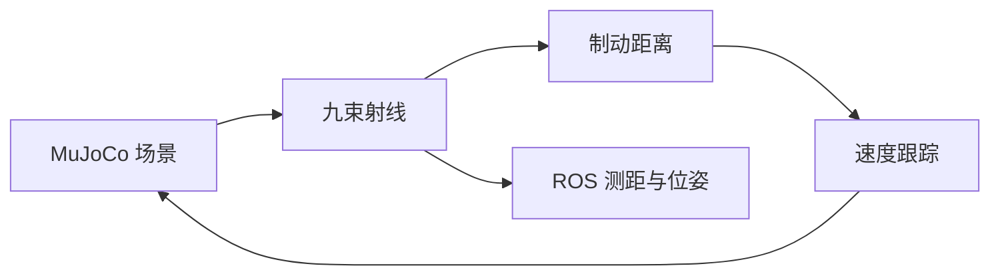
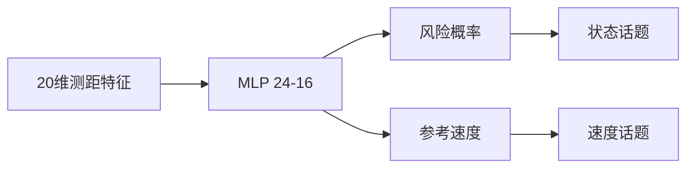

# 仓储通道巡检无人机多束测距与分级制动

## 场景与结构

系统采用 MuJoCo 3.12.0 构建仓储巡检通道，覆盖静态箱体、横穿障碍和窄通道。无人机具有三轴平移自由度，姿态固定；测距、标签计算和 ROS 发布共享同一物理模型。




## 测距与控制

射线在水平面覆盖 −60° 至 60°，间隔 15°，量程 8 m；排除自身机体。物理步长为 0.02 s。前方中央三束距离的最小值用于保守制动。

设测距值为 \(r\)，机体半径为 0.18 m，控制预留距离为 0.70 m：

\[
g=\max(0,r-0.18-0.70),\qquad d_b=v^2/4+0.25v
\]

\[
v_{ref}=\min(v_{cruise},\max(0,\sqrt{4g+0.25}-0.5))
\]

当 \(g\le d_b\) 时标签为制动；当 \(d_b<g\le d_b+1.5\) 时为警戒；其余为畅通。速度跟踪采用比例反馈并将纵向加速度限制在 ±2 m/s²；预留距离包含跟踪响应裕度，不代表严格碰撞安全证明。

## 运行与接口

源码位于 `src/air/mujoco_warehouse_uav_collision_braking`。模块提供 `main.py`、`launch/main.launch.py` 和 Dockerfile。Ubuntu 22.04、ROS 2 Humble 和 MuJoCo 环境可直接在 Docker Desktop 的 Linux 容器内运行。

```bash
docker build -t warehouse-uav:humble .
docker run --rm warehouse-uav:humble
python3 main.py --scenario static --render --output results/static
ros2 launch mujoco_warehouse_uav_collision_braking main.launch.py scenario:=crossing duration:=8.0
```

发布接口为 `/warehouse/scan`、`/warehouse/pose`、`/warehouse/reference_velocity` 和 `/warehouse/status`，类型分别为 LaserScan、PoseStamped、TwistStamped 和 String。

## 运行结果

下表为初始速度 1.2 m/s、持续 8 s 的参考控制结果；不作为神经网络性能结果。

| 场景| 碰撞| 终点 x| 末速度|
| 静态| 否| 4.9836 | 0.000004 |
| 横穿| 否| 9.1730 | 1.1613 |
| 窄道| 否| 4.9836 | 0.000004 |

ROS 启动检查持续 2 s，节点完成 100 个物理步并正常退出。动画大小约 2.37 MiB。单元检查覆盖射线几何、静态制动、接触检测、横穿运动与高度保持。

## 源码导读

`simulation.py` 构建场景、施加作用力并计算射线；`ros_node.py` 将物理状态转换为消息；`visualize.py` 使用仿真状态生成动画；`tests/test_simulation.py` 检查关键行为。

完整课题为“仓储通道巡检无人机的多束测距神经网络碰撞风险预测与分级制动”。训练、独立测试、学习控制的 ROS 集成与多场景比较在参考控制和监督数据基础上扩展。

参考资料](https://mujoco.readthedocs.io/)、[ROS 2 Humble](https://docs.ros.org/en/humble/)。

## 监督数据与隔离

`dataset.py` 对每条轨迹使用独立随机流，变化障碍位置、巡航速度和横穿速度。每个场景按完整轨迹分为训练60%、验证20%、测试20%；不按单帧随机打散。状态输入只使用当前观测和历史观测，不包含未来位置或碰撞结果。

| 输入或标签| 维度| 定义|
| 距离| 9 | 水平射线距离，0至8 m|
| 闭合速度| 9 | 前帧距离减当前距离除以0.02 s，限幅±10 m/s|
| | 2 | 当前纵向速度与轨迹巡航设定|
| 参考速度| 1 | 制动距离规则给出的速度|
| 风险标签| 1 | 0畅通、1警戒、2制动|

```bash
python3 main.py --collect --episodes 30 --seed 42 --duration 8 --output dataset
python3 -m unittest discover -s tests -v
```

| 分区| 轨迹| 样本| 畅通/警戒/制动|
| 训练| 18 | 5465 | 2437|
| 验证| 6 | 1816 | 854|
| 测试| 6 | 2008 | 990|

每条轨迹最多8 s，首次接触后停止，因而样本数量随轨迹变化。巡航与参考制动行为混合用于覆盖接近障碍时的观测。标签表达参考规则，不表示真实飞行中的碰撞概率。

[数据清单](mujoco_warehouse_uav_collision_braking/dataset_manifest.json) 保存种子、轨迹参数、特征顺序、分区统计和数组SHA-256；[样本片段](mujoco_warehouse_uav_collision_braking/sample_rows.csv) 便于查看数据结构。

八项检查覆盖几何与控制行为、首帧闭合速度复位、固定种子复现和轨迹泄漏拒绝。三个分区的轨迹集合互不相交，且每个分区均包含三个场景和三类风险标签。

## 轻量模型

训练器使用 NumPy MLP，输入20维，隐藏层为24和16个单元，输出风险三分类与速度回归。训练过程固定随机种子，保存标准化均值、尺度、权重和偏置，模型文件可独立加载。



评估只使用测试分区，输出 `risk_accuracy`、`speed_mae_mps` 和 3×3 混淆矩阵。固定种子容器示例得到风险准确率 0.768、速度平均绝对误差 0.522 m/s；这些指标用于检查模型加载与接口稳定性，不替代真实飞行验证。

学习控制节点通过 `/warehouse/scan`、`/warehouse/pose` 接收输入，通过 `/warehouse/learned_velocity`、`/warehouse/learned_status` 输出预测。它与参考控制接口并列，便于逐场景比较。

## 多场景对照

学习控制节点在发布速度前应用参考制动速度上限，模型负责风险和速度预测，规则层负责近障碍安全边界。该组合让速度输出可解释，也保留了模型接口。

| 场景| 接触| 末速度| 风险一致率|
| 静态| 否| 0.000000 | 1.000 |
| 横穿| 否| 0.000001 | 0.968 |
| 窄道| 否| 0.000000 | 0.000 |

窄道的风险分类一致率较低，说明该场景仍需要更多横向几何样本；速度上限仍保持安全制动行为。该指标用于定位数据覆盖缺口，不将低一致率包装成模型优势。

完整命令和固定种子结果见[验证记录](mujoco_warehouse_uav_collision_braking/validation_report.md)。

