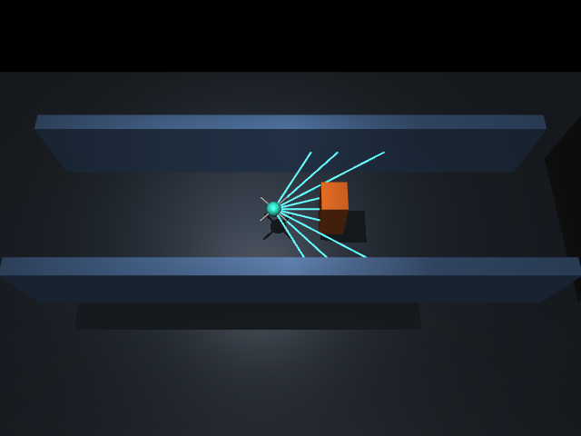
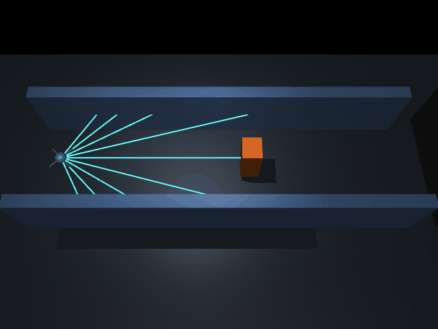
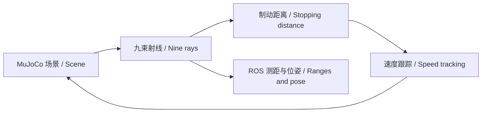

# 仓储通道巡检无人机多束测距与分级制动 / Multi-Beam Ranging and Graded Braking for Warehouse UAVs

## 场景与结构 / Scene and Structure

系统采用 MuJoCo 3.12.0 构建仓储巡检通道，覆盖静态箱体、横穿障碍和窄通道。无人机具有三轴平移自由度，姿态固定；测距、标签计算和 ROS 发布共享同一物理模型。
The system uses MuJoCo 3.12.0 for warehouse inspection aisles with static boxes, crossing obstacles and narrow passages. The UAV has three translational degrees of freedom and fixed attitude. Ranging, label calculation and ROS publication share the same physical model.







## 测距与控制 / Ranging and Control

射线在水平面覆盖 −60° 至 60°，间隔 15°，量程 8 m；排除自身机体。物理步长为 0.02 s。前方中央三束距离的最小值用于保守制动。
Horizontal rays span −60° to 60° at 15° intervals with an 8 m range, excluding the UAV body. The physics step is 0.02 s. The minimum of the three central beams supports conservative braking.

设测距值为 \(r\)，机体半径为 0.18 m，控制预留距离为 0.70 m：
Let \(r\) be the minimum central range, with body radius 0.18 m and control reserve 0.70 m:

\[
g=\max(0,r-0.18-0.70),\qquad d_b=v^2/4+0.25v
\]

\[
v_{ref}=\min(v_{cruise},\max(0,\sqrt{4g+0.25}-0.5))
\]

当 \(g\le d_b\) 时标签为制动；当 \(d_b<g\le d_b+1.5\) 时为警戒；其余为畅通。速度跟踪采用比例反馈并将纵向加速度限制在 ±2 m/s²；预留距离包含跟踪响应裕度，不代表严格碰撞安全证明。
Labels are brake for \(g\le d_b\), caution for \(d_b<g\le d_b+1.5\), and clear otherwise. Proportional speed feedback limits longitudinal acceleration to ±2 m/s². The reserve includes tracking response margin and is not a formal collision-safety guarantee.

## 运行与接口 / Execution and Interfaces

源码位于 `src/air/mujoco_warehouse_uav_collision_braking`。模块提供 `main.py`、`launch/main.launch.py` 和 Dockerfile。Ubuntu 22.04、ROS 2 Humble 和 MuJoCo 环境可直接在 Docker Desktop 的 Linux 容器内运行。
Source is located in `src/air/mujoco_warehouse_uav_collision_braking`. The module provides `main.py`, `launch/main.launch.py` and a Dockerfile. Ubuntu 22.04, ROS 2 Humble and MuJoCo run in Docker Desktop Linux containers.

```bash
docker build -t warehouse-uav:humble .
docker run --rm warehouse-uav:humble
python3 main.py --scenario static --render --output results/static
ros2 launch mujoco_warehouse_uav_collision_braking main.launch.py scenario:=crossing duration:=8.0
```

发布接口为 `/warehouse/scan`、`/warehouse/pose`、`/warehouse/reference_velocity` 和 `/warehouse/status`，类型分别为 LaserScan、PoseStamped、TwistStamped 和 String。
Published topics are `/warehouse/scan`, `/warehouse/pose`, `/warehouse/reference_velocity` and `/warehouse/status`, using LaserScan, PoseStamped, TwistStamped and String respectively.

## 运行结果 / Results

下表为初始速度 1.2 m/s、持续 8 s 的参考控制结果；不作为神经网络性能结果。
The table reports reference-control runs at an initial speed of 1.2 m/s for 8 s; these are not neural-network performance results.

| 场景 / Scenario | 碰撞 / Collision | 终点 x / Final x (m) | 末速度 / Final speed (m/s) |
| --- | --- | --- | --- |
| 静态 / Static | 否 / No | 4.9836 | 0.000004 |
| 横穿 / Crossing | 否 / No | 9.1730 | 1.1613 |
| 窄道 / Narrow | 否 / No | 4.9836 | 0.000004 |

ROS 启动检查持续 2 s，节点完成 100 个物理步并正常退出。动画大小约 2.37 MiB。单元检查覆盖射线几何、静态制动、接触检测、横穿运动与高度保持。
The ROS launch check runs for 2 s, completing 100 physics steps before a clean exit. The animation is approximately 2.37 MiB. Unit checks cover ray geometry, static braking, contact detection, crossing motion and altitude hold.

## 源码导读 / Source Guide

`simulation.py` 构建场景、施加作用力并计算射线；`ros_node.py` 将物理状态转换为消息；`visualize.py` 使用仿真状态生成动画；`tests/test_simulation.py` 检查关键行为。
`simulation.py` builds scenes, applies forces and casts rays; `ros_node.py` converts physical states to messages; `visualize.py` renders simulation states; `tests/test_simulation.py` checks key behavior.

完整课题为“仓储通道巡检无人机的多束测距神经网络碰撞风险预测与分级制动”。训练、独立测试、学习控制的 ROS 集成与多场景比较在参考控制和监督数据基础上扩展。
The full topic is “Neural Collision Risk Prediction and Graded Braking for Warehouse Inspection UAVs Using Multi-Beam Ranging”. Training, held-out testing, ROS integration of learned control and multi-scenario comparison extend the reference controller and supervised data.

参考资料 / References: [MuJoCo](https://mujoco.readthedocs.io/)、[ROS 2 Humble](https://docs.ros.org/en/humble/)。
