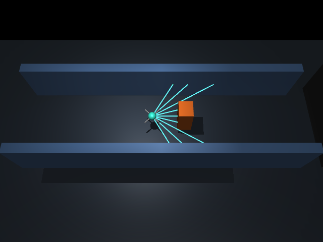
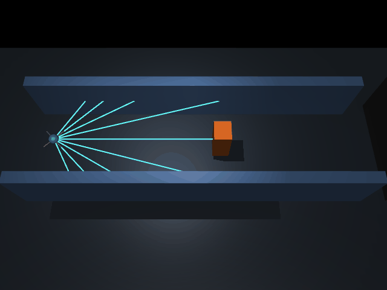
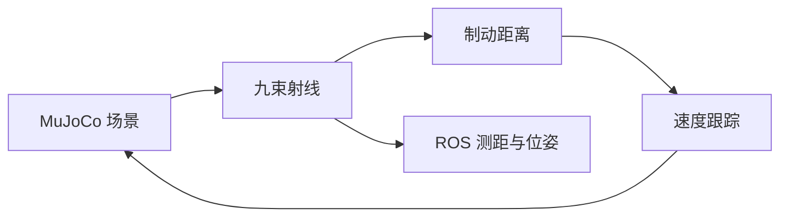
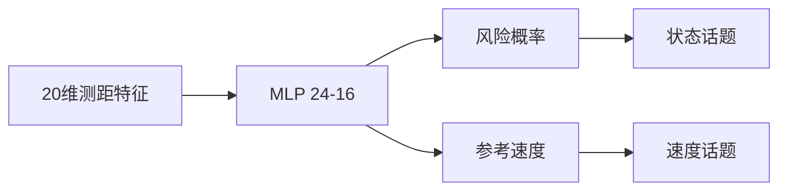

# 仓储通道巡检无人机多束测距与分级制动

## 场景与结构

系统采用 MuJoCo 3.12.0 构建仓储巡检通道，覆盖静态箱体、横穿障碍和窄通道。无人机具有三轴平移自由度，姿态固定；测距、标签计算和 ROS 发布共享同一物理模型。







## 测距与控制

射线在水平面覆盖 −60° 至 60°，间隔 15°，量程 8 m；排除自身机体。物理步长为 0.02 s。前方中央三束距离的最小值用于保守制动。

设测距值为 \(r\)，机体半径为 0.18 m，控制预留距离为 0.70 m：

$$
g=\max(0,r-0.18-0.70),\qquad d_b=v^2/4+0.25v
$$

$$
v_{ref}=\min(v_{cruise},\max(0,\sqrt{4g+0.25}-0.5))
$$

当 \(g\le d_b\) 时标签为制动；当 \(d_b<g\le d_b+1.5\) 时为警戒；其余为畅通。速度跟踪采用比例反馈并将纵向加速度限制在 ±2 m/s²；预留距离包含跟踪响应裕度，不代表严格碰撞安全证明。

## 运行与接口

源码位于 `src/air/mujoco_warehouse_uav_collision_braking`。模块提供 `main.py`、`launch/main.launch.py` 和 Dockerfile。Ubuntu 22.04、ROS 2 Humble 和 MuJoCo 环境可直接在 Docker Desktop 的 Linux 容器内运行。

```bash
docker build -t warehouse-uav:humble .
docker run --rm warehouse-uav:humble
python3 main.py --scenario static --render --output results/static
ros2 launch mujoco_warehouse_uav_collision_braking main.launch.py scenario:=crossing duration:=8.0
```

发布接口为 `/warehouse/scan`、`/warehouse/pose`、`/warehouse/reference_velocity` 和 `/warehouse/status`，类型分别为 LaserScan、PoseStamped、TwistStamped 和 String。

## 运行结果

下表为初始速度 1.2 m/s、持续 8 s 的参考控制结果；不作为神经网络性能结果。

| 场景 | 碰撞 | 终点 x | 末速度 |
| --- | --- | ---: | ---: |
| 静态| 否| 4.9836 | 0.000004 |
| 横穿| 否| 9.1730 | 1.1613 |
| 窄道| 否| 4.9836 | 0.000004 |

ROS 启动检查持续 2 s，节点完成 100 个物理步并正常退出。动画大小约 2.37 MiB。单元检查覆盖射线几何、静态制动、接触检测、横穿运动与高度保持。

## 源码导读

`simulation.py` 构建场景、施加作用力并计算射线；`ros_node.py` 将物理状态转换为消息；`visualize.py` 使用仿真状态生成动画；`tests/test_simulation.py` 检查关键行为。

完整课题为“仓储通道巡检无人机的多束测距神经网络碰撞风险预测与分级制动”。本模块包括监督数据生成、模型训练、独立测试、ROS 学习控制接口和多场景基准。

[参考资料：MuJoCo](https://mujoco.readthedocs.io/)、[ROS 2 Humble](https://docs.ros.org/en/humble/)。

## 监督数据与隔离

`dataset.py` 对每条轨迹使用独立随机流，变化障碍位置、巡航速度和横穿速度。每个场景按完整轨迹分为训练60%、验证20%、测试20%；不按单帧随机打散。状态输入只使用当前观测和历史观测，不包含未来位置或碰撞结果。

| 输入或标签 | 维度 | 定义 |
| --- | ---: | --- |
| 距离 | 9 | 水平射线距离，0 至 8 m |
| 闭合速度 | 9 | 前帧距离减当前距离后除以 0.02 s，限幅 ±10 m/s |
| 实际速度 / 巡航速度 | 2 | 当前纵向速度、轨迹巡航设定 |
| 参考速度 | 1 | 制动距离规则给出的速度 |
| 风险标签 | 1 | 0 畅通、1 警戒、2 制动 |

```bash
python3 main.py --collect --episodes 30 --seed 42 --duration 8
python3 -m unittest discover -s tests -v
```

| 分区 | 轨迹 | 样本 | 畅通 / 警戒 / 制动 |
| --- | ---: | ---: | --- |
| 训练 | 18 | 5465 | 2437 / 1195 / 1833 |
| 验证 | 6 | 1816 | 854 / 309 / 653 |
| 测试 | 6 | 2008 | 990 / 468 / 550 |

每条轨迹最多8 s，首次接触后停止，因而样本数量随轨迹变化。巡航与参考制动行为混合用于覆盖接近障碍时的观测。标签表达参考规则，不表示真实飞行中的碰撞概率。

[数据清单](mujoco_warehouse_uav_collision_braking/dataset_manifest.json) 保存种子、轨迹参数、特征顺序、分区统计和数组SHA-256；[样本片段](mujoco_warehouse_uav_collision_braking/sample_rows.csv) 便于查看数据结构。

16 项单元测试（含 CLI 默认路径 3 项）覆盖几何与控制行为、首帧闭合速度复位、固定种子复现、轨迹泄漏拒绝、模型训练和评估输出。三个分区的轨迹集合互不相交，且每个分区均包含三个场景和三类风险标签。

## 轻量模型

训练器使用 NumPy MLP，输入20维，隐藏层为24和16个单元，输出风险三分类与速度回归。训练过程固定随机种子，保存标准化均值、尺度、权重和偏置，模型文件可独立加载。



评估只使用测试分区，输出 `risk_accuracy`、`speed_mae_mps` 和 3×3 混淆矩阵。固定种子42、训练80轮得到风险准确率 0.770、速度平均绝对误差 0.820 m/s。修复速度回归梯度未按批次样本数归一化的问题后，速度 MAE 由旧运行的 0.522 m/s 变为 0.820 m/s；旧值来自样本数相关的梯度步长，不能作为同配置稳定基线。混淆矩阵行表示真实类别、列表示预测类别，类别顺序为畅通、警戒、制动。

| 真实类别 / 预测类别 | 畅通 | 警戒 | 制动 |
| --- | ---: | ---: | ---: |
| 畅通 | 915 | 71 | 4 |
| 警戒 | 220 | 162 | 86 |
| 制动 | 41 | 40 | 469 |

机器可读的完整指标见[独立测试结果](mujoco_warehouse_uav_collision_braking/test_metrics.json)。

学习控制节点通过 `/warehouse/scan`、`/warehouse/pose` 接收输入，通过 `/warehouse/learned_velocity`、`/warehouse/learned_status` 输出预测。它与参考控制接口并列，便于逐场景比较。

## 多场景对照

基准分别运行纯参考控制、纯学习控制和带参考制动上限的学习控制。学习节点发布指令时启用制动上限；纯学习组用于观察未经规则修正的模型行为。

离线基准直接使用 MuJoCo 的纵向速度真值构造模型输入和参考标签；ROS 学习节点则根据 `/warehouse/pose` 相邻位姿差分估速。因此，下列基准用于比较固定仿真条件下的控制组，不等同于 ROS 在线节点的实测指标。

| 控制方式 | 场景 | 接触 | 末速度 (m/s) | 风险一致率 |
| --- | --- | --- | ---: | ---: |
| 参考控制 | 静态 | 否 | 0.000004 | 0.818 |
| 参考控制 | 横穿 | 否 | 1.161290 | 0.728 |
| 参考控制 | 窄道 | 否 | 0.000004 | 0.905 |
| 纯学习 | 静态 | 是 | 0.000000 | 0.840 |
| 纯学习 | 横穿 | 是 | 1.418006 | 0.693 |
| 纯学习 | 窄道 | 是 | 0.000000 | 0.898 |
| 学习控制加制动上限 | 静态 | 否 | 0.000004 | 0.818 |
| 学习控制加制动上限 | 横穿 | 否 | 1.161035 | 0.753 |
| 学习控制加制动上限 | 窄道 | 否 | 0.000006 | 0.893 |

纯学习控制在三个固定场景中均发生接触，说明当前模型输出需要制动上限保护。学习控制加制动上限的三个场景均未发生接触。风险一致率用于衡量分类与参考标签的一致程度，不代表碰撞概率。受约束结果与纯学习结果分开展示，避免将规则约束效果计为模型性能。

表中窄道风险一致率在三个控制组内均为最高值；纯学习控制的横穿场景一致率最低，为 0.693。风险一致率仅表示模型分类与参考标签的一致程度，不表示碰撞概率。完整命令和固定种子结果见[验证记录](mujoco_warehouse_uav_collision_braking/validation_report.md)。

