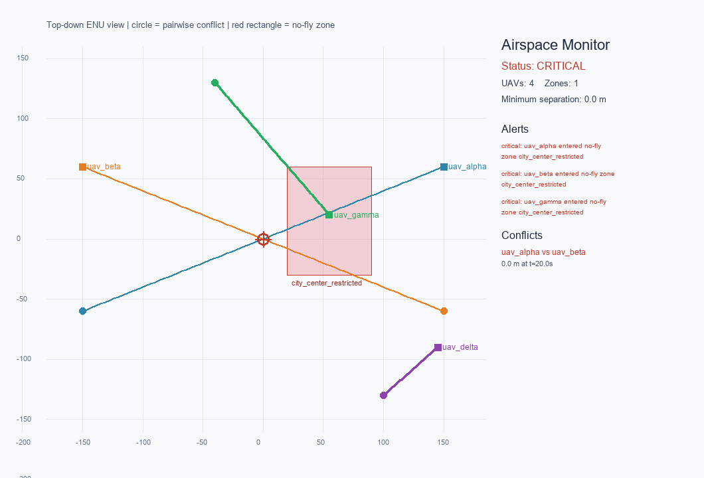

# 多无人机空域监测：多边形禁飞区与机间冲突

## 为什么需要这个模块

现有的 [禁飞区检测](../air/no_fly_zone_check/index.md) 模块面向单个经纬度点，
用 Haversine 距离判断是否落入圆形区域。它适合“起点/终点是否安全”的快速检查，
但无法回答低空多机场景中的两个关键问题：

1. 一架无人机沿整条航迹飞行时，是否会在某个时刻进入多边形禁飞区？
2. 两架无人机的航迹是否会在未来短时间内发生危险接近？

本模块把输入扩展为多架无人机的 ENU 时间序列，输出电子围栏告警、两两最近接近
距离和冲突解脱建议。核心算法只依赖 NumPy，可以在没有 ROS 2、AirSim 或 GPU 的
机器上运行。

## 快速运行

```bash
cd src/air/multi_uav_airspace_monitor
python -m pip install -r requirements.txt
python main.py demo
```

实际运行输出：

```text
status=critical
uavs=4 zones=1
minimum_separation_m=0.0
alerts=3 conflicts=1
conflict uav_alpha vs uav_beta: 0.00 m at 20.00 s
```



演示中有 4 架无人机：`uav_alpha` 与 `uav_beta` 在中心迎头交叉，
`uav_gamma` 进入 `city_center_restricted` 禁飞区，`uav_delta` 保持安全。
圆形标记表示机间最近接近点，红色多边形表示禁飞区。

## 方法

### 电子围栏

禁飞区由二维多边形和高度层 `[floor_z, ceiling_z]` 定义。对每个轨迹点：

- 先检查高度是否在层内；
- 再用射线法判断水平投影是否在多边形内部；
- 若不在内部，则计算到多边形边界的距离，小于 `buffer_m` 时给出 warning。

### 机间冲突

对每一对无人机，先取两条轨迹的公共时间区间，再截取其中从公共起点开始的前
`horizon_s` 秒，在窗口内以固定步长插值，计算三维距离：

$$
d(t) = \lVert \mathbf{p}_a(t) - \mathbf{p}_b(t) \rVert_2
$$

取**窗口内**的最小值作为最近接近距离。小于 `critical_distance_m` 为 critical，小于
`warning_distance_m` 为 warning。先截取、后取最小值是有意为之：如果窗口内已经进入
告警距离，而全程最小值出现在窗口之外，仍然要报出窗口内的这次接近，不能因为选中的
时刻超窗就把整对无人机跳过。当前实现是短时域 CPA 监测，不替代完整的 UTM 航路调度。

## 输入与输出

输入是 JSON：`zones` 定义禁飞区，`uavs` 定义每架无人机的 `times` 和 `positions`。
坐标统一为局部 ENU（东、北、上，米）。输出包括：

- `status`：safe / warning / critical；
- `alerts`：电子围栏告警；
- `conflicts`：机间冲突、最近距离、时刻和解脱建议；
- `minimum_separation_m`：所有无人机对的最小间隔。

完整字段和示例见模块内的 `README.md`。

## ROS 2 接口

节点订阅 `/airspace/uav_states`（`std_msgs/String`，JSON），发布
`/airspace/alerts`（`std_msgs/String`，JSON）。这样同一套监测逻辑可以接 AirSim、
CarlaAir、PX4 或回放数据，而不需要把仿真器客户端写进核心算法。

```bash
colcon build --packages-select multi_uav_airspace_monitor
source install/setup.bash
ros2 launch multi_uav_airspace_monitor main.launch.py
```

ROS 2 节点在当前 Windows 开发机上未执行；离线核心、8 个单元测试和 PNG 截图
均已实际运行。ROS 2 Humble 的启动验证需要在 Ubuntu 虚拟机中完成。

## 验证

```bash
python -m unittest discover -s tests -v
```

11 个测试全部通过，覆盖多边形边界、高度层过滤、缓冲区、迎头冲突、平行安全
航迹、时间窗内告警与窗口外更近的接近、以及非法 `horizon_s` 的拒绝和演示场景。

## 已知限制

- 线性插值不适用于极高机动或采样率过低的轨迹；
- 冲突解脱是规则建议，不是最优或可证明安全的轨迹规划；
- 禁飞区为垂直棱柱，复杂三维空域需要分层或体素化；
- 尚未实现 RViz marker 可视化。

## 大模型使用声明

代码、测试和文档使用 OpenAI Codex 辅助完成；运行结果和截图来自本机实际执行。
提交者需对内容负责。
