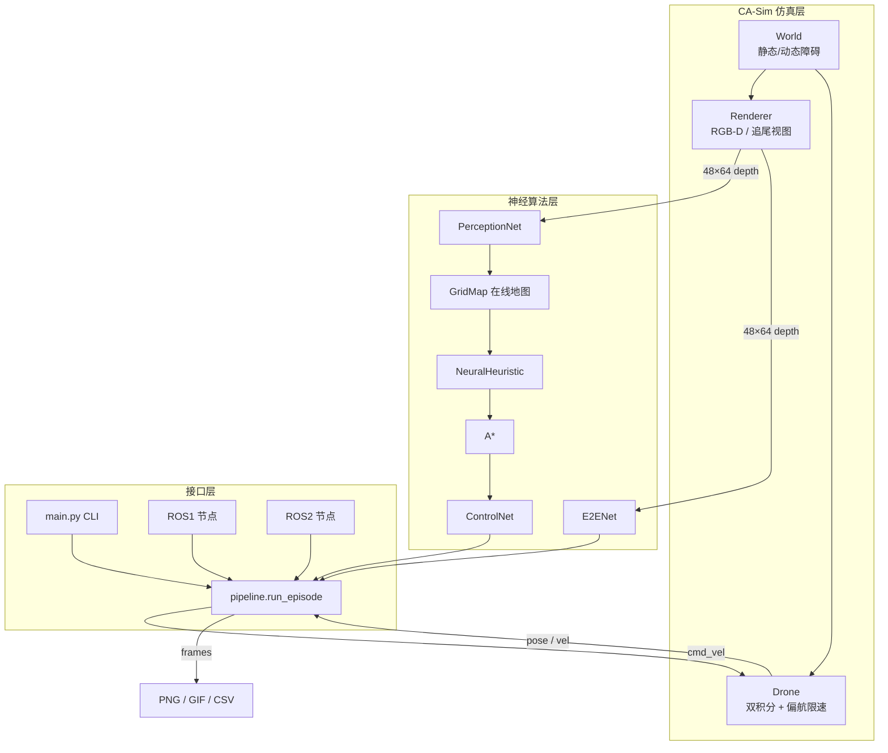

# 系统架构

## 1. 总体分层



代码按“核心库 + 入口 + 工具”三层组织：

```text
neural_ca_drone/
├── ca_drone/           # 核心库（无 ROS 依赖）
│   ├── sim/            # 世界、无人机、场景
│   ├── render/         # 3D 画家算法、深度图、HUD
│   ├── nn/             # Tensor 自动微分、层、优化器
│   ├── models/         # 四个网络
│   ├── data/           # 数据集采集
│   ├── training/       # 训练循环
│   ├── mapping.py      # 在线栅格地图
│   ├── planning/       # A* / Dijkstra / 路径简化
│   ├── control/        # 几何专家（教师）
│   └── pipeline.py     # 回合执行器
├── main.py             # 统一入口（--module）
├── tools/              # 数据、训练、评测、打包、绘图
├── ros1_ws/            # catkin 包
├── ros2_ws/            # ament 包
├── docs/               # 本文档
└── weights/            # 四个 .npz
```

## 2. 坐标系与符号

| 坐标系 | 定义 | 用途 |
| --- | --- | --- |
| `map` | 世界系，\(x\) 前、\(y\) 左、\(z\) 上 | 障碍物、起点/终点、地图 |
| `base_link` | 机体前向 \(x_b\)、左向 \(y_b\) | 控制网络输出、`/cmd_vel` |
| 相机系 | 与 `base_link` 同向，光轴为 \(x_b\) | 深度图 |

世界系到机体系的水平旋转：

\[
\begin{bmatrix} x_b \\ y_b \end{bmatrix}
=
\begin{bmatrix}
\cos\psi & \sin\psi\\
-\sin\psi & \cos\psi
\end{bmatrix}
\begin{bmatrix} x_w \\ y_w \end{bmatrix}
\]

反变换为其转置。`Drone.step` 接收机体系速度，内部转换到世界系后做一阶跟踪：

\[
\mathbf{v}_{k+1} = \mathbf{v}_k + \frac{\Delta t}{\tau}\left(\mathbf{v}^{\text{cmd}}_k-\mathbf{v}_k\right),
\qquad \Delta t=0.1\ \text{s},\ \tau=0.28\ \text{s}
\]

偏航角以最大角速度 \(\omega_{\max}=2.4\ \text{rad/s}\) 跟随速度方向，因此存在
约 0.2–0.4 s 的转向滞后——这是后面“切角撞墙”问题的物理根源。

## 3. 分层链路的数据流

一个控制周期（10 Hz）内：

1. **渲染深度**：`depth_image(world, p, yaw, 64, 48, 90°, 12 m)` 得到 \(D_k\)；
2. **感知**：`PerceptionNet` 输出 \(P_k\in[0,1]^{48\times64}\)；
3. **建图**：把 \(D_k\) 反投影到世界系栅格，命中格 \(+1.6\)，每帧衰减 \(0.99\)，
   概率 \(>0.6\) 视为占用；
4. **规划**（每 10 步）：`NeuralHeuristic` 对全图每个自由格预测 cost-to-go，
   作为 A\* 的启发式 \(h(n)\)，权重 \(w=0.75\)；
5. **控制**：在路径上取 2 m lookahead 点，构造 9×9 局部栅格 + 目标偏移 +
   当前机体系速度 + 局部间隙，`ControlNet` 输出 \((v_x,v_y)\)；
6. **执行**：限幅 \(\|\mathbf{u}\|\le1.2\) m/s，`Drone.step`，同步 `world.t`。

## 4. 端到端链路

\[
\mathbf{u}_k = \mathrm{E2ENet}\left(\frac{D_k}{12},\;
\left[\frac{x_b^g}{6},\frac{y_b^g}{6},\frac{\|\mathbf{p}^g-\mathbf{p}\|}{25}\right]\right)
\]

输出经 \(\tanh\) 限制在 \([-1.5,1.5]\) m/s。端到端没有显式地图与规划，
因此对“目标在身后”“贴墙恢复”这类状态完全依赖数据分布覆盖。

## 5. 权重与检查点

| 文件 | 内容 | 训练数据 |
| --- | --- | --- |
| `weights/perception.npz` | U-Net 权重 | 1,200 帧深度 + 真值占用 |
| `weights/planner.npz` | 启发式 MLP | 6,500 个 (patch, 目标) → 距离 |
| `weights/control.npz` | 控制 MLP | 15,305 条 DAgger 增广样本 |
| `weights/e2e.npz` | CNN + MLP | 7,373 帧深度 + 目标 + 速度标签（蒸馏 + 随机目标） |

加载方式统一为 `Model.load(path)`，内部用 `np.load` 读取，不依赖 pickle。

## 6. 运行入口

```bash
python main.py --module full      --scene sparse --gif
python main.py --module perception --scene dense
python main.py --module planning  --scene corridor
python main.py --module e2e       --scene dynamic
```

`--module` 与 ROS launch 的 `module` 参数一一对应：

| CLI | launch 参数 | 行为 |
| --- | --- | --- |
| `sim` | — | 只渲染一帧，检查环境 |
| `perception` | `perception` | 深度 → 占用三联图 + IoU |
| `planning` | `planning` | 经典 A\* vs 神经启发式对比 |
| `control` | `control` | 专家路径 + 控制网络跟踪 |
| `e2e` | `e2e` | 端到端闭环 |
| `full` | `full` | 感知 + 规划 + 控制闭环 |
| `demo` | — | 五场景快速巡检 |
