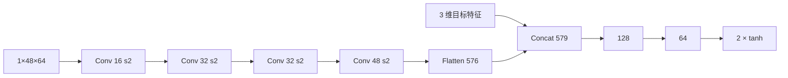

# 端到端：深度图 → 速度

`ca_drone/models/e2e.py` · `E2ENet`

## 1. 任务

端到端策略跳过显式地图与规划，直接从深度图和目标位置回归速度：

\[
\mathbf{u}_k=\tanh\!\Big(f_\theta\Big(\frac{D_k}{12},\;
\frac{x_b^g}{10},\frac{y_b^g}{10},\frac{\|\mathbf{p}^g-\mathbf{p}\|}{50}\Big)\Big)\odot
\begin{bmatrix}1.5\\1.5\end{bmatrix}
\]

与分层方案相比，它的优势是延迟低（单次前向 1 ms）、无需建图；
代价是可解释性差、对训练分布敏感。

## 2. 网络



| 层 | 配置 | 输出 |
| --- | --- | --- |
| c1 | 3×3, stride 2, 1→16 | 24×32 |
| c2 | 3×3, stride 2, 16→32 | 12×16 |
| c3 | 3×3, stride 2, 32→32 | 6×8 |
| c4 | 3×3, stride 2, 32→48 | 3×4 |
| flatten | — | 576 |
| concat | + 目标 3 维 | 579 |
| fc1 / fc2 | 128 / 64, ReLU | — |
| out | 2, tanh×1.5 | \((v_x,v_y)\) |

参数 **110,611**。感受野覆盖整个 48×64 输入，因此网络能看到左右两侧的障碍；
但因为没有 recurrent/记忆，它对“刚刚掠过”的障碍没有记忆。

## 3. 数据：三条路线

端到端最大的坑是**数据分布**。第一版数据只记录专家沿路径飞行时的
（深度，目标，速度）三元组，而专家在巡航时机体系速度几乎恒为 \((1.35,0)\)，
偏航又始终对准速度方向。结果网络学到的最优策略是“永远满速向前”：

| 探针状态 | 网络输出 |
| --- | --- |
| 空场景，目标在正前方 47 m | (1.40, −0.04) |
| 走廊，正前方 2.5 m 有墙 | (1.42, 0.03) |
| 空场景，目标在正左方 5 m | (0.17, 1.27) |

前两行说明它**完全忽略深度**。此后试过三种数据构造方式。

### 3.1 几何教师 + 目标增广（失败）

目标只是坐标，同一帧深度可以重标注任意目标。把教师的斥力半径从 2.8 m
加到 \(\rho=4.5\ \text{m}\)、增益 \(\kappa=2.6\)，再补 8 个近障碍位姿，
得到 14,000 样本。

但**教师本身不可靠**：在目标位于侧后方时，这个短视的斥力场会把无人机推向
另一侧障碍，闭环四场景全部碰撞。学生只是忠实复现了错误的标签。
这条路线说明：教师不可靠时，增广只会放大错误。

### 3.2 分层蒸馏

改用 full 栈（在线地图 + 神经 A\* + 控制网络）当教师：跑 24 回合、记录
（深度，目标，执行速度），得 5,236 样本。学生闭环在 dense 成功，
sparse / dynamic / corridor 零碰撞但超时。

### 3.3 随机目标演示（最终采用）

3.2 的机体系目标向量几乎总是指向前方（偏航跟随速度），网络缺少“目标在
侧后方”的样本。于是另跑 16 回合，目标在可通行区域均匀采样
（\(x\in[6,47]\)、\(y\in[-14,14]\)，含起点后方），仍用 full 栈标注，
得 2,137 样本；与 3.2 合并为 **7,373 样本** 重训 12 epoch。

## 4. 训练

| 项目 | 设置 |
| --- | --- |
| 样本 | 7,373（蒸馏 5,236 + 随机目标 2,137） |
| 损失 | MSE（对 \(v_x,v_y\)） |
| 优化器 | Adam，lr \(10^{-3}\)，batch 16 |
| epoch | 12 |
| 验证 | 15%，val MAE 0.0348 m/s |

## 5. 结果与讨论

端到端的闭环表现见 [性能评价](results.md)。这里先给出结论性的观察：

- **零碰撞**：5 个场景 15 回合全部没有撞上障碍，平均最小间隙 1.16 m；
- **40% 到点**：`dynamic` 与留出的 `unseen` 成功；`sparse` 飞到目标侧后方、`dense` 绕远后越过、
  corridor 在门洞间来回，都是“看见障碍就绕、绕完不记得目标”的表现；
- **推理最快**：单帧 0.77–0.85 ms，不含建图与规划。

因此在本项目中，端到端作为**对照方案**保留：它证明了“深度→速度”可以直接学习，
但也直观展示了分层方案在安全性上的优势。若要把端到端做到可用，
下一步应加入

1. 时序记忆（GRU/帧堆叠），让网络记住刚刚掠过的障碍；
2. 用分层方案做 DAgger 教师，在线纠正端到端的偏离状态；
3. 训练中加入“安全Critic”做动作筛选（shield）。

## 6. 源码解析

```python
class E2ENet(Module):
    def forward(self, depth, goal):
        h = self.c1(depth).relu()
        h = self.c2(h).relu()
        h = self.c3(h).relu()
        h = self.c4(h).relu()
        h = h.reshape(h.shape[0], -1)
        h = concat([h, goal], axis=1)
        h = self.fc1(h).relu()
        h = self.fc2(h).relu()
        return self.out(h).tanh() * Tensor(np.array([1.5, 1.5]))
```

- 四次 stride-2 卷积把 48×64 压到 3×4，再 flatten 成 576 维；
- 目标特征在 flatten 之后拼接，避免被卷积层空间化；
- 输出乘 1.5 的向量把 tanh 的 \([-1,1]\) 映射到速度范围。

推理时 `pipeline.run_episode` 还做了一次安全缩放：

```python
if world.clearance(drone.state.pos) < 0.8:
    cmd = cmd * 0.85
```

它只影响极端贴近障碍的情形，不改变网络的主体行为。

## 7. 入口

```bash
python main.py --module e2e --scene sparse --gif
python tools/diag_e2e.py          # 探针：打印若干状态下的网络输出
```
