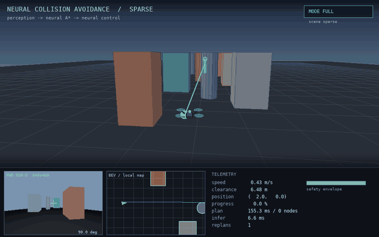
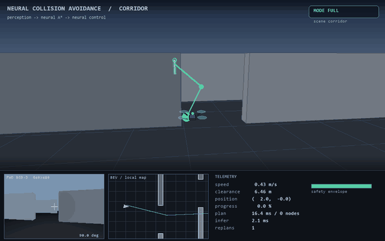
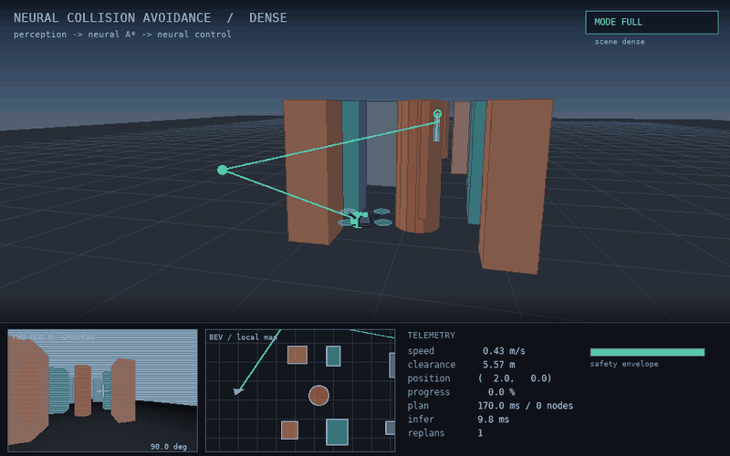

# 演示动图

项目提供两类动图：

1. **离线合成**：仿真器逐帧渲染后合成（`ca_drone/pipeline.py::save_gif`），无窗口边框、鼠标和编码噪点，文件小；
2. **真实录屏**：`tools/screen_demo.py` 打开 Tk 窗口实时播放，再用 X11 `xwd` 抓取窗口，得到带窗口的真实屏幕录制。

## 1. 分层神经方案 · sparse 场景（Ubuntu 20.04 实机）



| 属性 | 值 |
| --- | --- |
| 分辨率 | 640×400 |
| 帧数 | 109 |
| 大小 | 8.93 MiB（< 10 MB） |
| 内容 | 3D 追尾视图 + RGB-D + 局部栅格 + 遥测 |
| 结果 | 435 步到达，最小间隙 1.294 m，44 次重规划 |

该 GIF 在 **Ubuntu 20.04 + Python 3.8 + Pillow 7.0** 的 VMware 虚拟机中生成，
是“程序在目标环境可运行”的直接证据。

## 2. 分层神经方案 · corridor 场景（Windows）



| 属性 | 值 |
| --- | --- |
| 分辨率 | 640×400 |
| 帧数 | 102 |
| 大小 | 2.88 MiB |
| 内容 | 连续穿过 5 道交错门洞 |
| 结果 | 407 步到达，最小间隙 1.453 m，41 次重规划 |

corridor 是最能体现“感知→规划→控制”闭环的场景：每一道门都需要
在线地图先看到墙、A\* 再改道、控制网络再跟住折线。

## 3. 真实屏幕录制 · dense 场景（Ubuntu 20.04 虚拟机）



| 属性 | 值 |
| --- | --- |
| 分辨率 | 800×500（原始窗口 960×600） |
| 帧数 | 72 |
| 大小 | 3.26 MiB |
| 录制方式 | Tk 窗口 + `xwd -id` 逐帧抓取，8 fps 回放 |
| 结果 | 429 步到达，最小间隙 1.66 m，零碰撞 |

录制脚本 `tools/screen_demo.py` 把每帧渲染结果贴到 Tk 窗口上，同时用
`xwd -id <window>` 抓取该窗口，因此这是**程序窗口本身**的屏幕录制，
不是离线图片序列的重编码。虚拟机中没有 `ffmpeg`/`byzanz`/ImageMagick，
所以用 Python 直接解析 XWD（`read_xwd()`），再交给 `save_gif()` 合成。

```bash
export DISPLAY=:0
python3 tools/screen_demo.py --scene dense --capture \
    --out /home/user/ca/rec/dense --render-every 6 --hold 0.05
```

## 4. 如何自己录屏

Windows 下（有桌面）：

```bash
python tools/screen_demo.py --scene dense        # 打开 960×600 的实时窗口
```

然后用 ScreenToGif 录制 10–15 s，导出 10 fps、800 宽、64–128 色，通常 < 8 MB。

Linux 下无 ffmpeg 时，加 `--capture` 让脚本自己用 `xwd` 抓帧：

```bash
python3 tools/screen_demo.py --scene corridor --capture --out rec/ --render-every 6
```

命令行离线生成 GIF（无需录屏软件）：

```bash
python main.py --module full --scene corridor --gif --render-every 4
# 输出 runs/<时间>_full/full_corridor.gif
```

`--render-every` 控制抽帧间隔：4 表示每 4 个仿真步渲染一帧（10 Hz → 2.5 fps 播放，
配合 80 ms/帧的播放速度，观感接近实时）。
